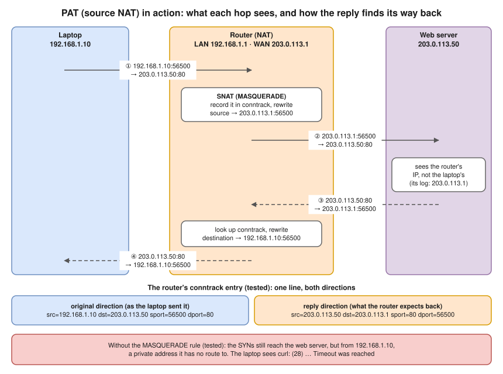
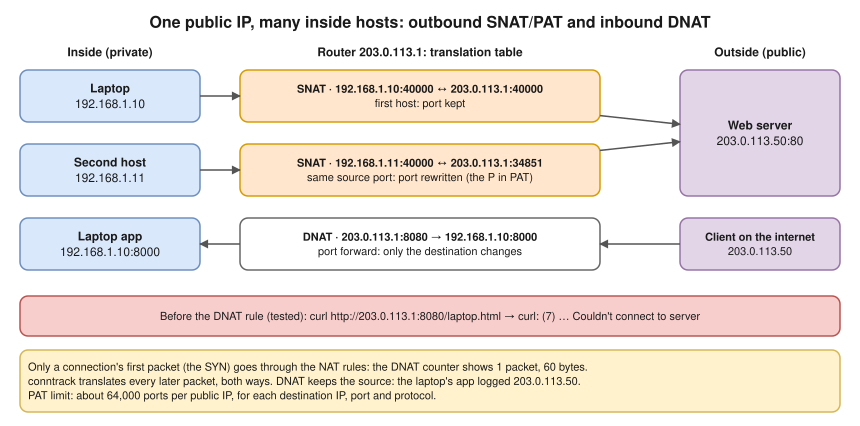
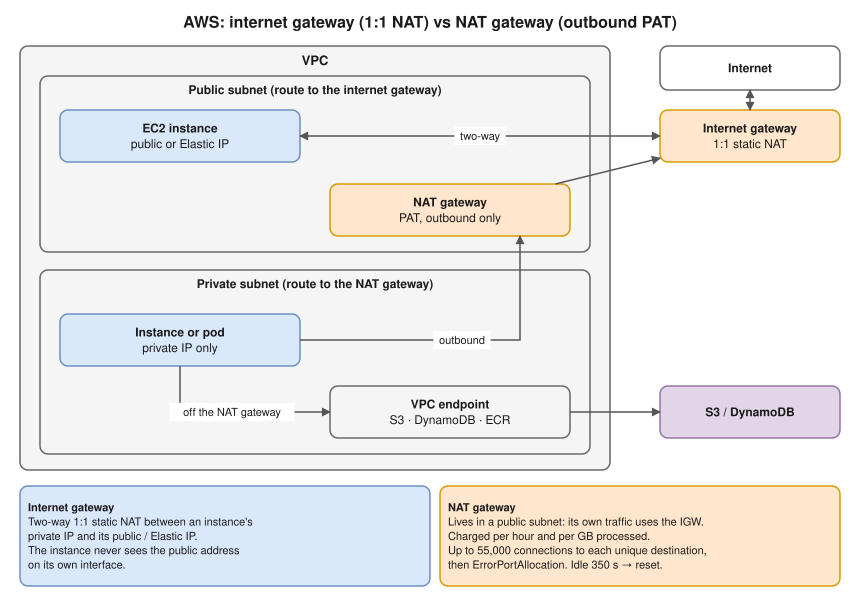

# 3.8 · NAT, PAT and Port Forwarding

> **Level 3 · Core networking protocols** · Lesson 8 of 11 · ⏱️ about 75 minutes (estimate) · 🧪 [Lab 3.4](../13-hands-on-labs/lab-03.4-nat-and-port-forwarding.md)
> ⬅️ [3.7 ICMP, ping and traceroute](07-icmp-ping-and-traceroute.md) · ➡️ [3.9 Everyday protocols and ports](09-everyday-protocols-and-ports.md)



- **Why NAT exists:** IPv4 has about 4.3 billion addresses. **Private** ranges ([2.2](../02-ip-addressing-and-subnetting/02-ipv4-addresses-and-ranges.md)) are reused everywhere and **aren't routed on the internet**, so a request from one can get out but the reply has no way back.
- **Source NAT** changes the **source** (going out); **destination NAT** changes the **destination** (coming in). The reply is always translated back automatically.
- ⭐ The **translation table** (Linux **conntrack**) maps the public `IP:port` back to the private `IP:port`. Only a connection's **first packet** goes through the NAT rules.
- **NAT is not a firewall**, although unsolicited inbound packets have no table entry and are dropped. Real filtering still belongs in security groups and firewall rules.
- Lab 3.4 setup: `laptop` `192.168.1.10` behind `router` (`192.168.1.1` / `203.0.113.1`), talking to `web` `203.0.113.50`. Ports and the 5-tuple: [3.2](02-tcp-and-udp.md).

## The kinds of NAT

| Kind | Maps | Typical use |
|---|---|---|
| **Static NAT** (1:1) | One private IP ↔ one public IP, permanently | A server that must be reachable; **AWS internet gateway** for instances with a public IP |
| **Dynamic NAT** | Private IPs ↔ a **pool** of public IPs, first come first served | Rare today |
| **PAT** (port address translation; also **NAPT**, "NAT overload", Linux **MASQUERADE**) | **Many** private IPs → **one** public IP, distinguished by **port** | Every home router; AWS **NAT gateway**; Docker containers going out |
| **Port forwarding** (destination NAT, **DNAT**) | public IP:port → private IP:port, for **incoming** connections | Hosting a service behind NAT; `docker run -p 8080:80` |
| **CGNAT** (carrier-grade NAT) | The provider NATs many customers behind its own public IPs, using `100.64.0.0/10` in between | Mobile and some broadband networks: you're behind **two** NATs |

## PAT in action (tested)

Without NAT, the laptop's `curl` times out (`curl: (28) … Timeout was reached`), yet the web server **did receive** its SYNs (and the retries), from a private address it has no route back to **(tested in the lab container)**:

```text
IP 192.168.1.10.56490 > 203.0.113.50.80: Flags [S], seq 66645990, ...
$ ip route get 192.168.1.10          # on the web server
RTNETLINK answers: Network is unreachable
```

One rule on the router fixes it. The web server now sees the router's address `203.0.113.1`, in the capture and in its access log **(tested in the lab container)**:

```console
$ iptables -t nat -A POSTROUTING -s 192.168.1.0/24 -o wan -j MASQUERADE
$ curl -sS http://203.0.113.50/
public web server
```

```text
IP 203.0.113.1.56500 > 203.0.113.50.80: Flags [S], seq 2475311208, ...
IP 203.0.113.50.80 > 203.0.113.1.56500: Flags [S.], seq 1051657739, ack 2475311209, ...
```

The router's conntrack entry, both directions in one line **(tested in the lab container)**:

```text
tcp 6 116 TIME_WAIT src=192.168.1.10 dst=203.0.113.50 sport=56500 dport=80 src=203.0.113.50 dst=203.0.113.1 sport=80 dport=56500 [ASSURED]
```

## Same source port, and port forwarding (tested)



- **Port collision:** `192.168.1.10` and `.11` both connect from port 40000. The second one is rewritten; that's the "**P**" in PAT **(tested in the lab container)**:

```text
src=192.168.1.10 dst=203.0.113.50 sport=40000 dport=80  src=203.0.113.50 dst=203.0.113.1 sport=80 dport=40000
src=192.168.1.11 dst=203.0.113.50 sport=40000 dport=80  src=203.0.113.50 dst=203.0.113.1 sport=80 dport=34851
```

- **Port forwarding:** before the rule, `curl` from the web server to the router's 8080 gets `(7) Couldn't connect to server`. After it **(tested in the lab container)**:

```console
$ iptables -t nat -A PREROUTING -i wan -p tcp --dport 8080 -j DNAT --to-destination 192.168.1.10:8000
$ curl -sS http://203.0.113.1:8080/laptop.html
laptop app
$ iptables -t nat -L PREROUTING -n -v
 pkts bytes target     prot opt in     out     source               destination
    1    60 DNAT       6    --  wan    *       0.0.0.0/0            0.0.0.0/0            tcp dpt:8080 to:192.168.1.10:8000
```

- `1 60` = only the SYN hit the rule. The laptop's app logged the **real** client, because DNAT changes only the destination:

```text
203.0.113.50 - - [14/Oct/2026 19:46:23] "GET /laptop.html HTTP/1.1" 200 -
```

- Which netfilter chain each rule lives in, and why DNAT must happen in PREROUTING: [8.6 · Netfilter, NAT and conntrack](../08-linux-networking/06-netfilter-nat-and-conntrack.md).

## What NAT costs

- **Inbound connections don't work** without explicit forwarding. Peer-to-peer apps (video calls, games) use **STUN/TURN** (NAT traversal).
- **The server sees the NAT's IP**, not the client's. Many users behind one CGNAT IP look like one user to rate limiters and logs. Proxies pass the original IP in `X-Forwarded-For` ([3.5](05-http-and-https.md)); NAT can't.
- **Port exhaustion:** one public IP has about 64,000 ports **per destination IP, port and protocol**, so a busy NAT talking to **one** popular destination can run out. Fix with more public IPs (or more gateways), or connection reuse.
- **State:** the table has timeouts; long-idle TCP connections are forgotten, and the next packet gets a **reset** ([3.3](03-tcp-in-depth.md)).
- **IPv6 doesn't need NAT**: every device can have a global address, and firewalls do the filtering. **NAT64** lets IPv6-only clients reach IPv4 servers ([2.6](../02-ip-addressing-and-subnetting/06-ipv6-fundamentals.md)).

## Where you meet it



| Where | NAT used |
|---|---|
| AWS internet gateway | **1:1 static NAT** between an instance's private IP and its public / Elastic IP, both ways. The instance never sees the public address on its own interface |
| AWS NAT gateway | **PAT** for private subnets, outbound only; lives in a **public** subnet. Charged per hour **and per GB processed** (a cost item to watch). Up to 55,000 simultaneous connections **to each unique destination**, then `ErrorPortAllocation`; idle timeout 350 s. Use **VPC endpoints** for S3/DynamoDB/ECR to keep that traffic off it (a gateway endpoint for S3 is free and faster) |
| Docker | Outbound = MASQUERADE; `-p 8080:80` = DNAT ([10.1](../10-container-and-kubernetes-networking/01-docker-bridge-networking-inside-out.md), [Lab 10.1](../13-hands-on-labs/lab-10.1-docker-bridge-nat-and-dns.md)) |
| Kubernetes | Pod traffic leaving the cluster is usually SNATed to the node IP (on EKS, the VPC CNI by default SNATs pod traffic bound for addresses **outside the VPC** to the node's primary IP; inside the VPC pods keep their IP). Service ClusterIPs and NodePorts are **DNAT** by kube-proxy |
| Home | If `ipconfig getifaddr en0` and `curl ifconfig.me` differ, you're behind NAT. A router WAN address in `100.64.0.0/10` or another private range means **CGNAT** too |

## Try it

**On your Mac (behind your home router):**

```bash
ipconfig getifaddr en0           # your private address, e.g. 192.168.29.x
curl -s https://ifconfig.me ; echo   # your public address, as the internet sees you
```

**On Linux (a NAT box or Docker host):**

```bash
sudo iptables -t nat -S                  # NAT rules (Docker adds MASQUERADE and DNAT)
sudo conntrack -L | head                 # the translation table
sudo conntrack -C                        # how many entries
sysctl net.netfilter.nf_conntrack_max    # the table's limit
```

## Troubleshooting

| You see | It means | Next step |
|---|---|---|
| Private hosts can't reach the internet | No SNAT rule, or forwarding off, or no route to the NAT | `iptables -t nat -S`; `sysctl net.ipv4.ip_forward`; route table → NAT gateway |
| Port forward doesn't work from outside | Rule missing / wrong interface; a firewall FORWARD rule; the app listens on `127.0.0.1` (DNAT sends to the LAN IP, so it must listen there or on `0.0.0.0`); or testing from **inside** the LAN (needs hairpin NAT) | DNAT counters (`-v`); `ss -tlnp` on the target; test from a real outside host |
| Random new-connection failures on a busy NAT | Port or conntrack table exhaustion | AWS: `ErrorPortAllocation` metric; Linux: `nf_conntrack: table full` in `dmesg` |
| Long-idle connections reset | NAT idle timeout | TCP keepalive shorter than the timeout |
| The server logs the NAT's IP, not the client's | Expected: NAT hides it | Use `X-Forwarded-For` at L7 if you need the original |
| Forwarding without NAT times out | The far side has no route back | NAT, or add the return route ([2.7](../02-ip-addressing-and-subnetting/07-default-gateway-routing-table-and-arp.md)) |

## Interview angle

- ⭐ **"What is NAT and why do we need it?"** → Rewrites addresses at the boundary so private addresses can share public ones. SNAT/PAT for outbound, DNAT for inbound port forwarding. Needed because IPv4 ran out and private ranges aren't routed.
- ⭐ **"Internet gateway vs NAT gateway?"** → IGW: two-way, 1:1 NAT for instances with public IPs. NAT gateway: outbound-only PAT for private subnets, sits in a public subnet, costs per GB.
- **"How does the reply get back to the right host?"** → The connection-tracking table maps the public IP:port back to the private IP:port.
- **"What's PAT?"** → Many-to-one NAT distinguished by ports; the router rewrites ports when two inside hosts collide.
- **"Why can't I SSH to my laptop at home from outside?"** → NAT (and maybe CGNAT): no inbound mapping. Port forwarding, a VPN, or a reverse tunnel.

## Check yourself

1. Which kind of NAT does a home router use for outbound traffic?
2. In the conntrack line `src=10.0.1.5 dst=1.2.3.4 sport=5000 dport=443 src=1.2.3.4 dst=52.9.9.9 sport=443 dport=5000`, what is the NAT's public IP?
3. A DNAT rule's counter stays at 0 although you're testing. Give two reasons.
4. Why does an AWS NAT gateway need to be in a **public** subnet?
5. Your service sees every request coming from the same IP, `100.64.3.7`. What's probably going on?

<details>
<summary><b>Answers</b> (try first)</summary>

1. **PAT** (NAT overload / MASQUERADE): many private hosts share one public IP, distinguished by port.
2. **`52.9.9.9`**: the reply is expected to that address.
3. Any two of: the traffic arrives on a different interface or port than the rule matches; the test comes from **inside** the LAN (so it doesn't pass that PREROUTING match); a connection that already existed (only new connections hit NAT rules); the packets never reach the router (routing/upstream firewall).
4. It needs a route to the **internet gateway** for its own (public) traffic; its private-subnet clients route to it.
5. The requests pass through a **NAT** (likely a CGNAT, given `100.64.0.0/10`, or a NAT in your own path). Use L7 headers like `X-Forwarded-For` if a proxy is involved; NAT itself can't preserve the client IP.

</details>

➡️ **Next:** [3.9 · Everyday protocols and ports](09-everyday-protocols-and-ports.md): SSH, SMTP, NTP, SNMP, LDAP and the other protocols you'll meet on the job.
