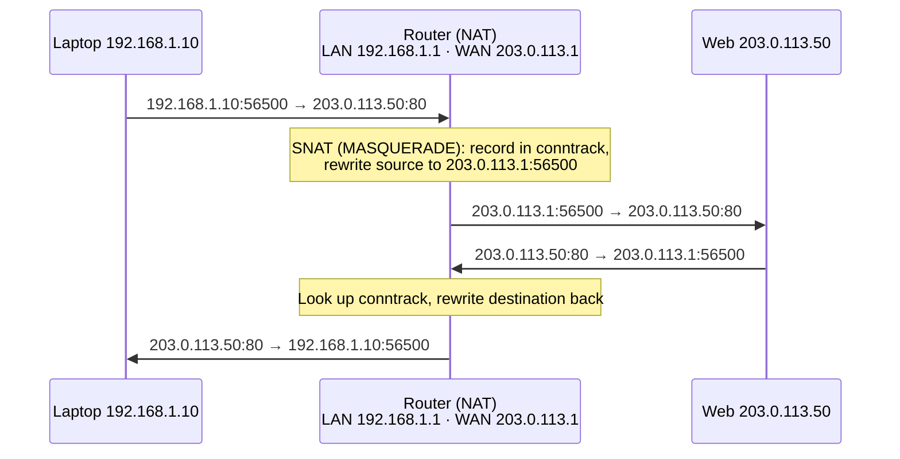

# 3.8 · NAT, PAT and Port Forwarding

> **Level 3 · Core networking protocols** · Lesson 8 of 11 · ⏱️ about 75 minutes (estimate)
> ⬅️ [3.7 ICMP, ping and traceroute](07-icmp-ping-and-traceroute.md) · ➡️ [3.9 Everyday protocols and ports](09-everyday-protocols-and-ports.md)

## What you'll learn

- **Why** NAT exists, and what each kind changes: **static NAT**, **dynamic NAT**, **PAT** (many-to-one), **port forwarding** (DNAT), **CGNAT**.
- How the **translation table** lets replies find their way back, shown with real `conntrack` entries.
- What happens when two private hosts use the **same source port** (tested).
- Why NAT breaks inbound connections, and what it costs (logging, port exhaustion, "NAT is not a firewall").
- How AWS (internet gateway vs NAT gateway), Docker and Kubernetes use NAT.

## Before you start

- [2.2](../02-ip-addressing-and-subnetting/02-ipv4-addresses-and-ranges.md): private (RFC 1918) vs public addresses.
- [3.2](02-tcp-and-udp.md): ports and the 5-tuple.

---

## The idea in plain words

A company has one public phone number and a receptionist. When an employee calls out, the receptionist dials from the **company number** and writes in a notebook *"line 7 is Priya's call to the bank"*. When the bank calls back on line 7, the receptionist knows to put it through to Priya.

- The company number = the **public IP**.
- The extensions = **private IPs**.
- "Line 7" = a **port number** on the public IP.
- The notebook = the **NAT translation table** (on Linux, **conntrack**).

An outside caller who just dials the company number with no line arranged gets nowhere, **unless** reception has a standing instruction: *"calls asking for sales go to extension 8000"*. That's **port forwarding**.

## Why it matters

- Every home network, every private subnet in a VPC, every Docker container and most Kubernetes pods reach the internet **through NAT**.
- Many "it can reach out but nothing can reach in" and "the server sees the wrong client IP" questions are NAT questions.
- NAT gateways have limits and costs; you'll size and debug them.

---

## How it works

### Why NAT exists

IPv4 has about 4.3 billion addresses, not enough for every device. **Private** ranges ([2.2](../02-ip-addressing-and-subnetting/02-ipv4-addresses-and-ranges.md)) are reused everywhere and **aren't routed on the internet**. So a packet from `192.168.1.10` can reach a public server, but the reply has no way back.

Proof from [Lab 3.4](../13-hands-on-labs/lab-03.4-nat-and-port-forwarding.md): a `laptop` (`192.168.1.10`) behind a `router` (`192.168.1.1` / `203.0.113.1`) talks to a `web` server (`203.0.113.50`), with **no NAT** **(tested in the lab container)**:

```console
$ curl -sS --connect-timeout 2 http://203.0.113.50/
curl: (28) Failed to connect to 203.0.113.50 port 80 after 2002 ms: Timeout was reached
```

The web server **did receive** the SYNs, from a private address it can't reply to:

```text
IP 192.168.1.10.56490 > 203.0.113.50.80: Flags [S], seq 66645990, ...
IP 192.168.1.10.56490 > 203.0.113.50.80: Flags [S], seq 66645990, ...
$ ip route get 192.168.1.10          # on the web server
RTNETLINK answers: Network is unreachable
```

Exactly like the internet: the request goes out, the reply has nowhere to go.

### The kinds of NAT

| Kind | Maps | Typical use |
|---|---|---|
| **Static NAT** (1:1) | One private IP ↔ one public IP, permanently | A server that must be reachable; **AWS internet gateway** for instances with a public IP |
| **Dynamic NAT** | Private IPs ↔ a **pool** of public IPs, first come first served | Rare today |
| **PAT** (port address translation; also **NAPT**, "NAT overload", Linux **MASQUERADE**) | **Many** private IPs → **one** public IP, distinguished by **port** | Every home router; AWS **NAT gateway**; Docker containers going out |
| **Port forwarding** (destination NAT, **DNAT**) | public IP:port → private IP:port, for **incoming** connections | Hosting a service behind NAT; `docker run -p 8080:80` |
| **CGNAT** (carrier-grade NAT) | The provider NATs many customers behind its own public IPs, using `100.64.0.0/10` in between | Mobile and some broadband networks: you're behind **two** NATs |

**Source NAT** changes the **source** address (going out); **destination NAT** changes the **destination** (coming in). The reply is always translated back automatically.

### PAT in action (tested)

The router gets one rule: rewrite the source of anything from the LAN leaving the WAN interface **(tested in the lab container)**:

```console
$ iptables -t nat -A POSTROUTING -s 192.168.1.0/24 -o wan -j MASQUERADE
$ curl -sS http://203.0.113.50/
public web server
```

Now the web server sees the **router's public address**, not the laptop's:

```text
IP 203.0.113.1.56500 > 203.0.113.50.80: Flags [S], seq 2475311208, ...
IP 203.0.113.50.80 > 203.0.113.1.56500: Flags [S.], seq 1051657739, ack 2475311209, ...
```

```text
203.0.113.1 - - [14/Oct/2026 19:46:19] "GET / HTTP/1.1" 200 -       ← the web server's log
```

The router's translation table (conntrack) remembers both sides **(tested in the lab container)**:

```text
tcp 6 116 TIME_WAIT src=192.168.1.10 dst=203.0.113.50 sport=56500 dport=80 src=203.0.113.50 dst=203.0.113.1 sport=80 dport=56500 [ASSURED]
    └──────────── original direction (as the laptop sent it) ─┘└──────────── reply direction (what the router expects back) ──┘
```

When a reply arrives for `203.0.113.1:56500`, the router looks it up and rewrites the destination back to `192.168.1.10:56500`.

### When two hosts pick the same port (tested)

PAT needs every outgoing connection to have a **unique** public `IP:port` for the same destination. Two LAN hosts (`192.168.1.10` and `.11`) both connect from **source port 40000** to the same server. The web server saw **(tested in the lab container)**:

```text
IP 203.0.113.1.40000 > 203.0.113.50.80: Flags [S], ...     ← first host: port kept
IP 203.0.113.1.34851 > 203.0.113.50.80: Flags [S], ...     ← second host: port rewritten
```

```text
src=192.168.1.10 dst=203.0.113.50 sport=40000 dport=80  src=203.0.113.50 dst=203.0.113.1 sport=80 dport=40000
src=192.168.1.11 dst=203.0.113.50 sport=40000 dport=80  src=203.0.113.50 dst=203.0.113.1 sport=80 dport=34851
```

That's the "**P**" in PAT: the router changes the **port** as well as the address when it has to. It also explains the limit: one public IP has about 64,000 ports **per destination IP, port and protocol**.

### Port forwarding (DNAT) (tested)

Without a rule, a connection from the internet to the router's port 8080 is refused: nothing listens there **(tested in the lab container)**:

```console
$ curl -sS http://203.0.113.1:8080/laptop.html        # from the web server
curl: (7) Failed to connect to 203.0.113.1 port 8080 after 0 ms: Couldn't connect to server
```

Forward router port 8080 to the laptop's port 8000:

```console
$ iptables -t nat -A PREROUTING -i wan -p tcp --dport 8080 -j DNAT --to-destination 192.168.1.10:8000
$ curl -sS http://203.0.113.1:8080/laptop.html
laptop app
$ iptables -t nat -L PREROUTING -n -v
 pkts bytes target     prot opt in     out     source               destination
    1    60 DNAT       6    --  wan    *       0.0.0.0/0            0.0.0.0/0            tcp dpt:8080 to:192.168.1.10:8000
```

The counter says **1 packet, 60 bytes**: only the first packet (the SYN) of a connection goes through the NAT rules; conntrack translates the rest. The laptop's app logged the **real** client (`203.0.113.50`), because DNAT changes only the destination:

```text
203.0.113.50 - - [14/Oct/2026 19:46:23] "GET /laptop.html HTTP/1.1" 200 -
```

The Linux details (which netfilter chain each rule lives in, and why DNAT must happen in PREROUTING) are in [8.6 · Netfilter, NAT and conntrack](../08-linux-networking/06-netfilter-nat-and-conntrack.md).



### What NAT costs

- **Inbound connections don't work** without explicit forwarding. Peer-to-peer apps (video calls, games) use tricks like **STUN/TURN** (NAT traversal) to work around it.
- **The server sees the NAT's IP**, not the client's. Many users behind one CGNAT IP look like one user to rate limiters and logs. Proxies pass the original IP in `X-Forwarded-For` ([3.5](05-http-and-https.md)); NAT can't.
- **Port exhaustion:** a busy NAT talking to **one** popular destination can run out of ports. AWS NAT gateway: up to 55,000 simultaneous connections **to each unique destination**; beyond that, `ErrorPortAllocation` and failed connections. Fix with more public IPs (or more gateways), or connection reuse.
- **State:** the table has timeouts; long-idle TCP connections are forgotten (AWS NAT gateway: 350 s), and the next packet gets a **reset** ([3.3](03-tcp-in-depth.md)).
- **NAT is not a firewall**, although it behaves a bit like one: unsolicited inbound packets have no table entry and are dropped. Real filtering still belongs in security groups and firewall rules.
- **IPv6 doesn't need NAT**: every device can have a global address, and firewalls do the filtering. **NAT64** lets IPv6-only clients reach IPv4 servers ([2.6](../02-ip-addressing-and-subnetting/06-ipv6-fundamentals.md)).

---

## Try it

**On your Mac (behind your home router):**

```bash
ipconfig getifaddr en0           # your private address, e.g. 192.168.29.x
curl -s https://ifconfig.me ; echo   # your public address, as the internet sees you
```

If the two differ, you're behind NAT. If your router's WAN address (in its admin page) is in `100.64.0.0/10` or another private range, you're also behind **CGNAT**.

**On Linux (a NAT box or Docker host):**

```bash
sudo iptables -t nat -S                  # NAT rules (Docker adds MASQUERADE and DNAT)
sudo conntrack -L | head                 # the translation table
sudo conntrack -C                        # how many entries
sysctl net.netfilter.nf_conntrack_max    # the table's limit
```

## In the real world

- **AWS internet gateway** does **1:1 static NAT** between an instance's private IP and its public/Elastic IP. The instance itself never sees the public address on its interface.
- **AWS NAT gateway** does **PAT** for private subnets: outbound only; it lives in a public subnet; charged per hour **and per GB processed** (a cost item to watch). Use **VPC endpoints** for S3/DynamoDB/ECR to keep that traffic off the NAT gateway.
- **Docker:** outbound = MASQUERADE; `-p 8080:80` = DNAT ([10.1](../10-container-and-kubernetes-networking/01-docker-bridge-networking-inside-out.md), [Lab 10.1](../13-hands-on-labs/lab-10.1-docker-bridge-nat-and-dns.md)).
- **Kubernetes:** pod traffic leaving the cluster is usually SNATed to the node IP (on EKS, the VPC CNI by default SNATs pod traffic bound for addresses **outside the VPC** to the node's primary IP; traffic inside the VPC keeps the pod IP); Service ClusterIPs and NodePorts are implemented with **DNAT** by kube-proxy.

## Common mistakes

| Mistake | Fix |
|---|---|
| Expecting the server to see the client's private IP | It sees the NAT's public IP; use `X-Forwarded-For` at L7 if you need the original |
| Forgetting the return path when forwarding without NAT | Either NAT, or make sure the far side has a route back ([2.7](../02-ip-addressing-and-subnetting/07-default-gateway-routing-table-and-arp.md)) |
| Port forwarding to a service bound to `127.0.0.1` | DNAT changes the destination to the LAN IP; the app must listen there (or on `0.0.0.0`) |
| Treating NAT as security | Use security groups / firewall rules explicitly |
| Sending all S3 traffic through a NAT gateway | A gateway VPC endpoint is free and faster |

## Troubleshooting

| Symptom | Likely cause | Check |
|---|---|---|
| Private hosts can't reach the internet | No SNAT rule, or forwarding off, or no route to the NAT | `iptables -t nat -S`; `sysctl net.ipv4.ip_forward`; route table → NAT gateway |
| Port forward doesn't work from outside | Rule missing / wrong interface; a firewall FORWARD rule; app listens on localhost; or testing from **inside** the LAN (needs hairpin NAT) | DNAT counters (`-v`); `ss -tlnp` on the target; test from a real outside host |
| Random new-connection failures on a busy NAT | Port or conntrack table exhaustion | AWS: `ErrorPortAllocation` metric; Linux: `nf_conntrack: table full` in `dmesg` |
| Long-idle connections reset | NAT idle timeout | TCP keepalive shorter than the timeout |

## Hands-on lab

[Lab 3.4 · NAT and port forwarding](../13-hands-on-labs/lab-03.4-nat-and-port-forwarding.md): build a home-router setup with namespaces, watch traffic fail without NAT, add MASQUERADE, read conntrack, force a port rewrite, and add a port forward.

## Interview angle

- ⭐ **"What is NAT and why do we need it?"** → Rewrites addresses at the boundary so private addresses can share public ones. SNAT/PAT for outbound, DNAT for inbound port forwarding. Needed because IPv4 ran out and private ranges aren't routed.
- ⭐ **"Internet gateway vs NAT gateway?"** → IGW: two-way, 1:1 NAT for instances with public IPs. NAT gateway: outbound-only PAT for private subnets, sits in a public subnet, costs per GB.
- **"How does the reply get back to the right host?"** → The connection-tracking table maps the public IP:port back to the private IP:port.
- **"What's PAT?"** → Many-to-one NAT distinguished by ports; the router rewrites ports when two inside hosts collide.
- **"Why can't I SSH to my laptop at home from outside?"** → NAT (and maybe CGNAT): no inbound mapping. Port forwarding, a VPN, or a reverse tunnel.

## Check yourself

1. Which kind of NAT does a home router use for outbound traffic?
2. In the conntrack line `src=10.0.1.5 dst=1.2.3.4 sport=5000 dport=443 src=1.2.3.4 dst=52.9.9.9 sport=443 dport=5000`, what is the NAT's public IP?
3. A DNAT rule's counter stays at 0 although you're testing. Give two reasons.
4. Why does an AWS NAT gateway need to be in a **public** subnet?
5. Your service sees every request coming from the same IP, `100.64.3.7`. What's probably going on?

<details>
<summary><b>Answers</b> (try first)</summary>

1. **PAT** (NAT overload / MASQUERADE): many private hosts share one public IP, distinguished by port.
2. **`52.9.9.9`**: the reply is expected to that address.
3. Any two of: the traffic arrives on a different interface or port than the rule matches; the test comes from **inside** the LAN (so it doesn't pass that PREROUTING match); a connection that already existed (only new connections hit NAT rules); the packets never reach the router (routing/upstream firewall).
4. It needs a route to the **internet gateway** for its own (public) traffic; its private-subnet clients route to it.
5. The requests pass through a **NAT** (likely a CGNAT, given `100.64.0.0/10`, or a NAT in your own path). Use L7 headers like `X-Forwarded-For` if a proxy is involved; NAT itself can't preserve the client IP.

</details>

## Summary

- NAT rewrites addresses at a boundary: **SNAT/PAT** outbound (many → one, by port), **DNAT** inbound (port forwarding).
- A **translation table** (conntrack) maps replies back; only the first packet of a connection hits the NAT rules.
- PAT rewrites the **port** too when needed; limits are per destination.
- NAT blocks unsolicited inbound traffic but **isn't a firewall**; it hides client IPs and has timeouts and port limits.
- AWS: **IGW = 1:1 NAT**, **NAT gateway = outbound PAT** for private subnets.

## Next

➡️ [3.9 · Everyday protocols and ports](09-everyday-protocols-and-ports.md): SSH, SMTP, NTP, SNMP, LDAP and the other protocols you'll meet on the job.
