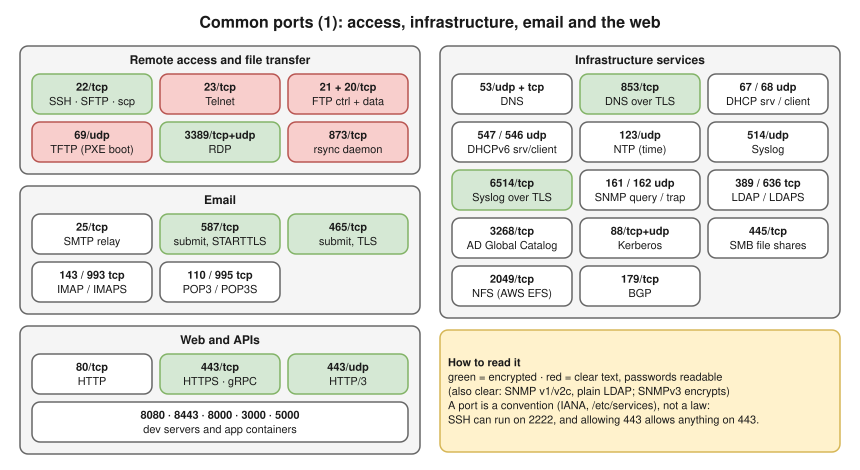
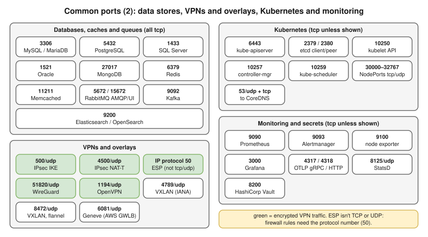
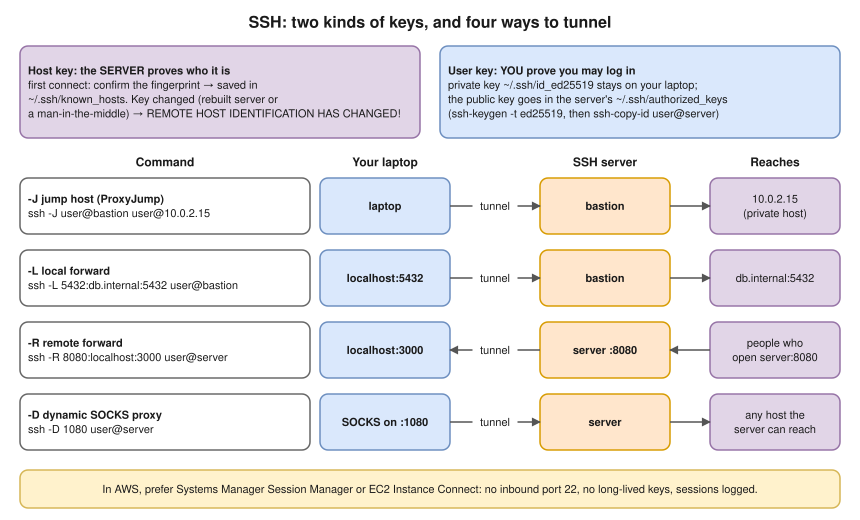

# 3.9 · Everyday Protocols and Ports

> **Level 3 · Core networking protocols** · Lesson 9 of 11 · ⏱️ about 60 minutes (estimate)
> ⬅️ [3.8 NAT, PAT and port forwarding](08-nat-pat-and-port-forwarding.md) · ➡️ [3.10 Packet flow end to end](10-packet-flow-end-to-end.md)



- A port is a **convention** (registered with IANA, listed in `/etc/services`), not a law: SSH can run on 2222, and a firewall that allows "443" allows **anything** on 443. Check what actually answers.
- Security groups, NACLs and NetworkPolicies are lists of **protocol + port**: know what each means and what breaks if it's closed.
- Clear-text legacy protocols (Telnet, FTP, SNMPv2c, plain LDAP) send **passwords in clear text**; use SSH, SFTP, SNMPv3, LDAPS.
- The classic port numbers were checked against the lab container's `/etc/services` (`getent services <port>/<proto>`) **(tested in the lab container)**. Application ports not in that file (e.g. 6443, 9090, 10250) are the projects' own defaults.

## Port list

Both maps as searchable text. Longer list: [references/common-ports.md](../references/common-ports.md).

- **Remote access, files:** SSH 22/tcp (also SFTP, scp) · Telnet 23/tcp · FTP 21/tcp control + 20/tcp or a random high port for data · TFTP 69/udp · RDP 3389/tcp (and udp) · rsync 873/tcp
- **Infrastructure:** DNS 53/udp + 53/tcp (DoT 853/tcp, DoH 443/tcp) · DHCP 67/udp server, 68/udp client (DHCPv6 547/udp server, 546/udp client) · NTP 123/udp · Syslog 514/udp, 6514/tcp over TLS · SNMP 161/udp queries, 162/udp traps · LDAP 389/tcp, LDAPS 636/tcp, AD Global Catalog 3268 · Kerberos 88/tcp+udp · SMB 445/tcp · NFS 2049/tcp · BGP 179/tcp
- **Email (tcp):** SMTP 25 · submission 587 (STARTTLS), 465 (implicit TLS) · IMAP 143, IMAPS 993 · POP3 110, POP3S 995
- **Web:** HTTP 80/tcp · HTTPS 443/tcp · HTTP/3 443/udp · alternate HTTP 8080, 8443, 8000, 3000, 5000
- **Databases, caches, queues (tcp):** MySQL / MariaDB 3306 · PostgreSQL 5432 · SQL Server 1433 · Oracle 1521 (convention) · MongoDB 27017 · Redis 6379 · Memcached 11211 · RabbitMQ (AMQP) 5672, management UI 15672 · Kafka 9092 · Elasticsearch / OpenSearch 9200
- **VPNs, overlays:** IPsec 500/udp (IKE), 4500/udp (NAT traversal), IP protocol 50 (ESP) · WireGuard 51820/udp · OpenVPN 1194/udp · VXLAN 4789/udp (IANA), 8472/udp (Linux/flannel default) · Geneve 6081/udp
- **Kubernetes (tcp):** kube-apiserver 6443 · etcd 2379 clients, 2380 peers · kubelet API 10250 · kube-controller-manager 10257 · kube-scheduler 10259 · NodePort Services 30000–32767 (tcp/udp)
- **Observability (tcp):** Prometheus 9090 · Alertmanager 9093 · node exporter 9100 · Grafana 3000 · OpenTelemetry OTLP 4317 gRPC, 4318 HTTP · StatsD 8125/udp · HashiCorp Vault 8200

## Details the map can't show

| Protocol | What to remember |
|---|---|
| **FTP** 21 + 20/tcp | Two connections: painful through NAT and firewalls (**active**: the server connects back to the client; **passive**: the client connects to a random server port). Prefer **SFTP** (over SSH, one port). FTPS = FTP over TLS, still two connections |
| Telnet 23/tcp | Clear-text shell. Only for lab devices; useful as a crude TCP port tester |
| TFTP 69/udp | No authentication. Network boot (PXE), device firmware |
| **RDP** 3389 / **SMB** 445 | Never expose to the internet; use a VPN, bastion or AWS Systems Manager |
| rsync 873/tcp | Daemon mode only; usually run **over SSH** instead |
| DNS 53 | Also DoT 853/tcp, DoH 443/tcp ([3.4](04-dns.md)) · DHCP: [2.8](../02-ip-addressing-and-subnetting/08-dhcp.md) |
| Syslog | 514/udp traditional, 6514/tcp over TLS: log shipping from network devices and servers |
| **SNMP** 161 / 162 udp | Queries / traps. v1/v2c use a clear-text "community string" as a password; **v3** adds authentication and encryption |
| LDAP / Kerberos | Active Directory also uses 3268 (Global Catalog). Kerberos needs clocks within **5 minutes** by default |
| NFS 2049 · BGP 179 | **AWS EFS** uses NFS. BGP: routing between networks ([Level 4](../04-switching-and-routing/README.md)) |
| **SMTP** 25/tcp | Server to server. **AWS restricts outbound port 25 from EC2 by default**: request removal or use a mail service. Apps should send on **587** (STARTTLS) or **465** (implicit TLS), e.g. to Amazon SES |
| IMAP / POP3 | IMAP keeps mail on the server; POP3 downloads it |
| HTTP | HTTP/3 runs on **443/udp** ([3.5](05-http-and-https.md)). gRPC: HTTP/2, usually 443 or the app's own port. WebSocket: same port as HTTP(S), starts as HTTP and upgrades (`101 Switching Protocols`) |

## Data, VPN and Kubernetes ports



- **IPsec** (AWS Site-to-Site VPN): UDP 500 (IKE), UDP 4500 (NAT traversal) and IP protocol **50 (ESP)**, which isn't TCP or UDP, so firewall rules need the protocol number.
- **VXLAN** = Ethernet frames inside UDP: Kubernetes overlays (flannel, Calico VXLAN mode). **Geneve** is newer; used by AWS Gateway Load Balancer and some CNIs. WireGuard is a simple, fast modern VPN.
- **EKS / Kubernetes:** the control plane talks to kubelets on **10250**; worker nodes need **443** to the API; pods need **53 tcp/udp** to CoreDNS; overlays need their UDP port open between nodes.

## SSH in practice



- SSH (RFC 4253 and friends): an encrypted channel for a shell, file transfer and tunnels.
- **Host key** proves the **server** (`~/.ssh/known_hosts`); **user key** (`~/.ssh/id_ed25519`) proves **you** (public key in the server's `~/.ssh/authorized_keys`).
- **In AWS**, prefer **Systems Manager Session Manager** or **EC2 Instance Connect** over opening port 22 to the internet: no inbound rule, no long-lived keys, and sessions are logged.

**Everyday commands** (not run in the lab container, which has no SSH tools installed):

```bash
ssh-keygen -t ed25519 -C "you@laptop"          # create a key pair
ssh-copy-id user@server                        # install your public key on a server
ssh -J user@bastion user@10.0.2.15             # jump through a bastion (ProxyJump)
ssh -L 5432:db.internal:5432 user@bastion      # local forward: localhost:5432 → db via the bastion
ssh -R 8080:localhost:3000 user@server         # remote forward: server:8080 → your laptop:3000
ssh -D 1080 user@server                        # dynamic SOCKS proxy
ssh -v user@server                             # verbose: see which keys and algorithms are tried
```

## NTP: time is a network dependency

NTP (123/udp) keeps clocks in sync, usually to within milliseconds. When clocks drift:

- **TLS** fails: certificates look "not yet valid" or "expired" ([3.6](06-tls-and-certificates.md)).
- **Kerberos / Active Directory** logins fail beyond 5 minutes of skew.
- **Logs and traces** from different machines can't be put in order; distributed databases and token expiry misbehave.
- AWS: the **Amazon Time Sync Service** at `169.254.169.123` (link-local, reachable from every instance). Linux: `chronyc tracking` or `timedatectl` shows the sync state.

## Where you meet it

| Where | What to know |
|---|---|
| Security groups | Open the **service port** only to the **source that needs it** (e.g. 5432 only from the app's security group), never `0.0.0.0/0` for databases, SSH or RDP |
| Corporate networks | Often allow only 80/443 out, so Git over SSH (22) and database clients fail. GitHub offers SSH over port 443 (`ssh.github.com`) for that reason |
| Your own machine | No dedicated lab: run `ss -tulpn` (Linux) or `lsof -nP -i` (Mac) and identify every listening port, then do the [Level 3 exercises](../14-practice-exercises/03-level-3-protocols.md), section B (ports) |

## Try it

```bash
getent services 22/tcp 53/udp 443/tcp 5432/tcp   # Linux: what /etc/services calls a port
grep -w 6379 /etc/services                       # macOS and Linux
ss -tulpn                                        # Linux: what's listening, on which protocol
lsof -nP -iTCP -sTCP:LISTEN                      # macOS: TCP listeners
nc -zv -w 3 smtp.gmail.com 587                   # does a TCP port answer?
openssl s_client -connect smtp.gmail.com:587 -starttls smtp </dev/null | head   # STARTTLS
```

## Troubleshooting

| You see | It means | Next step |
|---|---|---|
| `ssh: connect to host … port 22: Connection timed out` | Security group / firewall / routing | `nc -zv host 22`; SG inbound rule from **your** IP |
| `Permission denied (publickey)` | Wrong key, wrong user (`ec2-user` vs `ubuntu`), or key not in `authorized_keys` | `ssh -v`: which key is offered? |
| `REMOTE HOST IDENTIFICATION HAS CHANGED!` | Server rebuilt with new host keys (or a real attack) | Verify, then `ssh-keygen -R host` |
| App can't send mail from EC2 | Port 25 restricted | Use 587 to a mail service (e.g. SES) |
| Kerberos/AD login errors, TLS "not yet valid" | Clock skew | `timedatectl`, `chronyc tracking`; monitor NTP/chrony |
| VPN or overlay traffic blocked though "the port is open" | Only TCP allowed | IPsec needs UDP 500/4500 **and** ESP (protocol 50); VXLAN is UDP |
| "Port 443 is open, so it's HTTPS" | A port is a convention | Check what answers: `openssl s_client`, `curl -v` |

## Interview angle

- **"Which ports does Kubernetes need?"** → 6443 API, 2379–2380 etcd, 10250 kubelet, 30000–32767 NodePorts, plus the CNI's overlay port and 53 for DNS.
- **"SFTP vs FTPS?"** → SFTP runs over SSH (one port, 22). FTPS is FTP inside TLS (still two connections, firewall-unfriendly).
- **"How do you reach a private database from your laptop?"** → SSH local forward through a bastion (`ssh -L`), or Session Manager port forwarding; never open the DB to the internet.
- **"Why does time sync matter?"** → TLS validity, Kerberos, log correlation, token expiry.
- **"What does IPsec need through a firewall?"** → UDP 500, UDP 4500 (NAT-T), and IP protocol 50 (ESP).

## Check yourself

1. Name the port and transport for: SSH, DNS, NTP, PostgreSQL, the Kubernetes API, HTTP/3.
2. Which of these send credentials in clear text: Telnet, SSH, FTP, SFTP, SNMPv2c, LDAPS?
3. What does `ssh -L 8443:internal-api:443 user@bastion` let you do?
4. Your first SSH to a new server asks you to confirm a fingerprint. What is it, and why does it matter?
5. A VPN between two sites won't come up; UDP 500 and 4500 are allowed. What else might be blocked?

<details>
<summary><b>Answers</b> (try first)</summary>

1. SSH **22/tcp**; DNS **53/udp + tcp**; NTP **123/udp**; PostgreSQL **5432/tcp**; Kubernetes API **6443/tcp**; HTTP/3 **443/udp**.
2. **Telnet, FTP, SNMPv2c.** (SSH, SFTP and LDAPS are encrypted.)
3. Open `https://localhost:8443` on your laptop and reach `internal-api:443` **through the bastion**, over the encrypted SSH connection.
4. The server's **host key** fingerprint. Accepting it stores it in `known_hosts`, so a later different key (a server rebuild or a man-in-the-middle) triggers a warning.
5. **ESP** (IP protocol 50), if the VPN isn't using NAT traversal (which wraps ESP in UDP 4500).

</details>

➡️ **Next:** [3.10 · Packet flow end to end](10-packet-flow-end-to-end.md): everything from Levels 1–3 in one walk, from typing a URL to the page arriving.
