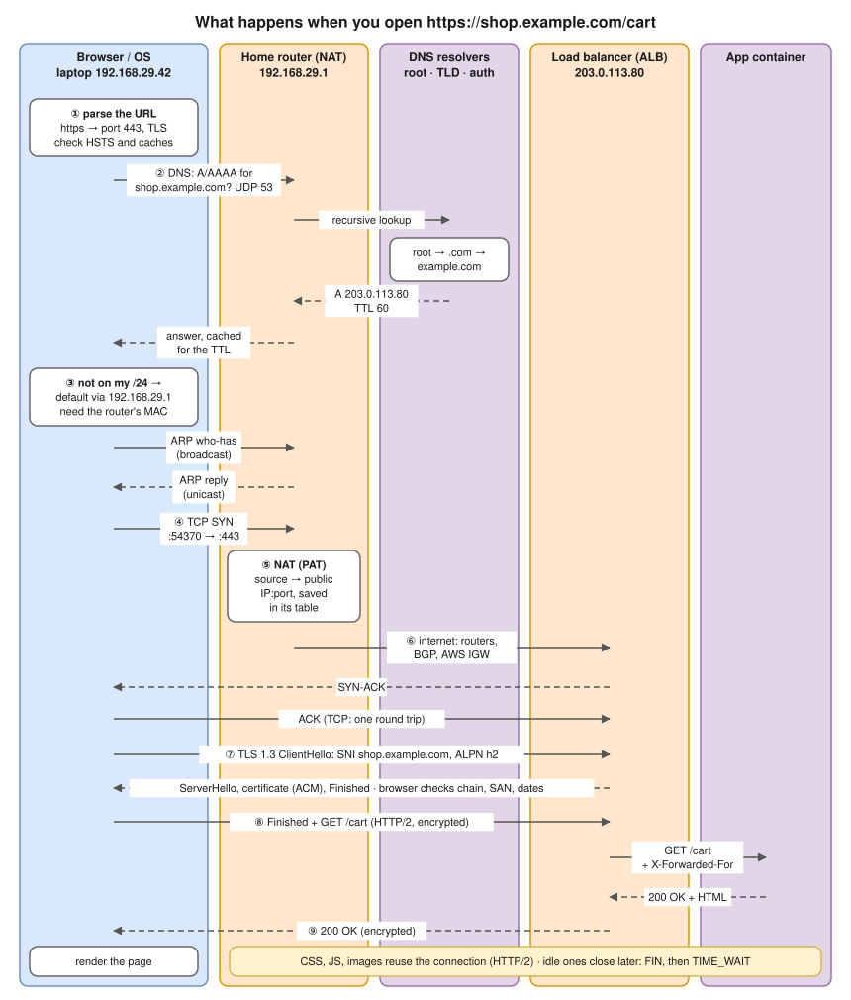
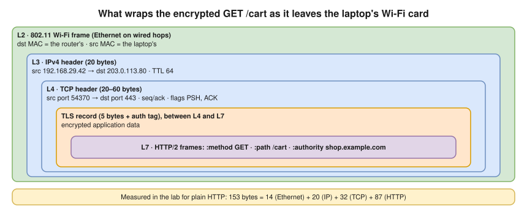

# 3.10 · Packet Flow End to End: What Happens When You Open a URL ⭐

> **Level 3 · Core networking protocols** · Lesson 10 of 11 · ⏱️ about 75 minutes (estimate)
> ⬅️ [3.9 Everyday protocols and ports](09-everyday-protocols-and-ports.md) · ➡️ [3.11 Troubleshooting connectivity](11-troubleshooting-connectivity.md)



- ⭐ "What happens when you type a URL?" is one of the most common DevOps/SRE interview questions. A good answer is **ordered**, names the protocols, and knows where each step can fail.
- Order: **DNS → route → ARP → TCP → (NAT) → internet routing → TLS → HTTP → response.** DNS must finish before anything can be sent to the server, which is why DNS problems look like "nothing works".
- Two round trips before the request: the **TCP handshake** and the **TLS 1.3 handshake** (DNS adds more if not cached).
- Setup: laptop `192.168.29.42` on home Wi-Fi, gateway `192.168.29.1` (the home router, which also does NAT and forwards DNS), server = an AWS Application Load Balancer in front of containers. Each step links back to its lesson below.

## The steps, with the details to say out loud

| # | Step | Details |
|---|---|---|
| 1 | Parse the URL, check caches | Scheme `https` → port **443**, TLS required. With **HSTS** from an earlier visit, even `http://` is upgraded inside the browser. HTTP cache, DNS cache and reusable open connections can skip steps |
| 2 | **DNS** · [3.4](04-dns.md) | The stub resolver checks `/etc/hosts` and its cache, then asks its DNS server (the router, learned from **DHCP**: [2.8](../02-ip-addressing-and-subnetting/08-dhcp.md)) for **A** and **AAAA** over **UDP 53**. The provider's **recursive resolver** walks **root → `.com` → `example.com`'s authoritative servers** and caches the answer for its TTL. In the lab, one client question became five resolver queries **(tested in the lab container, [3.4](04-dns.md))** |
| 3 | **Route and ARP** · [2.7](../02-ip-addressing-and-subnetting/07-default-gateway-routing-table-and-arp.md) | `203.0.113.80` isn't on the laptop's `/24` → **default route**, next hop `192.168.29.1`. ARP broadcast **"who-has 192.168.29.1"**, unicast reply. From now on, frames go to the **gateway's MAC** but carry the **server's IP** |
| 4 | **TCP handshake** · [3.3](03-tcp-in-depth.md) | Ephemeral source port (e.g. `54370`), **SYN** to `203.0.113.80:443`, **SYN-ACK**, **ACK**: one round trip. Options agreed: MSS, window scale, SACK, timestamps |
| 5 | **NAT** at the home router · [3.8](08-nat-pat-and-port-forwarding.md) | Source `192.168.29.42:54370` → `<its public IP>:<port>` (**PAT**), recorded so replies find their way back. With **CGNAT**, it happens again in the provider's network |
| 6 | Across the internet · [Level 4](../04-switching-and-routing/README.md) | Each router: **longest-prefix match**, **TTL** −1, **new MAC addresses**; IPs stay (except at NATs). Providers learn routes with **BGP**. AWS: the **internet gateway** maps the ALB's public IP to its private IP in the VPC |
| 7 | **TLS** · [3.6](06-tls-and-certificates.md) | **ClientHello** with **SNI** `shop.example.com` (clear text) and **ALPN** (`h2`, `http/1.1`). The ALB picks the matching certificate (from ACM) and completes **TLS 1.3** in one round trip; the browser checks the **chain**, the **SAN** and the **dates** |
| 8 | **HTTP request** · [3.5](05-http-and-https.md) | `GET /cart` with `Host: shop.example.com`, cookies and headers, **encrypted**, usually **HTTP/2** on this one connection. The ALB (L7) terminates TLS, picks a **healthy target** by host/path rules, opens (or reuses) a connection to the app, adds **`X-Forwarded-For`** with the client's (NATed) IP |
| 9 | Response and after | `200 OK` + HTML back through the ALB. The browser fetches CSS, JS and images, **reusing** the connection (HTTP/2 multiplexing) or opening more. Idle connections close later with **FIN**s; whoever closes first holds **TIME_WAIT** ([3.3](03-tcp-in-depth.md)) |

## Layer by layer: what wraps the request



- Sizes are the usual minimums. The same split was measured for a plain-HTTP request in the lab: **153 bytes = 14 (Ethernet) + 20 (IP) + 32 (TCP) + 87 (HTTP)** **(tested in the lab container, [3.3](03-tcp-in-depth.md))**.

## Where it can fail: symptom → step

The backbone of [troubleshooting](11-troubleshooting-connectivity.md). Every message was seen in this module's labs unless marked otherwise.

| Step | What failure looks like | Seen in |
|---|---|---|
| 0. No IP address | `169.254.x.x` on Mac/Windows; DHCP Discovers with no Offer | [2.8](../02-ip-addressing-and-subnetting/08-dhcp.md) |
| 2. DNS | `curl: (6) Could not resolve host`; `NXDOMAIN`; `SERVFAIL`; `no servers could be reached` | [3.4](04-dns.md) |
| 3. Routing | `connect: Network is unreachable` (no route); `Destination Net Unreachable` from a router | [2.7](../02-ip-addressing-and-subnetting/07-default-gateway-routing-table-and-arp.md) |
| 3. ARP | `Destination Host Unreachable` from your own IP; neighbour `FAILED` | [2.7](../02-ip-addressing-and-subnetting/07-default-gateway-routing-table-and-arp.md) |
| 4. TCP | `Connection refused` (RST: nothing listening); `curl: (28) … Timeout` (SYNs dropped) | [3.2](02-tcp-and-udp.md), [3.3](03-tcp-in-depth.md) |
| 5. NAT | Timeouts from private hosts; the server saw a private source IP it can't answer | [3.8](08-nat-pat-and-port-forwarding.md) |
| 6. Path / MTU | Handshake works, large responses hang | [3.7](07-icmp-ping-and-traceroute.md), [Lab 3.5](../13-hands-on-labs/lab-03.5-troubleshooting-challenge.md) |
| 7. TLS | `curl: (60)` unknown issuer / name mismatch / expired | [3.6](06-tls-and-certificates.md) |
| 8. HTTP / LB | `502` / `503` / `504` from the load balancer; `404`, `401`, `403` from the app | [3.5](05-http-and-https.md) (LB codes: illustrative, not reproduced in a lab) |

## The same journey from a Kubernetes pod in AWS (EKS)


- **Docker (default bridge):** DNS comes from the container's `/etc/resolv.conf` (copied from the host, or `127.0.0.11` on a user-defined network); `default via 172.17.0.1` → **docker0**; the host forwards and **MASQUERADEs** to its own IP; then the host's own route, NAT (home router / AWS NAT gateway), and steps 6–9 as above. Details and tested outputs: [10.1](../10-container-and-kubernetes-networking/01-docker-bridge-networking-inside-out.md), [Lab 10.1](../13-hands-on-labs/lab-10.1-docker-bridge-nat-and-dns.md).
- **EKS pod** calling `http://orders.shop.svc.cluster.local`, then an external API:
  1. **DNS** → CoreDNS (the `kube-dns` Service), with `ndots:5` search-list expansion ([3.4](04-dns.md)).
  2. The name resolves to a **ClusterIP**; **kube-proxy** rules **DNAT** it to one healthy **pod IP** ([3.8](08-nat-pat-and-port-forwarding.md)).
  3. With the AWS VPC CNI, pod IPs are real **VPC addresses**, so pod-to-pod traffic is plain VPC routing.
  4. Traffic leaving the VPC is SNATed to the node IP, then goes through a **NAT gateway** (the route for a private subnet) and the **internet gateway**.
- In depth: [Level 10](../10-container-and-kubernetes-networking/README.md) and [Level 9](../09-cloud-networking/README.md).

## Try it

Watch the steps yourself on your Mac (or Linux with `en0` → your interface):

```bash
# 1. DNS
dig shop.example.com +noall +answer       # or any real site
# 2. Route and gateway
route -n get example.com                  # Linux: ip route get <ip>
# 3. Phase timings: DNS, TCP connect, TLS, first byte, total
curl -sS -o /dev/null -w 'dns=%{time_namelookup} tcp=%{time_connect} tls=%{time_appconnect} ttfb=%{time_starttransfer} total=%{time_total}\n' https://example.com/
# 4. Everything at once, in another terminal while you run curl
sudo tcpdump -i en0 -nn 'port 53 or port 443'
```

## Interview angle

⭐ **"What happens when you type a URL and press Enter?"** A strong answer in about a minute:

1. URL parsed; HSTS and caches checked.
2. **DNS**: stub resolver → recursive resolver → root → TLD → authoritative; cached for the TTL.
3. **Routing**: not on my subnet → default gateway; **ARP** for the gateway's MAC.
4. **TCP** 3-way handshake to port 443 (NAT at the edge rewrites the source).
5. **TLS 1.3**: ClientHello with SNI/ALPN, certificate verified (chain, SAN, dates), session keys agreed.
6. **HTTP** request (often HTTP/2), load balancer picks a healthy backend, adds `X-Forwarded-For`.
7. Response, rendering, more requests over the same connection; connections close later (FIN, TIME_WAIT).

Then offer depth where they want it: "I can go deeper into DNS resolution, the TLS handshake, or what the load balancer does."

## Check yourself

1. List the steps before the first byte of HTTP data can be sent, in order, for a cold start.
2. Which step uses a broadcast?
3. Which two steps each cost about one round trip before the request can be sent?
4. The page fails with `curl: (60) … certificate has expired`. Which steps **succeeded**?
5. A pod resolves the Service name but gets `Connection refused` from the ClusterIP. Which step failed, and what would you check?

<details>
<summary><b>Answers</b> (try first)</summary>

1. DNS resolution → route lookup → ARP for the gateway (if not cached) → TCP handshake → TLS handshake → HTTP request.
2. **ARP** (the request is broadcast). (DHCP, before all of this, too.)
3. The **TCP handshake** and the **TLS 1.3 handshake** (DNS adds more if not cached).
4. DNS, routing/ARP, NAT and the TCP handshake all worked; the failure is in **TLS certificate verification**.
5. TCP connect: the DNAT picked a pod (or the Service has a wrong `targetPort`) where **nothing listens** on that port. Check the Service's `targetPort` vs the container port, and the endpoints (`kubectl get endpoints`).

</details>

➡️ **Next:** [3.11 · Troubleshooting connectivity](11-troubleshooting-connectivity.md): a repeatable method for finding which step is broken.
