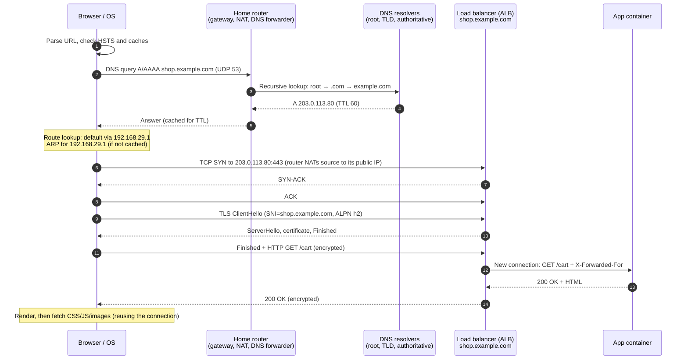

# 3.10 · Packet Flow End to End: What Happens When You Open a URL ⭐

> **Level 3 · Core networking protocols** · Lesson 10 of 11 · ⏱️ about 75 minutes (estimate)
> ⬅️ [3.9 Everyday protocols and ports](09-everyday-protocols-and-ports.md) · ➡️ [3.11 Troubleshooting connectivity](11-troubleshooting-connectivity.md)

## What you'll learn

- The full sequence of events from typing `https://shop.example.com/cart` to the page arriving: **every protocol from Levels 1–3, in order**.
- Which **layer** does what at each step, and which **headers** wrap the data.
- For each step, **what failure looks like**, so you can map an error message to a step.
- The same journey from a **Docker container** and from a **Kubernetes pod in AWS**.

## Before you start

This lesson ties together everything so far. If a step feels unfamiliar, follow its link back.

---

## The idea in plain words

Opening a web page is like sending a parcel abroad: look up the address (**DNS**), decide which post office to use (**routing**), find the post office on your street (**ARP**), agree a delivery arrangement with the recipient (**TCP**), check their ID and lock the box (**TLS**), send the actual request (**HTTP**), with the parcel re-labelled at the border (**NAT**) and passed between many sorting offices (**routers**) on the way.

## Why it matters

"What happens when you type a URL into a browser?" is one of the most common interview questions for DevOps and SRE roles. A good answer is ordered, names the protocols, and knows where each step can fail.

---

## The journey, step by step

The setup: a laptop `192.168.29.42` on home Wi-Fi, gateway `192.168.29.1` (the home router, which also does NAT and forwards DNS), opening `https://shop.example.com/cart`, served by an AWS Application Load Balancer in front of containers.



### 1. The browser parses the URL and checks its caches

- **Scheme** `https` → port **443**, TLS required. If the site sent **HSTS** before, even an `http://` URL is upgraded to `https://` inside the browser.
- The browser checks its own caches (HTTP cache, DNS cache, open connections it could **reuse**). A warm cache can skip several steps below.

### 2. Name resolution (DNS) · [3.4](04-dns.md)

1. The OS stub resolver checks `/etc/hosts` and its cache, then reads its DNS servers (here, the router `192.168.29.1`, learned from **DHCP**: [2.8](../02-ip-addressing-and-subnetting/08-dhcp.md)).
2. It sends an **A** (and **AAAA**) query over **UDP 53**.
3. The router forwards to the provider's **recursive resolver**, which (if not cached) walks **root → `.com` → `example.com`'s authoritative servers**, then caches the answer for its TTL.

**This step must happen before anything can be sent to the server**, which is why DNS problems look like "nothing works". In the lab you watched one client question turn into five resolver queries **(tested in the lab container, [3.4](04-dns.md))**.

### 3. Route lookup and ARP · [2.7](../02-ip-addressing-and-subnetting/07-default-gateway-routing-table-and-arp.md)

- `203.0.113.80` isn't on the laptop's `/24`, so the routing table picks the **default route** → next hop `192.168.29.1`.
- The laptop needs the gateway's **MAC address**: if it isn't in the ARP cache, it broadcasts **"who-has 192.168.29.1"** and gets a unicast reply.
- From here on, every frame to the internet is addressed to the **gateway's MAC** but carries the **server's IP**.

### 4. TCP handshake · [3.3](03-tcp-in-depth.md)

- The OS picks an ephemeral source port (e.g. `54370`) and sends a **SYN** to `203.0.113.80:443`; **SYN-ACK** returns; **ACK** completes it. One round trip.
- Options agreed: MSS, window scale, SACK, timestamps.

### 5. NAT at the home router · [3.8](08-nat-pat-and-port-forwarding.md)

- The router rewrites the source `192.168.29.42:54370` → `<its public IP>:<port>` (**PAT**) and records it in its translation table, so the replies find their way back.
- If the provider uses **CGNAT**, it happens a second time in the provider's network.

### 6. Across the internet · [Level 4](../04-switching-and-routing/README.md)

- Each router does a **longest-prefix match** and forwards; **TTL** drops by one per hop; **MAC addresses change at every hop**, IPs don't (except at NATs).
- Between providers, routes were learned with **BGP**. Inside AWS, the packet enters through the **internet gateway**, which maps the ALB's public IP to its private IP in the VPC.

### 7. TLS handshake · [3.6](06-tls-and-certificates.md)

- **ClientHello** carries the **SNI** `shop.example.com` (in clear text) and **ALPN** (`h2`, `http/1.1`).
- The ALB picks the matching certificate (from ACM), completes the **TLS 1.3** handshake (one round trip), and the browser verifies the **chain**, the **SAN** and the **dates**.

### 8. The HTTP request · [3.5](05-http-and-https.md)

- `GET /cart` with `Host: shop.example.com`, cookies and other headers, **encrypted** inside TLS, usually as **HTTP/2** over this one connection.
- The ALB (an L7 load balancer) terminates TLS, chooses a **healthy target** by host/path rules, opens (or reuses) a connection to the app container, and adds **`X-Forwarded-For`** with the client's (NATed) IP.

### 9. The response, and everything after

- The app returns **`200 OK`** and HTML; the ALB relays it to the browser.
- The browser parses the HTML and fetches CSS, JavaScript and images, **reusing** the same connection (HTTP/2 multiplexing) or opening more.
- Idle connections close later with **FIN**s; whoever closes first holds **TIME_WAIT** ([3.3](03-tcp-in-depth.md)).

## Layer by layer: what wraps the request

When the encrypted `GET /cart` leaves the laptop's Wi-Fi card, it's nested like this (sizes are the usual minimums):

| Layer | Header | Key fields at this moment |
|---|---|---|
| L7 Application | HTTP/2 frames | `:method GET`, `:path /cart`, `:authority shop.example.com` |
| (between L7 and L4) | TLS record (5 bytes + auth tag) | Encrypted application data |
| L4 Transport | TCP (20–60 bytes) | src port `54370`, dst port `443`, seq/ack, flags `PSH, ACK` |
| L3 Network | IPv4 (20 bytes) | src `192.168.29.42` → dst `203.0.113.80`, TTL 64 |
| L2 Data link | 802.11 Wi-Fi (on the laptop's link; Ethernet on wired hops) | dst MAC = **router's**, src MAC = laptop's |

The same decomposition was measured for a plain-HTTP request in the lab: **153 bytes = 14 (Ethernet) + 20 (IP) + 32 (TCP) + 87 (HTTP)** **(tested in the lab container, [3.3](03-tcp-in-depth.md))**.

## Where it can fail: symptom → step

This table is the backbone of [troubleshooting](11-troubleshooting-connectivity.md). Every message below was seen in this module's labs unless marked otherwise.

| Step | What failure looks like | Seen in |
|---|---|---|
| 0. No IP address | `169.254.x.x` on Mac/Windows; DHCP Discovers with no Offer | [2.8](../02-ip-addressing-and-subnetting/08-dhcp.md) |
| 2. DNS | `curl: (6) Could not resolve host`; `NXDOMAIN`; `SERVFAIL`; `no servers could be reached` | [3.4](04-dns.md) |
| 3. Routing | `connect: Network is unreachable` (no route); `Destination Net Unreachable` from a router | [2.7](../02-ip-addressing-and-subnetting/07-default-gateway-routing-table-and-arp.md) |
| 3. ARP | `Destination Host Unreachable` from your own IP; neighbour `FAILED` | [2.7](../02-ip-addressing-and-subnetting/07-default-gateway-routing-table-and-arp.md) |
| 4. TCP | `Connection refused` (RST: nothing listening); `curl: (28) … Timeout` (SYNs dropped) | [3.2](02-tcp-and-udp.md), [3.3](03-tcp-in-depth.md) |
| 5. NAT | Timeouts from private hosts; the server saw a private source IP it can't answer | [3.8](08-nat-pat-and-port-forwarding.md) |
| 6. Path / MTU | Handshake works, large responses hang | [3.7](07-icmp-ping-and-traceroute.md), [Lab 3.5](../13-hands-on-labs/lab-03.5-troubleshooting-challenge.md) |
| 7. TLS | `curl: (60)` unknown issuer / name mismatch / expired | [3.6](06-tls-and-certificates.md) |
| 8. HTTP / LB | `502` / `503` / `504` from the load balancer; `404`, `401`, `403` from the app | [3.5](05-http-and-https.md) (LB codes: illustrative, not reproduced in a lab) |

## The same journey from a container

From a container on Docker's **default bridge** calling an external API:

1. DNS: the container's `/etc/resolv.conf` (copied from the host, or `127.0.0.11` on a user-defined network).
2. Route: `default via 172.17.0.1` → the **docker0** bridge on the host.
3. The host **forwards** the packet and **MASQUERADEs** it to the host's IP.
4. Then the host's own route, NAT (home router / AWS NAT gateway), and steps 6–9 as above.

Details and tested outputs: [10.1](../10-container-and-kubernetes-networking/01-docker-bridge-networking-inside-out.md) and [Lab 10.1](../13-hands-on-labs/lab-10.1-docker-bridge-nat-and-dns.md).

## The same journey from a Kubernetes pod in AWS (EKS)

A pod calling `http://orders.shop.svc.cluster.local` and then an external API:

1. **DNS** → CoreDNS (the `kube-dns` Service), with `ndots:5` search-list expansion ([3.4](04-dns.md)).
2. The Service name resolves to a **ClusterIP**; **kube-proxy** rules **DNAT** it to one healthy **pod IP** ([3.8](08-nat-pat-and-port-forwarding.md)).
3. With the AWS VPC CNI, pod IPs are real **VPC addresses**, so pod-to-pod traffic is plain VPC routing.
4. For the external API, traffic leaving the VPC is SNATed to the node IP, then goes through a **NAT gateway** (private subnet) and the **internet gateway**.

Covered in depth in [Level 10](../10-container-and-kubernetes-networking/README.md) and [Level 9](../09-cloud-networking/README.md).

---

## Try it

Watch the steps yourself on your Mac (or Linux with `en0` → your interface):

```bash
# 1. DNS
dig shop.example.com +noall +answer       # or any real site
# 2. Route and gateway
route -n get example.com                  # Linux: ip route get <ip>
# 3. Phase timings: DNS, TCP connect, TLS, first byte, total
curl -sS -o /dev/null -w 'dns=%{time_namelookup} tcp=%{time_connect} tls=%{time_appconnect} ttfb=%{time_starttransfer} total=%{time_total}\n' https://example.com/
# 4. Everything at once, in another terminal while you run curl
sudo tcpdump -i en0 -nn 'port 53 or port 443'
```

## Interview angle

⭐ **"What happens when you type a URL and press Enter?"** A strong answer in about a minute:

1. URL parsed; HSTS and caches checked.
2. **DNS**: stub resolver → recursive resolver → root → TLD → authoritative; cached for the TTL.
3. **Routing**: not on my subnet → default gateway; **ARP** for the gateway's MAC.
4. **TCP** 3-way handshake to port 443 (NAT at the edge rewrites the source).
5. **TLS 1.3**: ClientHello with SNI/ALPN, certificate verified (chain, SAN, dates), session keys agreed.
6. **HTTP** request (often HTTP/2), load balancer picks a healthy backend, adds `X-Forwarded-For`.
7. Response, rendering, more requests over the same connection; connections close later (FIN, TIME_WAIT).

Then offer depth where they want it: "I can go deeper into DNS resolution, the TLS handshake, or what the load balancer does."

## Check yourself

1. List the steps before the first byte of HTTP data can be sent, in order, for a cold start.
2. Which step uses a broadcast?
3. Which two steps each cost about one round trip before the request can be sent?
4. The page fails with `curl: (60) … certificate has expired`. Which steps **succeeded**?
5. A pod resolves the Service name but gets `Connection refused` from the ClusterIP. Which step failed, and what would you check?

<details>
<summary><b>Answers</b> (try first)</summary>

1. DNS resolution → route lookup → ARP for the gateway (if not cached) → TCP handshake → TLS handshake → HTTP request.
2. **ARP** (the request is broadcast). (DHCP, before all of this, too.)
3. The **TCP handshake** and the **TLS 1.3 handshake** (DNS adds more if not cached).
4. DNS, routing/ARP, NAT and the TCP handshake all worked; the failure is in **TLS certificate verification**.
5. TCP connect: the DNAT picked a pod (or the Service has a wrong `targetPort`) where **nothing listens** on that port. Check the Service's `targetPort` vs the container port, and the endpoints (`kubectl get endpoints`).

</details>

## Summary

- **DNS → route → ARP → TCP → (NAT) → internet routing → TLS → HTTP → response.**
- Each step has a distinctive failure message; matching the message to the step is most of troubleshooting.
- Containers and pods add their own DNS, bridge/CNI routing and NAT/DNAT steps in front of the same journey.

## Next

➡️ [3.11 · Troubleshooting connectivity](11-troubleshooting-connectivity.md): a repeatable method for finding which step is broken.
