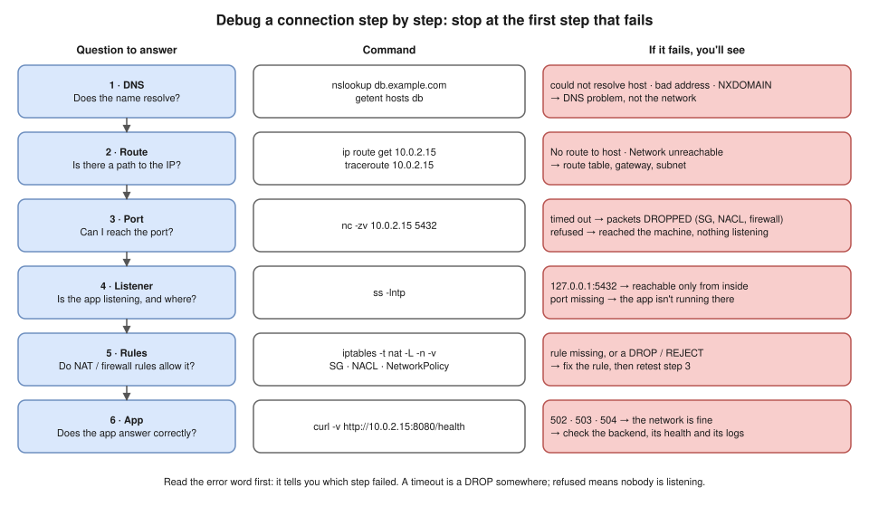
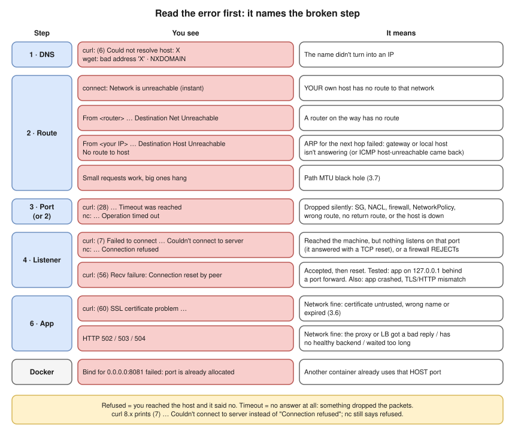
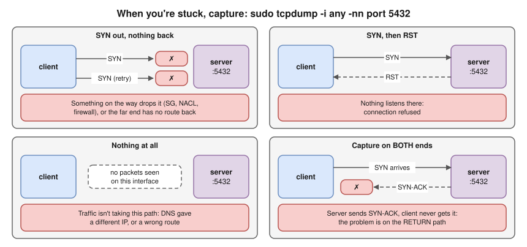

# 3.11 · Troubleshooting Connectivity: A Repeatable Method ⭐🔥

> **Level 3 · Core networking protocols** · Lesson 11 of 11 · ⏱️ about 90 minutes, plus the challenge lab (estimate) · 🧪 [Lab 3.5](../13-hands-on-labs/lab-03.5-troubleshooting-challenge.md)
> ⬅️ [3.10 Packet flow end to end](10-packet-flow-end-to-end.md) · ➡️ [Level 3 README and milestone](README.md)



- A connection is a chain: **name → route → port → listener → rules → app**. When it fails, one link is broken: **test each link in order**, don't guess.
- ⭐ **Read the error message first**: it usually names the broken step.
- **Test from where the client really runs**: a curl from your laptop proves nothing about a pod.
- When stuck, a **packet capture** settles it.
- 🔥 The interviewer feedback asked for exactly this: a calm, ordered method instead of jumping to conclusions. The Docker, Kubernetes and AWS scenarios (N1–N13) are in [15 · Troubleshooting scenarios](../15-interview-preparation/troubleshooting-scenarios-docker-kubernetes-aws.md). Before: [3.10](10-packet-flow-end-to-end.md), and [3.2](02-tcp-and-udp.md) / [3.3](03-tcp-in-depth.md) for refused vs timeout vs reset.

## The method (say this in the interview)

> "I go step by step from the bottom, and I **test, not guess**: first DNS, then the route, then whether the port is reachable, then whether the app is listening on the right address, then the firewall and NAT rules, and only then the app itself. And I test **from where the client really runs**: a curl from my laptop proves nothing about a pod."

| Step | Question | Command |
|---|---|---|
| 1 · DNS | Does the name resolve? | `nslookup db.example.com` · `getent hosts db` |
| 2 · Route | Is there a path to the IP? | `ip route get 10.0.2.15` · `traceroute 10.0.2.15` |
| 3 · Port | Can I reach the port? | `nc -zv 10.0.2.15 5432` |
| 4 · Listener | Is the app listening, and on which address? | `ss -lntp` (on the server or in the container) |
| 5 · Rules | Do NAT and firewall rules allow it? | `iptables -t nat -L -n -v` · security group · NACL · NetworkPolicy |
| 6 · App | Does the app answer correctly? | `curl -v http://10.0.2.15:8080/health` |

- ⚠️ **Don't trust `ping` alone.** ICMP is blocked by security groups by default: a failed ping proves little; a TCP test (`nc`, `curl`) proves a lot ([3.7](07-icmp-ping-and-traceroute.md)).
- Change **one thing at a time**, then re-test. Check the **return direction** too (return routes, NACL return ports, asymmetric paths). Don't stop at "it works now": write down the root cause and how you proved it.

## Read the error first ⭐: it tells you the step



The diagram as searchable text:

- **1 · DNS:** `curl: (6) Could not resolve host: X` · `wget: bad address 'X'` · `NXDOMAIN`
- **2 · Route:** `connect: Network is unreachable` (instant: **your own** host has no route) · `From <router> … Destination Net Unreachable` (a router has no route) · `From <your IP> … Destination Host Unreachable` / `No route to host` (ARP for the next hop failed) · small requests work, big ones hang (MTU black hole, [3.7](07-icmp-ping-and-traceroute.md))
- **3 · Port (or 2):** `curl: (28) … Timeout was reached` · `nc: … Operation timed out`: **dropped silently** (SG, NACL, firewall, NetworkPolicy, wrong or missing return route, host down)
- **4 · Listener:** `curl: (7) Failed to connect … Couldn't connect to server` · `nc: … Connection refused`: reached the machine, **nothing listens** (TCP reset) or a firewall REJECTs · `curl: (56) Recv failure: Connection reset by peer`: accepted, then reset (tested cause: app on `127.0.0.1` behind a port forward; also a crashed app or a TLS / HTTP mismatch)
- **6 · App:** `curl: (60) SSL certificate problem …` ([3.6](06-tls-and-certificates.md)) · HTTP `502` / `503` / `504`: **the network is fine**
- **Docker:** `Bind for 0.0.0.0:8081 failed: port is already allocated`: another container already uses that **host** port

- **Where these were seen:** the `curl (6)/(7)/(28)/(56)`, `bad address`, `port is already allocated` and `nc` messages were **tested on the Mac, Oct 2026**; the unreachable messages, `curl (60)` and the MTU hang were reproduced in this module's labs **(tested in the lab container)**. The `502/503/504` row is from load-balancer documentation and experience, not reproduced here.
- ⚠️ **curl 8.x no longer prints "Connection refused".** It prints `Couldn't connect to server` (error 7) **(tested on the Mac with curl 8.7 and 8.22, and with curl 8.5 in the lab container)**. `nc` still says "Connection refused".
- **In the building story:** **refused** = the letter reached the flat, and someone at the door said "nobody works at that counter"; **timeout** = the letter was **thrown away** on the way, and no answer ever came.

## Test from the right place

| The client runs in… | Test from there with |
|---|---|
| A Docker container | `docker exec <c> …`, or, if it has no tools: `docker run --rm -it --network container:<c> nicolaka/netshoot` |
| A Kubernetes pod | `kubectl debug -it <pod> --image=nicolaka/netshoot --target=<container>` |
| Anywhere in the cluster | `kubectl run tmp --rm -it --image=nicolaka/netshoot -- bash` |
| A Kubernetes node | `kubectl debug node/<node> -it --image=nicolaka/netshoot` (it shares the node's network) |
| A Linux host, inside a container's network | `nsenter -t <PID> -n ss -lntp` (the PID comes from `docker inspect -f '{{.State.Pid}}' <c>`) |
| A machine with bash but no curl | `timeout 3 bash -c '</dev/tcp/db/5432' && echo open` |

`nicolaka/netshoot` is a container full of network tools: `curl`, `dig`, `nc`, `ss`, `tcpdump`, `iptables`, `mtr` and more.

## When you're stuck: watch the packets



```bash
sudo tcpdump -i any -nn port 5432
```

- **SYN out, nothing back:** something drops it (SG, NACL, firewall), or the far end has **no route back**.
- **SYN, then RST:** nothing listens there (refused). **Nothing at all:** the traffic isn't taking this path (DNS gave a different IP, or a wrong route).
- Capture on **both ends** when you can: if the server sends a SYN-ACK the client never receives, the problem is on the **return path**.

## Worked example: "h1 can't reach h2"

[Lab 2.2](../13-hands-on-labs/lab-02.2-routing-between-two-subnets.md) with one route deliberately missing **(tested in the lab container)**:

1. **Error:** `ping 10.0.2.10` from h1 gives `100% packet loss` and **no error message**: a drop, not a refusal or a missing local route. (No DNS: we used an IP.)
2. **Local route:** `ip route get 10.0.2.10` on h1 → `via 10.0.1.1 dev eth0`. Fine.
3. **Path:** `traceroute -n 10.0.2.10` reaches `10.0.12.2` (r2), then stars: r1 and r2 forward; the trouble is at or after h2.
4. **Capture on h2:** `tcpdump -i eth0 -nn icmp` shows `ICMP echo request` arriving and **no reply** leaving.
5. **Why?** `ip route get 10.0.1.10` on h2 → `RTNETLINK answers: Network is unreachable`: **h2 has no route back**.
6. **Fix:** `ip route add default via 10.0.2.1` on h2. Ping now works with `ttl=62`. Only the far-end capture showed the **return path** was the problem.

## Practice

- [Lab 3.5 · Troubleshooting challenge](../13-hands-on-labs/lab-03.5-troubleshooting-challenge.md): a script hides one of eight faults (wrong resolver, wrong gateway, forwarding off, missing return route, firewall drop, no listener, localhost-only listener, PMTUD black hole). Find each using only this method. Solutions: [separate file](../14-practice-exercises/solutions/lab-03.5-troubleshooting-challenge-solutions.md).
- [15 · Troubleshooting scenarios: Docker, Kubernetes and AWS](../15-interview-preparation/troubleshooting-scenarios-docker-kubernetes-aws.md) (N1–N13), out loud.
- [Troubleshooting exercises](../14-practice-exercises/04-troubleshooting-scenarios.md), beginner to expert.

## Interview angle (practise out loud)

- ⭐ "Something can't connect. Walk me through how you debug it." → The 6 steps, the error-message table, and test from where the client runs.
- ⭐ "What's the difference between connection refused and a timeout?" → Refused: you reached the host and it said no (TCP reset), so nothing is listening. Timeout: no answer at all, so something dropped the packets.
- "Ping fails. Is the server down?" → Not necessarily: ICMP is often blocked. Test the real port with `nc` or `curl`.
- "How do you debug a distroless pod?" → `kubectl debug` with netshoot and `--target`, or the bash `/dev/tcp` trick.

## Check yourself

1. `curl` says `(7) … Couldn't connect to server` after 0 ms. Which step do you check first, and with what command on the server?
2. `nc -zv db 5432` hangs, then times out. List three possible causes.
3. A pod can reach a Service by IP but not by name. Which step is broken?
4. The server's capture shows SYNs arriving and SYN-ACKs leaving, but the client keeps re-sending SYNs. Where's the problem?
5. Why is "test from where the client runs" so important in Kubernetes?

<details>
<summary><b>Answers</b> (try first)</summary>

1. **Step 4, listener**: `ss -lntp` on the server. Is anything listening on that port, and on which address? (Then check for a REJECT rule.)
2. Any three of: a security group or NACL drop; a host firewall drop; a NetworkPolicy; a wrong route or no route back; the server is down or the IP is wrong.
3. **Step 1, DNS** (CoreDNS, resolv.conf, a NetworkPolicy blocking port 53, the wrong namespace in the name).
4. On the **return path** between server and client: the SYN-ACKs are dropped (a stateless NACL without ephemeral return ports, an asymmetric route through a firewall that never saw the SYN, or a missing route back).
5. A pod has its own network namespace, DNS settings (search domains, `ndots`), NetworkPolicies and source IP. A test from a laptop or the node takes a different path and proves nothing about the pod's path.

</details>

➡️ **Next:** finish Level 3 with the [Level 3 milestone](README.md), the [Level 3 exercises](../14-practice-exercises/03-level-3-protocols.md) and the [troubleshooting challenge](../13-hands-on-labs/lab-03.5-troubleshooting-challenge.md). Then [Level 4 · Switching and routing](../04-switching-and-routing/README.md).
