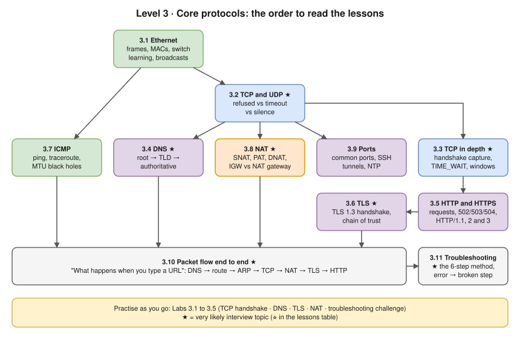

# Level 3 · Core Networking Protocols

- **Goal:** understand, and observe with your own captures, every protocol involved in "open a web page" (Ethernet, TCP and UDP, DNS, HTTP, TLS, ICMP, NAT), then use it to troubleshoot any connection methodically.
- **Start here if:** you've finished [Level 2](../02-ip-addressing-and-subnetting/README.md), or you can already subnet and explain a default gateway and ARP.
- ⏱️ **About 20 hours** (lessons ~15 h, labs ~5 h). This is an estimate.

## Lessons (read in this order)

| # | Lesson | You'll be able to… | ⏱️ (estimate) |
|---|---|---|---|
| 3.1 | [Ethernet and switching basics](01-ethernet-and-switching-basics.md) | Read a frame and a MAC address; explain learning, flooding and broadcast domains | 60 min |
| 3.2 | [TCP and UDP](02-tcp-and-udp.md) ⭐ | Choose between them; read "refused" vs "timeout" vs silence for each | 60 min |
| 3.3 | [TCP in depth](03-tcp-in-depth.md) ⭐ | Annotate a real capture; explain TIME_WAIT vs CLOSE_WAIT, retransmission, windows | 2 h |
| 3.4 | [DNS](04-dns.md) ⭐ | Trace a lookup through root, TLD and authoritative servers; debug DNS in Docker, Kubernetes, AWS | 2 h |
| 3.5 | [HTTP and HTTPS](05-http-and-https.md) | Read requests and responses; explain 502/503/504; compare HTTP/1.1, 2 and 3 | 90 min |
| 3.6 | [TLS and certificates](06-tls-and-certificates.md) ⭐ | Explain the TLS 1.3 handshake and chain of trust; diagnose every common certificate error | 2 h |
| 3.7 | [ICMP, ping and traceroute](07-icmp-ping-and-traceroute.md) | Read ping and traceroute correctly; find an MTU black hole | 75 min |
| 3.8 | [NAT, PAT and port forwarding](08-nat-pat-and-port-forwarding.md) ⭐ | Explain SNAT/PAT/DNAT with conntrack; IGW vs NAT gateway | 75 min |
| 3.9 | [Everyday protocols and ports](09-everyday-protocols-and-ports.md) | Recognise common ports; use SSH tunnels and jump hosts; know why NTP matters | 60 min |
| 3.10 | [Packet flow end to end](10-packet-flow-end-to-end.md) ⭐ | Answer "what happens when you type a URL" step by step, with failure modes | 75 min |
| 3.11 | [Troubleshooting connectivity](11-troubleshooting-connectivity.md) ⭐🔥 | Apply the 6-step method; map any error message to the broken step | 90 min |

## Practice

| Type | Link |
|---|---|
| 🖥️ Lab 3.1 | [Capture a TCP handshake](../13-hands-on-labs/lab-03.1-capture-a-tcp-handshake.md) (Linux lab container, 60 min) |
| 🖥️ Lab 3.2 | [Trace DNS resolution](../13-hands-on-labs/lab-03.2-trace-dns-resolution.md) (Linux lab container, 60 min) |
| 🖥️ Lab 3.3 | [TLS: certificates and the handshake](../13-hands-on-labs/lab-03.3-tls-certificates-and-handshake.md) (Linux lab container, 60 min) |
| 🖥️ Lab 3.4 | [NAT and port forwarding](../13-hands-on-labs/lab-03.4-nat-and-port-forwarding.md) (Linux lab container, 45 min) |
| 🖥️ Lab 3.5 | [Troubleshooting challenge](../13-hands-on-labs/lab-03.5-troubleshooting-challenge.md) (Linux lab container, 2 h) |
| ✍️ Exercises | [Level 3 exercises](../14-practice-exercises/03-level-3-protocols.md) · [solutions](../14-practice-exercises/solutions/03-level-3-protocols-solutions.md) |
| ✍️ Scenarios | [Troubleshooting exercises](../14-practice-exercises/04-troubleshooting-scenarios.md) · [interview scenarios N1–N13](../15-interview-preparation/troubleshooting-scenarios-docker-kubernetes-aws.md) |

## Milestone: you're ready for Level 4 when you can…

- [ ] Explain how a switch learns MACs and why a broadcast reaches every port.
- [ ] Say what "refused", "timed out" and "reset by peer" each mean, and give one cause of each.
- [ ] Annotate a TCP handshake capture: ISNs, the ACK numbers, MSS and window scale.
- [ ] Explain why a server has thousands of CLOSE_WAIT sockets, and whose bug it is.
- [ ] Walk a DNS lookup from stub resolver to authoritative server, and explain NXDOMAIN vs SERVFAIL.
- [ ] Explain the `ndots:5` problem in Kubernetes and two fixes.
- [ ] Explain the TLS 1.3 handshake and diagnose `unable to get local issuer certificate`.
- [ ] Explain 502 vs 503 vs 504 at a load balancer.
- [ ] Explain how traceroute works and what a PMTUD black hole looks like.
- [ ] Explain PAT with a conntrack entry, and IGW vs NAT gateway.
- [ ] Answer "what happens when you type a URL" in about a minute, in order.
- [ ] Find all 8 faults in [Lab 3.5](../13-hands-on-labs/lab-03.5-troubleshooting-challenge.md) using the 6-step method.

➡️ **Next level:** [Level 4 · Switching and routing](../04-switching-and-routing/README.md)
