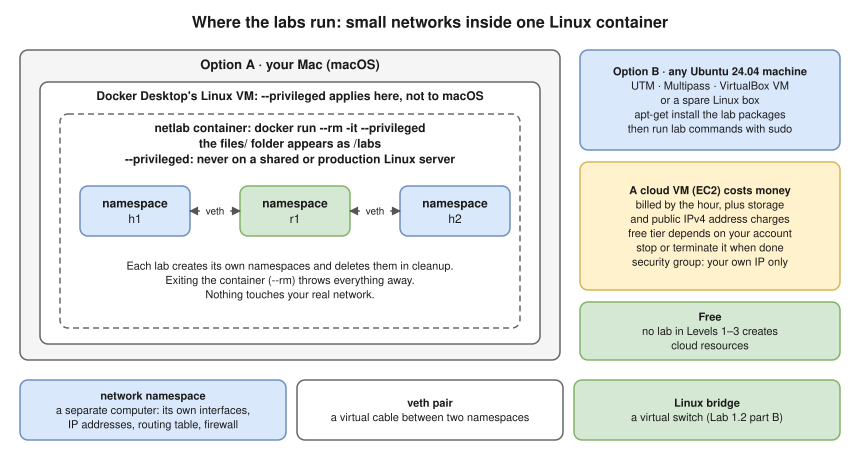

# Lab Environment Setup

> **Do this once** before the Linux labs. ⏱️ about 20 minutes (estimate), most of it waiting for the image to download.



- Each **network namespace** is a separate "computer": its own interfaces, IP addresses, routing table and firewall. A **veth pair** is a virtual cable; a **Linux bridge** is a virtual switch. Nothing touches your real network, and deleting the namespaces removes everything.
- **💰 Free.** Everything runs locally. No lab in Levels 1–3 creates cloud resources.
- `--privileged` lets the container create namespaces and firewall rules. That power applies to **Docker Desktop's Linux VM**, not to macOS. Don't run these labs with `--privileged` on a shared or production Linux server.
- Every lab ends with a **🧹 cleanup** step. Exiting the container (started with `--rm`) also throws everything away.

## Option A (recommended on a Mac): a Docker container

You already have Docker Desktop for the Docker labs.

1. Go to the labs folder:

   ```bash
   cd interview-prep/networking/13-hands-on-labs
   ```

2. Build the image from [files/netlab/Dockerfile](files/netlab/Dockerfile):

   ```bash
   docker build -t netlab files/netlab
   ```

3. Start a lab shell (the `files/` folder appears as `/labs` inside):

   ```bash
   docker run --rm -it --privileged --hostname netlab -v "$PWD/files:/labs" netlab
   ```

4. Check that namespaces work:

   ```bash
   ip netns add test && ip netns list && ip netns del test
   ```

   Expected: it prints `test`, and no errors.

> **Honest note.** Tested in an **Ubuntu 24.04 container with kernel 6.18** with the same packages (versions in the Dockerfile's header). The Dockerfile itself was **not built** during testing (no Docker daemon there). If a package name has changed, `apt-get` will say so: install the closest equivalent.

## Option B: any Ubuntu 24.04 machine

A local VM (UTM, Multipass, VirtualBox) or a spare Linux box works the same way:

```bash
sudo apt-get update
sudo apt-get install -y iproute2 iputils-ping iputils-tracepath traceroute mtr-tiny tcpdump tshark \
  curl netcat-openbsd dnsmasq-base isc-dhcp-client bind9 bind9-dnsutils openssl faketime \
  iptables nftables conntrack iperf3 ipcalc ethtool python3
```

Then run every lab command with `sudo` (or from `sudo -i`).

> ⚠️ **Cloud VMs cost money.** An EC2 instance works, but it's billed by the hour (plus storage and public IPv4 address charges), and free-tier eligibility depends on your account. Stop or terminate it when you finish, and never open its security group wider than your own IP.

## Conventions used in every lab

| Convention | Meaning |
|---|---|
| `$ command` | Run it in the lab shell (as root in the container) |
| `ip netns exec h1 <command>` | Run `<command>` **inside** the namespace `h1` (as if logged in to that computer) |
| `ip -n h1 <ip-command>` | Short form for `ip` commands only |
| **Expected (tested)** | Output captured when the lab was tested in the container described above. MAC addresses, ports, sequence numbers and timings will differ for you |
| **Expected (illustrative)** | Representative output that was **not** captured; the shape is right, details may differ |
| 🧹 Cleanup | Always run it, or the next lab may fail with "File exists" |

## If something goes wrong

| Problem | Fix |
|---|---|
| `Cannot create namespace file … Operation not permitted` | The container isn't privileged: restart it with `--privileged` |
| `RTNETLINK answers: File exists` | A previous lab wasn't cleaned up: `ip -all netns delete` (deletes **all** namespaces in the lab container) |
| `tcpdump: … Operation not permitted` | Run as root (in the container you are) |
| `curl` reaches out to a proxy | Your environment has `http_proxy` set: `unset http_proxy https_proxy HTTP_PROXY HTTPS_PROXY` |
| A background server keeps running after a lab | `ip netns pids <ns> \| xargs -r kill` before deleting the namespace |

➡️ **Next:** [Lab 1.1 · Inspect your own network](lab-01.1-inspect-your-own-network.md) (on your Mac, no container needed) or back to the [lab index](README.md).
