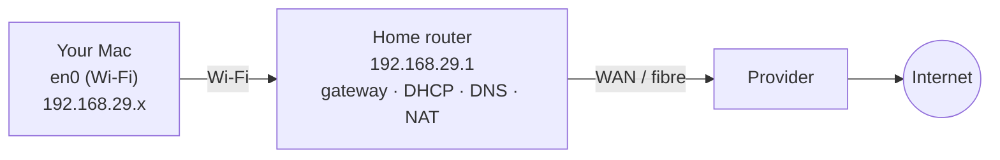

# Lab 1.1 · Inspect Your Own Network

> **Level 1** · ⏱️ about 20 minutes (estimate) · 💻 your Mac (and optionally any Linux machine) · 💰 free
> Related lessons: [1.1](../01-networking-fundamentals/01-what-is-a-network.md) · [1.2](../01-networking-fundamentals/02-network-devices.md) · [1.3](../01-networking-fundamentals/03-addresses-ports-and-protocols.md)

## Objective

Find, on your own machine: your **interfaces**, **MAC** and **IP addresses**, your **default gateway**, your **DNS servers**, your **public IP**, and the **programs listening** for connections. Then draw your home network.

## Prerequisites

- Lessons 1.1–1.3.
- A terminal on your Mac. Nothing to install.

## Tools

`ifconfig`, `ipconfig`, `networksetup`, `route`, `netstat`, `scutil`, `arp`, `lsof`, `ping`, `curl` (all built into macOS). Linux equivalents are given in each step.

## Topology



(The addresses are the ones seen on the author's Mac; yours may differ.)

## Steps

### 1. Your interfaces and their addresses

```bash
ifconfig en0                         # Wi-Fi: look for 'ether' (MAC), 'inet' (IPv4), 'inet6' (IPv6)
ipconfig getifaddr en0               # just the IPv4 address
networksetup -listallhardwareports   # which device name is Wi-Fi, which is Ethernet
```

**Linux:** `ip -br addr` and `ip -br link`.

**Expected (tested on the Mac, Oct 2026):** an IPv4 address in `192.168.29.0/24` on `en0`, plus IPv6 addresses. On a Linux lab container **(tested in the lab container)**:

```text
lo               UNKNOWN        127.0.0.1/8
eth0             UP             192.0.2.2/24
```

✍️ Write down: your interface name, MAC, IPv4 address and prefix length.

### 2. Your default gateway and routing table

```bash
route -n get default                 # the gateway and the interface used
netstat -rn -f inet | head -15       # the IPv4 routing table
```

**Linux:** `ip route` and `ip route get 8.8.8.8`.

**Expected:** on the author's Mac the gateway was `192.168.29.1` **(tested on the Mac, Oct 2026)**. In the Linux lab container **(tested in the lab container)**:

```text
default via 192.0.2.1 dev eth0
192.0.2.0/24 dev eth0 proto kernel scope link src 192.0.2.2
```

✍️ Write down: your gateway's IP.

### 3. The gateway's MAC address (ARP)

```bash
ping -c 2 192.168.29.1               # use YOUR gateway's IP
arp -a | head                        # the IP → MAC table
```

**Linux:** `ip neigh`.

**Expected:** an entry for your gateway with a MAC address. In the lab container **(tested in the lab container)**: `192.0.2.1 dev eth0 lladdr 02:fc:00:00:00:05 REACHABLE`.

### 4. Your DNS servers

```bash
scutil --dns | grep nameserver | sort -u
```

**Linux:** `cat /etc/resolv.conf` (or `resolvectl status` on systemd-resolved).

**Expected (tested on the Mac, Oct 2026):** the router, both as `192.168.29.1` and as an IPv6 address ending in `c0a8:1d01` (which is `192.168.29.1` in hex: see [2.1](../02-ip-addressing-and-subnetting/01-binary-decimal-and-hex.md)).

### 5. Your public IP (as the internet sees you)

```bash
curl -s https://ifconfig.me ; echo
```

**Expected:** a public address that is **not** your `192.168.x.x` address. That difference is **NAT** at your router ([3.8](../03-core-networking-protocols/08-nat-pat-and-port-forwarding.md)).

### 6. What's listening on your machine

```bash
lsof -nP -iTCP -sTCP:LISTEN
```

**Linux:** `ss -tlnp`.

**Expected:** a few programs. For each, note whether the local address is `127.0.0.1` (only this machine can connect) or `*` / `0.0.0.0` (anyone who can reach you can connect). See [1.3](../01-networking-fundamentals/03-addresses-ports-and-protocols.md).

### 7. Reachability

```bash
ping -c 3 192.168.29.1               # your gateway (LAN)
ping -c 3 8.8.8.8                    # the internet, by IP
ping -c 3 google.com                 # the internet, by name (needs DNS too)
```

Compare the `time=` values: the gateway should be a few milliseconds over Wi-Fi; the internet tens of milliseconds.

## Expected results

You have filled in this table for your own machine:

| Item | Your value |
|---|---|
| Interface / MAC | |
| IPv4 address / prefix | |
| Default gateway (IP and MAC) | |
| DNS servers | |
| Public IP | |
| Listening programs (and on which address) | |
| RTT to gateway / to 8.8.8.8 | |

## Verification

- Your IPv4 address and your gateway are in the **same subnet** (same first three octets for a `/24`).
- `ping 8.8.8.8` works. If `ping google.com` fails while `ping 8.8.8.8` works, DNS is the problem.
- The public IP differs from your private IP.

## Troubleshooting

| Problem | Likely cause |
|---|---|
| `ipconfig getifaddr en0` prints nothing | You're on Ethernet or another interface; use `networksetup -listallhardwareports` |
| Your IP starts with `169.254.` | DHCP failed ([2.8](../02-ip-addressing-and-subnetting/08-dhcp.md)) |
| `ping 8.8.8.8` fails but browsing works | ICMP blocked on your network, or a VPN/proxy is in use |
| The MAC in `ifconfig` differs from the one printed on your Mac's label | macOS can use a **private (randomised) Wi-Fi address** per network |

## 🧹 Cleanup

Nothing to clean up: this lab only reads settings.

## Challenges

1. Turn off Wi-Fi and connect by Ethernet (or your phone's hotspot). Which values in your table change, and which stay the same?
2. Find your router's WAN (internet-side) address in its admin page. Is it the same as your public IP? If not, your provider uses **CGNAT**.
3. Draw your home network with every device you own, labelled with which are LAN, WAN and internet.
