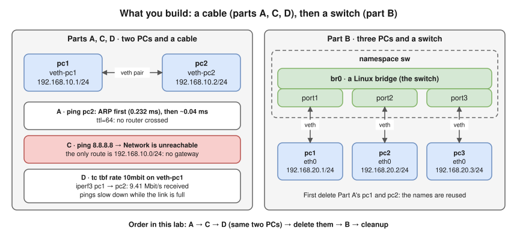
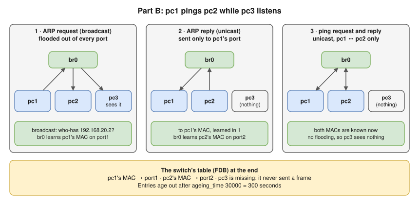

# Lab 1.2 · Build a Tiny Network with Namespaces

> **Level 1** · ⏱️ about 45 minutes (estimate) · 🐧 Linux lab container ([setup](00-lab-environment-setup.md)) · 💰 free
> Lessons: [1.2](../01-networking-fundamentals/02-network-devices.md) · [1.3](../01-networking-fundamentals/03-addresses-ports-and-protocols.md) · [1.4](../01-networking-fundamentals/04-network-performance.md) (part D) · [3.1](../03-core-networking-protocols/01-ethernet-and-switching-basics.md) · Tools: `ip`, `bridge`, `ping`, `tcpdump`, `tc`, `iperf3`



- **A:** two PCs and a cable: ping works, and an ARP entry appears only after the first packet.
- **C:** no gateway → `Network is unreachable`. **D:** a 10 Mbit/s limit measures about 9.4 Mbit/s, and RTT rises from ~0.04 ms to milliseconds under load.
- **B:** a switch: the third PC sees the broadcast but not the unicast conversation; the FDB has two entries.

## Part A · Two PCs and a cable

1. Create two empty "computers":

   ```bash
   ip netns add pc1
   ip netns add pc2
   ip netns exec pc1 ip addr
   ```

   **Expected (tested):** only a loopback interface, and it's down. A new namespace has **no network at all**.

   ```text
   1: lo: <LOOPBACK> mtu 65536 qdisc noop state DOWN group default qlen 1000
       link/loopback 00:00:00:00:00:00 brd 00:00:00:00:00:00
   ```

2. Create a virtual cable (a **veth pair**) and plug one end into each PC:

   ```bash
   ip link add veth-pc1 type veth peer name veth-pc2
   ip link set veth-pc1 netns pc1
   ip link set veth-pc2 netns pc2
   ```

3. Give each end an IP address in the same subnet, and switch them on:

   ```bash
   ip netns exec pc1 ip addr add 192.168.10.1/24 dev veth-pc1
   ip netns exec pc2 ip addr add 192.168.10.2/24 dev veth-pc2
   ip netns exec pc1 ip link set veth-pc1 up
   ip netns exec pc2 ip link set veth-pc2 up
   ip netns exec pc1 ip addr show veth-pc1
   ```

   **Expected (tested; your MAC will differ):** the MAC (`link/ether`), the IP (`inet`) and the MTU (1500):

   ```text
   10: veth-pc1@if9: <BROADCAST,MULTICAST,UP,LOWER_UP> mtu 1500 qdisc noqueue state UP group default qlen 1000
       link/ether 6a:f8:20:04:77:d2 brd ff:ff:ff:ff:ff:ff link-netns pc2
       inet 192.168.10.1/24 scope global veth-pc1
   ```

4. Look at pc1's neighbour (ARP) table, ping pc2, and look again:

   ```bash
   ip netns exec pc1 ip neigh
   ip netns exec pc1 ping -c 3 192.168.10.2
   ip netns exec pc1 ip neigh
   ip netns exec pc1 ip route
   ```

   **Expected (tested):** the first `ip neigh` prints **nothing**. Then:

   ```text
   64 bytes from 192.168.10.2: icmp_seq=1 ttl=64 time=0.232 ms
   64 bytes from 192.168.10.2: icmp_seq=2 ttl=64 time=0.041 ms
   64 bytes from 192.168.10.2: icmp_seq=3 ttl=64 time=0.042 ms
   ...
   192.168.10.2 dev veth-pc1 lladdr 8a:42:86:71:be:6b REACHABLE
   192.168.10.0/24 dev veth-pc1 proto kernel scope link src 192.168.10.1
   ```

   - The first ping is slower (0.232 ms): it waited for **ARP**. Afterwards pc1 knows pc2's MAC.
   - `ttl=64`: no router was crossed.

## Part C · Outside the subnet, with no gateway

(Uses Part A's PCs, so do it before cleaning up.)

```bash
ip netns exec pc1 ping -c 1 8.8.8.8
```

**Expected (tested):**

```text
ping: connect: Network is unreachable
```

pc1's only route is its own subnet. With no default gateway, it doesn't even try ([2.7](../02-ip-addressing-and-subnetting/07-default-gateway-routing-table-and-arp.md)).

## Part D · Bandwidth and latency under load

(Also uses Part A's PCs.)

1. Measure the unlimited virtual link:

   ```bash
   ip netns exec pc2 iperf3 -s -D -1          # server: run in the background, exit after one test
   ip netns exec pc1 iperf3 -c 192.168.10.2 -t 3
   ```

   **Expected (tested):** several **gigabits** per second, since it's all in memory (8.79 Gbits/sec in this run).

2. Limit pc1's sending side to 10 Mbit/s with a token-bucket filter, and measure again:

   ```bash
   ip netns exec pc1 tc qdisc add dev veth-pc1 root tbf rate 10mbit burst 32kbit latency 400ms
   ip netns exec pc2 iperf3 -s -D -1
   ip netns exec pc1 iperf3 -c 192.168.10.2 -t 4
   ```

   **Expected (tested):**

   ```text
   [  5]   0.00-4.00   sec  6.00 MBytes  12.6 Mbits/sec    0             sender
   [  5]   0.00-4.01   sec  4.50 MBytes  9.41 Mbits/sec                  receiver
   ```

   - Trust the **receiver** line: **9.41 Mbit/s**, just under the limit (headers take the rest). The sender counts data still sitting in buffers.
   - 4.50 **MBytes** in 4 s ≈ 1.1 MB/s: **bits vs bytes** ([1.4](../01-networking-fundamentals/04-network-performance.md)).

3. Compare latency when idle and when the link is full:

   ```bash
   ip netns exec pc1 ping -c 5 -i 0.2 192.168.10.2 | tail -1
   ip netns exec pc2 iperf3 -s -D -1
   ip netns exec pc1 iperf3 -c 192.168.10.2 -t 6 > /dev/null &
   sleep 1; ip netns exec pc1 ping -c 10 -i 0.2 192.168.10.2 | tail -1; wait $!
   ```

   **Expected (tested; numbers vary a lot between runs):**

   ```text
   rtt min/avg/max/mdev = 0.031/0.043/0.051/0.007 ms          ← idle
   rtt min/avg/max/mdev = 5.178/41.610/172.009/65.054 ms      ← while iperf3 fills the link
   ```

   The pings queue behind the bulk data: **bufferbloat**. In another run the busy average was about 5 ms; it depends on how full the queue happens to be.

4. Remove the limit:

   ```bash
   ip netns exec pc1 tc qdisc del dev veth-pc1 root
   ```

## Part B · Three PCs and a switch

First remove Part A's PCs (they reuse the names):

```bash
ip netns del pc1; ip netns del pc2
```

1. Build the switch and plug in three PCs:

   ```bash
   ip netns add sw
   ip netns exec sw ip link add br0 type bridge
   ip netns exec sw ip link set br0 up
   for i in 1 2 3; do
     ip netns add pc$i
     ip link add eth0 netns pc$i type veth peer name port$i netns sw
     ip netns exec sw ip link set port$i master br0
     ip netns exec sw ip link set port$i up
     ip netns exec pc$i ip addr add 192.168.20.$i/24 dev eth0
     ip netns exec pc$i ip link set eth0 up
     ip netns exec pc$i ip link set lo up
   done
   ip netns exec sw bridge link
   ```

   **Expected (tested):** three ports, all `state forwarding`:

   ```text
   3: port1@br0: <BROADCAST,MULTICAST,UP,LOWER_UP> mtu 1500 master br0 state forwarding priority 32 cost 2
   4: port2@br0: <BROADCAST,MULTICAST,UP,LOWER_UP> mtu 1500 master br0 state forwarding priority 32 cost 2
   5: port3@br0: <BROADCAST,MULTICAST,UP,LOWER_UP> mtu 1500 master br0 state forwarding priority 32 cost 2
   ```

2. Note each PC's MAC, and check the switch's learned table (empty so far):

   ```bash
   for i in 1 2 3; do echo -n "pc$i "; ip netns exec pc$i cat /sys/class/net/eth0/address; done
   ip netns exec sw bridge fdb show br br0 | grep -v permanent
   ```

3. Make pc3 listen, then have pc1 ping pc2:

   ```bash
   ip netns exec pc3 timeout 4 tcpdump -i eth0 -e -nn -l arp or icmp > /tmp/pc3.txt 2>/dev/null &
   sleep 1
   ip netns exec pc1 ping -c 1 192.168.20.2
   sleep 3; cat /tmp/pc3.txt
   ```

   **Expected (tested):** pc3 saw **only** the ARP broadcast:

   ```text
   76:32:69:66:e4:b9 > ff:ff:ff:ff:ff:ff, ethertype ARP (0x0806), length 42: Request who-has 192.168.20.2 tell 192.168.20.1, length 28
   ```

   

4. Look at what the switch learned:

   ```bash
   ip netns exec sw bridge fdb show br br0 | grep -v permanent
   ip netns exec sw cat /sys/class/net/br0/bridge/ageing_time
   ```

   **Expected (tested):**

   ```text
   76:32:69:66:e4:b9 dev port1 master br0
   aa:94:ac:4b:59:f0 dev port2 master br0
   30000
   ```

   pc1 and pc2 were learned on their ports; pc3 wasn't (it never sent anything). Ageing time 30000 = 300 seconds.

## Verification

```bash
ip netns list                                   # the namespaces you created
ip netns exec sw bridge fdb show br br0 | grep -c "master br0"
```

## Troubleshooting

| Problem | Fix |
|---|---|
| `ping` says `Network is unreachable` in Part A | The interface is down or has no address: re-run step 3 |
| `RTNETLINK answers: File exists` | Names from an earlier run still exist: see cleanup |
| `iperf3: error - unable to connect to server` | The server exited after one test (`-1`); start it again before each client run |
| `tcpdump` file is empty | You pinged before tcpdump started: keep the `sleep 1` |

## 🧹 Cleanup

```bash
for n in pc1 pc2 pc3 sw; do ip netns del $n 2>/dev/null; done
ip netns list            # should print nothing
rm -f /tmp/pc3.txt
```

## Challenges

1. In Part B, run `ip netns exec pc1 ping -c 1 192.168.20.3` and check that pc2 now sees a broadcast. Why does the FDB gain pc3?
2. Ping pc2 from pc1 every second, then delete and recreate pc2's link. How long until pings work again, and why (think ARP cache and FDB ageing)?
3. Add a fourth PC with an address in **another** subnet (`192.168.30.4/24`). Can it ping pc1? Which error do you get, and what would you need to fix it?
