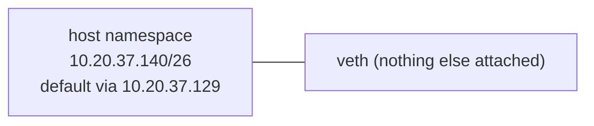

# Lab 2.1 · Subnetting by Hand, Then Verify 🔥

> **Level 2** · ⏱️ about 60 minutes (estimate) · 📝 paper + 🐍 Python 3 (Mac or Linux) + optional 🐧 lab container · 💰 free
> Related lessons: [2.2](../02-ip-addressing-and-subnetting/02-ipv4-addresses-and-ranges.md) · [2.3](../02-ip-addressing-and-subnetting/03-subnet-masks-and-cidr.md) · [2.4](../02-ip-addressing-and-subnetting/04-subnetting-step-by-step.md) · [2.5](../02-ip-addressing-and-subnetting/05-vlsm-and-route-summarization.md)

## Objective

Do subnetting **on paper first**, then check every answer with a tool, so you learn the method and find your own mistakes.

- **Part A:** classify addresses (private, public, special).
- **Part B:** find network, broadcast, host range and usable count for 10 addresses; then watch a Linux host make the "local or remote?" decision.
- **Part C:** build a VLSM plan, check it for overlaps, and test two summaries.

## Prerequisites

- Lessons 2.2–2.5.
- Python 3 (built into macOS and Linux). `ipcalc` is optional (`brew install ipcalc` on a Mac; it's in the lab container).

## Tools

- [files/lab-02.1/subnet_check.py](files/lab-02.1/subnet_check.py): a small checker using only Python's standard `ipaddress` module.
- `ipcalc`: prints the binary, which helps you see *why* an answer is right.

## Topology

None for parts A and C. Part B's last step uses one namespace with one interface:



## Steps

> ✍️ **Rule for this lab:** write every answer on paper **before** running a command. Score yourself honestly.

### Part A · Classify these addresses

For each: private (RFC 1918), public, or special (loopback, link-local, CGNAT, multicast)?

`10.1.2.3` · `172.32.0.1` · `172.31.255.254` · `192.168.1.1` · `100.64.3.7` · `169.254.169.254` · `127.0.0.1` · `8.8.8.8` · `224.0.0.5`

Then check:

```bash
cd interview-prep/networking/13-hands-on-labs/files/lab-02.1     # or /labs/lab-02.1 in the container
python3 subnet_check.py --classify 10.1.2.3 172.32.0.1 172.31.255.254 192.168.1.1 100.64.3.7 169.254.169.254 127.0.0.1 8.8.8.8 224.0.0.5
```

**Expected (tested in the lab container, Python 3.13):**

```text
10.1.2.3           global=False  private (RFC 1918)
172.32.0.1         global=True   public
172.31.255.254     global=False  private (RFC 1918)
192.168.1.1        global=False  private (RFC 1918)
100.64.3.7         global=False  shared/CGNAT (RFC 6598)
169.254.169.254    global=False  link_local
127.0.0.1          global=False  loopback
8.8.8.8            global=True   public
224.0.0.5          global=True   multicast
```

The trap: `172.32.0.1` is **public**: the private block is only `172.16.0.0`–`172.31.255.255`.

### Part B · Ten subnets on paper

For each, write: **network address, broadcast address, first and last host, usable hosts**, and usable hosts **in an AWS subnet** (5 reserved) where AWS allows the size.

1. `10.20.37.140/26`
2. `192.168.5.77/27`
3. `172.16.200.9/20`
4. `10.0.0.5/31`
5. `192.168.100.200/25`
6. `10.1.1.1/30`
7. `172.20.15.255/21`
8. `10.10.10.10/28`
9. `192.168.0.130/29`
10. `10.255.0.1/16`

Check them all at once:

```bash
python3 subnet_check.py 10.20.37.140/26 192.168.5.77/27 172.16.200.9/20 10.0.0.5/31 192.168.100.200/25 10.1.1.1/30 172.20.15.255/21 10.10.10.10/28 192.168.0.130/29 10.255.0.1/16
```

**Expected (tested), first answer shown:**

```text
10.20.37.140/26
  network    10.20.37.128/26   mask 255.255.255.192   wildcard 0.0.0.63
  broadcast  10.20.37.191
  hosts      10.20.37.129 - 10.20.37.190   usable 62   (in an AWS subnet: 59)
```

Then look at one in binary to see the boundary between network and host bits:

```bash
ipcalc -n 10.20.37.140/26
```

**Expected (tested):**

```text
Address:   10.20.37.140         00001010.00010100.00100101.10 001100
Netmask:   255.255.255.192 = 26 11111111.11111111.11111111.11 000000
Network:   10.20.37.128/26      00001010.00010100.00100101.10 000000
Broadcast: 10.20.37.191         00001010.00010100.00100101.10 111111
Hosts/Net: 62                    Class A, Private Internet
```

<details>
<summary><b>All ten answers</b> (generated by the script; check yours first)</summary>

| # | Network | Broadcast | Hosts | Usable | AWS usable |
|---|---|---|---|---|---|
| 1 | `10.20.37.128/26` | `10.20.37.191` | `.129`–`.190` | 62 | 59 |
| 2 | `192.168.5.64/27` | `192.168.5.95` | `.65`–`.94` | 30 | 27 |
| 3 | `172.16.192.0/20` | `172.16.207.255` | `172.16.192.1`–`172.16.207.254` | 4094 | 4091 |
| 4 | `10.0.0.4/31` | none (RFC 3021) | `10.0.0.4`–`10.0.0.5` | 2 | n/a |
| 5 | `192.168.100.128/25` | `192.168.100.255` | `.129`–`.254` | 126 | 123 |
| 6 | `10.1.1.0/30` | `10.1.1.3` | `.1`–`.2` | 2 | n/a |
| 7 | `172.20.8.0/21` | `172.20.15.255` | `172.20.8.1`–`172.20.15.254` | 2046 | 2043 |
| 8 | `10.10.10.0/28` | `10.10.10.15` | `.1`–`.14` | 14 | 11 |
| 9 | `192.168.0.128/29` | `192.168.0.135` | `.129`–`.134` | 6 | n/a (smaller than /28) |
| 10 | `10.255.0.0/16` | `10.255.255.255` | `10.255.0.1`–`10.255.255.254` | 65534 | 65531 |

Note #7: `172.20.15.255` **is** the broadcast address of its `/21`, so it isn't a valid host address.

</details>

**Local or remote? (lab container).** Give a namespace the address from question 1 and ask the kernel how it would reach some destinations:

```bash
ip netns add host
ip -n host link add veth0 type veth peer name veth1
ip -n host addr add 10.20.37.140/26 dev veth0
ip -n host link set veth0 up; ip -n host link set veth1 up
ip -n host route add default via 10.20.37.129
for d in 10.20.37.150 10.20.37.190 10.20.37.191 10.20.37.200 10.20.38.1; do ip netns exec host ip route get $d | head -1; done
```

**Expected (tested):**

```text
10.20.37.150 dev veth0 src 10.20.37.140 uid 0
10.20.37.190 dev veth0 src 10.20.37.140 uid 0
broadcast 10.20.37.191 dev veth0 src 10.20.37.140 uid 0
10.20.37.200 via 10.20.37.129 dev veth0 src 10.20.37.140 uid 0
10.20.38.1 via 10.20.37.129 dev veth0 src 10.20.37.140 uid 0
```

Inside the `/26` → delivered directly; `.191` → recognised as the **broadcast**; `.200` (looks close, but it's in the next `/26`) → **via the gateway**.

### Part C · A VLSM plan and two summaries

1. On paper, split `192.168.1.0/24` (largest first) for: **100 hosts**, **50 hosts**, **20 hosts**, and **two point-to-point links**.
2. Check that your plan has no overlaps (put **your** subnets in the command):

   ```bash
   python3 subnet_check.py --overlap 192.168.1.0/25 192.168.1.128/26 192.168.1.192/27 192.168.1.224/30 192.168.1.228/30
   ```

   **Expected (tested) for this plan:** `overlaps: none`. The free space left is `192.168.1.232/29` and `192.168.1.240/28`.

3. On paper: can `172.16.8.0/24` … `172.16.15.0/24` (8 networks) be summarised as one route? And `192.168.5.0/24` … `192.168.8.0/24` (4 networks)?
4. Check:

   ```bash
   python3 subnet_check.py --summarise 172.16.8.0/24 172.16.9.0/24 172.16.10.0/24 172.16.11.0/24 172.16.12.0/24 172.16.13.0/24 172.16.14.0/24 172.16.15.0/24
   python3 subnet_check.py --summarise 192.168.5.0/24 192.168.6.0/24 192.168.7.0/24 192.168.8.0/24
   ```

   **Expected (tested):**

   ```text
   exact summary: ['172.16.8.0/21']
   exact summary: ['192.168.5.0/24', '192.168.6.0/23', '192.168.8.0/24']
   ```

   The second set **can't** be one route: 5 isn't a multiple of 4, so it straddles two `/22` blocks ([2.5](../02-ip-addressing-and-subnetting/05-vlsm-and-route-summarization.md)).

## Expected results

- Part A: 9/9 correct.
- Part B: 10/10 correct for network, broadcast and usable count.
- Part C: a plan with no overlaps, and the correct summary/non-summary.

## Verification

Score yourself: **below 100% on Part B means more drills**, not more reading. Go to the [Level 2 drills](../14-practice-exercises/02-level-2-subnetting-drills.md).

## Troubleshooting

| Problem | Fix |
|---|---|
| `ValueError: … has host bits set` | You passed an address with host bits as a **network** to `--overlap`/`--summarise` (e.g. `10.0.5.0/22`). Use the real network address (`10.0.4.0/22`) |
| `ipcalc: command not found` | Optional; on a Mac `brew install ipcalc`, or skip it |
| `RTNETLINK answers: File exists` in Part B | `ip netns del host` and try again |

## 🧹 Cleanup

```bash
ip netns del host 2>/dev/null; ip netns list
```

## Challenges

1. Re-do Part B with a stopwatch. Target: under 60 seconds per question.
2. Plan `10.0.0.0/16` for 3 AZs × (public `/24`, app `/20`, data `/24`), as in [2.4](../02-ip-addressing-and-subnetting/04-subnetting-step-by-step.md), and verify with `--overlap`.
3. Extend `subnet_check.py` to print the next subnet of the same size (hint: `net.broadcast_address + 1`).
