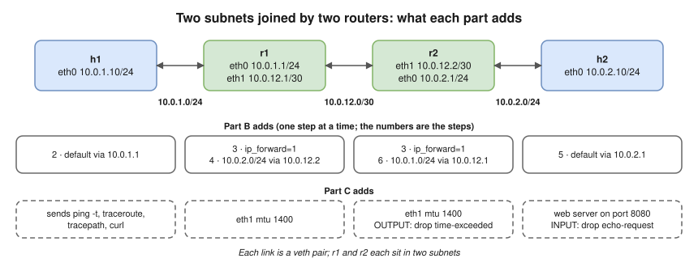
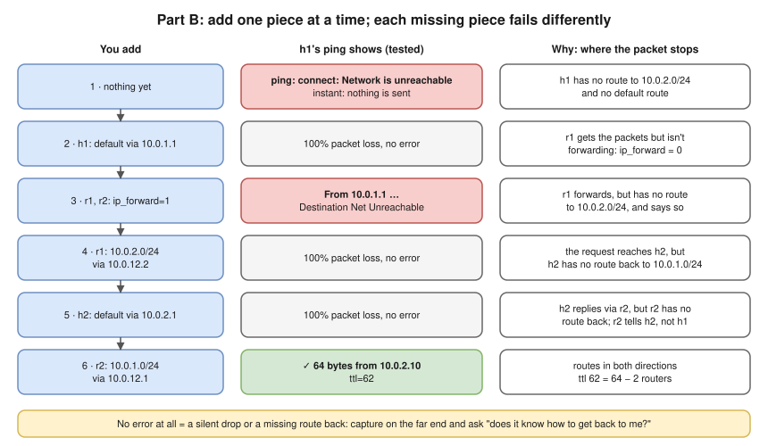
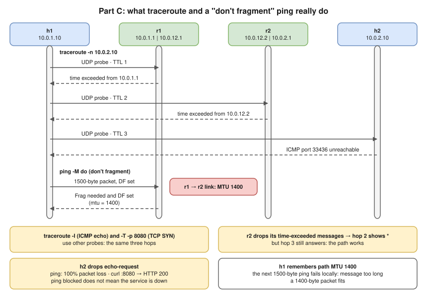

# Lab 2.2 · Routing Between Two Subnets

> **Level 2** · ⏱️ about 45 minutes, plus 20 for part C (estimate) · 🐧 Linux lab container ([setup](00-lab-environment-setup.md)) · 💰 free
> Lessons: [2.7](../02-ip-addressing-and-subnetting/07-default-gateway-routing-table-and-arp.md) · [3.7](../03-core-networking-protocols/07-icmp-ping-and-traceroute.md) · [3.11](../03-core-networking-protocols/11-troubleshooting-connectivity.md) · Tools: `ip`, `sysctl`, `ping`, `tcpdump`, `traceroute`, `tracepath`, `iptables`, `python3` (as a tiny web server)



- **A:** build two subnets joined by two routers. **B:** make `h1` reach `h2` one fix at a time and read the **different error** each missing piece produces.
- You'll see all three "unreachable" situations: no local route (instant error), a router without a route (`Destination Net Unreachable`), a missing return route (silence).
- **C:** TTL, `traceroute` (UDP, ICMP, TCP) in a capture, a silent hop, and path MTU discovery working when ICMP is allowed.

## Part A · Build it

```bash
for n in h1 r1 r2 h2; do ip netns add $n; ip netns exec $n ip link set lo up; done
ip link add eth0 netns h1 type veth peer name eth0 netns r1     # h1 <-> r1
ip link add eth1 netns r1 type veth peer name eth1 netns r2     # r1 <-> r2
ip link add eth0 netns r2 type veth peer name eth0 netns h2     # r2 <-> h2
ip -n h1 addr add 10.0.1.10/24 dev eth0
ip -n r1 addr add 10.0.1.1/24  dev eth0
ip -n r1 addr add 10.0.12.1/30 dev eth1
ip -n r2 addr add 10.0.12.2/30 dev eth1
ip -n r2 addr add 10.0.2.1/24  dev eth0
ip -n h2 addr add 10.0.2.10/24 dev eth0
for n in h1 r1 r2 h2; do for i in eth0 eth1; do ip -n $n link set $i up 2>/dev/null; done; done
ip -n h1 route
```

**Expected (tested):** only the connected route:

```text
10.0.1.0/24 dev eth0 proto kernel scope link src 10.0.1.10
```

## Part B · Fix it one step at a time

Run the same test after every step and **write down the exact message** before looking at the ladder below:

```bash
ip netns exec h1 ping -c 2 -W 1 10.0.2.10
```

| Step | Do this | Expected (tested) |
|---|---|---|
| 1 | Nothing yet | `ping: connect: Network is unreachable` |
| 2 | `ip -n h1 route add default via 10.0.1.1` | `2 packets transmitted, 0 received, 100% packet loss` (no error). Check: `ip netns exec r1 sysctl net.ipv4.ip_forward` → `0` |
| 3 | `ip netns exec r1 sysctl -w net.ipv4.ip_forward=1`<br/>`ip netns exec r2 sysctl -w net.ipv4.ip_forward=1` | `From 10.0.1.1 icmp_seq=1 Destination Net Unreachable` |
| 4 | `ip -n r1 route add 10.0.2.0/24 via 10.0.12.2` | `100% packet loss` (no error) |
| 5 | `ip -n h2 route add default via 10.0.2.1` | `100% packet loss` (no error) |
| 6 | `ip -n r2 route add 10.0.1.0/24 via 10.0.12.1` | `64 bytes from 10.0.2.10: icmp_seq=1 ttl=62 time=0.039 ms` ✅ |



**Prove steps 4 and 5 yourself** (on a fresh build, or delete the routes again). With no route back on h2, capture on h2 while h1 pings:

```bash
ip netns exec h2 timeout 4 tcpdump -i eth0 -nn icmp &
sleep 1; ip netns exec h1 ping -c 1 -W 1 10.0.2.10; wait $!
ip netns exec h2 ip route get 10.0.1.10
```

**Expected (tested):** the echo request arrives and nothing leaves; the kernel confirms it has no way back:

```text
IP 10.0.1.10 > 10.0.2.10: ICMP echo request, id 2080, seq 1, length 64
RTNETLINK answers: Network is unreachable
```

In step 5, r2 tells h2 (not h1!) about the problem, so only a capture on h2's side shows it **(tested)**:

```text
IP 10.0.2.10 > 10.0.1.10: ICMP echo reply, id 2090, seq 1, length 64
IP 10.0.2.1 > 10.0.2.10: ICMP net 10.0.1.10 unreachable, length 92
```

After step 6, look at the path and h1's tables:

```bash
ip netns exec h1 traceroute -n 10.0.2.10
ip netns exec h1 ip route get 10.0.2.10
ip netns exec h1 ip neigh
```

**Expected (tested; MACs will differ):** h1's neighbour table has the **gateway's** MAC, never h2's.

```text
 1  10.0.1.1  0.030 ms  0.003 ms  0.003 ms
 2  10.0.12.2  0.183 ms  0.006 ms  0.003 ms
 3  10.0.2.10  0.011 ms  0.005 ms  0.004 ms
10.0.2.10 via 10.0.1.1 dev eth0 src 10.0.1.10 uid 0
    cache
10.0.1.1 dev eth0 lladdr e2:42:f7:66:fc:1c REACHABLE
```

## Part C · TTL, traceroute and MTU

Everything below needs the working network from the end of Part B.



1. **TTL.** Send pings that are allowed only 1, then 2 hops:

   ```bash
   ip netns exec h1 ping -c 1 -t 1 10.0.2.10
   ip netns exec h1 ping -c 1 -t 2 10.0.2.10
   ```

   **Expected (tested):** `From 10.0.1.1 icmp_seq=1 Time to live exceeded`, then `From 10.0.12.2 icmp_seq=1 Time to live exceeded`.

2. **What traceroute sends.** Capture while tracing:

   ```bash
   ip netns exec h1 timeout 5 tcpdump -i eth0 -nn -l -v 'icmp or udp' > /tmp/tr.txt 2>/dev/null &
   sleep 1; ip netns exec h1 traceroute -n -q 1 10.0.2.10; sleep 4
   grep -E 'ttl [123],|ICMP' /tmp/tr.txt
   ```

   **Expected (tested, trimmed):** UDP probes with TTL 1, 2, 3; two `ICMP time exceeded in-transit` replies (from `10.0.1.1` and `10.0.12.2`), then `ICMP 10.0.2.10 udp port 33436 unreachable` from the destination.

3. **ICMP and TCP probes.** Start a web server on h2 and trace to its port:

   ```bash
   ip netns exec h2 python3 -m http.server 8080 > /dev/null 2>&1 &
   ip netns exec h1 traceroute -n -I -q 1 10.0.2.10            # ICMP echo probes
   ip netns exec h1 traceroute -n -T -p 8080 -q 1 10.0.2.10    # TCP SYN probes
   ```

   **Expected (tested):** the same three hops both times.

4. **A silent hop.** Make r2 stop sending time-exceeded messages:

   ```bash
   ip netns exec r2 iptables -A OUTPUT -p icmp --icmp-type time-exceeded -j DROP
   ip netns exec h1 traceroute -n -q 1 -w 1 10.0.2.10
   ip netns exec r2 iptables -F OUTPUT
   ```

   **Expected (tested):** hop 2 shows `*`, but hop 3 (`10.0.2.10`) still answers. The path works; one router just stays quiet.

5. **Ping blocked, service fine.**

   ```bash
   ip netns exec h2 iptables -A INPUT -p icmp --icmp-type echo-request -j DROP
   ip netns exec h1 ping -c 2 -W 1 10.0.2.10 | tail -2
   ip netns exec h1 curl -s -o /dev/null -w 'HTTP %{http_code}\n' http://10.0.2.10:8080/
   ip netns exec h2 iptables -F INPUT
   ```

   **Expected (tested):** `100% packet loss` from ping, and `HTTP 200` from curl.

6. **MTU.** Shrink the router-to-router link to 1400 bytes, then probe with "don't fragment" pings:

   ```bash
   ip -n r1 link set eth1 mtu 1400; ip -n r2 link set eth1 mtu 1400
   ip netns exec h1 ping -c 1 -M do -s 1472 10.0.2.10     # 1500-byte packet
   ip netns exec h1 ping -c 1 -M do -s 1472 10.0.2.10     # again
   ip netns exec h1 ping -c 1 -M do -s 1372 10.0.2.10     # 1400-byte packet
   ip netns exec h1 tracepath -n 10.0.2.10
   ```

   **Expected (tested):**

   ```text
   From 10.0.1.1 icmp_seq=1 Frag needed and DF set (mtu = 1400)
   ping: local error: message too long, mtu=1400
   1380 bytes from 10.0.2.10: icmp_seq=1 ttl=62 time=0.038 ms
   ...
        Resume: pmtu 1400 hops 3 back 3
   ```

   r1 refuses the first ping and reports the path's MTU; h1 **remembers** it, so the second fails locally; a 1400-byte packet fits.

## Verification

```bash
ip netns exec h1 ping -c 1 10.0.2.10 | grep ttl=62 && echo "routing OK"
for n in h1 r1 r2 h2; do echo "== $n"; ip -n $n route; done
```

## Troubleshooting

| Problem | Fix |
|---|---|
| `Error: Nexthop has invalid gateway.` when adding a route | The interface isn't up, or the gateway isn't on a connected subnet. Re-run the `link set up` loop |
| `traceroute -T` prints `socket: Operation not permitted` | It needs root; in the lab container you are root |
| Traceroute shows only stars after step 4 of Part C | You forgot `iptables -F OUTPUT` on r2 (or are still in Part B step 4/5) |
| Everything works from the start | Routes from a previous run are still there: clean up and rebuild |

## 🧹 Cleanup

```bash
for n in h1 r1 r2 h2; do ip netns pids $n | xargs -r kill 2>/dev/null; ip netns del $n 2>/dev/null; done
ip netns list
rm -f /tmp/tr.txt
```

## Challenges

1. Replace r1's specific route with a **default** route (`ip -n r1 route add default via 10.0.12.2`). Does everything still work? Why might a real network prefer specific routes?
2. Create a **routing loop**: add `10.0.9.0/24 via 10.0.12.2` on r1 and `10.0.9.0/24 via 10.0.12.1` on r2, then ping `10.0.9.9` from h1. When this was tested, the answer was `From 10.0.12.2 icmp_seq=1 Time to live exceeded`. Explain why, and why the TTL exists at all.
3. Add a second path (a third router) and use `traceroute` to show which one is used. Change a route and watch it switch.
