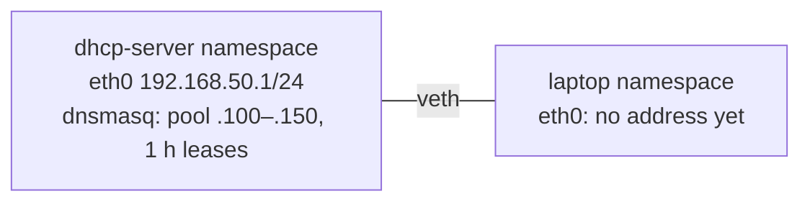

# Lab 2.3 · DHCP: Capture the DORA Exchange

> **Level 2** · ⏱️ about 30 minutes (estimate) · 🐧 Linux lab container ([setup](00-lab-environment-setup.md)) · 💰 free
> Related lesson: [2.8 · DHCP](../02-ip-addressing-and-subnetting/08-dhcp.md)

## Objective

Run a real DHCP server (`dnsmasq`) and client (`dhclient`) in two namespaces, capture **Discover, Offer, Request, Ack**, read the options and the lease, release the address, and see what a client does when no server answers.

## Prerequisites

- The [lab environment](00-lab-environment-setup.md) running.
- Lesson 2.8.

## Tools

`dnsmasq` (DHCP server), `dhclient` (ISC DHCP client), `tcpdump`, `ip`.

## Topology



## Steps

1. **Build the two namespaces and the cable.**

   ```bash
   ip netns add dhcp-server
   ip netns add laptop
   ip link add eth0 netns dhcp-server type veth peer name eth0 netns laptop
   ip -n dhcp-server addr add 192.168.50.1/24 dev eth0
   ip -n dhcp-server link set eth0 up
   ip -n laptop link set lo up
   ```

2. ⚠️ **Protect the container's own DNS settings.** `dhclient` writes the DNS server it receives into `/etc/resolv.conf`. Inside a namespace, `ip netns exec` uses `/etc/netns/<name>/resolv.conf` **if that file exists**; otherwise `dhclient` would overwrite the **container's** real `/etc/resolv.conf`. Create it first:

   ```bash
   mkdir -p /etc/netns/laptop
   echo "# placeholder, dhclient will replace this" > /etc/netns/laptop/resolv.conf
   ```

3. **Look at the laptop before DHCP.**

   ```bash
   ip -n laptop -br addr show eth0
   ```

   **Expected (tested):** `eth0@if2   DOWN` with no address.

4. **Try DHCP with no server running** (it gives up after the `timeout`).

   ```bash
   ip netns exec laptop timeout 25 dhclient -v -1 -pf /tmp/dhcp.pid -lf /tmp/dhcp.leases eth0 2>&1 | grep DHCP
   ```

   **Expected (tested):** Discovers with growing gaps, and no answer:

   ```text
   DHCPDISCOVER on eth0 to 255.255.255.255 port 67 interval 3 (xid=0x21d92f41)
   DHCPDISCOVER on eth0 to 255.255.255.255 port 67 interval 8 (xid=0x21d92f41)
   DHCPDISCOVER on eth0 to 255.255.255.255 port 67 interval 12 (xid=0x21d92f41)
   DHCPDISCOVER on eth0 to 255.255.255.255 port 67 interval 15 (xid=0x21d92f41)
   ```

   (A Mac or Windows laptop would now give itself a `169.254.x.x` address.)

5. **Start the DHCP server** (in the background, logging to a file):

   ```bash
   ip netns exec dhcp-server dnsmasq --no-daemon --conf-file=/dev/null \
     --interface=eth0 --bind-interfaces --port=0 \
     --dhcp-range=192.168.50.100,192.168.50.150,255.255.255.0,1h \
     --dhcp-option=option:router,192.168.50.1 \
     --dhcp-option=option:dns-server,192.168.50.1 \
     --dhcp-leasefile=/tmp/dnsmasq.leases --log-dhcp > /tmp/dnsmasq.log 2>&1 &
   ```

   `--port=0` turns off dnsmasq's DNS function: only DHCP runs.

6. **Capture, then ask for an address.**

   ```bash
   ip netns exec laptop timeout 20 tcpdump -i eth0 -nn -l -v 'udp port 67 or udp port 68' > /tmp/dora.txt 2>/dev/null &
   sleep 1
   ip netns exec laptop dhclient -v -1 -pf /tmp/dhcp.pid -lf /tmp/dhcp.leases eth0 2>&1 | grep -E 'DHCP|bound'
   ```

   **Expected (tested; the address and IDs may differ):** you'll see one or two Discovers before the Offer. Clients retry by design, so both are normal. In testing, the first Discover went unanswered in 4 of 10 runs, and never in 5 runs with dnsmasq's `--no-ping` option, so the likely cause is dnsmasq **pinging** the address before offering it, to check that nobody is already using it. This run needed two:

   ```text
   DHCPDISCOVER on eth0 to 255.255.255.255 port 67 interval 3 (xid=0xbaf0a29)
   DHCPDISCOVER on eth0 to 255.255.255.255 port 67 interval 5 (xid=0xbaf0a29)
   DHCPOFFER of 192.168.50.108 from 192.168.50.1
   DHCPREQUEST for 192.168.50.108 on eth0 to 255.255.255.255 port 67 (xid=0x290aaf0b)
   DHCPACK of 192.168.50.108 from 192.168.50.1 (xid=0xbaf0a29)
   bound to 192.168.50.108 -- renewal in 1503 seconds.
   ```

7. **See what DHCP configured.**

   ```bash
   ip -n laptop -br addr show eth0
   ip -n laptop route
   cat /etc/netns/laptop/resolv.conf
   cat /tmp/dnsmasq.leases
   ```

   **Expected (tested):**

   ```text
   eth0@if2         UP             192.168.50.108/24
   default via 192.168.50.1 dev eth0
   192.168.50.0/24 dev eth0 proto kernel scope link src 192.168.50.108
   nameserver 192.168.50.1
   1792010421 fe:25:0f:37:82:a2 192.168.50.108 vm *
   ```

   Address, default route **and** DNS server all came from one exchange.

8. **Read the capture** (wait for the `timeout 20` to finish first):

   ```bash
   grep -E 'BOOTP|DHCP-Message|Your-IP|Server-ID|Requested-IP|Lease-Time|RN|RB|Subnet-Mask|Default-Gateway|Domain-Name-Server' /tmp/dora.txt
   ```

   **Expected (tested in an earlier run, so the address differs):**

   ```text
   0.0.0.0.68 > 255.255.255.255.67: BOOTP/DHCP, Request from c2:ca:e3:9e:fd:85, length 300, xid 0x8ca96847, Flags [none]
       DHCP-Message (53), length 1: Discover
   192.168.50.1.67 > 192.168.50.128.68: BOOTP/DHCP, Reply, length 300, xid 0x8ca96847, Flags [none]
       Your-IP 192.168.50.128
       DHCP-Message (53), length 1: Offer
       Server-ID (54), length 4: 192.168.50.1
       Lease-Time (51), length 4: 3600
       RN (58), length 4: 1800
       RB (59), length 4: 3150
       Subnet-Mask (1), length 4: 255.255.255.0
       Domain-Name-Server (6), length 4: 192.168.50.1
       Default-Gateway (3), length 4: 192.168.50.1
   0.0.0.0.68 > 255.255.255.255.67: BOOTP/DHCP, Request from c2:ca:e3:9e:fd:85, length 300, xid 0x8ca96847, Flags [none]
       DHCP-Message (53), length 1: Request
       Server-ID (54), length 4: 192.168.50.1
       Requested-IP (50), length 4: 192.168.50.128
   192.168.50.1.67 > 192.168.50.128.68: BOOTP/DHCP, Reply, length 300, xid 0x8ca96847, Flags [none]
       DHCP-Message (53), length 1: ACK
   ```

   Find: the broadcast destination of Discover and Request; the **xid** tying all four together; **RN** = T1 (50% of 3600) and **RB** = T2 (87.5%).

9. **Release the address.**

   ```bash
   ip netns exec laptop dhclient -v -r -pf /tmp/dhcp.pid -lf /tmp/dhcp.leases eth0 2>&1 | grep DHCP
   ip -n laptop -br addr show eth0
   grep -E 'DHCP(DISCOVER|OFFER|REQUEST|ACK|RELEASE)' /tmp/dnsmasq.log
   ```

   **Expected (tested):** `DHCPRELEASE of 192.168.50.108 on eth0 to 192.168.50.1 port 67`, the interface has no address any more, and the server's log shows the whole story:

   ```text
   dnsmasq-dhcp: 196020777 DHCPDISCOVER(eth0) fe:25:0f:37:82:a2
   dnsmasq-dhcp: 196020777 DHCPOFFER(eth0) 192.168.50.108 fe:25:0f:37:82:a2
   dnsmasq-dhcp: 196020777 DHCPREQUEST(eth0) 192.168.50.108 fe:25:0f:37:82:a2
   dnsmasq-dhcp: 196020777 DHCPACK(eth0) 192.168.50.108 fe:25:0f:37:82:a2 vm
   dnsmasq-dhcp: 4206602068 DHCPRELEASE(eth0) 192.168.50.108 fe:25:0f:37:82:a2
   ```

## Expected results

- No server: repeated Discovers, no address.
- With the server: DORA completes; address, route and DNS are configured; the lease is recorded on both sides.
- Release: the address is removed and the server logs it.

## Verification

```bash
cat /etc/resolv.conf     # the CONTAINER's own file must be unchanged
```

If it now says `nameserver 192.168.50.1`, step 2 was skipped: restore it (in the tested environment it was `nameserver 8.8.8.8` / `nameserver 8.8.4.4`; yours may differ).

## Troubleshooting

| Problem | Fix |
|---|---|
| `dnsmasq: failed to bind DHCP server socket: Address in use` | Another dnsmasq is still running: `ip netns pids dhcp-server \| xargs -r kill` |
| The client never gets an Offer | Is dnsmasq running (`cat /tmp/dnsmasq.log`)? Is the server's `eth0` up with `192.168.50.1/24`? |
| `dhclient` hangs for a long time | It retries for 60 s by default with `-1`; use `timeout` as in step 4 |
| The container lost DNS | See Verification |

## 🧹 Cleanup

```bash
ip netns pids dhcp-server | xargs -r kill 2>/dev/null
ip netns pids laptop | xargs -r kill 2>/dev/null
ip netns del dhcp-server; ip netns del laptop
rm -rf /etc/netns/laptop /tmp/dora.txt /tmp/dnsmasq.log /tmp/dnsmasq.leases /tmp/dhcp.leases /tmp/dhcp.pid
ip netns list
```

## Challenges

1. Add a **reservation** so the laptop always gets `.142`: `--dhcp-host=<laptop MAC>,192.168.50.142`. Release and renew to prove it.
2. Shrink the pool to a single address (`.100,.100`) and add a second client namespace. What happens to the second client?
3. Start a **second (rogue) DHCP server** namespace on the same link (you'll need a bridge, as in [Lab 1.2](lab-01.2-build-a-tiny-network-with-namespaces.md) part B) handing out a different gateway. Which server wins? How would DHCP snooping on a switch prevent this?
