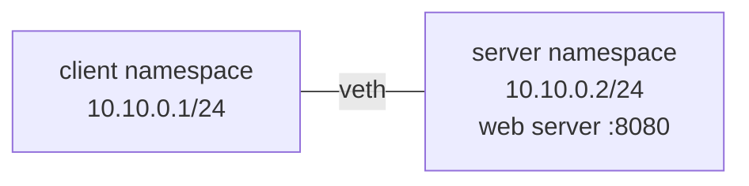

# Lab 3.1 · Capture a TCP Handshake

> **Level 3** · ⏱️ about 60 minutes (estimate) · 🐧 Linux lab container ([setup](00-lab-environment-setup.md)) · 💰 free
> Related lessons: [3.2](../03-core-networking-protocols/02-tcp-and-udp.md) · [3.3](../03-core-networking-protocols/03-tcp-in-depth.md) · [3.5](../03-core-networking-protocols/05-http-and-https.md)

## Objective

- **Part B:** capture a complete TCP connection (handshake, data, close) and see TIME_WAIT.
- **Part C:** see what a **closed** TCP port looks like (RST, "refused").
- **Part D:** compare a firewall **DROP** (timeout, SYN retries) with a **REJECT** (instant failure).
- **Part E:** compare a closed and an open **UDP** port.
- **Part F:** speak HTTP by hand, compare HTTP/1.0 and HTTP/1.1 connection reuse, and time a request.
- **Part G:** decode one packet's layers with `tshark`, and read TCP internals with `ss -ti`.

## Prerequisites

- The [lab environment](00-lab-environment-setup.md) running.
- Lessons 3.2 and 3.3.

## Tools

`tcpdump`, `tshark`, `ss`, `curl`, `nc`, `iptables`, `tc`, `python3 -m http.server`.

## Topology



## Part A · Build it

```bash
unset http_proxy https_proxy HTTP_PROXY HTTPS_PROXY no_proxy NO_PROXY
ip netns add client; ip netns add server
ip link add eth0 netns client type veth peer name eth0 netns server
ip -n client addr add 10.10.0.1/24 dev eth0; ip -n server addr add 10.10.0.2/24 dev eth0
for n in client server; do ip -n $n link set eth0 up; ip -n $n link set lo up; done
mkdir -p /tmp/lab31/www && echo "hello from the server" > /tmp/lab31/www/index.html
ip netns exec server python3 -m http.server 8080 --bind 10.10.0.2 --directory /tmp/lab31/www > /tmp/lab31/http.log 2>&1 &
sleep 1; ip netns exec server ss -lnt
```

**Expected (tested):**

```text
State  Recv-Q Send-Q Local Address:Port Peer Address:PortProcess
LISTEN 0      5          10.10.0.2:8080      0.0.0.0:*
```

## Part B · A complete connection

```bash
ip netns exec client timeout 4 tcpdump -i eth0 -nn -l -w /tmp/lab31/full.pcap tcp 2>/dev/null &
sleep 1
ip netns exec client curl -s http://10.10.0.2:8080/index.html
sleep 0.2; ip netns exec client ss -tan; ip netns exec server ss -tan
sleep 3; tcpdump -nn -r /tmp/lab31/full.pcap 2>/dev/null
```

**Expected (tested; ports, sequence numbers and timestamps will differ):**

```text
hello from the server
State     Recv-Q Send-Q Local Address:Port  Peer Address:PortProcess
TIME-WAIT 0      0          10.10.0.1:54370    10.10.0.2:8080
...
10.10.0.1.54370 > 10.10.0.2.8080: Flags [S], seq 4014836867, win 64240, options [mss 1460,sackOK,TS val 598057074 ecr 0,nop,wscale 10], length 0
10.10.0.2.8080 > 10.10.0.1.54370: Flags [S.], seq 3219876447, ack 4014836868, win 65160, options [mss 1460,sackOK,TS val 3005015560 ecr 598057074,nop,wscale 10], length 0
10.10.0.1.54370 > 10.10.0.2.8080: Flags [.], ack 1, win 63, ...
10.10.0.1.54370 > 10.10.0.2.8080: Flags [P.], seq 1:88, ack 1, win 63, ..., length 87: HTTP: GET /index.html HTTP/1.1
10.10.0.2.8080 > 10.10.0.1.54370: Flags [.], ack 88, win 64, ...
10.10.0.2.8080 > 10.10.0.1.54370: Flags [P.], seq 1:187, ack 88, win 64, ..., length 186: HTTP: HTTP/1.0 200 OK
10.10.0.1.54370 > 10.10.0.2.8080: Flags [.], ack 187, win 63, ...
10.10.0.2.8080 > 10.10.0.1.54370: Flags [P.], seq 187:209, ack 88, win 64, ..., length 22: HTTP
10.10.0.1.54370 > 10.10.0.2.8080: Flags [.], ack 209, win 63, ...
10.10.0.1.54370 > 10.10.0.2.8080: Flags [F.], seq 88, ack 209, win 63, ...
10.10.0.2.8080 > 10.10.0.1.54370: Flags [F.], seq 209, ack 89, win 64, ...
10.10.0.1.54370 > 10.10.0.2.8080: Flags [.], ack 210, win 63, ...
```

✍️ Label each of the 12 packets yourself (handshake, request, ACK, response headers, body, close), then compare with the table in [3.3](../03-core-networking-protocols/03-tcp-in-depth.md#a-complete-connection-packet-by-packet-tested). Which side is in **TIME-WAIT**? (In this run the client closed first; in another run the server did. Check yours.)

Use `tcpdump -S` to see absolute instead of relative sequence numbers.

## Part C · A closed TCP port

```bash
ip netns exec client timeout 3 tcpdump -i eth0 -nn -l tcp port 9999 > /tmp/lab31/rst.txt 2>/dev/null &
sleep 1
ip netns exec client curl -sS http://10.10.0.2:9999/
ip netns exec client nc -zv -w 2 10.10.0.2 9999
sleep 2; cat /tmp/lab31/rst.txt
```

**Expected (tested):**

```text
curl: (7) Failed to connect to 10.10.0.2 port 9999 after 0 ms: Couldn't connect to server
nc: connect to 10.10.0.2 port 9999 (tcp) failed: Connection refused
10.10.0.1.51358 > 10.10.0.2.9999: Flags [S], seq 2750311665, ...
10.10.0.2.9999 > 10.10.0.1.51358: Flags [R.], seq 0, ack 2750311666, win 0, length 0
```

One SYN, one RST, instant failure.

## Part D · DROP vs REJECT

```bash
# DROP: no answer at all
ip netns exec server iptables -A INPUT -p tcp --dport 8080 -j DROP
ip netns exec client timeout 7 tcpdump -i eth0 -nn -l -ttt 'tcp[tcpflags] & tcp-syn != 0' > /tmp/lab31/drop.txt 2>/dev/null &
sleep 1
ip netns exec client curl -sS --connect-timeout 4 http://10.10.0.2:8080/
sleep 3; cat /tmp/lab31/drop.txt
ip netns exec server iptables -F INPUT

# REJECT: an ICMP error comes back
ip netns exec server iptables -A INPUT -p tcp --dport 8080 -j REJECT
ip netns exec client curl -sS http://10.10.0.2:8080/
ip netns exec server iptables -F INPUT
```

**Expected (tested on kernel 6.18):**

```text
curl: (28) Failed to connect to 10.10.0.2 port 8080 after 4002 ms: Timeout was reached
 00:00:00.000000 IP 10.10.0.1.51846 > 10.10.0.2.8080: Flags [S], seq 3484792888, ...
 00:00:01.027019 IP 10.10.0.1.51846 > 10.10.0.2.8080: Flags [S], seq 3484792888, ...
 00:00:01.023991 IP 10.10.0.1.51846 > 10.10.0.2.8080: Flags [S], seq 3484792888, ...
 00:00:01.023984 IP 10.10.0.1.51846 > 10.10.0.2.8080: Flags [S], seq 3484792888, ...
curl: (7) Failed to connect to 10.10.0.2 port 8080 after 0 ms: Couldn't connect to server
```

The same SYN (same `seq`) is re-sent about once a second (`-ttt` shows the gap since the previous packet). On kernels older than 6.5 the gaps double instead (1, 2, 4 s …). Check yours: `sysctl net.ipv4.tcp_syn_linear_timeouts`.

## Part E · UDP: closed vs open

```bash
# Closed UDP port
ip netns exec client timeout 3 tcpdump -i eth0 -nn -l host 10.10.0.2 > /tmp/lab31/udp.txt 2>/dev/null &
sleep 1
echo hi | ip netns exec client nc -u -w 1 10.10.0.2 5353; echo "nc exit=$?"
sleep 2; cat /tmp/lab31/udp.txt

# Open UDP port
ip netns exec server sh -c 'nc -u -l -p 5000 > /tmp/lab31/udp-recv.txt' &
sleep 1
echo "hello over udp" | ip netns exec client nc -u -w 1 10.10.0.2 5000
sleep 1; cat /tmp/lab31/udp-recv.txt
```

**Expected (tested):**

```text
nc exit=0
10.10.0.1.45927 > 10.10.0.2.5353: domain [length 3 < 12] (invalid)
10.10.0.2 > 10.10.0.1: ICMP 10.10.0.2 udp port 5353 unreachable, length 39
hello over udp
```

The closed port answered with **ICMP port unreachable**, yet `nc` reported success (exit 0): it never noticed. (`tcpdump` tried to decode the 3 bytes as DNS because 5353 is the mDNS port.)

## Part F · HTTP by hand, connection reuse and timing

```bash
# 1. Type the request yourself
printf 'GET /index.html HTTP/1.1\r\nHost: 10.10.0.2\r\nConnection: close\r\n\r\n' | ip netns exec client nc -w 2 10.10.0.2 8080

# 2. HTTP/1.0 server: curl closes after each response
ip netns exec client curl -sv http://10.10.0.2:8080/index.html -o /dev/null 2>&1 | grep -E 'Connected|HTTP 1.0|Closing'

# 3. An HTTP/1.1 server on port 8081: two requests, one connection
(cd /tmp/lab31/www && ip netns exec server python3 -c "import http.server as h; h.SimpleHTTPRequestHandler.protocol_version='HTTP/1.1'; h.ThreadingHTTPServer(('10.10.0.2',8081), h.SimpleHTTPRequestHandler).serve_forever()") > /dev/null 2>&1 &
sleep 1
ip netns exec client curl -sv http://10.10.0.2:8081/index.html http://10.10.0.2:8081/index.html -o /dev/null -o /dev/null 2>&1 | grep -E '^\* (Connected|Re-using)|^> GET|^< HTTP'

# 4. Phase timings
ip netns exec client curl -s -o /dev/null -w 'dns=%{time_namelookup} connect=%{time_connect} ttfb=%{time_starttransfer} total=%{time_total}\n' http://10.10.0.2:8080/index.html
```

**Expected (tested):**

```text
HTTP/1.0 200 OK
Server: SimpleHTTP/0.6 Python/3.13.16
...
Content-Length: 22

hello from the server
* Connected to 10.10.0.2 (10.10.0.2) port 8080
* HTTP 1.0, assume close after body
* Closing connection
* Connected to 10.10.0.2 (10.10.0.2) port 8081
> GET /index.html HTTP/1.1
< HTTP/1.1 200 OK
* Re-using existing connection with host 10.10.0.2
> GET /index.html HTTP/1.1
< HTTP/1.1 200 OK
dns=0.000019 connect=0.000162 ttfb=0.001369 total=0.001414
```

(The HTTP/1.1 server serves files from the directory it was started in, which is why the command starts it from `/tmp/lab31/www`.)

## Part G · Decode a packet and read TCP internals

```bash
# Layer sizes of the HTTP request packet from Part B
tshark -r /tmp/lab31/full.pcap -Y 'http.request' -T fields -e frame.len -e ip.hdr_len -e ip.ttl -e tcp.hdr_len -e tcp.len 2>/dev/null

# TCP internals during a shaped 10 MB download
head -c 10000000 /dev/urandom > /tmp/lab31/www/big.bin
ip netns exec server tc qdisc add dev eth0 root tbf rate 20mbit burst 32kbit latency 400ms
ip netns exec client curl -s -o /dev/null -w 'downloaded %{size_download} bytes in %{time_total} s\n' http://10.10.0.2:8080/big.bin &
sleep 2; ip netns exec server ss -tin state established; wait $!   # wait for the download only
ip netns exec server tc qdisc del dev eth0 root
```

**Expected (tested):**

```text
153	20	64	32	87
...	 bbr wscale:10,10 rto:208 rtt:5.204/0.733 ato:40 mss:1448 pmtu:1500 ... cwnd:12 ... delivery_rate 19280952bps ... rwnd_limited:24ms(1.2%) ...
downloaded 10000000 bytes in 4.193788 s
```

153 bytes = 14 (Ethernet) + 20 (IP) + 32 (TCP with timestamps) + 87 (HTTP). The `ss` fields are explained in [3.3](../03-core-networking-protocols/03-tcp-in-depth.md#reading-ss--ti). Your congestion control may be `cubic` instead of `bbr`.

## Expected results

| Situation | Client sees | On the wire |
|---|---|---|
| Open TCP port | Data | SYN, SYN-ACK, ACK … FIN |
| Closed TCP port | `(7)` / refused, instantly | SYN → RST |
| DROP | `(28)` timeout | SYN, SYN, SYN … |
| REJECT | `(7)`, instantly | SYN → ICMP port unreachable |
| Closed UDP port | Nothing (nc exit 0) | Datagram → ICMP port unreachable |
| Open UDP port | Nothing (no reply needed) | One datagram |

## Verification

You can explain, from your own captures, why "refused" means "the network works" and "timed out" means "something dropped it".

## Troubleshooting

| Problem | Fix |
|---|---|
| `curl` goes to a proxy | `unset http_proxy https_proxy HTTP_PROXY HTTPS_PROXY no_proxy NO_PROXY` |
| `Address already in use` starting a server | One is still running: `ip netns pids server \| xargs -r kill`, then start again |
| `tshark` prints nothing | The capture file was empty (curl ran before tcpdump started); repeat Part B |
| Part D never times out | You forgot `--connect-timeout 4`; without it curl waits much longer |

## 🧹 Cleanup

```bash
for n in client server; do ip netns pids $n | xargs -r kill 2>/dev/null; ip netns del $n; done
rm -rf /tmp/lab31
ip netns list
```

## Challenges

1. Make the **server** close first: use the HTTP/1.1 server with `curl -H 'Connection: close'`. Where is TIME-WAIT now?
2. Use `tc qdisc add dev eth0 root netem loss 10%` on the server (if `sch_netem` is available in your kernel) during the big download, and find the retransmissions with `ss -ti` (`retrans:`) and in a capture.
3. Write a 10-line Python TCP server that accepts a connection and never calls `close()`. Connect with `nc`, press Ctrl-C on `nc`, and find the **CLOSE-WAIT** socket with `ss -tan`.
