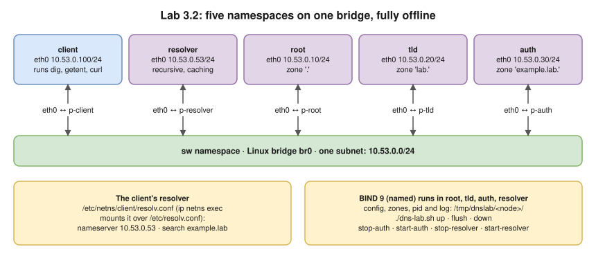
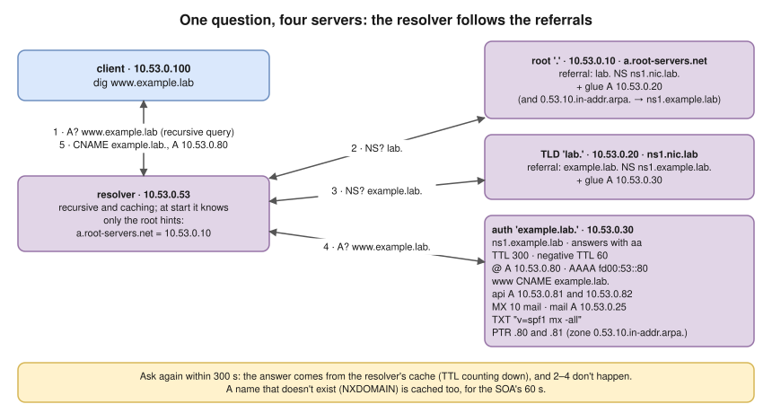

# Lab 3.2 · Trace DNS Resolution

> **Level 3** · ⏱️ about 60 minutes (estimate) · 🐧 Linux lab container ([setup](00-lab-environment-setup.md)) · 💰 free, fully offline
> Lesson: [3.4 · DNS](../03-core-networking-protocols/04-dns.md) first · Tools: BIND 9 (`named`) for all four servers, `dig`, `nslookup`, `getent`, `tcpdump`, `iptables`, the script [files/lab-03.2/dns-lab.sh](files/lab-03.2/dns-lab.sh)



- The script builds a **complete, private copy of the DNS hierarchy**: a root server, a TLD server for `lab.`, an authoritative server for `example.lab.`, a recursive resolver and a client.
- Watch one client question turn into a chain of referrals; compare **recursive**, **authoritative** and **referral** answers.
- Read every record type, the TTL countdown and **negative caching**; see why `dig` and applications disagree (**search domains**).
- Break the servers one by one and read each error: **SERVFAIL**, **connection refused**, **timed out**.



The zones the script writes are in the boxes above (open the script to read them; the comments explain each part).

## Steps

### 1. Start the lab

```bash
cd /labs/lab-03.2          # in the container; or wherever the files/ folder is
unset http_proxy https_proxy HTTP_PROXY HTTPS_PROXY no_proxy NO_PROXY
./dns-lab.sh up
```

**Expected (tested):** `DNS lab is up. Try:  sudo ip netns exec client dig www.example.lab`

Below, `C=` saves typing:

```bash
C="ip netns exec client"
```

### 2. One question, many referrals

Capture on the resolver, then ask once from the client:

```bash
ip netns exec resolver timeout 6 tcpdump -i eth0 -nn -l udp port 53 > /tmp/dns-cap.txt 2>/dev/null &
sleep 1; $C dig www.example.lab; sleep 5; cat /tmp/dns-cap.txt
```

**Expected (tested; IDs and ports differ):**

```text
;; ->>HEADER<<- opcode: QUERY, status: NOERROR, id: 15623
;; flags: qr rd ra; QUERY: 1, ANSWER: 2, AUTHORITY: 0, ADDITIONAL: 1
;; ANSWER SECTION:
www.example.lab.	300	IN	CNAME	example.lab.
example.lab.		300	IN	A	10.53.0.80
;; SERVER: 10.53.0.53#53(10.53.0.53) (UDP)

10.53.0.100.45837 > 10.53.0.53.53: 15623+ [1au] A? www.example.lab. (56)
10.53.0.53.44561 > 10.53.0.10.53: 31278 [1au] NS? . (40)
10.53.0.53.49318 > 10.53.0.10.53: 46229% [1au] NS? lab. (44)
10.53.0.10.53 > 10.53.0.53.44561: 31278*- 1/0/1 NS a.root-servers.net. (87)
10.53.0.10.53 > 10.53.0.53.49318: 46229- 0/1/2 (101)
10.53.0.53.37337 > 10.53.0.20.53: 14181% [1au] NS? example.lab. (52)
10.53.0.20.53 > 10.53.0.53.37337: 14181- 0/1/2 (102)
10.53.0.53.41680 > 10.53.0.30.53: 4659% [1au] A? www.example.lab. (56)
10.53.0.30.53 > 10.53.0.53.41680: 4659*- 2/1/2 CNAME example.lab., A 10.53.0.80 (136)
10.53.0.53.34804 > 10.53.0.30.53: 45317% [1au] A? example.lab. (68)
10.53.0.30.53 > 10.53.0.53.34804: 45317*- 1/1/2 A 10.53.0.80 (118)
10.53.0.53.53 > 10.53.0.100.45837: 15623 2/0/1 CNAME example.lab., A 10.53.0.80 (102)
```

✍️ Mark on the capture: the client's recursive question (`+`), the two **referrals** (`0/1/2`), the **authoritative** answers (`*`), and the reply to the client. Note that the root was only asked about `lab.`: **QNAME minimisation**.

### 3. The cache

```bash
sleep 8; $C dig www.example.lab +noall +answer
```

**Expected (tested):** the same answer with a **smaller TTL** (e.g. `292`): it came from the resolver's cache, and nothing was sent to the other servers.

### 4. Authoritative answer vs referral

```bash
$C dig @10.53.0.30 www.example.lab +norecurse | grep -E 'flags|^www|^example'
$C dig @10.53.0.10 www.example.lab +norecurse | grep -A1 -E 'flags|AUTHORITY|ADDITIONAL'
```

**Expected (tested):** the authoritative server sets **`aa`**; the root has **no answer**, only a referral:

```text
;; flags: qr aa; QUERY: 1, ANSWER: 2, AUTHORITY: 1, ADDITIONAL: 2
...
;; flags: qr; QUERY: 1, ANSWER: 0, AUTHORITY: 1, ADDITIONAL: 2
;; AUTHORITY SECTION:
lab.			86400	IN	NS	ns1.nic.lab.
;; ADDITIONAL SECTION:
ns1.nic.lab.		86400	IN	A	10.53.0.20
```

### 5. Walk the tree yourself

```bash
$C dig +trace www.example.lab | grep -v '^$'
```

**Expected (tested):** the root's NS, then `lab.` from `a.root-servers.net`, then `example.lab.` from `ns1.nic.lab`, then the answer from `ns1.example.lab` (full output in [3.4](../03-core-networking-protocols/04-dns.md#watching-a-resolver-work-tested)).

### 6. Record types and reverse lookups

```bash
for t in A AAAA MX TXT NS; do $C dig example.lab $t +noall +answer; done
$C dig api.example.lab +noall +answer
$C dig -x 10.53.0.80 +noall +answer
$C nslookup www.example.lab
```

**Expected (tested):** one line per type; two `A` records for `api`; `80.0.53.10.in-addr.arpa. 300 IN PTR example.lab.`; and `nslookup` reports `Non-authoritative answer:` because it asked the resolver.

### 7. "No such name" is cached too

```bash
$C dig nope.example.lab | grep -E 'status|SOA'
sleep 10; $C dig nope.example.lab +noall +authority
```

**Expected (tested):** `status: NXDOMAIN` with the zone's SOA (TTL **60**, the SOA's last field); 10+ seconds later the same SOA with a lower TTL (e.g. `47`), served from the negative cache.

### 8. Search domains: the app vs `dig`

```bash
$C cat /etc/resolv.conf
$C getent hosts api
$C dig api +noall +comments | grep status
$C dig api +search +noall +answer
```

**Expected (tested):** `getent` (like any application) finds `api.example.lab` through `search example.lab`; plain `dig api` gets **NXDOMAIN**; `dig +search` finds it.

### 9. DNS over TCP

```bash
$C dig +tcp example.lab +noall +answer +stats | grep -E 'IN|SERVER'
```

**Expected (tested):** the same answer, and `;; SERVER: 10.53.0.53#53(10.53.0.53) (TCP)`.

### 10. Break it, and read each error

```bash
# a) Authoritative server down, but the resolver's cache is still warm
./dns-lab.sh stop-auth
$C dig www.example.lab +noall +answer +comments | grep -E 'status|IN'

# b) Same, with the cache emptied
./dns-lab.sh flush
$C dig www.example.lab | grep -E 'status|SERVER'
./dns-lab.sh start-auth

# c) The resolver itself stopped
./dns-lab.sh stop-resolver
$C dig www.example.lab | grep -E 'error|reached'
$C curl -sS http://www.example.lab/
./dns-lab.sh start-resolver

# d) A firewall dropping DNS on the client
$C iptables -A OUTPUT -p udp --dport 53 -j DROP
time $C dig www.example.lab | grep -E 'error|reached'
$C iptables -F OUTPUT
```

**Expected (tested):**

| Case | Result | Meaning |
|---|---|---|
| a) | `status: NOERROR`, answer with a TTL counting down | A **warm cache hides the outage** until the TTL expires |
| b) | `status: SERVFAIL` | The resolver tried and **couldn't get an answer** |
| c) | `communications error to 10.53.0.53#53: connection refused` ×3, `no servers could be reached`; `curl: (6) Could not resolve host: www.example.lab` | The host is there, but **nothing listens** on port 53 |
| d) | `communications error to 10.53.0.53#53: timed out` ×3, `no servers could be reached`, after about **15 s** | Packets are **dropped**: 3 tries × 5 s |

## Verification

```bash
$C dig www.example.lab +short          # → example.lab. and 10.53.0.80 after everything is restored
```

You have seen a full recursive resolution, `aa` vs referral, TTL countdown, negative caching, the search-domain difference, and four distinct failure signatures.

## Troubleshooting

| Problem | Fix |
|---|---|
| `named: command not found` | BIND isn't installed: `apt-get install -y bind9` |
| `up` fails with `File exists` | A previous run is still there: `./dns-lab.sh down`, then `up` |
| Every query times out | Check the servers are running: `ls /tmp/dnslab/*/named.pid`; read `/tmp/dnslab/<node>/named.log` |
| `dig` uses a proxy or the wrong server | Always run `dig` **inside** the client namespace (`$C dig …`) |
| Reverse lookups give NXDOMAIN | The script sets `empty-zones-enable no;` on the resolver for this reason; don't remove it |

## 🧹 Cleanup

```bash
./dns-lab.sh down
rm -f /tmp/dns-cap.txt
ip netns list            # should print nothing
```

## Challenges

1. Add a record `new.example.lab A 10.53.0.99` to `/tmp/dnslab/auth/example.lab.zone`, **increase the SOA serial**, and reload with `kill -HUP $(cat /tmp/dnslab/auth/named.pid)`. Query it **before** and after adding it. How long does the client keep getting NXDOMAIN, and why?
2. Lower the zone TTL to 10 seconds, then time how long a stale answer survives after you change a record.
3. Give the authoritative server a second name server on a new namespace (`ns2`, `10.53.0.31`, a secondary zone). Stop `ns1`. Does resolution still work with an empty cache?

