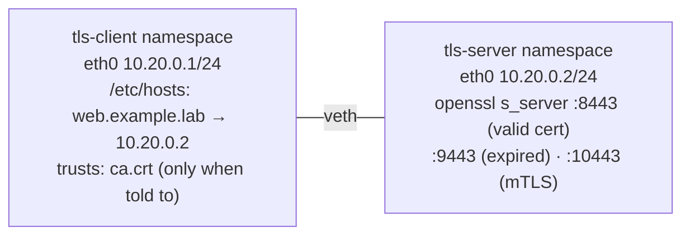

# Lab 3.3 · TLS: Certificates and the Handshake

> **Level 3** · ⏱️ about 60 minutes (estimate) · 🐧 Linux lab container ([setup](00-lab-environment-setup.md)) · 💰 free, fully offline
> Related lesson: [3.6 · TLS and certificates](../03-core-networking-protocols/06-tls-and-certificates.md)

## Objective

Be your own certificate authority, then:

- issue a server certificate with the right **SAN** (subject alternative name);
- serve HTTPS with `openssl s_server` and connect with `curl` and `openssl s_client`;
- reproduce the four errors you'll meet at work: **untrusted issuer**, **name mismatch** (by IP and by another name), **expired**, and see what `-k` really does;
- see in a capture what an observer can read (the **SNI**) and what they can't (the certificate, in TLS 1.3);
- turn on **mutual TLS** and watch a client without a certificate get rejected.

## Prerequisites

- The [lab environment](00-lab-environment-setup.md) running.
- Lesson 3.6, and the TCP handshake from [Lab 3.1](lab-03.1-capture-a-tcp-handshake.md).

## Tools

`openssl` (3.0 in the lab container), `curl`, `tshark`, `faketime` (to make an already-expired certificate), `ip`.

## Topology



There's no DNS server: the client gets the name from its own **hosts file**. `ip netns exec` uses `/etc/netns/<name>/hosts` in place of `/etc/hosts` when that file exists.

## Steps

All commands run as root in the lab container.

### 1. Build the network

```bash
unset http_proxy https_proxy HTTP_PROXY HTTPS_PROXY no_proxy NO_PROXY
ip netns add tls-server; ip netns add tls-client
ip link add eth0 netns tls-client type veth peer name eth0 netns tls-server
ip -n tls-client addr add 10.20.0.1/24 dev eth0
ip -n tls-server addr add 10.20.0.2/24 dev eth0
for n in tls-client tls-server; do ip -n $n link set lo up; ip -n $n link set eth0 up; done
mkdir -p /etc/netns/tls-client
printf '127.0.0.1 localhost\n10.20.0.2 web.example.lab\n' > /etc/netns/tls-client/hosts
ip netns exec tls-client getent hosts web.example.lab
```

**Expected (tested):** `10.20.0.2       web.example.lab`

### 2. Create a certificate authority

```bash
mkdir -p /tmp/lab33 && cd /tmp/lab33
openssl req -x509 -newkey rsa:2048 -nodes -keyout ca.key -out ca.crt -days 30 -subj "/CN=Lab Root CA"
openssl x509 -in ca.crt -noout -subject -issuer -ext basicConstraints
```

**Expected (tested):**

```text
subject=CN = Lab Root CA
issuer=CN = Lab Root CA
X509v3 Basic Constraints: critical
    CA:TRUE
```

A **root** certificate is **self-signed** (subject = issuer) and marked `CA:TRUE`: it may sign other certificates. `ca.key` is the most sensitive file in this lab; a real CA keeps it offline.

### 3. Issue a server certificate

The server makes its own key and a **CSR** (certificate signing request). The CA signs the CSR. The server's private key never goes to the CA.

```bash
openssl req -newkey rsa:2048 -nodes -keyout server.key -out server.csr \
  -subj "/CN=web.example.lab" -addext "subjectAltName=DNS:web.example.lab"
openssl x509 -req -in server.csr -CA ca.crt -CAkey ca.key -CAcreateserial \
  -out server.crt -days 7 -copy_extensions copy
openssl x509 -in server.crt -noout -subject -issuer -dates -ext subjectAltName
openssl verify -CAfile ca.crt server.crt
```

**Expected (tested; your dates differ):**

```text
Certificate request self-signature ok
subject=CN = web.example.lab
subject=CN = web.example.lab
issuer=CN = Lab Root CA
notBefore=Oct 14 20:11:56 2026 GMT
notAfter=Oct 21 20:11:56 2026 GMT
X509v3 Subject Alternative Name:
    DNS:web.example.lab
server.crt: OK
```

✍️ Note the three things a client checks: **who issued it** (`issuer`), **when it's valid** (`notBefore`/`notAfter`), and **which names it covers** (the SAN). Clients match the hostname against the **SAN**, not the CN. `-copy_extensions copy` is what carries the SAN from the CSR into the certificate; without it, the certificate would have no SAN and every name check would fail.

### 4. Serve HTTPS

```bash
(ip netns exec tls-server openssl s_server -4 -accept 8443 -cert server.crt -key server.key -www > /tmp/lab33/s_server.log 2>&1 &)
sleep 1
```

`-www` makes `s_server` answer any HTTP `GET` with a status page. `-4` makes it listen on IPv4.

### 5. Connect, and reproduce the first two errors

```bash
C="ip netns exec tls-client"
$C curl -sS https://web.example.lab:8443/ -o /dev/null                     # a) CA not trusted
$C curl -sS --cacert ca.crt https://10.20.0.2:8443/ -o /dev/null           # b) by IP
$C curl -sS --cacert ca.crt https://web.example.lab:8443/ -o /dev/null -w 'HTTP %{http_code}\n'   # c) correct
```

**Expected (tested; curl's "More details here" paragraph trimmed):**

```text
curl: (60) SSL certificate problem: unable to get local issuer certificate
curl: (60) SSL: no alternative certificate subject name matches target host name '10.20.0.2'
HTTP 200
```

- a) The server sent a certificate signed by "Lab Root CA", which isn't in the client's trust store.
- b) The CA is trusted now, but `10.20.0.2` isn't in the SAN. A certificate for an IP needs an `IP:` SAN entry.
- c) Trusted issuer, valid dates, matching name.

### 6. Read the handshake

```bash
$C curl -sv --cacert ca.crt https://web.example.lab:8443/ -o /dev/null 2>&1 | grep -E 'SSL connection|Server certificate|subject|issuer|date|verify ok'
echo | $C openssl s_client -connect web.example.lab:8443 -servername web.example.lab -CAfile ca.crt 2>/dev/null \
  | grep -E '^ *[0-9] s:|^ *i:|^(subject|issuer|Peer signature type|Server Temp Key|New,|Verify return code)'
```

**Expected (tested):**

```text
* SSL connection using TLSv1.3 / TLS_AES_256_GCM_SHA384 / X25519 / RSASSA-PSS
* Server certificate:
*  subject: CN=web.example.lab
*  start date: Oct 14 20:11:56 2026 GMT
*  expire date: Oct 21 20:11:56 2026 GMT
*  subjectAltName: host "web.example.lab" matched cert's "web.example.lab"
*  issuer: CN=Lab Root CA
*  SSL certificate verify ok.
 0 s:CN = web.example.lab
   i:CN = Lab Root CA
subject=CN = web.example.lab
issuer=CN = Lab Root CA
Peer signature type: RSA-PSS
Server Temp Key: X25519, 253 bits
New, TLSv1.3, Cipher is TLS_AES_256_GCM_SHA384
Verify return code: 0 (ok)
```

Decode the curl line: **TLS 1.3**, symmetric cipher **AES-256-GCM** with SHA-384, key exchange **X25519**, and the server proved it owns its key with an **RSA-PSS** signature. The `0 s: / i:` lines are the **chain the server sent**: only one certificate here, because the server is signed directly by the root.

Now without the CA:

```bash
echo | $C openssl s_client -connect web.example.lab:8443 -servername web.example.lab 2>/dev/null | grep 'Verify return code'
```

**Expected (tested):** `Verify return code: 21 (unable to verify the first certificate)`. Unlike curl, `s_client` **still completes the handshake** and only reports the problem; it's a diagnostic tool, not a safe client.

### 7. What an observer sees

```bash
$C timeout 5 tshark -i eth0 -f 'tcp port 8443' -Y tls.handshake -T fields -e ip.src -e ip.dst -e _ws.col.Info > /tmp/lab33/tls-cap.txt 2>/dev/null &
sleep 2; $C curl -s --cacert ca.crt https://web.example.lab:8443/ -o /dev/null; sleep 4
cat /tmp/lab33/tls-cap.txt
```

**Expected (tested):**

```text
10.20.0.1	10.20.0.2	Client Hello (SNI=web.example.lab)
10.20.0.2	10.20.0.1	Server Hello, Change Cipher Spec, Application Data, Application Data, Application Data, Application Data
```

- The **SNI is in clear text**: anyone on the path knows which site you asked for, even though everything after is encrypted.
- After the Server Hello, everything shows as "Application Data": in TLS 1.3 the **EncryptedExtensions, Certificate, CertificateVerify and Finished** messages are encrypted. The certificate isn't visible on the wire. (In TLS 1.2 it was.)

### 8. Another name, and `-k`

```bash
$C curl -sS --cacert ca.crt --resolve other.example.lab:8443:10.20.0.2 https://other.example.lab:8443/ -o /dev/null
$C curl -sk https://10.20.0.2:8443/ -o /dev/null -w 'HTTP %{http_code}\n'
$C curl -sS http://web.example.lab:8443/ -o /dev/null
```

**Expected (tested):**

```text
curl: (60) SSL: no alternative certificate subject name matches target host name 'other.example.lab'
HTTP 200
curl: (52) Empty reply from server
```

- `--resolve` sends `other.example.lab` to the same server: same certificate, different name, so the name check fails. This is what happens when a load balancer serves the wrong certificate for a hostname.
- `-k` "works" with an untrusted CA **and** the wrong name. It skips every check that protects you from a man in the middle. Use it to diagnose, never in scripts.
- Plain HTTP to a TLS port: the server sees bytes that aren't a ClientHello and closes the connection, so curl gets **no HTTP reply at all**.

### 9. An expired certificate

`faketime` runs a command with a fake clock, so the CA can sign a certificate that was valid for one week in September:

```bash
faketime '2026-09-01 12:00:00' openssl x509 -req -in server.csr -CA ca.crt -CAkey ca.key -CAcreateserial -out old.crt -days 7 -copy_extensions copy
openssl x509 -in old.crt -noout -dates
openssl verify -CAfile ca.crt old.crt
(ip netns exec tls-server openssl s_server -4 -accept 9443 -cert old.crt -key server.key -www > /tmp/lab33/s_server-old.log 2>&1 &)
sleep 1
$C curl -sS --cacert ca.crt https://web.example.lab:9443/ -o /dev/null
echo | $C openssl s_client -connect web.example.lab:9443 -servername web.example.lab -CAfile ca.crt 2>/dev/null | grep 'Verify return code'
```

**Expected (tested on 14 Oct 2026; if your clock is earlier than 8 Sep 2026, pick an older fake date):**

```text
Certificate request self-signature ok
subject=CN = web.example.lab
notBefore=Sep  1 12:00:00 2026 GMT
notAfter=Sep  8 12:00:00 2026 GMT
CN = web.example.lab
error 10 at 0 depth lookup: certificate has expired
error old.crt: verification failed
curl: (60) SSL certificate problem: certificate has expired
Verify return code: 10 (certificate has expired)
```

Checking expiry ahead of time, the way a monitoring job would:

```bash
openssl x509 -in server.crt -noout -checkend 86400;          echo "exit $?"   # still valid in 1 day?
openssl x509 -in server.crt -noout -checkend $((8*86400));   echo "exit $?"   # in 8 days?
```

**Expected (tested):** `Certificate will not expire` / `exit 0`, then `Certificate will expire` / `exit 1`.

### 10. Mutual TLS

The server now **requires** a client certificate signed by the same CA:

```bash
openssl req -newkey rsa:2048 -nodes -keyout client.key -out client.csr -subj "/CN=lab-client"
openssl x509 -req -in client.csr -CA ca.crt -CAkey ca.key -CAcreateserial -out client.crt -days 7
(ip netns exec tls-server openssl s_server -4 -accept 10443 -cert server.crt -key server.key -Verify 1 -CAfile ca.crt -www > /tmp/lab33/s_server-mtls.log 2>&1 &)
sleep 1
$C curl -sS --cacert ca.crt https://web.example.lab:10443/ -o /dev/null
$C curl -sS --cacert ca.crt --cert client.crt --key client.key https://web.example.lab:10443/ -o /dev/null -w 'HTTP %{http_code}\n'
grep -E 'did not return' /tmp/lab33/s_server-mtls.log
```

**Expected (tested):**

```text
curl: (56) OpenSSL SSL_read: OpenSSL/3.0.13: error:0A00045C:SSL routines::tlsv13 alert certificate required, errno 0
HTTP 200
4057262F0C7F0000:error:0A0000C7:SSL routines:tls_process_client_certificate:peer did not return a certificate:../ssl/statem/statem_srvr.c:3509:
```

Without a client certificate the server sends a `certificate required` alert; the server's log says why. With one, it's accepted. This is how service meshes authenticate one service to another.

## Expected results

| Situation | Result |
|---|---|
| Trusted CA, right name, valid dates | `HTTP 200`, `Verify return code: 0 (ok)` |
| CA not trusted | `curl: (60) … unable to get local issuer certificate` |
| By IP / by another name | `curl: (60) … no alternative certificate subject name matches …` |
| Expired | `curl: (60) … certificate has expired` |
| `-k` | `HTTP 200`, with no protection |
| HTTP to an HTTPS port | `curl: (52) Empty reply from server` |
| mTLS without a client certificate | `curl: (56) … alert certificate required` |

## Verification

```bash
$C curl -s --cacert /tmp/lab33/ca.crt https://web.example.lab:8443/ -o /dev/null -w '%{http_code} %{ssl_verify_result}\n'
```

`200 0` means the request succeeded and verification returned 0 (OK).

## Troubleshooting

| Problem | Fix |
|---|---|
| `curl: (6) Could not resolve host: web.example.lab` | The hosts file is missing: re-run the `mkdir`/`printf` in step 1. Run curl **inside** the `tls-client` namespace |
| `curl: (7) Failed to connect … Connection refused` | `s_server` isn't running: `cat /tmp/lab33/s_server.log`. Without `-4` it may listen on IPv6 only |
| `curl: (60)` even with `--cacert` | You're not in `/tmp/lab33` (curl can't find `ca.crt`), or the certificate has no SAN: check `openssl x509 -in server.crt -noout -ext subjectAltName` |
| The verbose output mentions a proxy | Run the `unset … proxy` line from step 1 |
| `bind: Address already in use` | An old `s_server` is still running: `ip netns pids tls-server \| xargs -r kill` |

## 🧹 Cleanup

```bash
cd /
for n in tls-server tls-client; do ip netns pids $n | xargs -r kill 2>/dev/null; done
ip netns del tls-server; ip netns del tls-client
rm -rf /etc/netns/tls-client /tmp/lab33
ip netns list            # should print nothing
```

## Challenges

1. Add an **intermediate CA**: root signs intermediate (with `basicConstraints=critical,CA:TRUE`), intermediate signs the server. Serve only the server certificate, and read curl's error. Then serve the chain (`-cert_chain intermediate.crt`) and compare `s_client`'s `0 s:/1 s:` lines.
2. Issue a certificate with `subjectAltName=DNS:web.example.lab,IP:10.20.0.2`. Does step 5b work now?
3. Issue a **wildcard** certificate for `*.example.lab`. Does it match `web.example.lab`? `example.lab`? `a.b.example.lab`? Predict first, then test with `--resolve`.
4. Using `-alpn h2,http/1.1` on `s_server`, find the curl line that shows which application protocol was agreed.
