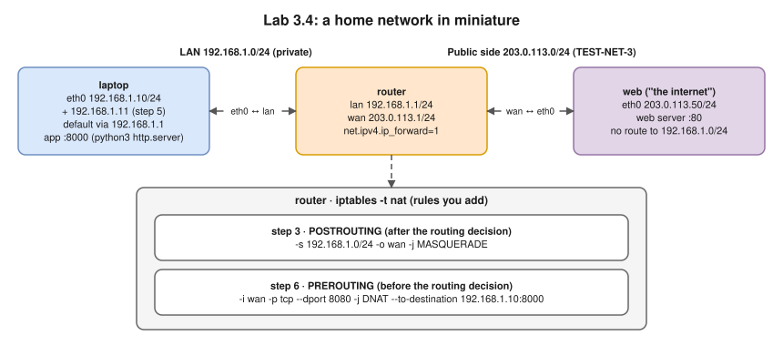
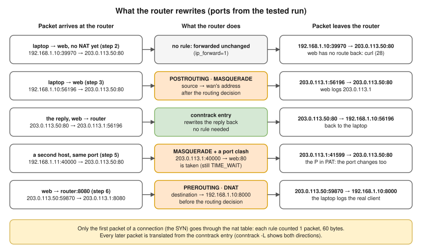

# Lab 3.4 · NAT and Port Forwarding

> **Level 3** · ⏱️ about 45 minutes (estimate) · 🐧 Linux lab container ([setup](00-lab-environment-setup.md)) · 💰 free, fully offline
> Lessons: [3.8 · NAT, PAT and port forwarding](../03-core-networking-protocols/08-nat-pat-and-port-forwarding.md) and the routing lab ([Lab 2.2](lab-02.2-routing-between-two-subnets.md)) first · Linux details: [8.6 · Netfilter, NAT and conntrack](../08-linux-networking/06-netfilter-nat-and-conntrack.md) · Tools: `ip`, `iptables` (the nat table), `conntrack`, `tcpdump`, `curl`, `python3 -m http.server`



- Prove that a private address **can't get replies** from the internet without NAT.
- Add **source NAT** (PAT / MASQUERADE), read the router's **translation table** (conntrack), and force a **port rewrite** with two hosts on the same source port.
- Add a **port forward** (DNAT) so the "internet" can reach an app on the laptop.
- `203.0.113.0/24` is a documentation range (TEST-NET-3) standing in for public addresses. `web` has **no route** to `192.168.1.0/24`, just as no internet router has a route to your home's private range. All commands run as root in the lab container.

## Steps

### 1. Build it

```bash
unset http_proxy https_proxy HTTP_PROXY HTTPS_PROXY no_proxy NO_PROXY
for n in laptop router web; do ip netns add $n; ip -n $n link set lo up; done
ip link add eth0 netns laptop type veth peer name lan netns router
ip link add wan netns router type veth peer name eth0 netns web
ip -n laptop addr add 192.168.1.10/24 dev eth0
ip -n router addr add 192.168.1.1/24 dev lan
ip -n router addr add 203.0.113.1/24 dev wan
ip -n web addr add 203.0.113.50/24 dev eth0
ip -n laptop link set eth0 up; ip -n router link set lan up; ip -n router link set wan up; ip -n web link set eth0 up
ip -n laptop route add default via 192.168.1.1
ip netns exec router sysctl -qw net.ipv4.ip_forward=1
```

Start the two web servers, each logging to a file:

```bash
mkdir -p /tmp/lab34/web /tmp/lab34/laptop
echo "public web server" > /tmp/lab34/web/index.html
echo "laptop app" > /tmp/lab34/laptop/laptop.html
(cd /tmp/lab34/web && ip netns exec web python3 -m http.server 80 > /tmp/lab34/web.log 2>&1 &)
(cd /tmp/lab34/laptop && ip netns exec laptop python3 -m http.server 8000 > /tmp/lab34/laptop.log 2>&1 &)
sleep 1
ip -n web route
```

**Expected (tested):** the web server only knows its own subnet:

```text
203.0.113.0/24 dev eth0 proto kernel scope link src 203.0.113.50
```

### 2. Without NAT

Capture on the web server while the laptop tries to connect:

```bash
ip netns exec web timeout 5 tcpdump -i eth0 -nn -t -l 'tcp port 80' > /tmp/lab34/cap1.txt 2>/dev/null &
sleep 1; ip netns exec laptop curl -sS --connect-timeout 2 http://203.0.113.50/; sleep 3
cut -c1-75 /tmp/lab34/cap1.txt
ip netns exec web ip route get 192.168.1.10
```

**Expected (tested; ports and sequence numbers differ):**

```text
curl: (28) Failed to connect to 203.0.113.50 port 80 after 2002 ms: Timeout was reached
IP 192.168.1.10.39970 > 203.0.113.50.80: Flags [S], seq 1419682051, win 64
IP 192.168.1.10.39970 > 203.0.113.50.80: Flags [S], seq 1419682051, win 64
RTNETLINK answers: Network is unreachable
```

- ✍️ The router **did forward** the SYN: the server received it twice (the second is a retransmission). It can't answer: it has no route to `192.168.1.10`. The laptop only sees a timeout.
- On the real internet the outcome is the same, and providers usually also filter packets with private source addresses.

### 3. Add source NAT (PAT)

```bash
ip netns exec router iptables -t nat -A POSTROUTING -s 192.168.1.0/24 -o wan -j MASQUERADE
ip netns exec web timeout 4 tcpdump -i eth0 -nn -t -l 'tcp port 80' > /tmp/lab34/cap2.txt 2>/dev/null &
sleep 1; ip netns exec laptop curl -sS http://203.0.113.50/; sleep 3
head -2 /tmp/lab34/cap2.txt | cut -c1-75
tail -1 /tmp/lab34/web.log
```

**Expected (tested):**

```text
public web server
IP 203.0.113.1.56196 > 203.0.113.50.80: Flags [S], seq 1451286889, win 6424
IP 203.0.113.50.80 > 203.0.113.1.56196: Flags [S.], seq 1240458598, ack 145
203.0.113.1 - - [14/Oct/2026 20:14:34] "GET / HTTP/1.1" 200 -
```

- The rule: "for packets **from** the LAN, leaving **through** `wan`, replace the source with `wan`'s address". The server now sees, and answers, `203.0.113.1`.
- `MASQUERADE` picks up the interface's current address, which suits a home router whose public IP changes. With a fixed public IP, `-j SNAT --to-source 203.0.113.1` does the same.

### 4. The translation table

```bash
ip netns exec router conntrack -L -p tcp
ip netns exec router iptables -t nat -L POSTROUTING -n -v
```

**Expected (tested):**

```text
tcp      6 116 TIME_WAIT src=192.168.1.10 dst=203.0.113.50 sport=56196 dport=80 src=203.0.113.50 dst=203.0.113.1 sport=80 dport=56196 [ASSURED] mark=0 use=1
conntrack v1.4.8 (conntrack-tools): 1 flow entries have been shown.
Chain POSTROUTING (policy ACCEPT 0 packets, 0 bytes)
 pkts bytes target     prot opt in     out     source               destination
    1    60 MASQUERADE  0    --  *      wan     192.168.1.0/24       0.0.0.0/0
```

Read the conntrack line in two halves:

| Part | Meaning |
|---|---|
| `tcp 6 116 TIME_WAIT` | Protocol 6 (TCP), **116 s** until the entry is removed, TCP state |
| `src=192.168.1.10 dst=203.0.113.50 sport=56196 dport=80` | The **original** direction, as the laptop sent it |
| `src=203.0.113.50 dst=203.0.113.1 sport=80 dport=56196` | The **reply** the router expects. Its destination is the router, not the laptop: that's the NAT |
| `[ASSURED]` | Traffic was seen in both directions |

- The rule counter is **1 packet, 60 bytes** although the request was several packets: only the **first** packet of a connection (the SYN) goes through the `nat` table. Every later packet is translated from the conntrack entry.



### 5. Two hosts, one source port

Give the laptop a second address (standing in for a second device), then make **both** connect from source port 40000:

```bash
ip -n laptop addr add 192.168.1.11/24 dev eth0
ip netns exec web timeout 5 tcpdump -i eth0 -nn -t -l 'tcp[tcpflags] == tcp-syn' > /tmp/lab34/cap3.txt 2>/dev/null &
sleep 1
ip netns exec laptop curl -sS --local-port 40000 http://203.0.113.50/
ip netns exec laptop curl -sS --interface 192.168.1.11 --local-port 40000 http://203.0.113.50/
sleep 4; cut -c1-55 /tmp/lab34/cap3.txt
ip netns exec router conntrack -L -p tcp --orig-port-src 40000 2>/dev/null
```

**Expected (tested; the rewritten port is random, e.g. `41599`, `40612` or `34851`, and the conntrack lines may come in either order):**

```text
public web server
public web server
IP 203.0.113.1.40000 > 203.0.113.50.80: Flags [S], seq
IP 203.0.113.1.41599 > 203.0.113.50.80: Flags [S], seq
tcp      6 115 TIME_WAIT src=192.168.1.10 dst=203.0.113.50 sport=40000 dport=80 src=203.0.113.50 dst=203.0.113.1 sport=80 dport=40000 [ASSURED] mark=0 use=1
tcp      6 115 TIME_WAIT src=192.168.1.11 dst=203.0.113.50 sport=40000 dport=80 src=203.0.113.50 dst=203.0.113.1 sport=80 dport=41599 [ASSURED] mark=0 use=1
```

- The first connection kept port 40000. The second **couldn't**: `203.0.113.1:40000 → 203.0.113.50:80` was still in the table (in TIME_WAIT), so the router changed the **port** too.
- That's the "P" in PAT, and why one public IP supports only so many connections **to the same destination**.

### 6. Port forwarding (DNAT)

From the "internet" (the `web` namespace), try to reach the laptop's app through the router, then directly:

```bash
ip netns exec web curl -sS http://203.0.113.1:8080/laptop.html
ip netns exec web curl -sS --connect-timeout 2 http://192.168.1.10:8000/laptop.html
```

**Expected (tested):**

```text
curl: (7) Failed to connect to 203.0.113.1 port 8080 after 0 ms: Couldn't connect to server
curl: (7) Failed to connect to 192.168.1.10 port 8000 after 0 ms: Couldn't connect to server
```

- The router has nothing on 8080 (it answers with a reset); the web server has no route to the private address.
- Now forward the router's port 8080 to the laptop's port 8000:

```bash
ip netns exec router iptables -t nat -A PREROUTING -i wan -p tcp --dport 8080 -j DNAT --to-destination 192.168.1.10:8000
ip netns exec web curl -sS http://203.0.113.1:8080/laptop.html
ip netns exec router iptables -t nat -L PREROUTING -n -v
tail -1 /tmp/lab34/laptop.log
ip netns exec router conntrack -L -p tcp --orig-port-dst 8080 2>/dev/null
```

**Expected (tested):**

```text
laptop app
Chain PREROUTING (policy ACCEPT 0 packets, 0 bytes)
 pkts bytes target     prot opt in     out     source               destination
    1    60 DNAT       6    --  wan    *       0.0.0.0/0            0.0.0.0/0            tcp dpt:8080 to:192.168.1.10:8000
203.0.113.50 - - [14/Oct/2026 20:14:57] "GET /laptop.html HTTP/1.1" 200 -
tcp      6 119 TIME_WAIT src=203.0.113.50 dst=203.0.113.1 sport=59870 dport=8080 src=192.168.1.10 dst=203.0.113.50 sport=8000 dport=59870 [ASSURED] mark=0 use=1
```

- DNAT is in **PREROUTING**: the destination must be rewritten **before** the routing decision, so the router routes the packet to the LAN instead of delivering it to itself.
- The laptop's log shows the **real client** (`203.0.113.50`): DNAT changes only the destination.
- The conntrack entry's reply half expects the answer **from `192.168.1.10:8000`**, and rewrites it back to `203.0.113.1:8080` on the way out.
- This is exactly what `docker run -p 8080:80` sets up on a Docker host ([Lab 10.1](lab-10.1-docker-bridge-nat-and-dns.md)).

## Verification

```bash
ip netns exec router iptables -t nat -S
```

**Expected (tested):** exactly your two rules (plus the default chain policies):

```text
-P PREROUTING ACCEPT
-P INPUT ACCEPT
-P OUTPUT ACCEPT
-P POSTROUTING ACCEPT
-A PREROUTING -i wan -p tcp -m tcp --dport 8080 -j DNAT --to-destination 192.168.1.10:8000
-A POSTROUTING -s 192.168.1.0/24 -o wan -j MASQUERADE
```

## Troubleshooting

| Problem | Fix |
|---|---|
| Step 3 still times out | Forwarding off (`ip netns exec router sysctl net.ipv4.ip_forward` must be `1`), or a typo in `-o wan` |
| `conntrack -L` prints nothing | The entries expired (TIME_WAIT lasts 120 s): run curl again first |
| `conntrack: command not found` | `apt-get install -y conntrack` |
| Step 5 shows no rewrite | More than 120 s passed between the two curls, so the first entry was gone. Run them back to back |
| `curl: (7)` after adding DNAT | The laptop app isn't running: `cat /tmp/lab34/laptop.log`; or the rule uses `-i lan` instead of `-i wan` |
| `curl: (45) bind failed` in step 5 | Port 40000 on that address is still in TIME_WAIT on the laptop: wait two minutes or use another port |

## 🧹 Cleanup

```bash
cd /
for n in laptop router web; do ip netns pids $n | xargs -r kill 2>/dev/null; done
for n in laptop router web; do ip netns del $n; done
rm -rf /tmp/lab34
ip netns list            # should print nothing
```

## Challenges

1. Replace `MASQUERADE` with `-j SNAT --to-source 203.0.113.1`. What's the difference in practice? When would a cloud NAT gateway prefer one?
2. Add a second public address `203.0.113.2/24` to `wan` and use `--to-source 203.0.113.1-203.0.113.2`. Repeat step 5. Which address does the second connection get now?
3. Delete the `PREROUTING` rule and instead add `-A OUTPUT -d 203.0.113.1 -p tcp --dport 8080 -j DNAT …` in the router. From which namespace does the forward now work, and why? (Hint: locally generated packets skip PREROUTING. This is the "hairpin" problem.)
4. In a second terminal, run `ip netns exec router conntrack -E` (live events), then repeat step 3. Match each `NEW`, `UPDATE` and `DESTROY` line to a moment in the TCP connection's life ([3.3](../03-core-networking-protocols/03-tcp-in-depth.md)).
