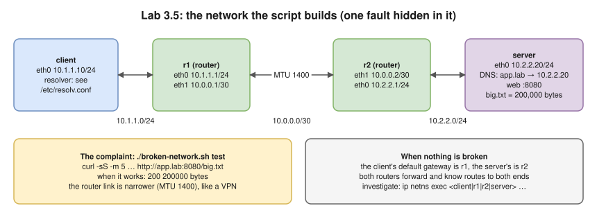
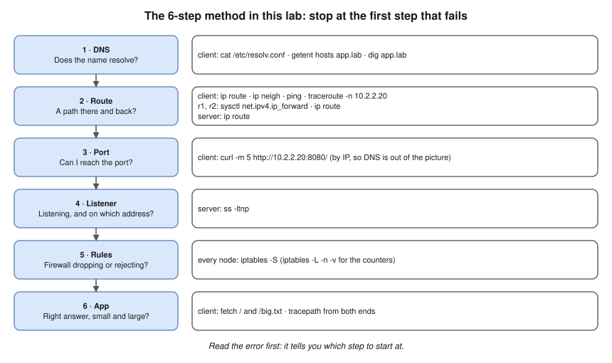

# Lab 3.5 · Troubleshooting Challenge: Eight Hidden Faults ⭐🔥

> **Level 3 capstone** · ⏱️ about 2 hours for all eight (estimate) · 🐧 Linux lab container ([setup](00-lab-environment-setup.md)) · 💰 free, fully offline
> Method: [3.11 · Troubleshooting connectivity](../03-core-networking-protocols/11-troubleshooting-connectivity.md) · Solutions: [separate file](../14-practice-exercises/solutions/lab-03.5-troubleshooting-challenge-solutions.md) (open it only after you've tried)
> Before: all of Level 3, especially [3.10](../03-core-networking-protocols/10-packet-flow-end-to-end.md) and [3.11](../03-core-networking-protocols/11-troubleshooting-connectivity.md); warm-ups: Labs [2.2](lab-02.2-routing-between-two-subnets.md) and [3.1](lab-03.1-capture-a-tcp-handshake.md) · Tools: the script [files/lab-03.5/broken-network.sh](files/lab-03.5/broken-network.sh), plus anything you like: `curl`, `dig`, `getent`, `ping`, `traceroute`, `tracepath`, `ip route`, `ip neigh`, `ss`, `iptables`, `sysctl`, `tcpdump`



- A script builds this network and breaks **one thing**. Every fault gives the same complaint: *"I can't download `http://app.lab:8080/big.txt`"*.
- For each of the eight faults: find the cause with the 6-step method, **without reading the script**; prove it with **one piece of evidence** (a command and its output); fix it with one command, and verify.
- This is the interview question "the app is unreachable, walk me through it", done for real.

## Steps

### 1. See the working network first

You can't spot "wrong" until you know "right". Build it with **no fault**:

```bash
cd /labs/lab-03.5          # in the container; or wherever the files/ folder is
unset http_proxy https_proxy HTTP_PROXY HTTPS_PROXY no_proxy NO_PROXY
./broken-network.sh up 0
./broken-network.sh test
```

**Expected (tested):**

```text
Network is up. A user on 'client' says: "I can't download http://app.lab:8080/big.txt"
See the complaint with:  sudo ./broken-network.sh test
$ curl -sS -m 5 -o /dev/null -w '%{http_code} %{size_download} bytes\n' http://app.lab:8080/big.txt
200 200000 bytes
```

Now record a **baseline** you can compare against later. Run each command in the namespace given:

```bash
C="ip netns exec client"
$C cat /etc/resolv.conf
$C getent hosts app.lab
ip -n client route
$C traceroute -n -q1 -w1 10.2.2.20
ip netns exec server ss -ltnup
```

✍️ Save this output. Most faults are "spot the difference from the baseline".

### 2. Work through the faults

For each fault number `N` from 1 to 8:

```bash
./broken-network.sh up N        # e.g. ./broken-network.sh up 1   (it removes the previous network first)
./broken-network.sh test        # read the complaint
```

Investigate with `ip netns exec <client|r1|r2|server> <command>`. Fill in one row of this log per fault **before** you look at the solutions:

| Fault | Exact error from `test` | Which step of the method failed? | Evidence (command → output) | Cause | Fix (one command) | `test` after the fix |
|---|---|---|---|---|---|---|
| 1 | | | | | | |
| 2 | | | | | | |
| … | | | | | | |

When you think you've fixed it, `./broken-network.sh test` must print `200 200000 bytes`.

### 3. The method, as a reminder



Read the error first: it tells you where to start ([3.11](../03-core-networking-protocols/11-troubleshooting-connectivity.md#read-the-error-first--it-tells-you-the-step)).

> **Rules:** don't read `broken-network.sh` until you've finished all eight. If you're stuck for more than 20 minutes, read only the **hint** for that fault in the solutions file. As a last resort, `cat /tmp/broken-network/.fault` shows the fault number you're on (useful with `random`).

### 4. Exam mode

When you've done all eight, practise against the clock with a random fault:

```bash
./broken-network.sh up random
./broken-network.sh test
```

Target: **under 5 minutes** per fault, explaining each step out loud as you would in an interview.

## Expected results

- Eight log rows, each with **one piece of evidence** that proves the cause, not a guess.
- You noticed that several faults give the **same** first error, and that you had to go past the first error to tell them apart.
- `./broken-network.sh test` prints `200 200000 bytes` after each fix.

## Verification

Compare your log with the [solutions](../14-practice-exercises/solutions/lab-03.5-troubleshooting-challenge-solutions.md). Score one point per fault for the right cause **with** evidence; half a point for the right cause without proof. 8/8 means you're ready for the Level 3 milestone.

## Troubleshooting

| Problem | Fix |
|---|---|
| `up` prints `RTNETLINK answers: File exists` | `./broken-network.sh down`, then `up` again |
| `test` hangs for a long time | It has a 5-second limit (`-m 5`); if it hangs longer, check you're not behind a proxy (`unset … proxy` in step 1) |
| `dig` ignores the client's resolver | Run it **inside** the client namespace: `ip netns exec client dig app.lab` |
| The fix worked but `test` still fails | Some faults need the right state *and* a running process; check `ss -ltn` on the server again |

## 🧹 Cleanup

```bash
./broken-network.sh down
ip netns list            # should print nothing
```

## Challenges

1. **Write your own fault.** Add a case `9` to a copy of the script (ideas: a wrong netmask on the server, a duplicate IP, a `REJECT` rule instead of `DROP`, a wrong DNS record). Give it to a friend.
2. **Two faults at once.** Combine faults 1 and 5 by hand. Does the method still find both? In which order?
3. **Explain it to a non-network person.** For fault 8, write three sentences a developer would understand: why the page loads but the download hangs.

