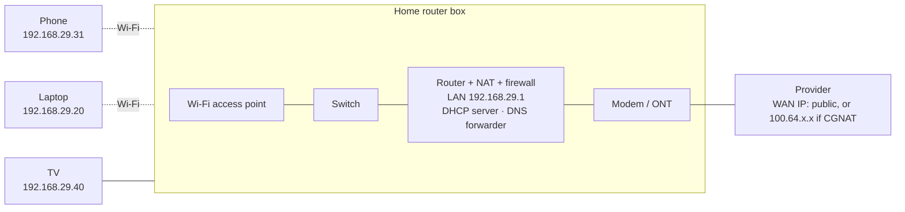

# Solutions · Level 1 Exercises

> ⚠️ Spoilers for [Level 1 exercises](../01-level-1-fundamentals.md). Calculations were checked with Python. Units: decimal (1 MB = 10⁶ bytes, 1 Mbit/s = 10⁶ bit/s) unless stated.

## 🟢 Beginner

**1.** a) router · b) switch · c) hub · d) modem · e) wireless access point · f) firewall · g) load balancer.
A home "router" box usually contains d, a, b, e and f in one case ([1.2](../../01-networking-fundamentals/02-network-devices.md)).

**2.** a) LAN. b) WAN: it connects distant sites, even though it's private. c) LAN (a data-centre LAN).

**3.** a) Client. b) Server. c) **Both**: a server to browsers, a client to the app behind it. d) **Both**: a server to your laptop, a client to the root, TLD and authoritative servers it asks ([3.4](../../03-core-networking-protocols/04-dns.md)).

**4.** a) Port. b) MAC address. c) IP address.

**5.** a) 1,000 Mbit/s ÷ 8 = **125 MB/s** (a bit less in practice, because of overhead). b) 100 MB × 8 = 800 Mbit; 800 ÷ 100 = **8 seconds**.

**6.** Link (Ethernet, Wi-Fi) → Internet (IP, ICMP) → Transport (TCP, UDP) → Application (HTTP, DNS, TLS, SSH…).

## 🟡 Intermediate

**7.** a) 2 GB × 8 = 16,000 Mbit; 16,000 ÷ 50 = **320 s ≈ 5 min 20 s**.
b) 2 GiB = 2 × 1,073,741,824 bytes = 2,147,483,648 bytes × 8 = 17,179,869,184 bits; ÷ 50,000,000 = **about 344 s**. The 7% difference between GB and GiB is a classic source of "the estimate was wrong".

**8.** a) 7,200 km ÷ 200,000 km/s = **36 ms**. b) **72 ms**. Real paths are longer than a straight line and add equipment delays, so expect more.
c) **No.** A faster link reduces only serialisation delay, which for a small ping packet is already microseconds. Propagation delay depends on distance and the speed of light in fibre; no upgrade changes it. To lower the RTT, move the server closer (a region or CDN edge nearer the users).

**9.** a) **1 · Physical.** b) **2 · Data link** (VLANs are a layer 2 concept). c) **3 · Network** (routing). d) **4 · Transport**: the rule matches a TCP port. e) TLS: in the OSI model it's usually placed at **6 · Presentation** (encryption) or treated as part of the application; in the TCP/IP model it's in the **application** layer. The network itself is working. f) **7 · Application**: DNS failed. The path may be fine.

**10.** Read the **first byte** in binary. The lowest bit is **I/G** (0 = unicast, 1 = multicast/group); the next bit is **U/L** (0 = universal, i.e. assigned by the manufacturer; 1 = locally administered, i.e. made up by software).

| MAC | First byte | Type | Administered |
|---|---|---|---|
| a) `3c:22:fb:…` | `0011 1100` | unicast | universal (a real vendor prefix) |
| b) `02:42:ac:…` | `0000 0010` | unicast | **local** (Docker generates these) |
| c) `ff:ff:ff:ff:ff:ff` | `1111 1111` | **broadcast** (all ones) | n/a |
| d) `01:00:5e:00:00:fb` | `0000 0001` | **multicast** (`01:00:5e` is the IPv4 multicast range; this one maps to `224.0.0.251`, mDNS) | universal |
| e) `a6:5b:…` | `1010 0110` | unicast | **local**: typical of a phone or laptop's private (randomised) Wi-Fi address |

**11.** Each full packet costs **1,538 bytes** on the wire: 8 (preamble) + 14 (Ethernet header) + 1,500 (IP packet) + 4 (FCS) + 12 (inter-frame gap). Of the 1,500-byte IP packet, 20 bytes are the IP header and 32 the TCP header, leaving **1,448 bytes** of data.
1,448 ÷ 1,538 = **94.1%** → about **941 Mbit/s**. The "missing" 60 Mbit/s is protocol overhead, not a fault. (The same 1448 shows up as the MSS in [3.3](../../03-core-networking-protocols/03-tcp-in-depth.md).)

**12.** a) 100 + 20 + 20 = **140 bytes**. b) 14 + 140 + 4 = **158 bytes**. c) 100 ÷ 158 = **63%**. Small messages pay a large share in headers, which is one reason protocols batch and reuse connections.

## 🟠 Advanced

**13.** **6 collision domains, 2 broadcast domains.**
- Collision domains: every **switch port** is its own (4 PCs + the switch's link to the router = 5); everything attached to the **hub** shares one (the 3 PCs and the router's interface 2) = 1. Total 6. (On modern full-duplex switched links, collisions don't happen at all; the term matters for hubs and old half-duplex links.)
- Broadcast domains: a **router** separates them, one per interface = 2. Switches and hubs both pass broadcasts.

**14.** a) 1,500 × 8 = 12,000 bits. At 10 Mbit/s: **1.2 ms**. At 1 Gbit/s: **12 µs**.
b) 1,000 km ÷ 200,000 km/s = **5 ms**.
c) Propagation dominates on both: 5 ms vs 1.2 ms on the slow link (serialisation is still about 19% of the 6.2 ms total), and 5 ms vs 0.012 ms on the fast link (negligible). Faster links help with **big transfers**; they barely help **latency** over distance.

**15.** a) BDP = 10,000,000,000 bit/s × 0.08 s = 800,000,000 bits = **100 MB** in flight.
b) 65,535 bytes × 8 ÷ 0.08 s = **about 6.55 Mbit/s**, whatever the link speed. That's why **window scaling** ([3.3](../../03-core-networking-protocols/03-tcp-in-depth.md)) exists.

**16.** Leaving the router towards the internet:

| Field | Before | After | Why |
|---|---|---|---|
| Source MAC | `aa:aa:…` (laptop) | the router's **WAN** MAC | MACs are rewritten at every hop |
| Destination MAC | `bb:bb:…` (router LAN) | the **next hop's** MAC (the provider's router) | Same reason |
| Source IP | `192.168.1.20` | `49.36.10.5` | **NAT**: private addresses can't be routed on the internet |
| Source port | `51000` | usually `51000`, but **may change** | PAT keeps the port if it's free and rewrites it if not ([Lab 3.4](../../13-hands-on-labs/lab-03.4-nat-and-port-forwarding.md)) |
| TTL | e.g. 64 | 63 | Every router decrements it |
| IP header checksum | | recalculated | The header changed |
| TCP checksum | | recalculated | It covers the IP addresses (the "pseudo-header") and the port |

**Unchanged:** destination IP and port, TCP sequence numbers and flags, and the (encrypted) data.

## 🔴 Expert

**17.** a) Throughput ≈ window ÷ RTT, so window = 50,000,000 bit/s × 0.2 s = 10,000,000 bits = **1.25 MB**.
b) BDP = 1,000,000,000 × 0.2 = 200,000,000 bits = **25 MB** in flight, on one connection, with no loss.
c) Any three of:
- **General:** several parallel connections (range requests, a multi-part download tool). Each gets its own window.
- **General:** larger socket buffers so TCP's window can grow (Linux `net.ipv4.tcp_rmem` / `tcp_wmem` maximums; window scaling must be on, which it is by default).
- **General:** check for **packet loss** first: with loss, standard congestion control (CUBIC) shrinks the window, and throughput falls roughly with 1/√loss. A loss-tolerant algorithm such as **BBR** on the **sender** can help.
- **Architecture:** shorten the RTT by serving from closer to the user: a CDN edge, a replica in a nearer region.
- **Vendor-specific (AWS):** S3 multipart / byte-range downloads, S3 Transfer Acceleration, CloudFront in front of the origin.

Saying "the link is 1 Gbit/s, so the server must be slow" is the trap: on long paths, **one TCP connection is limited by window ÷ RTT**.

**18.** A good answer (detail grows in [3.10 · Packet flow end to end](../../03-core-networking-protocols/10-packet-flow-end-to-end.md)):

1. The browser checks its own cache, and HSTS (always use HTTPS for this site).
2. **DNS** (application layer, usually UDP 53): the OS asks its configured resolver for `example.com`; the resolver walks root → `.com` → the authoritative server, and returns an IP.
3. **Routing decision** (layer 3): the destination isn't on the local subnet, so the packet goes to the **default gateway**.
4. **ARP** (layer 2/3): the laptop finds the gateway's MAC (if it isn't already cached).
5. **TCP handshake** (layer 4): SYN, SYN-ACK, ACK to port 443.
6. **TLS handshake**: ClientHello with SNI `example.com`; the server sends its certificate; the browser checks the chain, the name and the dates; keys are agreed.
7. **HTTP request** (layer 7): `GET /` with `Host: example.com`, encrypted inside TLS; HTTP/2 if both sides agreed via ALPN.
8. On the way, every **router** decrements the TTL and forwards by destination IP; **MACs** change at every hop; the home router applies **NAT**.
9. The server answers `200 OK` with the HTML, and the browser starts parsing it (and repeats much of this for each additional resource).

**19.** Example (from a typical home setup; yours will differ):

Check: the router's LAN IP is your **default gateway** and (often) your **DNS server**; `curl ifconfig.me` shows the **public IP**. If the router's WAN IP is not the same as that public IP, there's another NAT (CGNAT) upstream.
