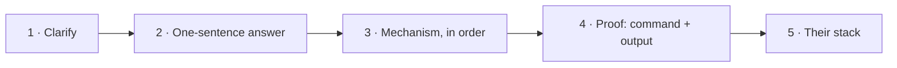

# 15 · Interview Preparation 🎤

Levels 1–12 teach. This module **rehearses**: it turns what you know into answers you can say clearly, in order, under time pressure, with a command that proves each claim.

**Start here when:** you've reached at least the [Level 3 milestone](../03-core-networking-protocols/README.md#milestone-youre-ready-for-level-4-when-you-can). Rehearsing answers you don't understand yet only builds confident mistakes.

⏱️ **Estimated time:** about 10 hours for a first pass (question bank ~3 h, scenarios ~3 h, drills and whiteboard ~2 h, one mock ~1 h, review ~1 h), then 20 minutes a day before an interview. These are estimates.

## What's in this module

| File | Use it for |
|---|---|
| This README | How to answer, the question bank by level, explain-out-loud drills, whiteboard diagrams, a mock interview plan |
| [Troubleshooting scenarios: Docker, Kubernetes and AWS](troubleshooting-scenarios-docker-kubernetes-aws.md) ⭐🔥 | 13 scenarios (N1–N13) in interview style: **Say**, **Check**, **He'll push** |

## Interview notes elsewhere in this repository

These were written for the One2N interviews and are the most realistic practice material you have. The networking parts are listed here; the rest of each file covers Linux, CI/CD, databases and observability.

| File | Networking parts |
|---|---|
| [Past interview questions](../../hemant-past-interview-questions.md) | The 58 questions as a checklist; sections 1–3 (DNS, IP addressing, TCP/HTTP), 5 (debugging) and 10 (hybrid connectivity) |
| [Model answers](../../hemant-model-answers.md) | Answers to the same questions: [DNS](../../hemant-model-answers.md#1-dns-and-name-resolution), [IP addressing](../../hemant-model-answers.md#2-ip-addressing), [TCP, UDP and HTTP](../../hemant-model-answers.md#3-tcp-udp-and-http), [debugging](../../hemant-model-answers.md#5-debugging-methodology), and Q50–Q51 (AWS to on-premises) |
| [Scenario deep dives](../../hemant-scenario-deep-dives.md) ⭐🔥 | A2 (overlapping CIDRs between VPCs), A3 (node vs pod CIDR on EKS), and the network scenarios in [Part B](../../hemant-scenario-deep-dives.md#part-b-more-scenarios-hemant-style) |
| [Transcript review, 9 Oct](../../interview-transcript-review-oct-9.md) 🔥 | What went wrong and why; [the subnetting gap](../../interview-transcript-review-oct-9.md#3-the-biggest-gap-ip-and-subnetting-maths) and [placement, route tables and traffic flow](../../interview-transcript-review-oct-9.md#4-placement-route-tables-and-traffic-flow) |
| [Interview review, 9 Oct](../../interview-review-oct-9.md) | VPC and subnet choices, CIDR, NAT gateway vs internet gateway, drawn as one architecture |

## How to answer a networking question

Interviewers rarely want a definition. They want to see that you can follow a packet and prove where it stopped. Use the same five steps for almost every question:

1. **Clarify** the question in one line. "Not reachable from where: the same VPC, the internet, another pod?"
2. **Answer in one sentence** first. "It's listening on `127.0.0.1`, so only the same machine can connect."
3. **Walk the mechanism in order**: the packet's path, or the layers, or the [6-step method](../03-core-networking-protocols/11-troubleshooting-connectivity.md#the-method-say-this-in-the-interview) (DNS → route → port → listener → rules → app).
4. **Prove it**: name the command, and what its output would show. `ss -ltnp` shows `127.0.0.1:8000`.
5. **Connect it to their stack**: the same idea in Docker, Kubernetes or AWS.

**When you don't know:** say what you do know, how you'd find out (the command or the document), and what you'd expect to see. "I'm not sure of the exact default, but I'd check `sysctl net.ipv4.tcp_keepalive_time`" is a good answer; a confident guess is a bad one.

## Question bank by level

Answer each one **out loud before** you open the link. The link goes to the lesson that answers it. ⭐ = very likely · 🔥 = a gap from the 9 Oct review · 🖥️ = you may be asked to show it live.

### Level 1 · Fundamentals

| Question | Answer in |
|---|---|
| What's the difference between a switch and a router? | [1.2](../01-networking-fundamentals/02-network-devices.md) |
| ⭐ The app works inside the container but not from outside. Why might that be? | [1.3](../01-networking-fundamentals/03-addresses-ports-and-protocols.md) |
| What is a socket? What is the 5-tuple? | [1.3](../01-networking-fundamentals/03-addresses-ports-and-protocols.md) |
| 🔥 A 300 Mbit/s link: how many megabytes per second is that? | [1.4](../01-networking-fundamentals/04-network-performance.md) |
| Latency vs bandwidth: which one makes a page with 80 small requests slow? | [1.4](../01-networking-fundamentals/04-network-performance.md) |
| ⭐ Walk the OSI layers with one protocol for each. Where does an L4 load balancer stop reading, and an L7 one? | [1.5](../01-networking-fundamentals/05-osi-and-tcp-ip-models.md) |

### Level 2 · IP addressing and subnetting 🔥

| Question | Answer in |
|---|---|
| ⭐🔥 What do `/16` and `10.0.1.0/24` mean? The first and last address? How many usable in an AWS subnet? | [2.3](../02-ip-addressing-and-subnetting/03-subnet-masks-and-cidr.md) |
| ⭐ Is `172.32.0.5` a private address? Which ranges are private, exactly? | [2.2](../02-ip-addressing-and-subnetting/02-ipv4-addresses-and-ranges.md) |
| ⭐🔥 Split `10.0.0.0/16` into 3 AZs × 3 tiers. Why that many subnets, and how big? | [2.4](../02-ip-addressing-and-subnetting/04-subnetting-step-by-step.md) |
| 🔥 Do `10.0.0.0/16` and `10.0.128.0/17` overlap? Why does it matter when you peer two VPCs? | [2.5](../02-ip-addressing-and-subnetting/05-vlsm-and-route-summarization.md) |
| ⭐ How does a host decide whether to send a packet to the gateway? What is longest prefix match? | [2.7](../02-ip-addressing-and-subnetting/07-default-gateway-routing-table-and-arp.md) |
| Across three routers, which addresses in a packet change at each hop, and which don't? | [2.7](../02-ip-addressing-and-subnetting/07-default-gateway-routing-table-and-arp.md) |
| A laptop shows `169.254.12.7`. What happened? | [2.8](../02-ip-addressing-and-subnetting/08-dhcp.md) |
| Why is every IPv6 LAN a `/64`? | [2.6](../02-ip-addressing-and-subnetting/06-ipv6-fundamentals.md) |

Drill the maths, not just the questions: [Level 2 drills](../14-practice-exercises/02-level-2-subnetting-drills.md), sets B and C, until each answer takes under a minute on paper.

### Level 3 · Core protocols

| Question | Answer in |
|---|---|
| ⭐🖥️ What happens when you type a URL into the browser? | [3.10](../03-core-networking-protocols/10-packet-flow-end-to-end.md) |
| ⭐ "Connection refused" vs "timed out" vs "reset by peer": what does each tell you? | [3.2](../03-core-networking-protocols/02-tcp-and-udp.md), [3.11](../03-core-networking-protocols/11-troubleshooting-connectivity.md) |
| ⭐ A server has thousands of `CLOSE_WAIT` sockets. Whose bug is it? And `TIME_WAIT`? | [3.3](../03-core-networking-protocols/03-tcp-in-depth.md) |
| 🖥️ Prove that HTTP runs on top of TCP. | [3.5](../03-core-networking-protocols/05-http-and-https.md), [Lab 3.1](../13-hands-on-labs/lab-03.1-capture-a-tcp-handshake.md) |
| ⭐🖥️ Walk a DNS lookup from `/etc/resolv.conf` to the authoritative server. What does "non-authoritative answer" mean? | [3.4](../03-core-networking-protocols/04-dns.md) |
| NXDOMAIN vs SERVFAIL? What is `ndots:5` in Kubernetes and why does it cost lookups? | [3.4](../03-core-networking-protocols/04-dns.md) |
| ⭐ 502 vs 503 vs 504 at a load balancer: which side failed? | [3.5](../03-core-networking-protocols/05-http-and-https.md) |
| ⭐ Walk the TLS 1.3 handshake. What does `unable to get local issuer certificate` mean? | [3.6](../03-core-networking-protocols/06-tls-and-certificates.md) |
| How does traceroute work? What does a path MTU black hole look like? | [3.7](../03-core-networking-protocols/07-icmp-ping-and-traceroute.md) |
| ⭐🔥 Internet gateway vs NAT gateway: where does each go, and why does a private subnet need NAT? | [3.8](../03-core-networking-protocols/08-nat-pat-and-port-forwarding.md) |
| 🔥 How does a developer reach a database in a private subnet? | [3.9](../03-core-networking-protocols/09-everyday-protocols-and-ports.md) |
| ⭐🔥 `example.com/ABC` works but `example.com/DEF` doesn't. How do you debug it? | [3.11](../03-core-networking-protocols/11-troubleshooting-connectivity.md), [model answer Q26](../../hemant-model-answers.md#5-debugging-methodology) |

### Levels 8 and 10 · Linux, containers and Kubernetes (written parts)

| Question | Answer in |
|---|---|
| ⭐ MASQUERADE vs SNAT vs DNAT. What does conntrack remember? | [8.6](../08-linux-networking/06-netfilter-nat-and-conntrack.md) |
| ⭐🔥 How does `docker run -p 8080:80` actually work? Why doesn't `ufw` block a published port? | [8.6](../08-linux-networking/06-netfilter-nat-and-conntrack.md), [10.1](../10-container-and-kubernetes-networking/01-docker-bridge-networking-inside-out.md) |
| 🖥️ Show me the bridge and the veth pair for a running container. | [Lab 10.1](../13-hands-on-labs/lab-10.1-docker-bridge-nat-and-dns.md) |
| How do two containers in the same pod talk to each other? Why can't both listen on port 80? | [Level 10](../10-container-and-kubernetes-networking/README.md#the-idea-underneath-it-all-network-namespaces) |

### Levels 4–7, 9, 11 and 12 (not written yet)

These levels are outlines. Until they're written, practise their likeliest interview topics from the notes that already exist:

- **Cloud networking (Level 9):** overlapping CIDRs between VPCs ([deep dive A2](../../hemant-scenario-deep-dives.md)), pod CIDRs on EKS (A3), AWS to on-premises connectivity ([model answers Q50–Q51](../../hemant-model-answers.md)), and the AWS scenarios in [N1–N13](troubleshooting-scenarios-docker-kubernetes-aws.md).
- **Kubernetes Services and Ingress (Level 10):** [Kubernetes 08 · Services and DNS](../../kubernetes/08-services-and-dns.md) and [14 · Cluster networking](../../kubernetes/14-cluster-networking.md).
- **Expert troubleshooting (Level 12):** the 🟠 advanced and 🔴 expert cases in the [troubleshooting exercises](../14-practice-exercises/04-troubleshooting-scenarios.md) (NAT port exhaustion, idle timeouts, long-haul throughput).

## Explain-out-loud drills

Talking is a separate skill from knowing. Do one or two of these a day: **set a timer, record yourself on your phone, then listen back** for gaps, filler words and steps out of order.

| # | Drill | Time limit | Check against |
|---|---|---|---|
| 1 | "What happens when you type a URL?" | 60 s, then again in 5 min with every detail | [3.10](../03-core-networking-protocols/10-packet-flow-end-to-end.md) |
| 2 | Subnet `10.123.45.67/20` out loud: network, broadcast, host range, count | 60 s | [Lab 2.1's script](../13-hands-on-labs/files/lab-02.1/subnet_check.py) |
| 3 | Map each error to the broken step: `Could not resolve host`, `Connection refused`, `Connection timed out`, `Connection reset by peer`, `SSL certificate problem`, `502` | 90 s | [3.11](../03-core-networking-protocols/11-troubleshooting-connectivity.md) |
| 4 | Explain NAT to a non-engineer using the [building story](../10-container-and-kubernetes-networking/README.md#the-one-story-behind-docker-networking) | 2 min | [3.8](../03-core-networking-protocols/08-nat-pat-and-port-forwarding.md) |
| 5 | Read a TCP handshake capture line by line: flags, sequence numbers, MSS | 2 min | [Lab 3.1](../13-hands-on-labs/lab-03.1-capture-a-tcp-handshake.md) |
| 6 | Walk a DNS lookup, naming who caches what and for how long | 2 min | [3.4](../03-core-networking-protocols/04-dns.md) |
| 7 | A pod in a private subnet calls an external API: every hop, every address change | 3 min | [3.8](../03-core-networking-protocols/08-nat-pat-and-port-forwarding.md), [deep dive A3](../../hemant-scenario-deep-dives.md) |
| 8 | Pick any scenario from N1–N13 and answer in the 6-step order without notes | 3 min each | [The scenarios](troubleshooting-scenarios-docker-kubernetes-aws.md) |

## Whiteboard diagrams to practise

You'll often be asked to draw. Practise each one **from memory** on paper until you can draw it in two minutes while talking.

| Diagram | Reference | When it comes up |
|---|---|---|
| The debugging ladder | [06-debug-ladder](../diagrams/06-debug-ladder.drawio.svg), [3.11](../03-core-networking-protocols/11-troubleshooting-connectivity.md) | Any "it doesn't work" question |
| A DNS lookup's journey | [04-dns-journey](../diagrams/04-dns-journey.drawio.svg), [3.4](../03-core-networking-protocols/04-dns.md) | "What happens when you type a URL" |
| The OSI layers and encapsulation | [08-osi-layers](../diagrams/08-osi-layers.drawio.svg), [08-osi-encapsulation](../diagrams/08-osi-encapsulation.drawio.svg) | "Where does X sit?", L4 vs L7 |
| A packet's journey through a Docker host | [the packet flow](../../docker/diagrams/08-packet-flow.drawio.svg), [10.1](../10-container-and-kubernetes-networking/01-docker-bridge-networking-inside-out.md) | `-p`, NAT, "why can't I reach my container" |
| Netfilter's five hooks | [02-netfilter-chains](../diagrams/02-netfilter-chains.drawio.svg), [8.6](../08-linux-networking/06-netfilter-nat-and-conntrack.md) | iptables, kube-proxy, Docker and `ufw` |
| A VPC: 3 AZs × public, private and data subnets, IGW, NAT gateways, route tables | [Interview review, section 1](../../interview-review-oct-9.md) | 🔥 Any AWS design question |

## A one-hour mock interview

Ask a friend to play the interviewer, or do it alone with a recorder. They pick; you don't see the list in advance.

| Minutes | Part | Material |
|---|---|---|
| 0–10 | Warm-up: three questions from Levels 1–2 | The question bank above |
| 10–25 | Depth: one Level 3 question, then "and then what?" three times | The question bank above |
| 25–40 | Troubleshooting: one scenario, answered in method order | [N1–N13](troubleshooting-scenarios-docker-kubernetes-aws.md) or [T1–T14](../14-practice-exercises/04-troubleshooting-scenarios.md) |
| 40–55 | Design on the whiteboard: a VPC and its traffic flow | The diagrams above |
| 55–60 | Feedback: what was vague, what was out of order, what had no proof | Write it down; that's tomorrow's practice |

## Ready-for-interview checklist

- [ ] Every milestone in Levels 1–3 ticked ([1](../01-networking-fundamentals/README.md), [2](../02-ip-addressing-and-subnetting/README.md), [3](../03-core-networking-protocols/README.md)).
- [ ] Level 2 drills: 90% or better, under a minute per set B question.
- [ ] [Lab 3.5](../13-hands-on-labs/lab-03.5-troubleshooting-challenge.md): 8 of 8 faults found, each with evidence.
- [ ] Every question in the bank above answered out loud without notes.
- [ ] N1–N13 answered in method order, including the "He'll push" follow-ups.
- [ ] All six whiteboard diagrams drawn from memory.
- [ ] One full mock interview done, and its feedback practised.
