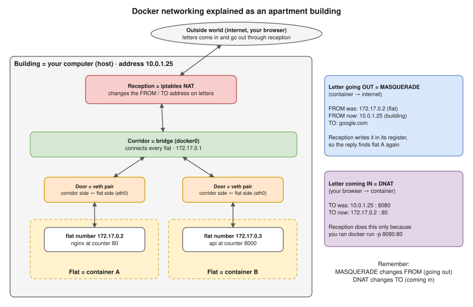

# 🌐 Networking Notes: Interview Edition

Everything we've learned about networking while preparing for the interview with Hemant (One2N), in the same format as the [Docker](../docker/README.md) and [Kubernetes](../kubernetes/README.md) notes.

Networking is not a separate topic in this round. It sits **underneath** Docker, Kubernetes and AWS, and Hemant likes to dig into it ("what really happens when…?"). So every file here connects the idea back to those topics.

## How to use these notes

- Read one file at a time, then try its **Practice** commands, then answer its **Interview angle** questions **out loud**.
- ⭐ = very likely interview topic · 🖥️ = he may ask you to show it live · 🔥 = Hemant's feedback topics
- Every output marked **(tested)** was really run on this Mac (Docker Desktop 29.6.2) on 7–8 Oct 2026.

## The one story behind all of it

| Real thing | In the story |
|---|---|
| Your computer (the **host**) | **The building**, with a street address (`10.0.1.25`) |
| A **container** | **A flat** inside it, with a flat number (`172.17.0.2`) that only means something inside the building |
| A **packet** | **A letter**, with a **FROM** address and a **TO** address |
| A **port** | **A counter number** inside a flat (nginx sits at counter 80) |
| **Bridge** (`docker0`) | **The corridor** that connects all the flats |
| **veth pair** | **The door** of each flat: one side inside (`eth0`), one side in the corridor |
| **iptables NAT** | **Reception**: the only place that changes addresses on letters |
| **MASQUERADE** | Reception **masks the FROM** address on letters going **out** |
| **DNAT** | Reception **changes the TO** address on letters coming **in** (only because of `-p`) |
| **conntrack** | Reception's **register**: it remembers every change, so replies find their way back |
| **DNS** | **The phonebook**: turns a name into an address |

## Contents

| # | File | What's inside |
|---|---|---|
| 01 | [Basics](01-basics.md) | IP addresses, private ranges, CIDR, ports, TCP vs UDP, interfaces, `127.0.0.1` vs `0.0.0.0` ⭐, gateways, namespaces |
| 02 ⭐ | [NAT: MASQUERADE, SNAT, DNAT](02-nat.md) | Full forms, the 5 netfilter checkpoints, conntrack, the ufw bypass 🔥, NAT gateway |
| 03 ⭐ | [Docker bridge networking, inside out](03-docker-bridge.md) | Bridge, veth, routes, the packet's journey, docker-proxy, what Docker Desktop hides |
| 04 ⭐ | [DNS](04-dns.md) | `nslookup` line by line, authoritative vs cached, records, TTL, Docker / Kubernetes / AWS DNS |
| 05 🖥️ | [Hands-on lab](05-hands-on-lab.md) | See the bridge, the doors, MASQUERADE and DNAT with your own eyes (20 minutes) |
| 06 ⭐🔥 | [Debugging](06-debugging.md) | The 6-step method, what each error means, scenarios in Hemant's style |
| 07 | [Network command list](07-network-commands.md) | Every command by task: Mac, Linux, Docker, Kubernetes, AWS (all tested) |

**Before Friday:** read 02, 03, 04 and 06 (about 1.5 hours), and do the lab (05) if you have 20 minutes.

## Diagrams

The diagrams are in [diagrams/](diagrams/) as editable **`.drawio.svg`** files. They appear inside the notes; to edit one, open it in VS Code (Draw.io Integration) or [app.diagrams.net](https://app.diagrams.net). Two more live in the Docker notes and are used here too: [the bridge network](../docker/diagrams/08-bridge-network.drawio.svg) and [the packet's journey](../docker/diagrams/08-packet-flow.drawio.svg).

**To redraw on a whiteboard in the interview:** the packet's journey (03) and the debugging ladder (06).

## Related files

- [Docker 08 Networking](../docker/08-networking.md): network types, the default-bridge DNS trap, port publishing.
- Kubernetes: [08 Services and DNS](../kubernetes/08-services-and-dns.md), [14 Cluster networking](../kubernetes/14-cluster-networking.md), [17 Troubleshooting](../kubernetes/17-troubleshooting.md), [20 EKS](../kubernetes/20-eks.md).
- [Scenario deep dives](../hemant-scenario-deep-dives.md): A2 overlapping CIDRs, A3 node vs pod CIDR, B1 and B10–B13 (network scenarios).

## Videos (already in your study plan, all checked)

- ⭐ [NAT Explained](https://www.youtube.com/watch?v=FTUV0t6JaDA) · PowerCert · 4 min
- [DNS explained](https://www.youtube.com/watch?v=mpQZVYPuDGU) · 6 min
- [Docker networking is CRAZY!!](https://www.youtube.com/watch?v=bKFMS5C4CG0) · NetworkChuck · 39 min
- [Life of a Packet](https://www.youtube.com/watch?v=0Omvgd7Hg1I) · Michael Rubin, Google (KubeCon) · 34 min, Kubernetes networking
