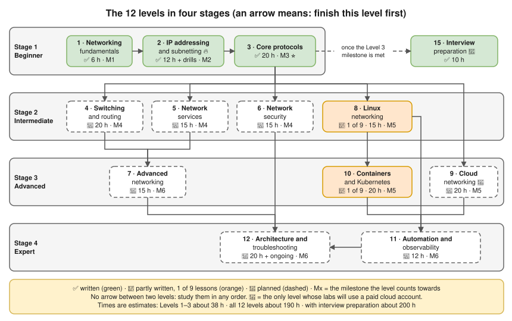

# 🌐 Networking: Zero to Expert

From "what is a network?" to designing and troubleshooting production networks in Linux, Kubernetes and the cloud. Started as the networking notes for the One2N interviews: **networking sits underneath Docker, Kubernetes and AWS**, so every lesson connects back to them.

> **Status.** Levels 1–3 (the foundations) are written in full: 24 lessons, 10 labs, 4 exercise sets with solutions. Levels 4–12 have detailed outlines, and Levels 8 and 10 each have one deep note already. The [content audit](00-learning-roadmap/content-audit.md) lists exactly what exists and what remains.

## Start here

1. [Prerequisites](00-learning-roadmap/prerequisites.md): no networking knowledge needed, just a terminal and Docker.
2. [How to study](00-learning-roadmap/how-to-study.md) (10 minutes): the lesson layout, the symbols and the study loop.
3. Pick a path in the [learning roadmap](00-learning-roadmap/learning-roadmap.md): DevOps/SRE/cloud, network engineer, or the interview fast track. It explains every arrow above.
4. Begin [Level 1](01-networking-fundamentals/README.md). Set up the [lab environment](13-hands-on-labs/00-lab-environment-setup.md) before its second lab.

## Modules

✅ written · 🚧 partly written · 📝 planned (outline only). Times are **estimates**.

| # | Module | Status | Time (estimate) | What's inside |
|---|---|---|---|---|
| 00 | [Learning roadmap](00-learning-roadmap/README.md) | ✅ | 30 min | The roadmap, prerequisites, how to study, the content audit |
| 01 | [Networking fundamentals](01-networking-fundamentals/README.md) | ✅ | 6 h | Networks, devices, addresses and ports, performance, the OSI and TCP/IP models |
| 02 | [IP addressing and subnetting](02-ip-addressing-and-subnetting/README.md) 🔥 | ✅ | 12 h + daily drills | Binary, IPv4 ranges, CIDR, subnetting, VLSM, IPv6, routing tables and ARP, DHCP |
| 03 | [Core networking protocols](03-core-networking-protocols/README.md) ⭐ | ✅ | 20 h | Ethernet, TCP and UDP, DNS, HTTP, TLS, ICMP, NAT, end-to-end flow, troubleshooting |
| 04 | [Switching and routing](04-switching-and-routing/README.md) | 📝 | 20 h | VLANs, STP, LACP, static and dynamic routing, OSPF, BGP, FHRP and ECMP |
| 05 | [Network services and infrastructure](05-network-services-and-infrastructure/README.md) | 📝 | 15 h | Load balancers, proxies, CDNs, DNS and DHCP at scale, NTP, VPNs |
| 06 | [Network security](06-network-security/README.md) | 📝 | 15 h | Firewalls, segmentation and zero trust, layer 2 attacks, DDoS, securing DNS and TLS, detection |
| 07 | [Advanced networking](07-advanced-networking/README.md) | 📝 | 15 h | Tunnels, VXLAN and Geneve overlays, MPLS and SD-WAN, QoS, multicast, IPv6 in production, anycast |
| 08 | [Linux networking](08-linux-networking/README.md) | 🚧 1 of 9 | 15 h | `iproute2`, namespaces, policy routing, `sysctl`, `tc`, **netfilter and conntrack** (written), nftables, eBPF |
| 09 | [Cloud networking](09-cloud-networking/README.md) 💸 | 📝 | 20 h | VPC design, IGW vs NAT gateway, security groups vs NACLs, endpoints, Transit Gateway, hybrid |
| 10 | [Container and Kubernetes networking](10-container-and-kubernetes-networking/README.md) | 🚧 1 of 9 | 20 h | **Docker bridge networking** (written), the Kubernetes network model, CNI, Services, Ingress, NetworkPolicy |
| 11 | [Network automation and observability](11-network-automation-and-observability/README.md) | 📝 | 12 h | Networks as code, flow logs, metrics, packet capture at scale |
| 12 | [Expert architecture and troubleshooting](12-expert-architecture-and-troubleshooting/README.md) | 📝 | 20 h | Data-centre and multi-region design, designing for failure, intermittent problems |
| 13 | [Hands-on labs](13-hands-on-labs/README.md) 🖥️ | ✅ for Levels 1–3 | about 9 h for Levels 1–3 | Reproducible labs in a free local container; every lab breaks something on purpose |
| 14 | [Practice exercises](14-practice-exercises/README.md) ✍️ | ✅ for Levels 1–3 | about 8–10 h for Levels 1–3 | Beginner to expert questions, with solutions in a separate folder |
| 15 | [Interview preparation](15-interview-preparation/README.md) 🎤 | ✅ | 10 h | How to answer, a question bank by level, scenarios, drills, whiteboard diagrams, a mock interview |
| | [Diagrams](diagrams/README.md) | ✅ | | Editable `.drawio.svg` diagrams used in the lessons |
| | [References](references/README.md) | ✅ | | Glossary, common ports, command cheatsheet, RFCs, videos and books |

**Total (estimate):** Levels 1–3 about 38 h; all 12 levels about 190 h; with interview preparation about 200 h. [Pacing](00-learning-roadmap/learning-roadmap.md#pacing): weeks at 5, 10 or 20 hours a week.

## Milestones

Each level ends with a milestone checklist (the Mx tags in the diagram):

| # | After | You can… |
|---|---|---|
| M1 | [Level 1](01-networking-fundamentals/README.md#milestone-youre-ready-for-level-2-when-you-can) | Draw and explain your own network, layer by layer |
| M2 | [Level 2](02-ip-addressing-and-subnetting/README.md#milestone-youre-ready-for-level-3-when-you-can) | Subnet on paper in under a minute, and plan a VPC without overlaps |
| M3 ⭐ | [Level 3](03-core-networking-protocols/README.md#milestone-youre-ready-for-level-4-when-you-can) | Troubleshoot any connection with the 6-step method, with evidence. **Interview-ready for networking fundamentals** |
| M4–M6 | Levels 4–12 | Design and secure networks; debug Linux, cloud and Kubernetes networking; design for scale and lead incidents (planned) |

## Prerequisites and tools

- **Knowledge:** none in networking; basic terminal and basic Docker ([details](00-learning-roadmap/prerequisites.md#skills)).
- **Machine:** a Mac with Docker Desktop (what these notes were written on) or any Linux machine. Windows through WSL 2 or a VM: not tested.
- **Tools:** the [lab container](13-hands-on-labs/00-lab-environment-setup.md) has every Linux tool the labs use (`ip`, `tcpdump`, `tshark`, `dig`, BIND, `dnsmasq`, `openssl`, `iptables`, `conntrack`, `iperf3`…). [Tools by level](00-learning-roadmap/prerequisites.md#tools-by-level).
- **Cost:** Levels 1–8, 10 and 11 are **free** and local. Level 9's labs (planned) will use a cloud account: 💸 **may cost money**.

## Lab index

All current labs are 💰 free; times are estimates. Planned labs and safety notes: [lab index](13-hands-on-labs/README.md).

| Lab | Level | Runs on | Time |
|---|---|---|---|
| [00 · Lab environment setup](13-hands-on-labs/00-lab-environment-setup.md) | all | 💻 Mac + Docker | 20 min |
| [1.1 · Inspect your own network](13-hands-on-labs/lab-01.1-inspect-your-own-network.md) | 1 | 💻 Mac | 20 min |
| [1.2 · Build a tiny network with namespaces](13-hands-on-labs/lab-01.2-build-a-tiny-network-with-namespaces.md) | 1 | 🐧 lab container | 45 min |
| [2.1 · Subnetting by hand, then verify](13-hands-on-labs/lab-02.1-subnetting-by-hand-then-verify.md) 🔥 | 2 | 📝 paper + 🐍 Python | 60 min |
| [2.2 · Routing between two subnets](13-hands-on-labs/lab-02.2-routing-between-two-subnets.md) | 2 | 🐧 lab container | 65 min |
| [2.3 · DHCP: capture DORA](13-hands-on-labs/lab-02.3-dhcp-dora-capture.md) | 2 | 🐧 lab container | 30 min |
| [3.1 · Capture a TCP handshake](13-hands-on-labs/lab-03.1-capture-a-tcp-handshake.md) | 3 | 🐧 lab container | 60 min |
| [3.2 · Trace DNS resolution](13-hands-on-labs/lab-03.2-trace-dns-resolution.md) | 3 | 🐧 lab container | 60 min |
| [3.3 · TLS: certificates and the handshake](13-hands-on-labs/lab-03.3-tls-certificates-and-handshake.md) | 3 | 🐧 lab container | 60 min |
| [3.4 · NAT and port forwarding](13-hands-on-labs/lab-03.4-nat-and-port-forwarding.md) | 3 | 🐧 lab container | 45 min |
| [3.5 · Troubleshooting challenge](13-hands-on-labs/lab-03.5-troubleshooting-challenge.md) ⭐🔥 | 3 | 🐧 lab container | 2 h |
| [10.1 · Docker bridge, NAT and DNS](13-hands-on-labs/lab-10.1-docker-bridge-nat-and-dns.md) | 10 | 💻 Mac + Docker | 20 min |

## Exercise index

Solutions are in a separate [solutions/](14-practice-exercises/solutions/) folder. 🟢 beginner · 🟡 intermediate · 🟠 advanced · 🔴 expert.

| Set | Level | Difficulty | Solutions |
|---|---|---|---|
| [01 · Level 1 fundamentals](14-practice-exercises/01-level-1-fundamentals.md) | 1 | 🟢 → 🔴 | [solutions](14-practice-exercises/solutions/01-level-1-fundamentals-solutions.md) |
| [02 · Level 2 subnetting drills](14-practice-exercises/02-level-2-subnetting-drills.md) 🔥 | 2 | 🟢 → 🔴 | [solutions](14-practice-exercises/solutions/02-level-2-subnetting-drills-solutions.md) |
| [03 · Level 3 protocols](14-practice-exercises/03-level-3-protocols.md) | 3 | 🟢 → 🔴 | [solutions](14-practice-exercises/solutions/03-level-3-protocols-solutions.md) |
| [04 · Troubleshooting scenarios](14-practice-exercises/04-troubleshooting-scenarios.md) ⭐ | 3+ | 🟢 → 🔴 | [solutions](14-practice-exercises/solutions/04-troubleshooting-scenarios-solutions.md) |
| [Lab 3.5 challenge](13-hands-on-labs/lab-03.5-troubleshooting-challenge.md) | 3 | 🟡 → 🟠 | [solutions](14-practice-exercises/solutions/lab-03.5-troubleshooting-challenge-solutions.md) |
| [Interview scenarios N1–N13](15-interview-preparation/troubleshooting-scenarios-docker-kubernetes-aws.md) ⭐🔥 | 3, 8–10 | 🟡 → 🟠 | answers inline (Say / Check / He'll push) |

## Reference index

| Reference | Use it for |
|---|---|
| [Glossary](references/glossary.md) | About 120 terms in plain words, each linked to its lesson |
| [Common ports](references/common-ports.md) | Ports by category, checked against `/etc/services` |
| [Network command cheatsheet](references/network-commands-cheatsheet.md) | Every command by task: Mac, Linux, Docker, Kubernetes, AWS |
| [Standards and RFCs](references/standards-and-rfcs.md) | The documents behind each lesson |
| [Videos and further reading](references/videos-and-further-reading.md) | Videos by level, books, online references |
| [Diagrams](diagrams/README.md) | The editable diagram sources |

## Progress checklist

Tick as you go (copy the list into your own notes, or edit this file).

**Getting started**
- [ ] Read the [prerequisites](00-learning-roadmap/prerequisites.md) and [how to study](00-learning-roadmap/how-to-study.md)
- [ ] Set up the [lab environment](13-hands-on-labs/00-lab-environment-setup.md)

**Level 1 · Fundamentals**
- [ ] [1.1](01-networking-fundamentals/01-what-is-a-network.md) · [1.2](01-networking-fundamentals/02-network-devices.md) · [1.3](01-networking-fundamentals/03-addresses-ports-and-protocols.md) · [1.4](01-networking-fundamentals/04-network-performance.md) · [1.5](01-networking-fundamentals/05-osi-and-tcp-ip-models.md) lessons
- [ ] Labs [1.1](13-hands-on-labs/lab-01.1-inspect-your-own-network.md) and [1.2](13-hands-on-labs/lab-01.2-build-a-tiny-network-with-namespaces.md)
- [ ] [Level 1 exercises](14-practice-exercises/01-level-1-fundamentals.md): 80% or better
- [ ] **M1** milestone ticked

**Level 2 · IP addressing and subnetting** 🔥
- [ ] [2.1](02-ip-addressing-and-subnetting/01-binary-decimal-and-hex.md) · [2.2](02-ip-addressing-and-subnetting/02-ipv4-addresses-and-ranges.md) · [2.3](02-ip-addressing-and-subnetting/03-subnet-masks-and-cidr.md) · [2.4](02-ip-addressing-and-subnetting/04-subnetting-step-by-step.md) lessons
- [ ] [2.5](02-ip-addressing-and-subnetting/05-vlsm-and-route-summarization.md) · [2.6](02-ip-addressing-and-subnetting/06-ipv6-fundamentals.md) · [2.7](02-ip-addressing-and-subnetting/07-default-gateway-routing-table-and-arp.md) · [2.8](02-ip-addressing-and-subnetting/08-dhcp.md) lessons
- [ ] Labs [2.1](13-hands-on-labs/lab-02.1-subnetting-by-hand-then-verify.md), [2.2](13-hands-on-labs/lab-02.2-routing-between-two-subnets.md) and [2.3](13-hands-on-labs/lab-02.3-dhcp-dora-capture.md)
- [ ] [Subnetting drills](14-practice-exercises/02-level-2-subnetting-drills.md): 90% or better, under a minute per set B question
- [ ] **M2** milestone ticked

**Level 3 · Core protocols**
- [ ] [3.1](03-core-networking-protocols/01-ethernet-and-switching-basics.md) · [3.2](03-core-networking-protocols/02-tcp-and-udp.md) · [3.3](03-core-networking-protocols/03-tcp-in-depth.md) · [3.4](03-core-networking-protocols/04-dns.md) lessons
- [ ] [3.5](03-core-networking-protocols/05-http-and-https.md) · [3.6](03-core-networking-protocols/06-tls-and-certificates.md) · [3.7](03-core-networking-protocols/07-icmp-ping-and-traceroute.md) · [3.8](03-core-networking-protocols/08-nat-pat-and-port-forwarding.md) lessons
- [ ] [3.9](03-core-networking-protocols/09-everyday-protocols-and-ports.md) · [3.10](03-core-networking-protocols/10-packet-flow-end-to-end.md) · [3.11](03-core-networking-protocols/11-troubleshooting-connectivity.md) lessons
- [ ] Labs [3.1](13-hands-on-labs/lab-03.1-capture-a-tcp-handshake.md), [3.2](13-hands-on-labs/lab-03.2-trace-dns-resolution.md), [3.3](13-hands-on-labs/lab-03.3-tls-certificates-and-handshake.md) and [3.4](13-hands-on-labs/lab-03.4-nat-and-port-forwarding.md)
- [ ] [Lab 3.5 challenge](13-hands-on-labs/lab-03.5-troubleshooting-challenge.md): 8 of 8 faults, with evidence
- [ ] [Level 3 exercises](14-practice-exercises/03-level-3-protocols.md) and [troubleshooting scenarios](14-practice-exercises/04-troubleshooting-scenarios.md)
- [ ] **M3** milestone ticked ⭐

**Written notes from later levels**
- [ ] [8.6 · Netfilter, NAT and conntrack](08-linux-networking/06-netfilter-nat-and-conntrack.md)
- [ ] [10.1 · Docker bridge networking](10-container-and-kubernetes-networking/01-docker-bridge-networking-inside-out.md) and [Lab 10.1](13-hands-on-labs/lab-10.1-docker-bridge-nat-and-dns.md)

**Interview preparation**
- [ ] The [ready-for-interview checklist](15-interview-preparation/README.md#ready-for-interview-checklist)

**Levels 4–12** (as they're written)
- [ ] 4 · Switching and routing
- [ ] 5 · Network services
- [ ] 6 · Network security
- [ ] 7 · Advanced networking
- [ ] 8 · Linux networking (the rest)
- [ ] 9 · Cloud networking
- [ ] 10 · Containers and Kubernetes (the rest)
- [ ] 11 · Automation and observability
- [ ] 12 · Expert architecture and troubleshooting

## How to navigate

- **Folders are numbered in study order:** `00` the roadmap, `01`–`12` the levels; `13` labs, `14` exercises and `15` interview preparation support every level.
- **Every level has a README:** goal, prerequisites, time estimate, lessons in order, practice links, milestone checklist.
- **Lessons are numbered `level.lesson`** (3.4 = Level 3, lesson 4); labs share their level's number (Lab 3.4 practises Level 3). Every lesson ends with a **Next** link.
- **Symbols:** ⭐ likely interview topic · 🔥 a gap from the 9 Oct interview review · 🖥️ may be asked to show it live · 💰 free / 💸 may cost money ([all symbols](00-learning-roadmap/how-to-study.md#symbols-and-labels)).
- **Output labels:** **(tested)** = copied from a real run in the lab container (Ubuntu 24.04, 14 Oct 2026); **(tested on the Mac, Oct 2026)** = a real run on macOS with Docker Desktop 29.6.2; **(illustrative)** = the shape of real output, not captured. Your addresses, ports and timings will differ.
- **Fundamentals vs vendor details:** the vendor-neutral idea first, then AWS, Docker, Kubernetes or macOS specifics, marked as such.
- **Diagrams:** every diagram is a draw.io `.drawio.svg` file in [diagrams/](diagrams/README.md). GitHub shows it as a picture; draw.io (app.diagrams.net, draw.io desktop or the VS Code Draw.io Integration extension) opens it for editing.
- **Looking something up?** The [glossary](references/glossary.md) first, then your editor's search across this folder.

## Related notes in this repository

- [Docker notes](../docker/README.md), especially [08 · Networking](../docker/08-networking.md)
- [Kubernetes notes](../kubernetes/README.md): [08 · Services and DNS](../kubernetes/08-services-and-dns.md), [14 · Cluster networking](../kubernetes/14-cluster-networking.md), [17 · Troubleshooting](../kubernetes/17-troubleshooting.md), [20 · EKS](../kubernetes/20-eks.md)
- Interview material: [past questions](../hemant-past-interview-questions.md), [model answers](../hemant-model-answers.md), [scenario deep dives](../hemant-scenario-deep-dives.md), [transcript review, 9 Oct](../interview-transcript-review-oct-9.md)
