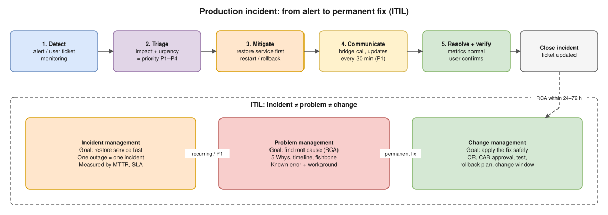
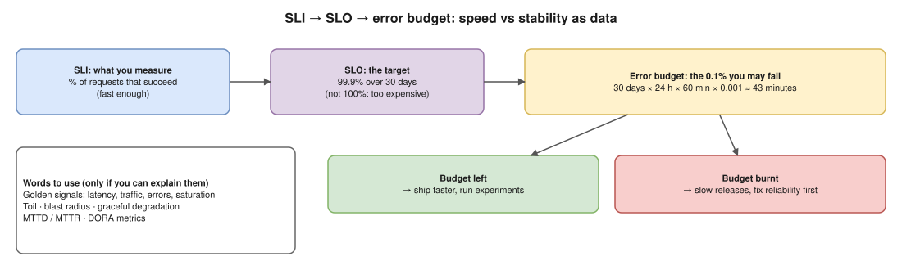
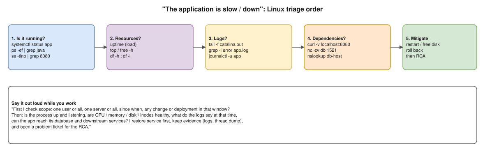

# NiCE Actimize · Application Support Engineer / SRE · F2F cheat sheet

**Interview:** 11 Nov 2026, 2:00 PM IST, face to face. R Systems is the employer and NiCE Actimize is the client, in Pune (Hinjawadi Phase 2).
**Rule from NiCE:** only mention tools that are on your resume. Expect them to dig into practical scenarios for every tool you list.



---

## 0. The rule that decides this interview

- Before you go in, mark every JD line as one of three:
  - **Used in production.** You need a story with numbers.
  - **Know the concept.** Say so plainly: "I know how it works, but I haven't run it in production."
  - **Never used.** Use the honest line below.
- **The honest line:** "I haven't used *Dynatrace* in production. I've used *[your tool]* for the same job: dashboards, alerts and log search. The concepts carry over, and I'd get productive in it quickly."
- **When you don't know:** "I'm not sure. Here's how I'd find out: logs first, then docs, then a test in a lower environment." NiCE's own instructions say an honest "I don't know" beats a guess.
### Your resume vs this JD

| JD asks for | On your resume? | How to play it |
|---|---|---|
| L2/L3 production support, incidents, RCA | Yes: Koko (incident response, RCA, 99.9% uptime, EKS upgrades, SSL renewals, release coordination), One2N (production support, troubleshooting) | Your main ground. Describe your DevOps work in support terms: detect, triage, mitigate, RCA, prevent |
| Linux + Shell scripting | Shell yes (BridgeLabz, daily ops) | Type section 5 commands tomorrow; they will test this |
| Python automation | "Python (Basic)" | Say "basic": you read and change scripts, your automation is mostly Shell, Jenkins, Ansible, Terraform. Don't oversell |
| SQL | Listed; MySQL, PostgreSQL, RDS | Expect live queries. Practise section 7 |
| Monitoring tools | Prometheus, Grafana, Nagios; ELK only as trainee (2020–21) | Lead with federated Prometheus + Grafana + alerting. ELK: say it was early-career. **Not** Dynatrace, AppDynamics, Datadog, Splunk, New Relic → honest line |
| Tomcat / Apache / Nginx / WebLogic / JBoss | **No** | Biggest gap. "My apps ran as containers on EKS behind load balancers, so I didn't run Tomcat directly. I know how it works:" then section 8 at concept level |
| ITIL, ServiceNow / JIRA / PagerDuty | **No** | Know the concepts (section 3). Describe the process you followed (alert → triage → fix → RCA → change via release coordination) without naming tools you didn't use |
| Git, deployment / release management | Yes, strong: GitLab CI, Jenkins → ArgoCD (10 → 2 min), Dev/UAT/Prod releases | Strong story |
| 24x7 / on-call | Not stated | Say what you actually did (on-call rotation? escalation?) and that you're fine with shifts |
| AWS, Docker, Kubernetes, CI/CD, Terraform, Ansible (good to have) | Yes, your strongest area | This is your differentiator. Bring answers back here when you can |
| SLI/SLO, error budgets | Partly: 99.9% uptime, MTTD | Know section 4 numbers cold, because you claim 99.9% |
| Kafka / RabbitMQ / Redis | **No** | Don't claim |
| Certifications | "AWS Cloud Practitioner **Essentials**" is the free training course, not the AWS Certified Cloud Practitioner exam. KodeKloud Docker is a course certificate | If they read it as the AWS certification, correct them yourself. Being caught later is far worse |

**Claims they will ask you to prove (have the numbers ready):**
- **99.9% uptime** (Koko and Perfios): measured how, over what period, on which services? What took the remaining 0.1%?
- **20–30% cost cut during the EKS migration** and **30% EKS cost cut at One2N**: compared with what, and how much from each lever?
- **Image size −30–40%**, **deploy time 10 → 2 min**, **setup 2 h → 20 min**: what changed exactly?
- **"Directed incident response and RCA"**: name one incident, its impact, and your role.
- **Dates:** your Oct 2026 interview notes describe One2N expectations for "1.5–2 years". If anyone asks about your One2N role or the Jan–Mar 2026 gap, answer plainly and consistently with the resume. Background verification will check dates.

- **Questions you should expect on your resume points:** what the 30% EKS saving was measured against and how it splits by lever (gp3, Graviton, cross-AZ), and why telemetry in a single AZ is acceptable. See the FinOps thread notes.

## 1. Your 60-second introduction (fill it in)

"I'm a ___ with ___ years of experience at ___. Day to day I ___ (support / monitor / deploy / automate) ___ (which apps, on what stack). I handle ___ (incidents, on-call, releases). One thing I'm proud of: ___ (a result with a number). I'm looking for an L2/L3 / SRE role where I own reliability end to end, and the financial-crime domain at Actimize is where reliability matters most."

**Draft from your resume (edit it into your own words):**
"I'm a Site Reliability Engineer with about five and a half years in production operations on AWS. I'm currently SRE II at One2N, where I support Kubernetes production environments and set up the Prometheus and Grafana stack for monitoring and alerting. Before that, at Koko Networks, I migrated applications from Docker Swarm to EKS, ran the production side (EKS upgrades, SSL renewals, release coordination, incident response and RCA), and held 99.9% uptime. I started at Perfios, building AWS infrastructure with Terraform and Ansible and supporting Dev, UAT and Prod releases. I want to move closer to the application side: owning the reliability of business-critical apps, and Actimize, in the fintech and compliance space I already know from Perfios, is a good fit for that."

- [Likely] Perfios builds financial data and analytics software for banks and lenders. That makes it your banking/financial-services link to the JD's preferred domains. Only use it if it's accurate for your work there.

## 2. STAR incident stories (prepare 3, 2 minutes each)

| Letter | What to say | Example prompt |
|---|---|---|
| **S**ituation | System, time, who was affected, business impact | "Payment API returned 5xx for 40 min, ~20% of requests" |
| **T**ask | Your role (L2 on-call, incident owner…) | "I was primary on-call" |
| **A**ction | What *you* did, in order: triage, mitigation, communication, evidence | "Checked dashboards, saw DB connection-pool exhaustion, restarted the pool, raised a bridge, updated stakeholders every 30 min" |
| **R**esult | Numbers + permanent fix + what changed after | "Restored in 25 min; RCA found a missing index; added alert on pool usage > 80%; no repeat in 3 months" |

Have these three kinds ready:
1. **A P1 or major incident** that you mitigated under pressure.
2. **An RCA** where the root cause wasn't obvious and you found it with logs or metrics.
3. **An automation** that removed toil, such as a script that cut a manual task from X min to Y min.

**Candidates from your resume.** Pick real incidents. Don't invent any details:

| Story type | Resume source | What to have ready |
|---|---|---|
| P1 / major incident | Koko: "Directed incident response and RCA" | The worst outage you handled: what alerted, the impact, your first 3 actions, who you pulled in, time to restore |
| RCA / detection | Koko: federated Prometheus, proactive alerting for infra and third-party services, MTTD reduced | An incident you caught earlier because of an alert you built. Before vs after detection time |
| Risky change done safely | Koko: Docker Swarm → EKS migration, EKS upgrades, SSL renewals | How you did cutover and rollback, what broke, how you validated. An expired or near-expired certificate story fits "proactive" well |
| Automation / toil | Perfios: Ansible setup 2 h → 20 min; Koko: Jenkins → ArgoCD (10 → 2 min), RDS backup automation via Jenkins | What was manual before, what the script/pipeline does, how you know it works (and that the backup restores!) |

**Likely follow-ups:** What would you do differently? How did you stop it from happening again? Who did you escalate to, and when?

## 3. Incident, problem, change (ITIL)

| | Incident | Problem | Change |
|---|---|---|---|
| Goal | Restore service fast | Find and remove the root cause | Apply changes safely |
| Trigger | Alert, user ticket | Recurring incidents, any P1 | Fix, release, config change |
| Output | Service restored, ticket closed | RCA, known error, workaround | Approved CR, implemented with rollback plan |
| Metric | MTTR, SLA breach count | Repeat incidents | Change success rate, change-caused incidents |

- **Priority = impact × urgency.** P1 means a critical service is down for many users with no workaround. P4 is a minor single-user issue.
- **Change types:**
  - **Standard** changes are pre-approved and low risk.
  - **Normal** changes go to CAB (Change Advisory Board) review.
  - **Emergency** changes are fast-tracked during an incident and reviewed afterwards.
- **Service request vs incident:** "Give me access" is a request. "It's broken" is an incident.
- **Known Error Database (KEDB):** records known problems and their workarounds, so L1/L2 can resolve repeats quickly.
- **Major incident handling:**
  1. Declare the major incident and open a bridge call.
  2. Assign roles: incident commander, communications lead, technical leads.
  3. Send stakeholder updates on a fixed cadence.
  4. Mitigate first.
  5. Write the RCA and hold a blameless post-mortem within 24–72 hours.
  6. Track action items to closure.
- **RCA techniques:**
  - **5 Whys:** keep asking why until you reach a process or design cause, not "human error".
  - **Timeline:** detection, response, mitigation, resolution.
  - **Fishbone:** people, process, technology, environment.

## 4. SLI, SLO, SLA, error budget



- **SLI (Service Level Indicator)** is what you measure, for example the % of requests that succeed in under 500 ms.
- **SLO (Service Level Objective)** is the internal target, for example 99.9% over 30 days.
- **SLA (Service Level Agreement)** is the contract with the customer, with penalties. It is set looser than the SLO, so you get warned before you breach it.
- **Error budget** (no abbreviation) = 100% − SLO, the amount of failure the SLO allows. For 99.9% over 30 days, that's about 43 minutes. For 99.95%, about 21.6 minutes. For 99.99%, about 4.3 minutes.
- **When the budget is burnt:** freeze risky releases and spend the time on reliability work. When budget is left, ship faster.
- **Formulas:**
  - Availability SLI = good requests ÷ total valid requests × 100
  - Error budget (requests) = (1 − SLO) × total requests. Error budget (time) = (1 − SLO) × minutes in the window (30 days = 43,200 min)
  - Budget consumed % = actual bad ÷ allowed bad × 100
  - Burn rate = current error rate ÷ (1 − SLO). Google's SRE workbook pages at 14.4× over 1 h, which burns 2% of the 30-day budget in an hour
  - Availability = MTBF ÷ (MTBF + MTTR)
  - Serial dependencies: A × B (99.9% × 99.9% = 99.8%). Redundant pair: 1 − (1−A)(1−B) (two 99.9% replicas = 99.9999%)
- **Worked example:**
  - 10,000,000 requests in 30 days, 4,000 failed, so SLI = 99.96%.
  - The 99.9% SLO allows 10,000 failures, so 40% of the budget is used and 60% is left.
  - An error rate of 0.5% means a burn rate of 5×, so the budget is gone in 6 days.
- **Downtime allowed:**

  | SLO | Per 30 days | Per year |
  |---|---|---|
  | 99% | 7.2 h | 3.65 days |
  | 99.5% | 3.6 h | 1.83 days |
  | 99.9% | 43.2 min | 8.76 h |
  | 99.95% | 21.6 min | 4.38 h |
  | 99.99% | 4.32 min | 52.6 min |
- **PromQL availability:** `sum(rate(http_requests_total{code!~"5.."}[30d])) / sum(rate(http_requests_total[30d]))`
- **"Why not 100%?"** Each extra nine costs far more, users can't tell the difference because their own network fails more often, and a 100% target leaves no room to ship changes.
- **Golden signals:** latency, traffic, errors, saturation. RED (rate, errors, duration) is for services. USE (utilisation, saturation, errors) is for resources.
- **Other terms:**
  - **MTTD:** mean time to detect.
  - **MTTR:** mean time to restore.
  - **MTBF:** mean time between failures.
  - **Toil:** manual, repetitive work that should be automated.

## 5. Linux troubleshooting (type these, don't just read them)



| Symptom | Commands | What you're looking for |
|---|---|---|
| Service down | `systemctl status app`, `journalctl -u app --since "30 min ago"`, `ps -ef \| grep java` | Crashed? OOM-killed? Exit code? |
| Port not reachable | `ss -tlnp \| grep 8080`, `curl -v http://localhost:8080/health`, `nc -zv host 8080`, `firewall-cmd --list-all` / `iptables -L` | Listening only on 127.0.0.1? Firewall? |
| High CPU | `top` (press `P`), `ps aux --sort=-%cpu \| head`, `top -H -p <pid>` (threads), `jstack <pid>` | Which process/thread; Java busy thread → convert TID to hex, find in thread dump |
| High memory / OOM | `free -h`, `ps aux --sort=-%mem \| head`, `dmesg -T \| grep -i oom`, `jmap -heap <pid>` / heap dump | Leak? Heap too small? OOM killer? |
| Disk full | `df -h`, `du -sh /var/log/* \| sort -h \| tail`, `find / -size +1G 2>/dev/null` | Logs not rotated; check `logrotate` |
| Disk "full" but `df -h` is fine | `df -i` | Inodes exhausted (millions of tiny files) |
| Space not freed after delete | `lsof +L1` or `lsof \| grep deleted` | A process still holds the deleted file. Restart it, or truncate with `> file` next time |
| Load high, CPU low | `uptime`, `vmstat 1 5`, `iostat -x 1 5` | I/O wait (`wa`), slow disk/NFS |
| Network/DNS | `ping`, `traceroute`, `nslookup` / `dig host`, `telnet host port`, `curl -kv https://…` | DNS, routing, TLS cert expired? |
| Who changed what | `last`, `history`, `ls -lt /etc \| head`, `rpm -qa --last \| head` | Recent change = prime suspect |

**Log analysis one-liners**
```bash
grep -i "error\|exception" app.log | tail -50
grep -c "ERROR" app.log                                  # count errors
grep "11/Nov/2026:13:" access.log | awk '{print $9}' | sort | uniq -c | sort -rn   # HTTP status counts for one hour (nginx/apache)
awk '{print $1}' access.log | sort | uniq -c | sort -rn | head    # top client IPs
awk '$NF > 2' access.log                                 # slow requests, if response time is the last field
sed -n '/13:00:00/,/13:15:00/p' app.log                  # lines between two times
zgrep "OutOfMemoryError" app.log.*.gz                   # search rotated logs
tail -f app.log | grep --line-buffered ERROR
```

**Permissions and processes:** `chmod 640 f`, `chown app:app f`, `kill -15 <pid>` (graceful) before `kill -9` (forced), `nohup cmd &`, `crontab -l` (`m h dom mon dow`).

### Kubernetes troubleshooting (your home ground: EKS)

**Triage order:** pod status → `describe` (Events at the bottom) → logs → Service/endpoints → node → recent change.
```bash
kubectl get pods -n <ns> -o wide                         # status, restarts, node, pod IP
kubectl describe pod <pod> -n <ns>                       # Events: why it's Pending/failing
kubectl logs <pod> -n <ns> [-c <container>] --tail=100 -f
kubectl logs <pod> -n <ns> --previous                    # logs of the crashed container (CrashLoopBackOff)
kubectl get events -n <ns> --sort-by=.lastTimestamp | tail -20
kubectl exec -it <pod> -n <ns> -- sh                     # inside the container: env, curl, cat config
kubectl top pods -n <ns> --sort-by=memory ; kubectl top nodes   # needs metrics-server
kubectl rollout history deploy/<name> -n <ns>            # what changed recently?
```

| Symptom (STATUS) | Usual causes | Commands / what to check | Fix |
|---|---|---|---|
| **Pending** | Not enough CPU/memory on any node; nodeSelector/affinity/taints don't match; PVC not bound; max pods per node (EKS: limited by ENI IPs) | `describe pod` → Events: `0/3 nodes are available: insufficient cpu` / `didn't match node affinity` / `had untolerated taint`; `kubectl describe node`, `kubectl get pvc` | Lower requests, add nodes (Cluster Autoscaler/Karpenter), fix selector/toleration, fix PVC |
| **ImagePullBackOff / ErrImagePull** | Wrong image name/tag; private registry without `imagePullSecrets`; node IAM role can't pull from ECR; no NAT/egress | `describe pod` → `manifest unknown` / `unauthorized` / `i/o timeout` | Fix tag, add pull secret or ECR permissions to the node role, check NAT/VPC endpoints |
| **CrashLoopBackOff** | App exits on start: bad config/env, missing secret, can't reach DB, wrong command; liveness probe too aggressive | `logs --previous`; `describe` → `Last State: Terminated, Exit Code`; check ConfigMap/Secret exist | Fix config/secret/dependency; give the probe `initialDelaySeconds` or a `startupProbe` |
| **OOMKilled** (exit code 137) | Container used more memory than its `limits.memory`; Java heap bigger than the limit | `describe pod` → `Reason: OOMKilled`; `kubectl top pod`; Grafana memory panel | Raise the limit or fix the leak; for Java set `-XX:MaxRAMPercentage=75` so heap fits the limit |
| **Exit codes** | 0 = finished normally (wrong for a Deployment: command exits); 1 = app error; 137 = SIGKILL (OOM or killed); 143 = SIGTERM (graceful stop); 126/127 = command not executable / not found | `describe pod` | Depends on code |
| **Running but 0/1 READY** | Readiness probe failing → pod removed from Service endpoints | `describe pod` → `Readiness probe failed: HTTP 500`; `exec` and `curl localhost:8080/health` | Fix the health endpoint, path/port, or dependency |
| **CreateContainerConfigError** | Referenced ConfigMap/Secret or key doesn't exist | `describe pod` → `secret "db-pass" not found` | Create it / fix the name (with Secrets Manager: check the sync / CSI driver) |
| **Evicted** | Node under pressure (disk/memory) | `kubectl get pods -A \| grep Evicted`; `describe node` → `DiskPressure/MemoryPressure` | Free disk (images/logs), set requests/limits, clean up: `kubectl delete pod --field-selector=status.phase=Failed -A` |
| **Terminating forever** | Finalizers, node gone, app ignores SIGTERM | `kubectl get pod <pod> -o yaml \| grep -A3 finalizers` | Fix the app's shutdown; last resort `kubectl delete pod <pod> --grace-period=0 --force` |
| **Rollout stuck** | New pods failing (any of the above), `maxUnavailable: 0` with no room | `kubectl rollout status deploy/<name>`; `get rs` (new ReplicaSet not ready) | Fix and redeploy, or `kubectl rollout undo deploy/<name>` (or `git revert` in ArgoCD) |

**Networking: "the service is not reachable"**
```bash
kubectl get svc <svc> -n <ns> -o wide                    # type, ClusterIP, ports, selector
kubectl get endpoints <svc> -n <ns>                      # EMPTY = selector doesn't match pod labels, or pods not Ready
kubectl get pods -n <ns> --show-labels                   # compare labels with the Service selector
kubectl port-forward svc/<svc> 8080:80 -n <ns>           # test the Service bypassing Ingress/LB
kubectl run tmp --rm -it --image=busybox:1.36 -- sh      # throwaway debug pod inside the cluster:
#   nslookup <svc>.<ns>.svc.cluster.local    → DNS works? (if not: kubectl get pods -n kube-system -l k8s-app=kube-dns)
#   wget -qO- http://<svc>.<ns>:80/health    → Service works?
kubectl get ingress -n <ns> ; kubectl describe ingress <name> -n <ns>    # host/path rules, backend service, address
kubectl get networkpolicy -n <ns>                        # a policy may block the traffic
```
- **Order to follow:** Ingress/ALB → Service → endpoints → pod → container port. Each hop must match: the Ingress backend names the Service and port, the Service selector matches the pod labels, and `targetPort` matches the port the container listens on.
- **502/503 from the ALB or Ingress:** usually no healthy targets (empty endpoints, failing readiness probe) or a wrong `targetPort`. On EKS also check the target group health with `aws elbv2 describe-target-health`, and the AWS Load Balancer Controller logs: `kubectl logs -n kube-system deploy/aws-load-balancer-controller`.

**Node problems**
```bash
kubectl get nodes -o wide                                # NotReady?
kubectl describe node <node>                             # Conditions: MemoryPressure, DiskPressure, PIDPressure, Ready; Allocated resources
kubectl cordon <node> ; kubectl drain <node> --ignore-daemonsets --delete-emptydir-data   # move workloads off for maintenance
kubectl uncordon <node>
# on the node (SSM Session Manager on EKS): systemctl status kubelet ; journalctl -u kubelet -f ; df -h ; crictl ps
```
- **NotReady causes:** kubelet stopped, the node is out of disk or memory, network/CNI problems (on EKS, `aws-node` pods failing or subnet IPs exhausted), or the instance itself is unhealthy.

**Storage, config, scaling, permissions**
```bash
kubectl get pvc,pv -n <ns> ; kubectl describe pvc <pvc> -n <ns>   # Pending: no StorageClass / EBS CSI driver issue / AZ mismatch (EBS is per-AZ)
kubectl get configmap,secret -n <ns>
kubectl get secret <name> -n <ns> -o jsonpath='{.data.password}' | base64 -d    # check the value (only in non-prod / with approval)
kubectl get hpa -n <ns> ; kubectl describe hpa <name> -n <ns>      # <unknown> targets = metrics-server missing or no CPU requests set
kubectl auth can-i list pods --as=system:serviceaccount:<ns>:<sa> -n <ns>   # RBAC check
kubectl get all -n <ns> ; kubectl api-resources
kubectl get pod <pod> -n <ns> -o yaml                    # the full live spec, to compare with what you expected
kubectl debug -it <pod> -n <ns> --image=busybox:1.36 --target=<container>   # ephemeral debug container for distroless images
```

**Say it:** "I start with `kubectl get pods` and `describe`, because the Events tell me *why*: scheduling, image pull, probe or OOM. Then I read the logs with `--previous` for crashes. For connectivity I go hop by hop, Ingress, Service, endpoints, pod, and empty endpoints usually mean a label mismatch or failing readiness. Before deep debugging I check what changed: the rollout history or the last ArgoCD sync. If a deploy caused it, I roll back first and debug after."

More commands: [kubectl commands](kubernetes/23-kubectl-commands.md).

## 6. Shell and Python automation (show you can write a small one)

```bash
#!/bin/bash
# disk_alert.sh: warn when any filesystem is above a threshold (run from cron every 10 min)
THRESHOLD=85
df -hP | awk 'NR>1 {gsub("%","",$5); print $5, $6}' | while read use mount; do
  if [ "$use" -ge "$THRESHOLD" ]; then
    echo "$(date '+%F %T') WARNING: $mount at ${use}%" | tee -a /var/log/disk_alert.log
  fi
done
```

```bash
# health check with retry, then restart
for i in 1 2 3; do
  curl -sf http://localhost:8080/health && exit 0
  sleep 10
done
systemctl restart app && echo "restarted app at $(date)" >> /var/log/app_restart.log
```

```python
# count errors per hour in a log
import re, collections
counts = collections.Counter()
with open("app.log") as f:
    for line in f:
        if "ERROR" in line:
            m = re.match(r"(\d{4}-\d{2}-\d{2} \d{2})", line)
            if m:
                counts[m.group(1)] += 1
for hour, n in sorted(counts.items()):
    print(hour, n)
```

**Say it:** "Whenever I do something manually a third time, I script it. Then I make it idempotent, log what it did, and alert when it fails."

## 7. SQL for data validation and troubleshooting

[Likely] Actimize runs on Oracle or SQL Server databases and processes data in batch (loading transactions, generating alerts). So expect questions like "the data didn't arrive" and "the counts don't match".

```sql
-- rows per day: did yesterday's load arrive?
SELECT CAST(created_at AS DATE) AS day, COUNT(*) FROM transactions
GROUP BY CAST(created_at AS DATE) ORDER BY day DESC;

-- duplicates
SELECT txn_id, COUNT(*) FROM transactions GROUP BY txn_id HAVING COUNT(*) > 1;

-- remove duplicates, keep the latest (window function)
WITH ranked AS (
  SELECT t.*, ROW_NUMBER() OVER (PARTITION BY txn_id ORDER BY updated_at DESC) AS rn
  FROM transactions t)
SELECT * FROM ranked WHERE rn = 1;

-- rows in source but missing in target (reconciliation)
SELECT s.txn_id FROM staging_txn s
LEFT JOIN transactions t ON t.txn_id = s.txn_id
WHERE t.txn_id IS NULL;

-- count mismatch between source and target
SELECT (SELECT COUNT(*) FROM staging_txn) AS src, (SELECT COUNT(*) FROM transactions) AS tgt;

-- NULLs in mandatory columns
SELECT COUNT(*) FROM customers WHERE account_no IS NULL OR TRIM(account_no) = '';

-- top 5 customers by amount in the last 7 days
SELECT customer_id, SUM(amount) AS total FROM transactions
WHERE created_at >= CURRENT_DATE - 7            -- Oracle: SYSDATE - 7
GROUP BY customer_id ORDER BY total DESC FETCH FIRST 5 ROWS ONLY;   -- MySQL/Postgres: LIMIT 5

-- second highest salary (classic)
SELECT MAX(salary) FROM emp WHERE salary < (SELECT MAX(salary) FROM emp);

-- failed batch jobs today
SELECT job_name, status, start_time, end_time FROM job_runs
WHERE status = 'FAILED' AND start_time >= CURRENT_DATE;
```

| Concept | One-liner |
|---|---|
| INNER vs LEFT JOIN | INNER = only matches; LEFT = all left rows, NULLs where no match (use for "missing" checks) |
| WHERE vs HAVING | WHERE filters rows before grouping; HAVING filters groups after |
| `COUNT(*)` vs `COUNT(col)` | `COUNT(col)` skips NULLs |
| `= NULL` | Never true: use `IS NULL` |
| DELETE vs TRUNCATE vs DROP | DELETE rows (can rollback, WHERE allowed); TRUNCATE all rows, fast, minimal logging; DROP removes the table |
| UNION vs UNION ALL | UNION removes duplicates (slower) |
| Index | Speeds reads on filtered/joined columns, slows writes; check with `EXPLAIN` / `EXPLAIN PLAN` |
| Slow query triage | Execution plan → full table scan? missing index? stale stats? locks (`v$session` / `sp_who2`)? |
| Transactions | `BEGIN … COMMIT / ROLLBACK`; in production run `SELECT` with the same `WHERE` before any `UPDATE/DELETE` |

## 8. Tomcat, Apache, Nginx basics

| | Tomcat | Nginx / Apache httpd |
|---|---|---|
| What | Java servlet container (runs `.war` apps) | Web server / reverse proxy / load balancer |
| Default port | 8080 (HTTP), 8005 (shutdown), 8443 (HTTPS) | 80 / 443 |
| Config | `conf/server.xml` (connectors, ports, threads), `conf/context.xml` (DB pools/JNDI), `bin/setenv.sh` (`JAVA_OPTS`, `-Xms -Xmx`) | `/etc/nginx/nginx.conf`, `conf.d/*.conf`; Apache `httpd.conf` |
| Logs | `logs/catalina.out`, `localhost_access_log.*.txt`, app logs | `/var/log/nginx/access.log`, `error.log` |
| Deploy | Drop `.war` in `webapps/` (auto-deploy) or Manager app | `nginx -t` then `systemctl reload nginx` (no downtime) |
| Start/stop | `bin/startup.sh`, `bin/shutdown.sh`, or `systemctl` | `systemctl start/stop/reload` |

> **Not on your resume.** Answer at concept level and say so: "I haven't administered Tomcat directly. Our services ran as containers on EKS behind load balancers. Here's how I'd troubleshoot it…" The 502/504 and thread-dump logic below applies just as much to pods behind an ingress or ALB, which you can speak to from experience.

**Common errors and what they mean**
- **502 Bad Gateway** (Nginx): the backend (Tomcat) is down or refusing connections. Check that Tomcat is up and listening, and check `proxy_pass`.
- **504 Gateway Timeout:** the backend is too slow. Look for a slow DB, thread exhaustion or GC pauses. Raise `proxy_read_timeout` only after you know the cause.
- **503:** the backend is overloaded or in maintenance, or the upstream has no healthy servers.
- **`java.lang.OutOfMemoryError: Java heap space`:** take a heap dump and check for a leak, then increase `-Xmx` if it's justified.
- **`Address already in use`:** the port is taken. Use `ss -tlnp | grep 8080` to see by what.
- **All threads busy / requests hang:** use `jstack <pid>` and look for threads that are BLOCKED or waiting on the DB. Check `maxThreads` in `server.xml` and the size of the DB connection pool.

**Thread dump routine:** take 3 `jstack` dumps about 10 seconds apart. If the same threads are stuck in the same place in all three, that's your bottleneck.

**Nginx reverse proxy snippet**
```nginx
upstream app { server 10.0.1.10:8080; server 10.0.1.11:8080; }
server {
  listen 443 ssl;
  server_name app.example.com;
  location / { proxy_pass http://app; proxy_set_header Host $host; proxy_read_timeout 60s; }
}
```

## 9. Monitoring and observability (only the tools you used)

- **The three signals:**
  - **Metrics** tell you *that* something is wrong (Prometheus, Grafana, CloudWatch).
  - **Logs** tell you *what* happened (ELK, Splunk, Loki).
  - **Traces** tell you *where* in the call chain (Jaeger, APM tools).
- **MELT** (the four telemetry types; New Relic popularised the term):

  | | What it is | Answers | Example | Your tool |
  |---|---|---|---|---|
  | **Metrics** | Numbers over time, cheap to store and aggregate | *Is* something wrong? | CPU 92%, 5xx rate 2%, p99 800 ms | Prometheus, Grafana |
  | **Events** | Discrete significant happenings at a point in time | *What changed?* | Deploy, config change, pod restart, scaling, alert fired | `kubectl get events`, ArgoCD sync history |
  | **Logs** | Detailed timestamped text records | *Why* did it break? | `ERROR Connection refused db:5432` | ELK (trainee), `kubectl logs` |
  | **Traces** | One request followed across services as spans | *Where* is it slow? | API 2 s = 50 ms auth + 1.9 s payment-db | Jaeger / APM (not on your resume) |

  **Say it:** "A metric alert tells me error rate is up. I check events for a deploy or config change at that time, logs give me the actual error, and traces show which downstream call is slow."
- **Prometheus RED metrics: queries, percentiles, alert rules**

  **The two metrics most apps expose** (names vary, e.g. `http_server_requests_seconds_*` for Spring Boot):
  - `http_requests_total{method, route, code}`: a **counter** of requests. Use it for Rate and Errors.
  - `http_request_duration_seconds_bucket{le="0.1"|"0.25"|…|"+Inf"}`: a **histogram**. Each bucket counts the requests that took ≤ `le` seconds, cumulatively. It also exposes `_sum` (total seconds) and `_count` (total requests). Use it for Duration.

  **RED queries (PromQL)**
  ```promql
  # R: Rate, requests per second over the last 5 min
  sum(rate(http_requests_total[5m]))
  sum by (route) (rate(http_requests_total[5m]))

  # E: Errors, the 5xx ratio (0.02 = 2%)
  sum(rate(http_requests_total{code=~"5.."}[5m]))
    / sum(rate(http_requests_total[5m]))

  # D: Duration, percentiles from the histogram
  histogram_quantile(0.50, sum by (le) (rate(http_request_duration_seconds_bucket[5m])))   # p50 (median)
  histogram_quantile(0.75, sum by (le) (rate(http_request_duration_seconds_bucket[5m])))   # p75
  histogram_quantile(0.90, sum by (le) (rate(http_request_duration_seconds_bucket[5m])))   # p90
  histogram_quantile(0.99, sum by (le) (rate(http_request_duration_seconds_bucket[5m])))   # p99
  # per route: keep `route` next to `le`
  histogram_quantile(0.90, sum by (le, route) (rate(http_request_duration_seconds_bucket[5m])))

  # average latency (hides outliers, so always show it next to p90/p99)
  sum(rate(http_request_duration_seconds_sum[5m])) / sum(rate(http_request_duration_seconds_count[5m]))

  # SLI: % of requests faster than 300 ms (needs a bucket at le="0.3")
  sum(rate(http_request_duration_seconds_bucket{le="0.3"}[5m])) / sum(rate(http_request_duration_seconds_count[5m]))
  ```

  **What p50 / p75 / p90 / p99 mean**
  - **pXX** is the latency that XX% of requests are faster than. If p90 = 400 ms, 90% of requests took ≤ 400 ms and the slowest 10% took longer.
  - **p50 (median)** is the typical user. **p90/p99 (tail latency)** is where the worst user experience hides, so SLOs and alerts usually use p90/p95/p99, not the average.
  - **Exact calculation from raw data:** sort all N latencies ascending, then pXX is the value at position ⌈XX/100 × N⌉. For 1,000 requests, p90 is the 900th fastest.

  **How `histogram_quantile` estimates it** (worked example, 1,000 requests in the window):

  | Bucket `le` | Cumulative count |
  |---|---|
  | 0.1 s | 600 |
  | 0.25 s | 850 |
  | 0.5 s | 950 |
  | 1 s | 990 |
  | +Inf | 1000 |

  1. Rank = quantile × total. For p90 that's 0.9 × 1000 = 900.
  2. Find the first bucket whose cumulative count ≥ rank. 900 falls in the 0.25–0.5 s bucket, which runs from 850 to 950.
  3. Interpolate linearly inside that bucket: lower + (upper − lower) × (rank − count below) ÷ (count in bucket).
     - **p90** = 0.25 + 0.25 × (900 − 850) ÷ 100 = **0.375 s**
     - **p50:** rank 500 is in the 0–0.1 bucket, so 0 + 0.1 × 500 ÷ 600 = **0.083 s**
     - **p75:** rank 750 is in 0.1–0.25, so 0.1 + 0.15 × (750 − 600) ÷ 250 = **0.19 s**
     - **p99:** rank 990 is in 0.5–1, so 0.5 + 0.5 × (990 − 950) ÷ 40 = **1.0 s**
  - **Gotchas:**
    - It's an **estimate**, and only as accurate as your bucket boundaries, so put buckets near your SLO threshold.
    - **Never average percentiles** across pods. Sum the buckets `by (le)` first, then take the quantile, as the queries above do.
    - A **Summary** metric computes quantiles inside the app. It's exact per pod but **can't be aggregated** across pods, which is why histograms are preferred.

  **Getting the numbers from the command line**
  ```bash
  # Prometheus HTTP API (instant query)
  curl -s 'http://prometheus:9090/api/v1/query' \
    --data-urlencode 'query=histogram_quantile(0.90, sum by (le) (rate(http_request_duration_seconds_bucket[5m])))' | jq '.data.result'

  # Validate rule files before loading them
  promtool check rules red-alerts.yaml
  promtool test rules red-alerts-test.yaml

  # p50/p75/p90/p99 from an Nginx access log, when $request_time is the last field
  awk '{print $NF}' /var/log/nginx/access.log | sort -n | awk '
    {a[NR]=$1}
    END {
      split("50 75 90 99", p, " ")
      for (i in p) { idx=int((p[i]/100)*NR + 0.999); if (idx<1) idx=1; printf "p%s=%.3fs ", p[i], a[idx] }
      printf "count=%d\n", NR
    }'

  # Measure response time yourself: 100 requests, then percentiles
  for i in $(seq 100); do curl -o /dev/null -s -w '%{time_total}\n' https://app.example.com/health; done \
    | sort -n | awk '{a[NR]=$1} END {print "p50="a[int(NR*0.5)], "p90="a[int(NR*0.9)], "p99="a[int(NR*0.99)]}'
  ```

  **Alert rules (`red-alerts.yaml`)**
  ```yaml
  groups:
    - name: red-recording            # precompute heavy queries; alerts and dashboards reuse them
      interval: 30s
      rules:
        - record: job:http_requests:rate5m
          expr: sum by (job) (rate(http_requests_total[5m]))
        - record: job:http_errors:ratio5m
          expr: |
            sum by (job) (rate(http_requests_total{code=~"5.."}[5m]))
              / sum by (job) (rate(http_requests_total[5m]))
        - record: job:http_latency:p90_5m
          expr: histogram_quantile(0.90, sum by (job, le) (rate(http_request_duration_seconds_bucket[5m])))

    - name: red-alerts
      rules:
        - alert: HighErrorRate                     # E
          expr: job:http_errors:ratio5m > 0.05
          for: 5m                                  # must stay true 5 min, which avoids flapping on spikes
          labels:
            severity: critical
          annotations:
            summary: "{{ $labels.job }}: 5xx error rate {{ $value | humanizePercentage }}"
            description: "More than 5% of requests failing for 5 minutes."
            runbook_url: "https://wiki.example.com/runbooks/high-error-rate"

        - alert: HighLatencyP90                    # D
          expr: job:http_latency:p90_5m > 0.5
          for: 10m
          labels:
            severity: warning
          annotations:
            summary: "{{ $labels.job }}: p90 latency {{ $value | humanizeDuration }} (> 500 ms)"

        - alert: TrafficDrop                       # R: sudden drop often means an upstream/LB/DNS problem
          expr: job:http_requests:rate5m < 0.5 * (job:http_requests:rate5m offset 1d)
          for: 15m
          labels:
            severity: warning
          annotations:
            summary: "{{ $labels.job }}: traffic below 50% of the same time yesterday"

        - alert: TargetDown                        # no data at all, as opposed to a bad value
          expr: up{job="my-app"} == 0
          for: 2m
          labels:
            severity: critical
          annotations:
            summary: "{{ $labels.instance }} is not being scraped (down?)"

        - alert: ErrorBudgetFastBurn               # SLO 99.9%: 14.4× burn = 2% of 30-day budget in 1 h
          expr: |
            (sum(rate(http_requests_total{code=~"5.."}[1h])) / sum(rate(http_requests_total[1h]))) > (14.4 * 0.001)
            and
            (sum(rate(http_requests_total{code=~"5.."}[5m])) / sum(rate(http_requests_total[5m]))) > (14.4 * 0.001)
          labels:
            severity: critical
          annotations:
            summary: "Burning the 99.9% error budget 14x faster than allowed"
  ```
  - **`for:`** means the condition must hold that long before the alert fires (pending → firing).
  - **`labels.severity`** is what Alertmanager routes on, for example critical → PagerDuty/phone and warning → Slack/email.
  - **Burn-rate alert with two windows:** the long 1 h window shows the problem is real, and the short 5 m window shows it's still happening, so the alert clears quickly once it's fixed.

  **Alertmanager routing (`alertmanager.yml`, short version)**
  ```yaml
  route:
    receiver: slack-default
    group_by: [alertname, job]      # one notification per alert type per service, not one per pod
    group_wait: 30s
    group_interval: 5m
    repeat_interval: 4h
    routes:
      - matchers: [severity="critical"]
        receiver: oncall-pager
  receivers:
    - name: slack-default
      slack_configs: [{ api_url: "https://hooks.slack.com/services/XXX", channel: "#alerts" }]
    - name: oncall-pager
      pagerduty_configs: [{ routing_key: "XXX" }]
  inhibit_rules:                     # if the whole target is down, don't also page for its latency
    - source_matchers: [alertname="TargetDown"]
      target_matchers: [severity="warning"]
      equal: [job]
  ```
- **Push vs pull: which tool uses which**
  - **How to justify it:** ask *who opens the connection* and *where the config lives*.
    - **Pull:** the server keeps a list of targets and connects to them on a schedule.
    - **Push:** an agent on the host knows the server's address (and an API key) and sends data to it.

  | Tool | Model | Justification |
  |---|---|---|
  | **Prometheus** | **Pull** | The server scrapes `http://target:port/metrics` every `scrape_interval`. Targets are listed in `prometheus.yml` (`scrape_configs`, or Kubernetes service discovery). **Exceptions:** the **Pushgateway** lets short-lived batch jobs push metrics, which Prometheus then pulls from the gateway. `remote_write` pushes *out* to long-term storage (Thanos, Mimir). Federation is also pull: a central Prometheus scrapes `/federate`, which you set up at Koko. |
  | **Grafana** | **Neither: it's a visualisation layer** | It stores no metrics. It **queries** data sources (Prometheus, Loki, Elasticsearch, CloudWatch) when a dashboard loads or an alert rule evaluates. If you call it pull, say "pull at query time". |
  | **Datadog** | **Push** | The Datadog Agent on each host or node collects metrics, logs and traces and pushes them over HTTPS to Datadog's SaaS with an API key. Locally the agent can *scrape* Prometheus/OpenMetrics endpoints, but delivery to Datadog is push. |
  | **Splunk** | **Push** (mostly) | The **Universal Forwarder** tails log files and pushes them to indexers (TCP 9997). The **HTTP Event Collector (HEC)** receives pushed events over HTTPS with a token. Some pull inputs exist: DB Connect polling a database, scripted/modular inputs, cloud API inputs. |
  | **ELK / Elastic** | **Push** (mostly) | Beats (Filebeat, Metricbeat) and Logstash ship data *to* Elasticsearch. Logstash inputs can also pull, such as the JDBC input or S3/Kafka polling. Metricbeat can poll endpoints locally. |
  | **Loki** | **Push** | Promtail, Grafana Alloy or Fluent Bit push log lines to Loki's API. |
  | **Nagios** | **Pull** (active checks) | The Nagios server runs check plugins on a schedule and reaches hosts via NRPE. **Passive checks** (NSCA) are push. You used this at Perfios. |
  | **Zabbix** | **Both** | A passive agent is polled by the server (pull). An active agent sends data to the server (push). |
  | **New Relic, Dynatrace, AppDynamics** (APM) | **Push** | Language agents (Java agent, Dynatrace OneAgent) instrument the app and push data to the SaaS or controller. |
  | **AWS CloudWatch** | **Push** | AWS services and the CloudWatch agent push metrics and logs to CloudWatch (`PutMetricData`). |
  | **StatsD / Graphite, InfluxDB + Telegraf** | **Push** | The app or agent sends metrics to the server. StatsD uses UDP fire-and-forget. |
  | **OpenTelemetry Collector** | **Both** | Its receivers can scrape (Prometheus receiver = pull) or accept OTLP (push). Exporters usually push OTLP to the backend. |

  **Trade-offs (this is what "justify" means)**

  | | Pull (Prometheus, Nagios active) | Push (Datadog, Splunk, APM agents) |
  |---|---|---|
  | Detecting a dead target | **Easy:** a failed scrape sets `up == 0` | **Hard:** silence could mean dead or idle, so you need absence/heartbeat alerts |
  | Control of load | The server decides how often it scrapes, so a misbehaving app can't flood it | Many agents can flood the receiver, which needs rate limits and buffering |
  | Network | The server must reach every target, which needs service discovery and is hard across NAT, firewalls or other accounts | Agents only need outbound access to one endpoint, which works behind NAT and for SaaS |
  | Short-lived jobs (cron, batch) | Can finish before a scrape, so you need the Pushgateway | Natural fit: push before exiting |
  | Debugging | `curl target:9100/metrics` shows exactly what's exposed | Check agent status and logs (`datadog-agent status`, `splunk list forward-server`) |
  | Typical use | Metrics in your own network or Kubernetes cluster | SaaS observability, logs, events, traces |

  **Say it:** "Prometheus is pull-based: it scrapes `/metrics` endpoints it discovers, so a failed scrape (`up == 0`) is itself an alert, and the server controls the load. For batch jobs we'd use the Pushgateway. Datadog, Splunk forwarders and APM agents are push-based: agents send data out to a central or SaaS endpoint, which works across NAT and suits short-lived workloads, but then you need heartbeat alerts to tell 'dead' from 'quiet'. Grafana is neither; it only queries the data sources at view time."
- **Where data is stored, and retention** (these are tool defaults and typical values. **Quote your own team's setting if you know it**, and if you don't, say "typically")

  | Tool | Where data lives | Default retention | Typical setting / how to change it |
  |---|---|---|---|
  | **Prometheus** | Local TSDB on disk: `--storage.tsdb.path` (default `data/`), 2-hour blocks plus a WAL. On Kubernetes, a PVC (EBS gp3) | **15 days** (`--storage.tsdb.retention.time`; `--storage.tsdb.retention.size` caps disk) | 7–30 days locally. For long-term storage, `remote_write` or a sidecar to **Thanos/Mimir on S3** for 13 months or more |
  | **Grafana** | **No metrics or logs.** Only its own config DB: SQLite `grafana.db` in `/var/lib/grafana`, or MySQL/Postgres, holding dashboards, users and alert rules | n/a | Back up the DB, or keep dashboards as code in Git |
  | **Loki** | Index + compressed chunks in **object storage (S3)** | [Likely] Retention is off by default, so logs are kept forever | Compactor `retention_period`, e.g. 30 days, plus an S3 lifecycle rule |
  | **Elasticsearch (ELK)** | Indices split into shards on data-node disks (`/var/lib/elasticsearch`), usually one index per day (`logs-2026.11.11`) | Forever unless you set a policy | **ILM policy** moving data hot → warm → cold → delete, e.g. delete after 30 days. Snapshots to S3 for archive. Curator in older setups |
  | **Splunk** | Indexes on indexers: buckets go **hot → warm → cold → frozen** under `$SPLUNK_HOME/var/lib/splunk` | [Likely] `frozenTimePeriodInSecs` = 188,697,600 s ≈ **6 years**, or until `maxTotalDataSizeMB` (500 GB) is hit, whichever comes first | Set per index in `indexes.conf`, e.g. 90 days searchable, then frozen (deleted or archived). Splunk Cloud: per contract |
  | **Datadog** | Datadog SaaS | [Likely] Logs: **15 days** indexed by default (plans of 3/7/15/30 days). Metrics: **15 months**. Indexed traces: 15 days | Index retention per index; **Log Archives** to your own S3 for long-term storage, with Rehydrate to search them again |
  | **CloudWatch Logs** | Log groups / log streams in AWS | **Never expire** by default | Set retention per log group (1 day to 10 years), e.g. 30 days, and export to S3. Metrics: 15 months with rollups (1-min data for 15 days, 5-min for 63 days, 1-hour for 455 days) |
  | **Kubernetes pod logs** | stdout/stderr written to the node at `/var/log/pods/…` (symlinked from `/var/log/containers/*.log`) | kubelet rotates at **10 MiB × 5 files** (`containerLogMaxSize`, `containerLogMaxFiles`). **Deleted with the pod** | That's why a DaemonSet (Fluent Bit, Promtail, Filebeat) ships them to Loki or ELK |
  | **Linux** | `/var/log/*` (messages/syslog, secure/auth.log); journald in `/var/log/journal` (persistent) or `/run/log/journal` (lost on reboot) | logrotate: often `weekly`, `rotate 4` | `/etc/logrotate.d/app`: `daily`, `rotate 7`, `compress`, `missingok`. journald: `SystemMaxUse=` in `journald.conf` |
  | **Tomcat** | `logs/catalina.out`, `localhost_access_log.YYYY-MM-DD.txt` | `catalina.out` is **not rotated by default**, which is a classic disk-full cause | logrotate with `copytruncate` |
  | **Nagios** | `nagios.log` in its `var/` directory, rotated into `var/archives/` | Rotated daily by default | Clean up old archives with cron |

  - **Compliance angle (banks / Actimize):**
    - Regulators want audit and security logs kept for **years**. [Certain] PCI DSS requires **1 year of audit logs, with 3 months immediately available**.
    - The usual design is **hot** (7–30 days, searchable in ELK/Loki/Splunk) → **archive in S3** → S3 lifecycle to **Glacier**, kept for 1–7 years.
    - Make the archive **immutable**: S3 Object Lock, with write access separated from delete access.
  - **Say it:** "Hot logs for about 30 days in the search tool for troubleshooting, metrics for 15 days in Prometheus and 13 months or more in long-term storage, and older logs archived to S3 and Glacier for the compliance period. Retention is a cost-versus-compliance decision, so it's set per data type, not one number for everything."
- **Good alerting:**
  - Alert on symptoms users feel, like error rate or latency SLO burn, not on every CPU spike.
  - Every alert needs an owner and a runbook.
  - Cut noise. Alert fatigue means real alerts get missed.
- **Proactive monitoring examples:** disk growth trend, certificate expiry (alert 30 days ahead), batch job not finishing by its expected time (an absence alert), queue depth, DB connection-pool usage.
- **Your tools, in order of strength:**
  - **Prometheus + Grafana:** federated Prometheus across multiple EKS clusters, dashboards, proactive alerting (Koko). The observability stack setup at One2N. Be ready for: what federation is (a central Prometheus scrapes selected series from per-cluster Prometheus via `/federate`); why (one view across clusters); its limits (the central server is a bottleneck, and long-term storage usually needs Thanos/Mimir); Alertmanager routing and grouping; a PromQL example such as `sum(rate(http_requests_total{status=~"5.."}[5m])) / sum(rate(http_requests_total[5m]))` for error rate.
  - **Nagios** (Perfios): host and service checks for EC2 health, with OK/WARNING/CRITICAL/UNKNOWN states from check plugins.
  - **ELK** (BridgeLabz trainee): Filebeat/Logstash → Elasticsearch → Kibana. Present it as early-career exposure.
- **APM tools** (Dynatrace, AppDynamics, New Relic, Datadog) auto-instrument the JVM and show response time per transaction, slow DB calls and errors. **If they aren't on your resume, use the honest line from section 0.**

## 10. Deployments, releases, Git

- **Release checklist:**
  1. Get CR approval.
  2. Take a backup (DB and config).
  3. Do a pre-check of health and baseline metrics.
  4. Deploy.
  5. Run smoke tests.
  6. Monitor for 30–60 minutes.
  7. Roll back if a criterion fails, with the rollback decided before you start.
- **Strategies:** rolling, blue-green (switch traffic, instant rollback) and canary (small % of traffic first).
- **Git basics:** `git log --oneline`, `git diff`, `git revert <sha>` (safe on shared branches) vs `git reset` (rewrites history), branches, PR review, tags for releases.
- **Config changes:** keep them version-controlled, peer-reviewed, and applied through a CR, not edited directly on the server.

### Deployment strategies in detail

| Strategy | How it works | Downtime | Rollback | Extra cost | Risk / when |
|---|---|---|---|---|---|
| **Recreate** | Stop all old, start all new | Yes | Redeploy old | None | Dev/test, or apps that can't run two versions at once |
| **Rolling** | Replace instances a few at a time | No | Roll back gradually (`kubectl rollout undo`) | Small (surge pods) | Default in Kubernetes. Old and new run together for a while, so both must be compatible |
| **Blue-green** | Full new stack (green) next to old (blue), test it, then switch all traffic at once | No | **Instant**: switch back to blue | **2× capacity** while both exist | Big releases, strict rollback needs, regulated systems |
| **Canary** | Send a small % of real traffic (1% → 10% → 50% → 100%) to the new version, compare metrics, then promote or abort | No | Fast: set weight back to 0 | Small | Risky changes; needs good metrics (error rate, p90) to judge |
| **A/B testing** | Route by user attribute (header, cookie, region) to compare *features*, not stability | No | Change routing | Small | Product experiments |
| **Shadow / mirror** | Copy live traffic to the new version, discard its responses | No | Nothing to roll back | Double load | Testing performance on real traffic without user impact |
| **Feature flags** | Deploy code switched off, enable it per user or % at runtime (LaunchDarkly, Unleash, config) | No | Flip the flag off | None | Separates *deploy* from *release* |

**1. Rolling update (Kubernetes Deployment)**
```yaml
spec:
  replicas: 4
  strategy:
    type: RollingUpdate
    rollingUpdate:
      maxSurge: 1          # at most 1 extra pod above 4 during the update
      maxUnavailable: 0    # never drop below 4 ready pods
  template:
    spec:
      containers:
        - name: app
          image: myrepo/app:1.4.0
          readinessProbe:  # new pod gets traffic only when this passes. Without it, rolling = outage
            httpGet: { path: /health, port: 8080 }
            initialDelaySeconds: 10
```
```bash
kubectl set image deployment/app app=myrepo/app:1.4.1
kubectl rollout status deployment/app      # watch progress
kubectl rollout history deployment/app
kubectl rollout undo deployment/app        # back to previous ReplicaSet
kubectl rollout undo deployment/app --to-revision=3
kubectl rollout pause|resume deployment/app
```
- **With ArgoCD (your setup):** the Git commit *is* the deployment. Rollback = `git revert` the image-tag change, and ArgoCD syncs it, or use ArgoCD's history/rollback in the UI. Say this, because it's on your resume.

**2. Blue-green**
- **On Kubernetes:** run two Deployments (`app-blue`, `app-green`) and one Service. Switch by changing the Service selector:
  ```bash
  kubectl patch service app -p '{"spec":{"selector":{"app":"myapp","version":"green"}}}'
  # rollback: same command with "blue"
  ```
- **On AWS with an ALB:** use two target groups (blue, green) and change the listener's default action to the green target group. The switch is instant and per request.
- **With Route 53:** point the record (alias) at the green load balancer. It's simple, but the switch is slow and uneven because of DNS caching (see the caveats below).
- **AWS CodeDeploy** has a built-in blue/green mode for ECS and EC2 Auto Scaling groups.

**3. Canary: the options, from coarse to precise**

**a) Route 53 weighted routing (DNS level)**
- Create two records with the same name and type, each with a `SetIdentifier` and a `Weight`. Route 53 answers each DNS query in proportion to weight ÷ total weight. For example, 90 and 10 sends about 10% of DNS answers to the canary.
```bash
aws route53 change-resource-record-sets --hosted-zone-id Z123EXAMPLE --change-batch '{
  "Changes": [
    {"Action": "UPSERT", "ResourceRecordSet": {
      "Name": "app.example.com", "Type": "A", "SetIdentifier": "stable", "Weight": 90,
      "AliasTarget": {"HostedZoneId": "Z35SXDOTRQ7X7K", "DNSName": "stable-alb-123.us-east-1.elb.amazonaws.com", "EvaluateTargetHealth": true}}},
    {"Action": "UPSERT", "ResourceRecordSet": {
      "Name": "app.example.com", "Type": "A", "SetIdentifier": "canary", "Weight": 10,
      "AliasTarget": {"HostedZoneId": "Z35SXDOTRQ7X7K", "DNSName": "canary-alb-456.us-east-1.elb.amazonaws.com", "EvaluateTargetHealth": true}}}
  ]}'
# promote: 10 → 25 → 50 → 100 (stable → 0). Abort: canary weight 0
```
- **Caveats, which interviewers like to hear:**
  - **DNS caching.** Resolvers and clients cache answers for the TTL, and some ignore it. So the split is per resolver, not per request, and a rollback takes effect only after caches expire. Keep the TTL low (60 s) *before* the release.
  - **Big clients skew the split.** One corporate resolver behind many users can send all of them to the canary.
  - Weight 0 on all records means equal split; weight 0 on one record means it gets no traffic.
  - Health checks plus `EvaluateTargetHealth` take an unhealthy side out automatically.
  - **Best fit:** canary between whole environments, regions or clusters (for example the old EKS cluster vs the new one during a migration).
- **AWS documents the exact zone ID per ALB region.** The `Z35SXDOTRQ7X7K` above is us-east-1's ALB zone. Use `aws elbv2 describe-load-balancers` to get `CanonicalHostedZoneId`.

**b) ALB weighted target groups (request level, preferred on AWS)**
```bash
aws elbv2 modify-listener --listener-arn arn:aws:elasticloadbalancing:...:listener/app/my-alb/abc/def \
  --default-actions '[{"Type":"forward","ForwardConfig":{
     "TargetGroups":[
       {"TargetGroupArn":"arn:...:targetgroup/app-stable/111","Weight":90},
       {"TargetGroupArn":"arn:...:targetgroup/app-canary/222","Weight":10}],
     "TargetGroupStickinessConfig":{"Enabled":true,"DurationSeconds":300}}}]'
```
- It splits **per request** and takes effect instantly, with no DNS caching. Stickiness keeps a user on one version so they don't flip-flop between them.

**c) Inside Kubernetes: ingress-nginx canary annotations**
```yaml
apiVersion: networking.k8s.io/v1
kind: Ingress
metadata:
  name: app-canary
  annotations:
    nginx.ingress.kubernetes.io/canary: "true"
    nginx.ingress.kubernetes.io/canary-weight: "10"            # 10% of requests
    # or by header, for testers only:
    # nginx.ingress.kubernetes.io/canary-by-header: "X-Canary"  # send "X-Canary: always"
spec:
  ingressClassName: nginx
  rules:
    - host: app.example.com
      http:
        paths:
          - path: /
            pathType: Prefix
            backend: { service: { name: app-canary, port: { number: 80 } } }
```
- The main Ingress points to `app-stable`. This second Ingress with the same host takes the weighted share.

**d) Automated canary: Argo Rollouts / Flagger** (progressive delivery; **not on your resume**, so present it as concept only)
```yaml
apiVersion: argoproj.io/v1alpha1
kind: Rollout
metadata: { name: app }
spec:
  replicas: 5
  strategy:
    canary:
      steps:
        - setWeight: 10
        - pause: { duration: 10m }
        - analysis: { templates: [{ templateName: success-rate }] }   # runs a Prometheus query
        - setWeight: 50
        - pause: { duration: 10m }
        - setWeight: 100
  # selector and template same as a Deployment
---
apiVersion: argoproj.io/v1alpha1
kind: AnalysisTemplate
metadata: { name: success-rate }
spec:
  metrics:
    - name: success-rate
      interval: 1m
      failureLimit: 2                       # abort and roll back automatically after 2 failed checks
      successCondition: result[0] >= 0.99
      provider:
        prometheus:
          address: http://prometheus:9090
          query: |
            sum(rate(http_requests_total{app="app",code!~"5.."}[2m])) / sum(rate(http_requests_total{app="app"}[2m]))
```
- It's the natural next step after ArgoCD: the same GitOps flow, plus automatic promotion or abort driven by the RED metrics above.

**e) Others to name:**
- **Istio / service mesh:** a `VirtualService` with route weights, for example 90/10, or routing by header.
- **AWS CodeDeploy (ECS, Lambda):** predefined configs like `CodeDeployDefault.ECSCanary10Percent5Minutes` (10% for 5 minutes, then 100%) or `ECSLinear10PercentEvery1Minutes`, with automatic rollback on CloudWatch alarms.
- **AWS API Gateway** stage canary settings and **Lambda alias** weights.

**4. How to decide "promote or roll back" (say this)**
- **Define the criteria before the release:**
  - Error rate for the canary vs stable (for example, abort if more than 1% or 2× stable).
  - p90/p99 latency vs baseline.
  - Saturation (CPU, memory, DB connections).
  - Business metrics (logins, transactions processed).
- **Compare the canary with stable at the same time,** not with yesterday, so traffic patterns are the same.
- **Watch each step long enough to see real traffic,** for example 10–30 minutes per step.

**5. The part people forget: database and compatibility**
- During rolling, canary and blue-green deployments, **old and new code run at the same time against the same database**. Schema changes must be backward compatible.
- **Expand/contract pattern:**
  1. Add the new column (nullable).
  2. Deploy code that writes both the old and new columns.
  3. Backfill the data.
  4. Switch reads to the new column.
  5. Remove the old column in a later release.
- Never rename or drop a column in the same release that stops using it.
- **Take a DB backup or snapshot before the release.** On your resume, Jenkins automated the RDS backups.

**6. Release checklist for a regulated client (Actimize, banks)**
- An approved change request (CR) with an implementation plan, a test plan and a **rollback plan with a time limit**.
- A change window, with stakeholders informed.
- Pre-checks: health and baseline metrics, plus backups.
- Deploy using the agreed strategy.
- Smoke tests and close monitoring for 30–60 minutes.
- Close the CR or roll back, and record the result.

## 11. On-call and 24x7

- **Handover notes** at the end of each shift: open incidents, ongoing changes, things to watch.
- **Escalation matrix:** L1 → L2 (you) → L3/dev → vendor. Escalate on a time box, for example after 30 minutes on a P1 with no progress, not when you're out of ideas.
- **Runbooks** for frequent alerts, so a 3 AM fix doesn't depend on memory.
- **Say it:** "I'm comfortable with rotational shifts and on-call. I keep runbooks current and write handover notes, and I treat repeat pages as problems to fix, not something to live with."

## 12. Actimize context (10 minutes, don't overclaim)

- [Certain] NiCE Actimize sells financial-crime, risk and compliance software to banks: anti-money laundering (AML), fraud detection, trade surveillance and customer due diligence.
- [Likely] Support work looks like this:
  - Batch jobs that load transactions and generate alerts.
  - Rules or analytics engines.
  - Large Oracle/SQL Server databases.
  - Java web apps on application servers.
  - Strict change control, because the customers are regulated banks.
- **Why it matters for you:** if a job fails at night, the bank's compliance team may miss suspicious activity. So data completeness checks (section 7) and on-time batch SLAs carry as much weight as uptime.

### About the company (from training knowledge; check nice.com for anything marked [Likely])

- **NICE Ltd (parent):**
  - [Certain] An Israeli company headquartered in Ra'anana and listed on NASDAQ (ticker NICE).
  - [Certain] It has two businesses: **Customer Engagement** (CXone, a cloud contact-center platform with AI analytics) and **Financial Crime & Compliance** (NICE Actimize).
  - [Likely] About $2.7B revenue and 8,000+ employees. Scott Russell has been CEO since 2025, after Barak Eilam. Pune is a large R&D and operations centre.
- **NICE Actimize:** [Certain] software that banks, brokers and insurers use to detect fraud, prevent money laundering and meet regulatory requirements. Many of the world's largest banks use it.

| Product [Likely] | What it does |
|---|---|
| **X-Sight** | Cloud platform with AI/analytics that the newer products run on |
| **IFM-X** (Integrated Fraud Management) | Real-time fraud detection on payments, cards and online banking (millisecond scoring) |
| **SAM** (Suspicious Activity Monitoring) | Anti-money laundering rules and models over transactions, often nightly batches, which raise alerts |
| **CDD-X** (Customer Due Diligence) | KYC (Know Your Customer) risk scoring |
| **WL-X** (Watch List Filtering) | Sanctions screening (OFAC, UN lists) |
| **SURVEIL-X** | Trade and communications surveillance (insider trading, market abuse) |
| **ActOne** | Case management for investigators |
| **Xceed** | AI fraud/AML for mid-size banks and credit unions (from Guardian Analytics) |

- **What it means for the role:**
  - **Real-time fraud scoring:** a latency or availability failure blocks payments or lets fraud through.
  - **Batch AML jobs:** a failed or incomplete run means compliance misses suspicious activity, and the bank answers to its regulator.
  - So reliability = uptime + latency + data completeness + on-time batches. Expect strict CRs, change windows, audit trails and data-security rules.
- **"Why NiCE Actimize?"** "I've worked on AWS and Kubernetes reliability, and at Perfios I worked in fintech. At Actimize, reliability has real consequences: if fraud detection is slow or an AML batch fails, a bank misses fraud or a regulatory obligation. I want my SRE work to protect something that important, at the scale of the world's largest banks."
- **Extra question to ask:** "Which Actimize products would this team support: the cloud X-Sight services, or on-prem installations at banks?"

## 13. Questions to ask them

1. How is work split between your L2/L3 team and NiCE product engineering? What do I own end to end?
2. What were the top recurring incidents last quarter, and what does the on-call rotation look like?
3. Which SLOs or SLAs will I be measured on in my first 90 days?

## 14. Logistics checklist

- [ ] Original government ID. The gate pass is already requested, so show your ID at the tech park security desk.
- [ ] 3 printed copies of your resume, the same version you sent R Systems.
- [ ] Pen and a small notebook. Phone charged.
- [ ] Address: Embassy Tech Zone, Plot 3A, Hinjawadi Phase 2, Rajiv Gandhi Infotech Park, Pune 411057. NiCE office: Block Rhine, Wings A & B.
- [ ] **Order of steps:**
  1. Tech park gate (show ID).
  2. **Wing A, 8th floor** security desk for the temporary access ID.
  3. **Wing B, 3rd floor (3B)** reception: say you're there for the 2 PM interview.
- [ ] **Arrive at the gate by 1:20 PM** so you reach 3B by 1:45. Hinjawadi traffic at midday is unpredictable.
