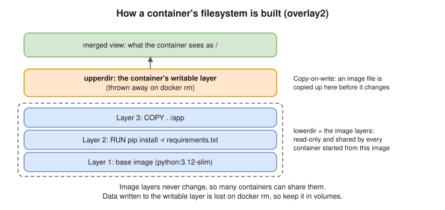

# R1 Q2 · What is Docker? Difference between image and container?



## Say this first

"**Docker** is a platform to build, ship and run applications as **containers**: the app plus everything it needs (runtime, libraries, config) packaged so it runs the same on a laptop, in CI and in production. A container is **not a VM**: it's a normal Linux process isolated with **namespaces** (what it can see: PID, network, mount, UTS, IPC, user) and limited with **cgroups** (what it can use: CPU, memory, IO). All containers share the host kernel, so they start in milliseconds and are much lighter than VMs.

An **image** is the read-only template: a stack of filesystem **layers** plus metadata (entrypoint, env, ports), built from a Dockerfile and stored in a registry like ECR. A **container** is a running (or stopped) **instance** of an image: Docker adds a thin **writable layer** on top and starts the process. One image → many containers. If you delete a container, its writable layer is gone, which is why data goes in volumes."

## Image vs container side by side

| | Image | Container |
|---|---|---|
| What it is | Read-only template (layers + config) | Running instance of an image |
| Analogy | Class / a VM template / an ISO | Object / a running VM |
| State | Immutable; identified by digest `sha256:…` | Has state: running, stopped, exited; writable layer |
| Created by | `docker build` (Dockerfile) or `docker pull` | `docker run` / `docker create` |
| Stored | Registry (ECR, Docker Hub) and local cache | On the host only |
| Lifetime | Until you delete it | Until removed; writable data lost on `docker rm` (use volumes) |
| Commands | `docker images`, `docker build`, `docker push`, `docker rmi` | `docker ps -a`, `docker run`, `docker exec`, `docker logs`, `docker rm` |

## Details interviewers like (show depth)

- **Layers and cache:** each Dockerfile instruction that changes the filesystem (`RUN`, `COPY`, `ADD`) creates a layer. Layers are shared between images and cached on rebuild, so put rarely-changing steps (install dependencies) before often-changing ones (copy source).
- **Copy-on-write (overlay2):** when a container modifies a file from the image, the file is copied up into the writable layer first; the image never changes.
- **Tag vs digest:** `app:1.4` is a movable name; `app@sha256:…` is the exact content. Deploy by digest or immutable tags in production.
- **Architecture:** Docker CLI → `dockerd` (API) → `containerd` (manages container lifecycle) → `runc` (creates the namespaces/cgroups and starts the process). Kubernetes talks to containerd directly through CRI; it doesn't need dockerd.
- **Container vs VM:** VM = full guest OS + its own kernel on a hypervisor (GBs, boots in minutes); container = process on the shared host kernel (MBs, starts in ms), weaker isolation boundary.

```bash
docker build -t app:1.0 .                # image from Dockerfile
docker images                            # list images
docker history app:1.0                   # see its layers
docker run -d --name web -p 8080:80 app:1.0   # container from image
docker ps -a                             # list containers (running + stopped)
docker exec -it web sh                   # shell inside
docker diff web                          # files changed in the writable layer
docker rm -f web                         # writable layer gone; image stays
```

## Follow-up questions

**Q: What happens when you run `docker run nginx`?** The CLI calls dockerd; if the image isn't local it's pulled layer by layer; containerd creates the container (writable layer on top of the image layers); runc sets up namespaces, cgroups, networking (veth to the docker0 bridge) and starts the entrypoint as PID 1.

**Q: CMD vs ENTRYPOINT?** ENTRYPOINT is the executable; CMD gives default arguments (or the default command if there's no ENTRYPOINT). `docker run image args` replaces CMD, not ENTRYPOINT.

**Q: How do you make images smaller?** Multi-stage builds, slim/distroless base, combine and clean up in the same `RUN`, `.dockerignore`.

## Deeper notes

[docker/01-fundamentals.md](../../docker/01-fundamentals.md) · [docker/02-architecture-internals.md](../../docker/02-architecture-internals.md) · [docker/03-images.md](../../docker/03-images.md) · [docker/04-containers.md](../../docker/04-containers.md)

## 🎯 Drill: type from memory, then check

1. Two Linux kernel features that make a container, and what each does.
2. One sentence each: image, container.
3. Which command shows the layers of an image? Which shows files a container changed?
4. Why is data lost when you remove a container, and the fix?

<details><summary>Check your answers</summary>

1. Namespaces (isolation: what the process can see) and cgroups (limits: what it can use).
2. Image: read-only layered template plus config. Container: a running instance of an image with a writable layer on top.
3. `docker history <image>`; `docker diff <container>`.
4. Changes live in the container's writable layer, which is deleted with the container; use volumes (or bind mounts) for data.

</details>

## 🗣️ 30-second spoken answer

"Docker packages an app with its dependencies so it runs the same everywhere. A container is just a Linux process isolated by namespaces and limited by cgroups, sharing the host kernel, so it's much lighter than a VM. An image is the read-only template, a stack of layers built from a Dockerfile and stored in a registry. A container is a running instance of that image with a thin writable layer on top. One image can run many containers, and when a container is removed its writable layer goes, so persistent data goes in volumes."
