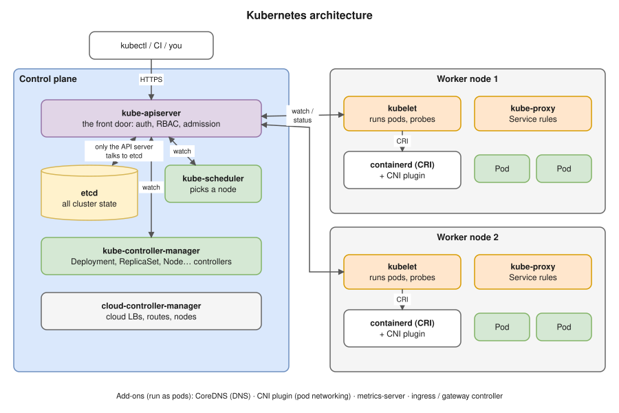

# R1 Q3 · What is Kubernetes? Explain its architecture.

## Say this first

"**Kubernetes** is a container orchestrator: you declare the desired state, for example 'three replicas of this image, reachable on port 80', and Kubernetes keeps the actual state matching it. It schedules containers onto machines, restarts them when they fail, scales them, rolls out new versions and gives them service discovery and load balancing.

It has two parts. The **control plane** decides: the **API server** is the front door, every component and `kubectl` talks only to it; **etcd** is the key-value store holding the whole cluster state; the **scheduler** picks a node for each new pod based on resources, affinity and taints; the **controller manager** runs the control loops, like the Deployment and ReplicaSet controllers, that keep reality matching the spec; and the **cloud controller manager** talks to the cloud for load balancers and nodes.

**Worker nodes** run the workloads: the **kubelet** on each node watches the API server for pods assigned to it and makes the container runtime, **containerd**, start them, then reports status; **kube-proxy** programs iptables or IPVS rules so Service IPs reach the pods; and a **CNI plugin**, like the AWS VPC CNI on EKS, gives every pod its own IP. On **EKS** AWS runs and scales the control plane across three AZs; we manage the nodes."

## Components table (be able to fill this in blank)

| Component | Where | Job | If it breaks |
|---|---|---|---|
| kube-apiserver | Control plane | REST front door; authn → authz (RBAC) → admission → validate → write to etcd | Nothing can change; running pods keep running |
| etcd | Control plane | Consistent key-value store (Raft); the only stateful part | Cluster state lost unless backed up; needs quorum (3 or 5 members) |
| kube-scheduler | Control plane | Assigns pods without a node: filter (resources, taints, affinity) → score → bind | New pods stay `Pending` |
| kube-controller-manager | Control plane | Control loops: Deployment, ReplicaSet, Node, Job, EndpointSlice … | Nothing reconciles: no replacement pods, no rollouts |
| cloud-controller-manager | Control plane | Cloud integration: LoadBalancer Services, node lifecycle, routes | `LoadBalancer` Services stay `<pending>` |
| kubelet | Every node | Runs the pods assigned to its node via CRI, runs probes, reports status | Node goes `NotReady`; pods evicted after a timeout |
| container runtime (containerd) | Every node | Pulls images, creates containers (runc) | Pods can't start |
| kube-proxy | Every node | Service VIP → pod IPs (iptables/IPVS) | Service IPs stop working on that node |
| CNI plugin | Every node | Pod networking and IPs (VPC CNI, Calico, Cilium) | Pods stuck `ContainerCreating`, no network |
| CoreDNS | Add-on (pods) | Cluster DNS: `svc.namespace.svc.cluster.local` | Service names don't resolve |

## How they work together (the reconciliation loop)

`kubectl apply` a Deployment → API server stores it in etcd → Deployment controller creates a ReplicaSet → ReplicaSet controller creates Pod objects → scheduler binds each Pod to a node → that node's kubelet sees it, asks containerd to pull and start the containers, runs probes → status goes back to the API server → when the pod is Ready, the EndpointSlice controller adds its IP behind the Service. Every component **watches** the API server; none of them talk to each other directly. Full flow: [04-kubectl-apply-flow.md](../../kubernetes/04-kubectl-apply-flow.md).

## Follow-up questions

**Q: What does EKS manage vs what do you manage?** AWS: API server, etcd, scheduler, controller managers, their HA across 3 AZs, patching and backups. You: worker nodes (managed node groups, Karpenter or Fargate), add-ons (VPC CNI, CoreDNS, kube-proxy versions), workloads, IAM, upgrades of nodes.

**Q: Why is etcd an odd number?** Raft needs a majority (quorum): 3 members tolerate 1 failure, 5 tolerate 2; 4 tolerates only 1, so even numbers add cost without extra tolerance.

**Q: Does the scheduler start the pod?** No. It only writes the node name into the pod (binding). The kubelet starts it.

## Deeper notes

[kubernetes/02-architecture.md](../../kubernetes/02-architecture.md) (every component in depth) · [kubernetes/01-fundamentals.md](../../kubernetes/01-fundamentals.md) · [kubernetes/20-eks.md](../../kubernetes/20-eks.md)

## 🎯 Drill: draw it from memory, then check

Draw two boxes, control plane and node, and write every component in the right box with one line each. Then:

1. Which component is the only one that talks to etcd?
2. Which component decides the node, and which one starts the container?
3. What does kube-proxy do?
4. What does EKS take off your hands?

Check your answers

Control plane: kube-apiserver, etcd, kube-scheduler, kube-controller-manager, cloud-controller-manager. Node: kubelet, container runtime (containerd), kube-proxy, CNI plugin (+ CoreDNS runs as pods).

1. The API server.
2. Scheduler chooses (binding); kubelet starts it through containerd.
3. Programs iptables/IPVS rules so a Service's virtual IP is load-balanced to the ready pod IPs.
4. Running, scaling, patching and backing up the control plane (API server, etcd, scheduler, controllers) across 3 AZs.

## 🗣️ 30-second spoken answer

"Kubernetes is a container orchestrator: I declare desired state and it keeps the cluster matching it. The control plane has the API server as the single front door, etcd storing all state, the scheduler choosing a node for each pod, and the controller manager running the loops that reconcile, like Deployments and ReplicaSets. Each worker node runs the kubelet, which starts pods through containerd and reports health, kube-proxy for Service routing, and a CNI plugin for pod IPs. On EKS AWS runs the control plane; we run the nodes and workloads."
