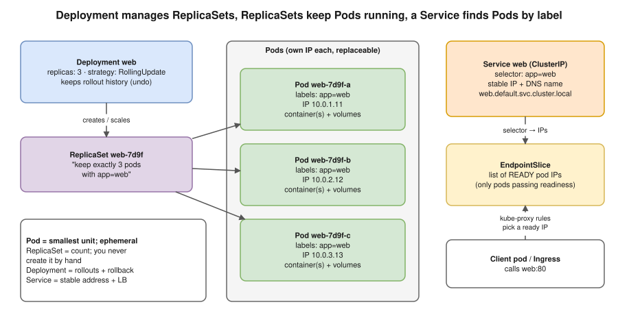

# R1 Q4 · What is a Pod, Service, and Deployment?



## Say this first

"A **Pod** is the smallest thing Kubernetes runs: one or more containers that share a network namespace (one IP, talk over localhost) and volumes, always scheduled together on one node. Pods are **ephemeral**: if one dies it is replaced by a new pod with a new IP, never repaired.

A **Deployment** is how you run stateless apps: you declare the image and the number of replicas, and it creates a **ReplicaSet** that keeps exactly that many pods running. When you change the image, the Deployment creates a new ReplicaSet and does a **rolling update**, and it keeps history so you can roll back with `kubectl rollout undo`.

A **Service** gives those changing pods one **stable virtual IP and DNS name** and load-balances across them. It finds pods by **label selector**, and only pods that pass their **readiness probe** are put in its EndpointSlice. Types: ClusterIP (internal, default), NodePort, LoadBalancer (cloud LB, on EKS an NLB/ALB via the controller), and ExternalName."

## The three objects in one YAML (type it from memory)

```yaml
apiVersion: apps/v1
kind: Deployment
metadata:
  name: web
spec:
  replicas: 3
  selector:
    matchLabels: {app: web}          # must match the template labels
  strategy:
    type: RollingUpdate
    rollingUpdate: {maxSurge: 1, maxUnavailable: 0}
  template:                          # the Pod template
    metadata:
      labels: {app: web}
    spec:
      containers:
        - name: web
          image: 123456789012.dkr.ecr.ap-south-1.amazonaws.com/web:1.4.0
          ports: [{containerPort: 8080}]
          readinessProbe:
            httpGet: {path: /health, port: 8080}
          resources:
            requests: {cpu: 100m, memory: 128Mi}
            limits: {memory: 256Mi}
---
apiVersion: v1
kind: Service
metadata:
  name: web
spec:
  type: ClusterIP
  selector: {app: web}               # finds the pods by label
  ports:
    - port: 80                       # the Service port clients call
      targetPort: 8080               # the container port
```

## Compare

| | Pod | Deployment | Service |
|---|---|---|---|
| Purpose | Run containers | Keep N pods running + rollouts/rollback | Stable address + load balancing |
| Lifetime | Ephemeral, new IP on replacement | Long-lived | Long-lived, IP never changes |
| Links by | — | Owns ReplicaSet → owns Pods (ownerReferences) | Label selector → EndpointSlice of ready pod IPs |
| Create directly? | Rarely (only for debugging) | Yes, for stateless apps | Yes, one per app |
| Key commands | `kubectl get pods -o wide`, `logs`, `exec`, `describe` | `kubectl rollout status/history/undo`, `scale` | `kubectl get svc,endpointslices`, `port-forward svc/web` |

## Related objects they may ask next

- **ReplicaSet:** keeps the count; you don't create it by hand. Old ReplicaSets (scaled to 0) are kept for rollback (`revisionHistoryLimit`, default 10).
- **StatefulSet:** stable names (`db-0`, `db-1`), stable storage per pod, ordered start; for databases/Kafka. **DaemonSet:** one pod per node (log agents, node-exporter). **Job/CronJob:** run to completion.
- **Ingress:** HTTP routing (host/path) from outside to Services; needs an ingress controller.
- **Multi-container pods:** sidecars (log shipper, proxy), init containers (run before the app, e.g. wait for DB/migrate).

## Follow-up questions

**Q: Why not just run pods?** Nothing recreates a bare pod if its node dies, and there's no rolling update or rollback.

**Q: How does a Service know which pods to send to?** The selector; the EndpointSlice controller keeps the list of matching **Ready** pod IPs; kube-proxy turns the Service IP into rules for those IPs.

**Q: port vs targetPort vs nodePort?** port = Service port; targetPort = container port; nodePort = port opened on every node (30000–32767) for NodePort/LoadBalancer types.

## Deeper notes

[kubernetes/05-pods.md](../../kubernetes/05-pods.md) · [kubernetes/07-workloads.md](../../kubernetes/07-workloads.md) · [kubernetes/08-services-and-dns.md](../../kubernetes/08-services-and-dns.md)

## 🎯 Drill: type the YAML above from memory (Deployment + Service), then check

1. What links a Service to its pods?
2. What does a Deployment create directly?
3. Which pods get traffic from a Service?
4. Four Service types.

<details><summary>Check your answers</summary>

1. Labels: the Service's `selector` matches the pod template labels.
2. A ReplicaSet (which creates the Pods).
3. Only pods that match the selector **and** are Ready (readiness probe passing).
4. ClusterIP, NodePort, LoadBalancer, ExternalName (plus headless = ClusterIP: None).

</details>

## 🗣️ 30-second spoken answer

"A Pod is the smallest unit: one or more containers sharing an IP and volumes, and it's disposable. A Deployment declares the image and replica count; it creates a ReplicaSet that keeps that many pods running, does rolling updates and supports rollback. A Service gives the pods a stable IP and DNS name and load-balances to the pods that match its label selector and are Ready. So: Deployment manages pods, Service exposes them."
