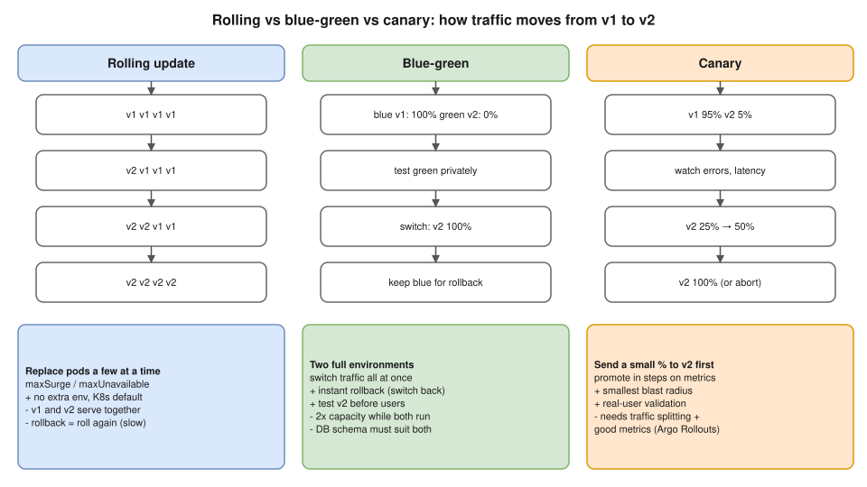

# R1 Q5 · Difference between Rolling, Blue-Green, and Canary deployments



## Say this first

"All three move users from v1 to v2 without downtime; they differ in **how much risk** you take and **how fast you can undo**.

**Rolling** replaces pods a few at a time; it's the Kubernetes Deployment default, controlled by `maxSurge` and `maxUnavailable`. No extra infrastructure, but for a while v1 and v2 both serve traffic, and rollback is another rollout.

**Blue-green** runs two full environments: blue is live, green gets v2. You test green, then switch all traffic at once, by changing a Service selector, a load balancer target group or DNS. Rollback is instant, switch back, but you pay for double capacity during the release.

**Canary** sends a small slice of real traffic, say 5%, to v2, watches error rate and latency, then increases step by step to 100%, or aborts. Smallest blast radius, but you need traffic splitting and good metrics; in Kubernetes we'd use Argo Rollouts or Flagger with an ingress or service mesh."

## Comparison table

| | Rolling | Blue-green | Canary |
|---|---|---|---|
| How | Replace instances gradually | Two full stacks, switch 100% at once | Small % to v2, increase in steps |
| Extra capacity | `maxSurge` pods only | 2x during release | Small (canary pods) |
| Both versions live at once? | Yes, mixed | No (except during switch) | Yes, by design |
| Rollback | Roll back again (minutes) | Switch back (seconds) | Set canary weight to 0 (seconds) |
| Blast radius if v2 is bad | Grows as rollout proceeds | Everyone, until you switch back | Only the canary % |
| Needs | Readiness probes | LB/DNS/Service switch, 2 envs | Traffic splitting + metrics (Argo Rollouts, Flagger, ALB weighted target groups, Istio) |
| Good for | Most stateless services | Big releases, easy instant rollback | High-traffic, risky changes |

## How each is done in practice

**Rolling (native Deployment):**

```yaml
strategy:
  type: RollingUpdate
  rollingUpdate:
    maxSurge: 25%        # extra pods above replicas during the rollout
    maxUnavailable: 0    # never drop below desired capacity
```

```bash
kubectl set image deploy/web web=web:1.5.0
kubectl rollout status deploy/web
kubectl rollout undo deploy/web          # rollback
```

**Blue-green in Kubernetes:** two Deployments (`web-blue`, `web-green`) and one Service; switch with the selector:

```bash
kubectl patch svc web -p '{"spec":{"selector":{"app":"web","version":"green"}}}'
```

On AWS: swap ALB listener to another target group, Route 53 weighted records, or CodeDeploy blue/green for ECS/EC2.

**Canary with Argo Rollouts:**

```yaml
apiVersion: argoproj.io/v1alpha1
kind: Rollout
spec:
  strategy:
    canary:
      steps:
        - setWeight: 5
        - pause: {duration: 10m}     # analysis on Prometheus error rate can auto-abort
        - setWeight: 25
        - pause: {duration: 10m}
        - setWeight: 50
        - pause: {}                  # wait for manual promote
```

Without a mesh, a plain-Kubernetes canary is approximate: 1 canary pod out of 10 pods ≈ 10% of traffic.

## Gotchas they may probe

- **Database changes:** in rolling and canary both versions run at once, and blue-green may switch back; schema changes must be backward compatible (expand → migrate → contract).
- **Recreate** strategy: kill all old pods, then start new ones; downtime, but needed when two versions can't run together.
- **Sessions/long connections:** draining (`preStop` hook, `terminationGracePeriodSeconds`, ALB deregistration delay).
- **Feature flags** decouple deploy from release: deploy dark, enable for 1% of users.

## Resume angle

You did GitOps with ArgoCD; deployments were ⟨fill: rolling updates via ArgoCD sync⟩. If asked "did you use canary?": only say yes if you did. Honest version: "We used rolling updates with readiness probes and git-revert rollback; canary with Argo Rollouts is the next step I'd add for risky services."

## Deeper notes

[kubernetes/07-workloads.md, Deployments and rolling updates](../../kubernetes/07-workloads.md#deployments-and-rolling-updates-) · [kubernetes/21-helm-kustomize-gitops.md](../../kubernetes/21-helm-kustomize-gitops.md)

## 🎯 Drill: say it from memory, then check

1. Which strategy is the Kubernetes default and which two fields tune it?
2. Which one has the fastest rollback and why?
3. Which one has the smallest blast radius?
4. What breaks all three if you're careless?

<details><summary>Check your answers</summary>

1. RollingUpdate; `maxSurge` and `maxUnavailable`.
2. Blue-green (and canary at low weight): the old version is still running, so you just switch traffic back.
3. Canary: only a small percentage of users see v2.
4. Backward-incompatible database changes (and missing readiness probes / connection draining).

</details>

## 🗣️ 30-second spoken answer

"Rolling replaces pods a few at a time; it's the Kubernetes default, cheap, but both versions serve together and rollback is another rollout. Blue-green runs a full second environment and flips all traffic at once, so rollback is instant, but it costs double capacity. Canary sends a small percentage of real traffic to the new version, watches metrics and increases step by step, giving the smallest blast radius, but it needs traffic splitting and good monitoring, like Argo Rollouts. In all three, database changes must stay backward compatible."
