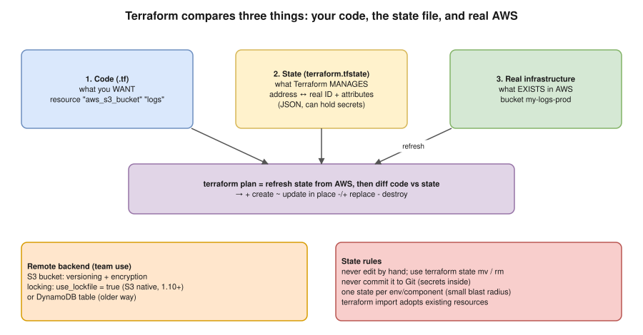

# R1 Q6 · What is Terraform? What is a state file?



## Say this first

"**Terraform** is HashiCorp's infrastructure-as-code tool. I describe infrastructure, VPCs, EKS clusters, RDS, IAM, in declarative **HCL** files; **providers** (AWS, Kubernetes, Helm…) translate that into API calls. The workflow is `init` → `plan` → `apply`: plan shows exactly what will be created, changed or destroyed before anything happens, so changes are reviewed like code in a merge request.

The **state file**, `terraform.tfstate`, is Terraform's record of what it manages: it maps each resource address in my code, like `aws_s3_bucket.logs`, to the real object ID in AWS, with its attributes and dependencies. On every plan Terraform refreshes state from AWS and diffs it against the code. Without state it wouldn't know which bucket is 'its' bucket.

For a team the state goes in a **remote backend**: an S3 bucket with versioning and encryption, with **locking** so two applies can't run at once (S3 native locking with `use_lockfile`, or a DynamoDB table in older setups). State can contain secrets, so it's never committed to Git, access is restricted, and it's only changed with `terraform state` commands, never by hand."

## Core commands

| Command | What it does |
|---|---|
| `terraform init` | Downloads providers and modules, configures the backend |
| `terraform fmt` / `validate` | Formats code / checks syntax and references |
| `terraform plan -out=tfplan` | Refresh + diff; saves the exact plan |
| `terraform apply tfplan` | Applies exactly that plan |
| `terraform destroy` | Deletes everything in this state |
| `terraform state list` / `state show <addr>` | What's in state / one resource's attributes |
| `terraform state mv` / `state rm` | Rename an address (refactor) / stop managing without deleting |
| `terraform import` or `import {}` block | Adopt an existing resource into state |
| `terraform force-unlock <ID>` | Release a stuck lock (after checking nothing runs) |
| `terraform output` | Show outputs (e.g. cluster endpoint) |

## Remote backend (write this from memory)

```hcl
terraform {
  required_version = ">= 1.10"
  required_providers {
    aws = { source = "hashicorp/aws", version = "~> 6.0" }
  }
  backend "s3" {
    bucket       = "acme-terraform-state"
    key          = "prod/eks/terraform.tfstate"   # one state per env/component
    region       = "ap-south-1"
    encrypt      = true
    use_lockfile = true    # S3-native locking (1.10+); older setups: dynamodb_table = "terraform-locks"
  }
}
```

## Key concepts in one line each

- **Declarative:** you describe the end state, not the steps; Terraform works out the order from the dependency graph.
- **Provider / resource / data source / module / variable / output / locals:** plugin / something Terraform manages / something it only reads / reusable package of resources / input / exported value / named expression.
- **Plan symbols:** `+` create, `~` update in place, `-/+` destroy and recreate (replace), `-` destroy.
- **Drift:** someone changed AWS by hand; plan shows the difference; fix by applying code or updating code.
- **Workspaces vs directories per env:** workspaces share code and backend with separate state; many teams prefer a directory (or Terragrunt) per environment for clearer separation.
- **Terraform vs Ansible:** Terraform provisions infrastructure (declarative, stateful); Ansible configures servers (procedural tasks, idempotent modules, no state file). You used both.

## Follow-up questions

**Q: What happens if two people apply at the same time?** With locking, the second one fails with "Error acquiring the state lock". Without locking, state can be corrupted.

**Q: State file deleted or corrupted?** S3 versioning lets you restore the previous version; worst case, re-import resources.

**Q: Sensitive data in state?** Marking an output `sensitive` only hides it in CLI output; the value is still in state in plain text. Protect the bucket (encryption, IAM, no public access), or keep secrets out of Terraform (generate in Secrets Manager, or use ephemeral values/write-only arguments in newer versions).

**Q: What is `terraform refresh`?** Updates state from real infrastructure; now done as part of plan (`terraform plan -refresh-only` to just see drift).

## Deeper notes

Terraform Q&A (10 notes: import vs taint, secrets, count vs for_each, drift, remote backend, environments, provisioners, rollback, refresh vs plan, modules): `interview-prep/terraform/` in draft PR #9. Scenario versions: `interview-prep/scenario-questions/terraform/` in draft PR #11. Playbook section 5b in draft PR #12.

## 🎯 Drill: type from memory, then check

1. Write the S3 backend block with locking.
2. Three things state stores.
3. What does plan compare?
4. Two rules for handling state.

<details><summary>Check your answers</summary>

1. See the block above: `bucket`, `key`, `region`, `encrypt = true`, `use_lockfile = true` (or `dynamodb_table`).
2. Mapping of resource address → real ID; resource attributes; dependencies/metadata (also outputs).
3. The code (desired) against state refreshed from the real infrastructure.
4. Remote backend with locking + versioning + encryption; never edit by hand or commit to Git (use `terraform state` commands).

</details>

## 🗣️ 30-second spoken answer

"Terraform is infrastructure as code: I write declarative HCL, providers turn it into API calls, and plan shows every change before apply. The state file maps each resource in my code to the real object in AWS, so Terraform knows what it owns and can diff code against reality. In a team it lives in a remote backend, S3 with versioning, encryption and locking, so two applies can't collide. It can hold secrets, so it's never in Git and never edited by hand."
