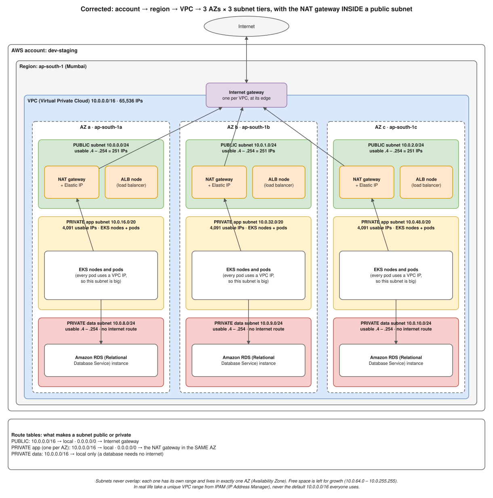

# R1 Q7 · Difference between public and private subnets in AWS

> **You lost marks on exactly this on 13 Nov** (private EC2 with no internet: you talked about inbound SSH and never mentioned the NAT gateway or the route table). The one sentence to never forget: **a subnet is public or private only because of its route table.**

## Say this first

"The difference is the **route table**, nothing else. A **public subnet**'s route table has `0.0.0.0/0 → Internet Gateway`, so instances with a public or Elastic IP are reachable from and can reach the internet directly. A **private subnet** has no route to the IGW; its default route is `0.0.0.0/0 → NAT Gateway`, so instances can make **outbound** connections, for updates or calling APIs, but nothing on the internet can start a connection to them.

The **NAT gateway itself lives in a public subnet** and has an Elastic IP; for high availability you put one per AZ. In a typical design the public subnets hold only the load balancer, NAT gateways and maybe a bastion; app servers, EKS nodes and databases go in private subnets, and the database tier often has no internet route at all. To reach AWS services like S3 or ECR privately, you add **VPC endpoints** instead of going through NAT."

## Compare

| | Public subnet | Private subnet |
|---|---|---|
| Default route | `0.0.0.0/0 → igw-…` | `0.0.0.0/0 → nat-…` (or none, for isolated DB subnets) |
| Instance IP | Public/Elastic IP needed to be reachable | Private IP only |
| Inbound from internet | Possible (if SG/NACL allow) | Impossible directly; only via a load balancer or bastion/SSM |
| Outbound to internet | Directly via IGW | Via NAT gateway (in a public subnet) |
| What goes here | ALB/NLB, NAT GW, bastion | App servers, EKS nodes/pods, RDS, ElastiCache, Lambda in VPC |
| Cost note | IGW is free | NAT GW charged per hour + per GB processed |

## Pieces you must name

- **VPC:** your private network, a CIDR like `10.0.0.0/16`, in one region. **Subnet:** a slice of it in **one AZ**. AWS reserves 5 IPs in every subnet (network, router `.1`, DNS `.2`, future `.3`, broadcast).
- **Internet Gateway:** one per VPC, horizontally scaled, does 1:1 NAT for public IPs.
- **NAT Gateway:** in a public subnet, with an EIP; outbound only; zonal, so one per AZ for HA.
- **Route table:** associated with subnets; the `local` route (VPC CIDR) is always there.
- **Security group** (stateful, instance level, allow-only) vs **NACL** (stateless, subnet level, allow + deny, numbered rules, needs ephemeral ports 1024–65535 for return traffic).
- **VPC endpoints:** gateway type (S3, DynamoDB; free, route table entry) and interface type (PrivateLink ENI; ECR, STS, Secrets Manager, CloudWatch…).
- **Private access to instances:** SSM Session Manager (no open SSH), bastion host, or VPN/Direct Connect.

## The classic follow-up: "My private EC2 can't reach the internet"

Check in order: **route table** of the private subnet has `0.0.0.0/0 → nat-…` → NAT gateway is **Available** and sits in a **public** subnet whose route table has `0.0.0.0/0 → igw` → **security group** outbound allows it (default allows all) → **NACL** of both subnets allow outbound + inbound ephemeral ports → DNS resolution enabled on the VPC → OS proxy/firewall. Evidence: VPC Flow Logs, Reachability Analyzer.

## Deeper notes

[interview-review-oct-9.md](../../interview-review-oct-9.md) (the corrected VPC diagrams r1, r5) · [networking/09-cloud-networking/aws/README.md](../../networking/09-cloud-networking/aws/README.md) · [AWS NAT diagram](../../networking/diagrams/3.8-aws-nat.drawio.svg) · playbook S2 "private EC2 can't reach the internet" in draft PR #12

## 🎯 Drill: write from memory, then check

1. Write the route table for a public subnet and for a private subnet (two rows each).
2. Where does the NAT gateway live, and why one per AZ?
3. What goes in public subnets in a good design?
4. How do you reach S3 from a private subnet without NAT?

Check your answers

1. Public: `10.0.0.0/16 → local`, `0.0.0.0/0 → igw-xxxx`. Private: `10.0.0.0/16 → local`, `0.0.0.0/0 → nat-xxxx`.
2. In a public subnet (with an Elastic IP); NAT gateways are zonal, so if that AZ fails the other AZs lose outbound internet.
3. Only load balancers, NAT gateways and (if needed) a bastion.
4. An S3 gateway VPC endpoint (route table entry, free).

## 🗣️ 30-second spoken answer

"It's the route table. A public subnet routes 0.0.0.0/0 to the Internet Gateway, so resources with public IPs can be reached from the internet. A private subnet routes 0.0.0.0/0 to a NAT gateway, which sits in a public subnet, so instances can go out but nobody can connect in. I put only load balancers and NAT gateways in public subnets, and apps, EKS nodes and databases in private ones, with one NAT per AZ and VPC endpoints for S3 and ECR."
