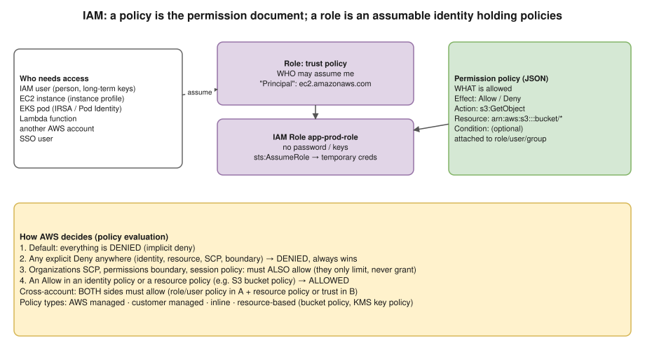

# R1 Q8 · What is IAM? Difference between role and policy?



## Say this first

"**IAM**, Identity and Access Management, controls **who** can do **what** on **which** AWS resources. It's global and free. The building blocks are **identities**, users, groups and roles, and **policies**, which are JSON documents of permissions.

A **policy** is the permission itself: statements with `Effect` Allow or Deny, `Action` like `s3:GetObject`, `Resource` ARNs and optional `Condition`s. On its own it does nothing until it's attached to an identity or a resource.

A **role** is an identity with no password or long-term keys that someone **assumes** to get **temporary credentials** from STS. It has two policies: a **trust policy** that says who may assume it, for example the EC2 service, a Lambda function, an EKS pod's service account or another AWS account, and **permission policies** that say what it can do. So: the policy is *what is allowed*; the role is *who gets those permissions, temporarily*. We use roles everywhere instead of access keys: instance profiles for EC2, IRSA or Pod Identity for EKS pods, execution roles for Lambda, OIDC roles for CI."

## Role vs policy vs user

| | IAM User | IAM Role | IAM Policy |
|---|---|---|---|
| What | Identity for one person/app | Identity that is **assumed** | JSON permission document |
| Credentials | Password and/or long-term access keys | Temporary STS credentials (expire, 15 min – 12 h) | None |
| Used by | Humans (better: SSO), legacy apps | AWS services, pods, CI, other accounts, SSO users | Attached to users, groups, roles, or resources |
| Answers | "Who am I?" | "Who can become me (trust), and what can I do?" | "What is allowed or denied?" |

## Example policies (type them)

Permission policy (attached to the role):

```json
{
  "Version": "2012-10-17",
  "Statement": [{
    "Effect": "Allow",
    "Action": ["s3:GetObject", "s3:PutObject"],
    "Resource": "arn:aws:s3:::acme-reports/*"
  }, {
    "Effect": "Allow",
    "Action": "s3:ListBucket",
    "Resource": "arn:aws:s3:::acme-reports"
  }]
}
```

Trust policy (on the role; who can assume it):

```json
{
  "Version": "2012-10-17",
  "Statement": [{
    "Effect": "Allow",
    "Principal": {"Service": "ec2.amazonaws.com"},
    "Action": "sts:AssumeRole"
  }]
}
```

Note `ListBucket` is on the **bucket** ARN and `GetObject` on **bucket/\***: a very common mistake.

## Policy types

- **Identity-based:** AWS managed (e.g. `ReadOnlyAccess`), customer managed (reusable, versioned), inline (embedded in one identity).
- **Resource-based:** attached to the resource: S3 bucket policy, KMS key policy, SQS/SNS policy, Lambda resource policy, role trust policy. They name a `Principal`.
- **Guardrails** (limit, never grant): Organizations **SCPs**, **permissions boundaries**, session policies.

## How AWS evaluates a request

1. Everything starts **implicitly denied**.
2. Any **explicit Deny** in any applicable policy → denied. Deny always wins.
3. SCPs, permissions boundary and session policy must also allow (if present).
4. An **Allow** in an identity policy or a resource policy → allowed.
5. **Cross-account:** both sides must allow (identity policy in account A **and** resource policy/trust in account B).

## Best practices to mention

Least privilege (start small; use IAM Access Analyzer to generate policies from CloudTrail activity) · roles not keys · MFA, no root usage · SSO (IAM Identity Center) for humans · conditions (`aws:SourceIp`, `aws:PrincipalOrgID`, `aws:MultiFactorAuthPresent`) · audit with CloudTrail, Access Analyzer, credential report.

## Deeper notes

Scenario notes on IAM audit and cross-account access: `interview-prep/scenario-questions/aws/07-audit-iam-for-compliance.md` and `08-cross-account-access-for-partner.md` in draft PR #11 · EKS Pod Identity diagram: [20-pod-identity](../../kubernetes/diagrams/20-pod-identity.drawio.svg) · S3 AccessDenied walk-through: [R2 Q5](../round-2/05-s3-access-denied.md)

## 🎯 Drill: write from memory, then check

1. Write a trust policy that lets EC2 assume a role.
2. Write a policy allowing read of objects in bucket `logs` (both statements).
3. The evaluation rule in one line.
4. How does an EKS pod get AWS permissions without keys?

<details><summary>Check your answers</summary>

1. See the trust policy above: `Principal: {"Service": "ec2.amazonaws.com"}`, `Action: sts:AssumeRole`.
2. `s3:GetObject` on `arn:aws:s3:::logs/*` and `s3:ListBucket` on `arn:aws:s3:::logs`.
3. Default deny; explicit Deny always wins; otherwise you need an Allow (and guardrails like SCPs must allow too).
4. IRSA (service account annotated with a role ARN, OIDC provider, web identity token) or EKS Pod Identity (association + agent); the SDK picks up temporary credentials.

</details>

## 🗣️ 30-second spoken answer

"IAM controls who can do what on which AWS resources. A policy is a JSON document of permissions: effect, actions, resources, conditions. It does nothing until it's attached. A role is an identity with no long-term credentials that a service, a pod, CI or another account assumes to get temporary credentials; its trust policy says who can assume it and its permission policies say what it can do. Deny always wins, and I use roles with least privilege instead of access keys."
