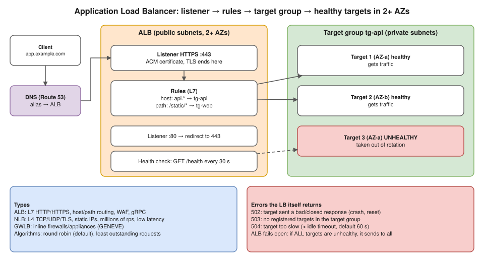

# R1 Q9 · What is a Load Balancer and how does it work?

> **You lost marks here on 13 Nov:** you said an ALB can sit in one public subnet (it needs subnets in **at least two AZs**) and that unhealthy targets give a 502. Get the error codes right: see the table below.

## Say this first

"A load balancer is a single entry point that spreads incoming traffic across multiple healthy backends, so no single server is overloaded and a failed server doesn't take the app down. It also lets you scale horizontally and do zero-downtime deploys.

On AWS, an **Application Load Balancer** works at **layer 7**. Clients resolve its DNS name, usually through a Route 53 alias, and connect to a **listener**, for example HTTPS on 443, where TLS is terminated with an ACM certificate. **Rules** on the listener route by host, path, header or method to a **target group**: EC2 instances, IPs (pods on EKS) or Lambda. The ALB constantly runs **health checks** against each target and only sends traffic to healthy ones. It's deployed in subnets in **at least two AZs** and scales automatically.

A **Network Load Balancer** works at **layer 4**, TCP/UDP/TLS: very high throughput, low latency, static IPs per AZ, and it can preserve the client IP. I'd pick ALB for HTTP apps and microservices, NLB for non-HTTP or extreme performance."

## ALB vs NLB vs GWLB

| | ALB | NLB | GWLB |
|---|---|---|---|
| OSI layer | 7 (HTTP/HTTPS, gRPC, WebSocket) | 4 (TCP, UDP, TLS) | 3 (IP packets, GENEVE) |
| Routing | Host, path, header, query, method | Port/protocol | To appliance fleet |
| IPs | Dynamic (use DNS name) | Static IP / EIP per AZ | — |
| TLS | Terminates (ACM), SNI for many certs | Pass-through or terminate | — |
| Extras | WAF, Cognito/OIDC auth, redirects, fixed responses, sticky sessions | Client IP preserved, PrivateLink | Inline firewalls/IDS |
| Use | Web apps, microservices, EKS Ingress | Non-HTTP, millions of rps, static IP needs | Third-party security appliances |

## How a request flows (say it in order)

1. DNS: `app.example.com` → alias → ALB nodes in each enabled AZ.
2. Client connects to a **listener** (443); TLS terminated with the ACM cert.
3. **Rules** evaluated by priority → target group.
4. **Algorithm** picks a healthy target: round robin (default) or least outstanding requests (also weighted random with anomaly mitigation).
5. ALB opens a separate connection to the target, adds `X-Forwarded-For` / `X-Forwarded-Proto`.
6. Response goes back through the ALB.
7. Meanwhile health checks (path, interval, healthy/unhealthy thresholds) add and remove targets; **deregistration delay** (default 300 s) drains in-flight requests on scale-in or deploy.

## Errors the load balancer itself returns

| Code | Meaning | Usual cause |
|---|---|---|
| 502 Bad Gateway | Target gave an invalid response or closed the connection | App crashed/reset, keep-alive timeout on target shorter than ALB idle timeout, wrong protocol (HTTPS to an HTTP port) |
| 503 Service Unavailable | No registered targets in the target group (or listener rule points to an empty group) | Targets deregistered, ASG/Deployment at 0, on EKS all pods not Ready → removed |
| 504 Gateway Timeout | Target didn't answer within the idle timeout (default 60 s) | Slow app/DB, SG blocks ALB → target, target not listening |
| 460 / 463 | Client closed connection / too many X-Forwarded-For IPs | Client side |

**Fail-open detail:** if **all** targets in a target group are unhealthy, the ALB routes to **all** of them anyway (it fails open), so the users then see whatever the broken targets return (often 502/504). A 503 means there was nothing registered to send to.

## Kubernetes link

On EKS the **AWS Load Balancer Controller** creates an ALB from an `Ingress` (IP-mode targets = pod IPs) or an NLB from a `Service type: LoadBalancer`. Public subnets need tag `kubernetes.io/role/elb=1`, private ones `kubernetes.io/role/internal-elb=1`.

## Deeper notes

[networking 3.5-lb-5xx diagram](../../networking/diagrams/3.5-lb-5xx.drawio.svg) · [hemant-model-answers.md Q28–Q30](../../hemant-model-answers.md#q28-it-returns-502-what-do-501-502-and-503-each-mean) · [R2 Q10: pods running but 503](../round-2/10-pods-running-users-get-503.md) · playbook S3/S4 in draft PR #12

## 🎯 Drill: say it from memory, then check

1. Name the four ALB building blocks in request order.
2. Minimum AZs for an ALB?
3. 502 vs 503 vs 504.
4. When ALB, when NLB?

Check your answers

1. Listener → rules → target group → targets (with health checks).
2. Two (subnets in at least two AZs).
3. 502: target sent a bad response or closed the connection. 503: no registered targets. 504: target didn't respond within the idle timeout.
4. ALB for HTTP(S) with host/path routing, WAF, TLS termination; NLB for TCP/UDP, static IPs, extreme throughput/low latency, client IP preservation.

## 🗣️ 30-second spoken answer

"A load balancer is one entry point that spreads traffic across healthy backends, so you can scale out and survive failures. An ALB is layer 7: a listener on 443 terminates TLS, rules route by host or path to target groups, and health checks keep traffic only on healthy targets, across at least two AZs. An NLB is layer 4 for TCP/UDP with static IPs and very low latency. If it errors, 502 means the target sent a bad response, 503 means no registered targets, 504 means the target timed out."
