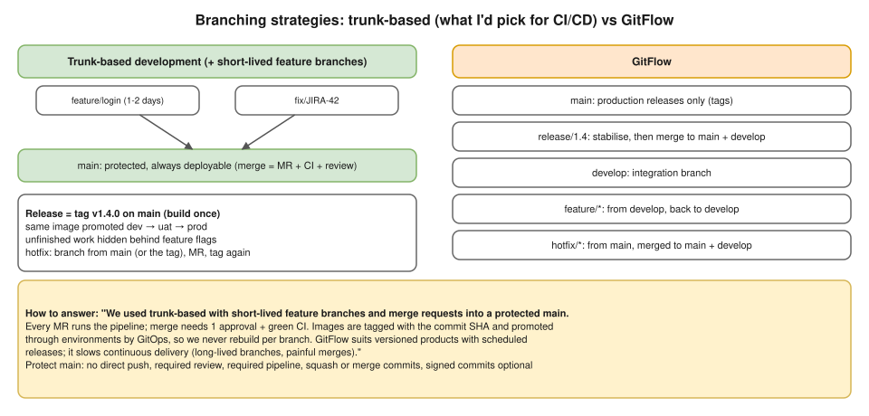

# R1 Q10 · What is a Git branching strategy?



## Say this first

"A branching strategy is the team's agreement on how branches are created, named, merged and released, so many people can work in parallel without breaking `main`, and so CI/CD knows what to build and deploy.

The common ones: **trunk-based development**, everyone merges small changes into `main` at least daily through short-lived feature branches and merge requests, and `main` is always deployable; **GitHub Flow**, basically the same with a deploy from main after each merge; and **GitFlow**, with long-lived `main` and `develop` branches plus `feature/*`, `release/*` and `hotfix/*` branches, which suits products with versioned, scheduled releases.

In our team we used ⟨fill: what you really used, most likely short-lived feature branches + MRs into a protected main⟩. Every MR runs the pipeline, merge needs an approval and a green pipeline, the image is tagged with the commit SHA, and the same image is promoted dev → UAT → prod through the GitOps repo, so we never rebuild per branch. For CI/CD I prefer trunk-based, because long-lived branches mean big, risky merges and slow feedback."

## Compare

| | Trunk-based / GitHub Flow | GitFlow | Release branches (GitLab Flow style) |
|---|---|---|---|
| Long-lived branches | `main` only | `main` + `develop` | `main` + `release/x.y` or env branches |
| Feature branches | Hours–2 days | Days–weeks | Short |
| Release | Tag on main / every merge | `release/*` branch → merge to main + develop | Cut a release branch, cherry-pick fixes |
| Hotfix | Branch from main, MR, tag | `hotfix/*` from main → merge to main + develop | Fix on main, cherry-pick to release |
| Fits | Continuous delivery, SaaS, microservices | Versioned products, mobile/desktop, slow release cycles | Several supported versions at once |
| Risk | Needs good tests + feature flags | Merge hell, slow feedback | Cherry-pick discipline |

## Rules that make any strategy work (mention 3–4)

- **Protected `main`:** no direct pushes, MR with ≥1 approval, required green pipeline, resolved discussions; CODEOWNERS for critical paths.
- **Naming:** `feature/JIRA-123-login`, `fix/…`, `hotfix/…`; commit messages reference the ticket (conventional commits optional).
- **Small MRs**, rebased on main before merge; squash merge for clean history (or merge commits if you want MR boundaries).
- **Feature flags** to merge unfinished work safely.
- **Tags + semantic versioning** (`v1.4.0`) for releases; build once per commit SHA.
- **Infrastructure repos** (Terraform, GitOps): same flow; plan on the MR, apply after merge; env folders instead of env branches.

## Commands you should be able to type

```bash
git switch -c feature/JIRA-123-login        # new branch (older: git checkout -b)
git add -p && git commit -m "JIRA-123: add login endpoint"
git fetch origin && git rebase origin/main  # stay up to date
git push -u origin feature/JIRA-123-login   # then open the MR
git tag -a v1.4.0 -m "release 1.4.0" && git push origin v1.4.0
git cherry-pick <sha>                        # bring one fix to a release branch
git revert <sha>                             # undo a merged commit safely (new commit)
```

**merge vs rebase:** merge keeps history as it happened and adds a merge commit; rebase replays your commits on top of main for a linear history; never rebase a branch others are using. **revert vs reset:** revert adds an undo commit (safe on shared branches); reset moves the branch pointer (rewrites history, local only).

## Deeper notes

[hemant-model-answers.md Q39 (branch divergence between envs)](../../hemant-model-answers.md#q39-if-the-dev-image-is-deployed-to-qa-github-shows-a-divergence-between-the-branch-and-what-is-running-how-do-you-solve-that) · Git day in the 15-day plan (draft PR #10)

## 🎯 Drill: say it from memory, then check

1. Name three strategies and one line each.
2. Which do you recommend for CI/CD and why?
3. Four protections on `main`.
4. revert vs reset.

<details><summary>Check your answers</summary>

1. Trunk-based: short-lived branches merged into always-deployable main. GitHub Flow: feature branch → MR → deploy main. GitFlow: main + develop + feature/release/hotfix branches for versioned releases.
2. Trunk-based: small changes, fast feedback, no merge hell, fits build-once-promote.
3. No direct push, required approval, required green pipeline, CODEOWNERS / resolved discussions (also signed commits optional).
4. revert = new commit that undoes a commit (safe on shared branches); reset = move the branch pointer, rewrites history.

</details>

## 🗣️ 30-second spoken answer

"A branching strategy is how a team creates, merges and releases branches. Trunk-based keeps one always-deployable main with short-lived feature branches merged through MRs; GitFlow adds develop, release and hotfix branches for scheduled versioned releases. We used short-lived feature branches into a protected main: every MR runs the pipeline and needs an approval, images are tagged with the commit SHA and promoted through environments with GitOps. I prefer trunk-based for CI/CD because small merges give fast feedback and avoid merge hell."
