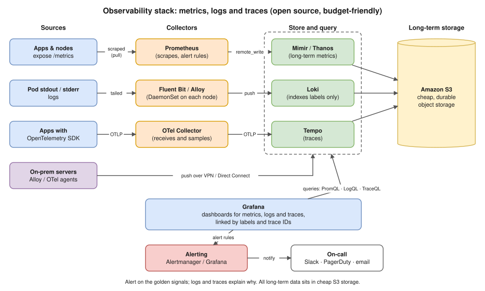

# R1 Q11 · How do you monitor applications in production?



## Say this first

"I monitor at three levels with three signals. **Levels:** infrastructure (nodes, disks, network), the platform (Kubernetes: pods, restarts, deployments) and the application (requests, errors, latency, business metrics). **Signals:** **metrics** for trends and alerts, **logs** for details of what happened, and **traces** to see which service in a call chain is slow.

At Koko we used **Prometheus** in each EKS cluster, scraping node-exporter, kube-state-metrics and the apps' `/metrics`, with a **central Prometheus federating** the clusters, **Grafana** dashboards, and **Alertmanager** routing alerts to ⟨fill: Slack / PagerDuty⟩. CloudWatch covered AWS-managed services like RDS and the ALB. For logs ⟨fill: what you used, e.g. CloudWatch Logs / Loki / ELK⟩.

What I alert on: user-facing **symptoms** first, using the four golden signals, **latency, traffic, errors, saturation**, ideally against an **SLO** like 99.9% of requests succeed, with burn-rate alerts. Then key causes: node down, disk over 80%, pods crash-looping, certificate expiry, third-party endpoints failing. Every alert has a severity, a `for:` duration to avoid flapping, and a runbook link."

## What to monitor (be concrete)

| Layer | Metrics | Tool |
|---|---|---|
| Users / synthetic | Uptime, response time from outside, TLS expiry | Blackbox exporter, Route 53 health checks, CloudWatch Synthetics |
| Load balancer | Request count, 4xx/5xx (ELB vs target), TargetResponseTime, UnHealthyHostCount | CloudWatch |
| Application (RED) | **R**ate, **E**rrors, **D**uration (p50/p95/p99) per endpoint | Prometheus client libraries / OpenTelemetry |
| Kubernetes | Restarts, CrashLoopBackOff, Pending pods, OOMKilled, HPA at max, deployment replicas available | kube-state-metrics |
| Nodes (USE) | **U**tilisation, **S**aturation, **E**rrors: CPU, memory, disk space/IO, network | node-exporter |
| Databases | Connections, slow queries, replication lag, CPU, free storage | CloudWatch RDS, Performance Insights, postgres/mysql exporter |
| Dependencies | Third-party API errors/latency | App metrics, blackbox probes |
| Business | Orders/min, payments failing | Custom metrics |

## PromQL you should be able to write

```promql
# error ratio (5xx / all) over 5 minutes
sum(rate(http_requests_total{code=~"5.."}[5m])) / sum(rate(http_requests_total[5m]))

# p99 latency
histogram_quantile(0.99, sum by (le) (rate(http_request_duration_seconds_bucket[5m])))

# pods restarting
increase(kube_pod_container_status_restarts_total[15m]) > 3

# disk will fill within 4 hours
predict_linear(node_filesystem_avail_bytes{mountpoint="/"}[1h], 4*3600) < 0
```

Alert rule shape:

```yaml
groups:
  - name: app
    rules:
      - alert: HighErrorRate
        expr: sum(rate(http_requests_total{code=~"5.."}[5m])) / sum(rate(http_requests_total[5m])) > 0.05
        for: 5m
        labels: {severity: critical}
        annotations:
          summary: "5xx above 5% for 5 minutes"
          runbook_url: https://wiki.example.com/runbooks/high-error-rate
```

## Good practices to mention

- **Symptoms over causes:** page on what users feel (errors, latency); causes go to dashboards/tickets.
- **SLOs and error budgets:** 99.9% monthly = ~43 minutes of allowed failure; alert on burn rate.
- **Avoid alert fatigue:** `for:`, grouping and inhibition in Alertmanager, severity routing, review noisy alerts.
- **Correlate:** same labels (service, env, version) across metrics, logs and traces; trace IDs in logs.
- **Dashboards per service** (golden signals) + one overview; deploy markers on graphs.
- **Monitor the monitoring:** Prometheus `up == 0`, a dead-man's-switch alert.
- **Long-term / multi-cluster:** federation (what you built), or Thanos/Mimir with S3 at larger scale.

## Resume check

Prometheus, Grafana, Nagios, federated Prometheus, Alertmanager: yours, own them. ELK only from the BridgeLabz traineeship: say "basic ELK experience". APM tools (Datadog, New Relic, Splunk) are **not** on your resume: don't claim them; say you know the concepts.

## Deeper notes

[hemant-model-answers.md Q45–Q49](../../hemant-model-answers.md#q45-we-have-zero-observability-how-would-you-build-the-stack-at-our-future-scale-on-a-tight-budget) · [kubernetes/16-observability.md](../../kubernetes/16-observability.md) · [SLO / error budget diagram](../../diagrams/c3-slo-error-budget.drawio.svg) · Prometheus scenarios (cluster monitoring, Alertmanager → Slack) in draft PR #11 · Story 3 (federated Prometheus) in draft PR #12

## 🎯 Drill: type from memory, then check

1. The four golden signals.
2. RED and USE: what each letter means and where each applies.
3. Write the PromQL for error ratio and p99 latency.
4. Three ways to avoid alert fatigue.

<details><summary>Check your answers</summary>

1. Latency, traffic, errors, saturation.
2. RED = Rate, Errors, Duration (request-driven services). USE = Utilisation, Saturation, Errors (resources: CPU, memory, disk, network).
3. See the PromQL block above.
4. `for:` durations; alert on symptoms/SLO burn rate, not every cause; Alertmanager grouping/inhibition/severity routing (plus runbooks and reviewing noisy alerts).

</details>

## 🗣️ 30-second spoken answer

"I monitor infrastructure, Kubernetes and the application, using metrics, logs and traces. At Koko each EKS cluster had Prometheus scraping node-exporter, kube-state-metrics and app metrics, federated into a central Prometheus, with Grafana dashboards and Alertmanager alerts, plus CloudWatch for RDS and the ALB. I alert on the golden signals, latency, traffic, errors and saturation, ideally against an SLO, with for-durations and runbooks so alerts are actionable, not noisy."
