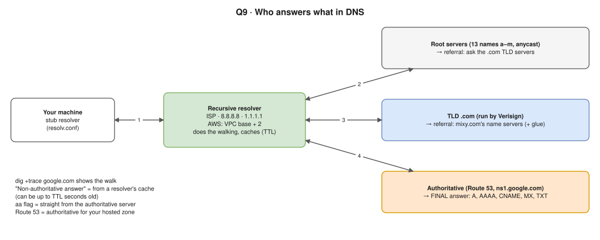

# R1 Q12 · What is DNS and how does it work?



## Say this first

"DNS, the Domain Name System, translates names like `app.example.com` into IP addresses. It's a distributed, hierarchical database, mostly over **UDP port 53** (TCP for large responses and zone transfers).

When I open a site, the browser and OS first check their **caches** and `/etc/hosts`. If not found, the OS stub resolver asks the **recursive resolver** configured in `/etc/resolv.conf`, for example the ISP's, 8.8.8.8, or in a VPC the Route 53 Resolver at the VPC base + 2. The recursive resolver does the work: it asks a **root server**, which refers it to the **.com TLD servers**, which refer it to the domain's **authoritative name servers**, for example Route 53, which return the actual record. The resolver caches the answer for the record's **TTL** and returns it. Then the browser opens the TCP and TLS connection to that IP."

## The steps (number them when you speak)

1. Browser cache → OS cache → `/etc/hosts` (order from `/etc/nsswitch.conf`).
2. Stub resolver → **recursive resolver** (`/etc/resolv.conf` `nameserver`).
3. Resolver cache hit? Return it. Otherwise:
4. **Root** (13 named root server identities, anycast) → "ask the `.com` servers".
5. **TLD** `.com` → "ask `ns-123.awsdns-45.com`" (the domain's NS records, from the registrar).
6. **Authoritative** → `app.example.com A 203.0.113.10, TTL 300`.
7. Resolver caches for the TTL → answers the client. "Non-authoritative answer" in `nslookup` = it came from a resolver's cache, not the authoritative server.

## Record types

| Record | Purpose | Example |
|---|---|---|
| A / AAAA | Name → IPv4 / IPv6 | `app A 203.0.113.10` |
| CNAME | Alias to another name (not at the zone apex) | `www CNAME app.example.com` |
| Alias (Route 53) | Like CNAME but works at the apex, free queries, points to AWS resources (ALB, CloudFront, S3) | `example.com ALIAS my-alb-123.elb.amazonaws.com` |
| MX | Mail servers, with priority | `10 mail.example.com` |
| TXT | Verification, SPF, DKIM | `"v=spf1 include:_spf.google.com ~all"` |
| NS | Authoritative servers for the zone | `ns-123.awsdns-45.com` |
| SOA | Zone metadata (primary NS, serial, negative TTL) | |
| PTR | Reverse lookup IP → name | |
| SRV / CAA | Service location / which CAs may issue certificates | |

## Commands

```bash
dig app.example.com                 # full answer, TTL, which server answered
dig +short app.example.com          # just the IP
dig +trace app.example.com          # walk root → TLD → authoritative yourself
dig NS example.com                  # authoritative servers
dig @8.8.8.8 app.example.com        # ask a specific resolver
nslookup app.example.com            # simpler, pre-installed nearly everywhere
cat /etc/resolv.conf                # which resolver, search domains, ndots
```

`dig` shows the **DNS answer**, not network hops (that's `traceroute`/`mtr`). You mixed these up on 13 Nov.

## Route 53 and Kubernetes angles

- **Route 53:** hosted zones (public/private), routing policies: simple, weighted, latency, failover (with health checks), geolocation, geoproximity, multivalue. Resolver endpoints for hybrid DNS with on-prem.
- **Kubernetes:** CoreDNS answers `web.default.svc.cluster.local`; pods have `ndots:5`, so short external names try the search domains first (extra lookups → latency); fix with FQDNs ending in `.` or a lower `ndots`, or NodeLocal DNSCache.
- **Troubleshooting:** wrong IP → stale cache/TTL, wrong record, private vs public zone; NXDOMAIN → record missing, typo, wrong zone delegated; SERVFAIL → DNSSEC or authoritative server problem; timeout → resolver unreachable (SG/NACL UDP 53).

## Deeper notes

[networking/03-core-networking-protocols/04-dns.md](../../networking/03-core-networking-protocols/04-dns.md) · [DNS journey diagram](../../networking/diagrams/04-dns-journey.drawio.svg) · [hemant-model-answers.md Q1–Q9](../../hemant-model-answers.md#1-dns-and-name-resolution) · [lab: trace DNS resolution](../../networking/13-hands-on-labs/lab-03.2-trace-dns-resolution.md)

## 🎯 Drill: say it from memory, then check

1. The resolution chain from browser to answer (7 steps).
2. Who answers what: root, TLD, authoritative.
3. CNAME vs Route 53 alias.
4. Which command walks the chain yourself?

<details><summary>Check your answers</summary>

1. Browser cache → OS cache/hosts → recursive resolver → root → TLD → authoritative → answer cached for TTL and returned.
2. Root: which TLD servers to ask. TLD: which authoritative servers hold the domain. Authoritative: the actual record.
3. CNAME maps a name to another name and can't be at the zone apex; an alias can be at the apex, points to AWS resources, and alias queries to AWS resources are free.
4. `dig +trace name`.

</details>

## 🗣️ 30-second spoken answer

"DNS turns names into IP addresses. The browser and OS check their caches first; then the recursive resolver from resolv.conf does the lookup: it asks a root server, which points to the TLD servers, which point to the domain's authoritative servers, like Route 53, which return the record. The resolver caches it for the TTL. Common records are A, AAAA, CNAME, MX, TXT and NS, and on AWS alias records point to ALBs or CloudFront, even at the apex. I debug with dig and dig +trace."
