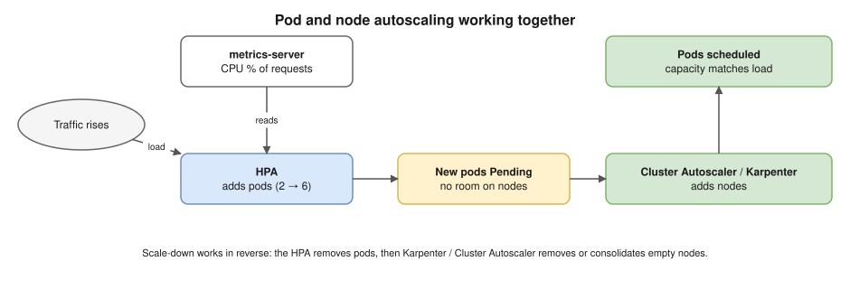

# R2 Q1 · How do you scale an application in Kubernetes?



## Say this first

"There are two layers to scale: **pods** and **nodes**, and they work together.

For pods: manually with `kubectl scale` or by changing `replicas` in Git; automatically with the **Horizontal Pod Autoscaler**, which adds or removes replicas to keep a metric at a target, for example average CPU at 70% of requests, using metrics-server, or custom metrics like requests per second through Prometheus Adapter; **KEDA** for event-driven scaling, like SQS queue length or Kafka lag, including scale to zero; and the **Vertical Pod Autoscaler**, which right-sizes CPU and memory requests instead of adding pods.

For nodes: when new pods are **Pending** because no node has room, the **Cluster Autoscaler** grows the node group's Auto Scaling group, or on EKS **Karpenter** launches a right-sized instance directly; both remove empty or underused nodes later.

The prerequisite for all of it is correct **resource requests**, because the HPA's CPU percentage and the scheduler both use them, plus readiness probes so new pods only get traffic when ready, and a PodDisruptionBudget so scale-down doesn't take too many pods at once."

## The pieces

| Tool | Scales | Based on | Notes |
|---|---|---|---|
| `kubectl scale` / replicas in Git | Pods | You | With GitOps, change Git (or ArgoCD will revert it) |
| HPA (`autoscaling/v2`) | Pod count | CPU/memory % of **requests**, custom/external metrics | Needs metrics-server; don't let ArgoCD fight it: remove `replicas` from the manifest or ignore it |
| KEDA | Pod count (0..N) | Event sources: SQS, Kafka, Prometheus query, cron | Creates/drives an HPA underneath |
| VPA | Pod requests/limits | Historical usage | Recreates pods to apply (in-place resize is newer); don't combine with HPA on the same CPU/memory metric |
| Cluster Autoscaler | Nodes (ASG/node group) | Pending pods; underused nodes | Works with node group min/max |
| Karpenter | Nodes (any instance type) | Pending pods' requirements | Faster, bin-packs, consolidation, spot; EKS default choice now |

## HPA YAML (type from memory)

```yaml
apiVersion: autoscaling/v2
kind: HorizontalPodAutoscaler
metadata:
  name: web
spec:
  scaleTargetRef:
    apiVersion: apps/v1
    kind: Deployment
    name: web
  minReplicas: 3
  maxReplicas: 20
  metrics:
    - type: Resource
      resource:
        name: cpu
        target: {type: Utilization, averageUtilization: 70}   # 70% of the CPU *request*
  behavior:
    scaleDown:
      stabilizationWindowSeconds: 300    # avoid flapping
```

```bash
kubectl scale deploy/web --replicas=5
kubectl autoscale deploy/web --cpu-percent=70 --min=3 --max=20
kubectl get hpa web -w            # TARGETS shows current/target; <unknown> = metrics-server missing or no requests set
kubectl top pods
```

HPA formula: `desired = ceil(current × currentMetric / target)`. Example: 4 pods at 90% CPU, target 70% → ceil(4 × 90/70) = 6.

## Things that go wrong (follow-up material)

- `TARGETS <unknown>`: metrics-server not installed, or the pods have no CPU **requests**.
- HPA maxed out: raise `maxReplicas`, or the bottleneck is elsewhere (DB, a downstream service).
- New pods **Pending**: node autoscaler limits (ASG max, Karpenter NodePool limits), or on EKS the subnet is **out of IPs** (VPC CNI gives each pod a VPC IP) or the instance's ENI/IP limit.
- Scaling too slow for spikes: image pull time, slow app start, node launch time → pre-scale with a higher `minReplicas`/scheduled scaling, KEDA cron, overprovisioning pods with low priority, smaller images.
- Scale-down kills too many: PodDisruptionBudget, graceful shutdown (`preStop`, `terminationGracePeriodSeconds`).
- Stateful apps: StatefulSets scale too, but the data layer (DB) often needs its own scaling (read replicas, sharding).

## Deeper notes

[kubernetes/12-resources-and-autoscaling.md, Autoscaling](../../kubernetes/12-resources-and-autoscaling.md#autoscaling-) · HPA too slow scenario: `interview-prep/scenario-questions/kubernetes/04-hpa-too-slow.md` in draft PR #11 · [requests vs limits diagram](../../kubernetes/diagrams/12-requests-limits.drawio.svg)

## 🎯 Drill: type from memory, then check

1. Write the HPA YAML for CPU 70%, min 3, max 20.
2. What does the HPA percentage refer to?
3. Pod Pending after scale-out: three causes on EKS.
4. HPA vs VPA vs Cluster Autoscaler vs Karpenter, one line each.

<details><summary>Check your answers</summary>

1. See the YAML above.
2. Percentage of the container's CPU **request** (averaged over the pods).
3. Node autoscaler at its max/limits; subnet out of IPs (VPC CNI); instance ENI/IP limit (also taints/affinity with no matching node).
4. HPA: number of pods. VPA: size (requests) of pods. Cluster Autoscaler: grows/shrinks node groups for Pending pods. Karpenter: launches right-sized nodes directly, consolidates.

</details>

## 🗣️ 30-second spoken answer

"I scale pods and nodes. Pods scale with the HPA on CPU, memory or custom metrics like requests per second, KEDA for queue-based scaling, and VPA to right-size requests. When pods go Pending because there's no room, Cluster Autoscaler or Karpenter adds nodes and removes them when idle. It only works with correct resource requests, readiness probes and PodDisruptionBudgets, and on EKS I watch subnet IPs because every pod takes a VPC IP."
