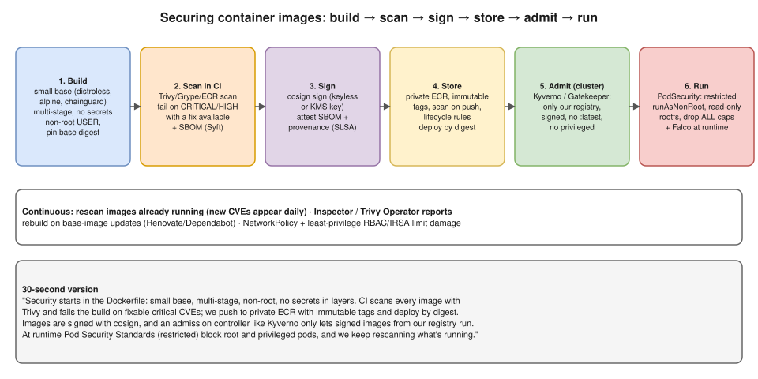

# R2 Q2 · How do you secure container images in Kubernetes?



## Say this first

"I secure images at every stage, from the Dockerfile to the running pod.

**Build:** a minimal base image, distroless or slim, pinned by digest; multi-stage builds so compilers and build tools don't ship; a non-root `USER`; and no secrets in layers or build args. **Scan:** CI scans every image with Trivy or Grype, or ECR scanning, and fails the pipeline on critical or high CVEs that have a fix; we also generate an SBOM. **Sign:** sign the image with cosign so we can prove it came from our pipeline. **Store:** a private ECR repository with immutable tags and scan-on-push, and we deploy by digest or immutable SHA tags, never `latest`.

**Admit:** an admission controller, Kyverno or OPA Gatekeeper, only lets pods run if the image comes from our registry, is signed, and isn't `latest`. **Run:** Pod Security Standards at the `restricted` level: run as non-root, read-only root filesystem, drop all capabilities, no privileged containers, plus NetworkPolicies and least-privilege service accounts. And because new CVEs appear every day, we keep **rescanning running images** and rebuild when the base image is patched."

## Controls by stage

| Stage | Control | Example |
|---|---|---|
| Dockerfile | Small base, pinned | `FROM gcr.io/distroless/static:nonroot@sha256:…` |
| | Multi-stage | build in `golang:1.23`, copy only the binary |
| | Non-root | `USER 65532:65532` |
| | No secrets | BuildKit secrets `RUN --mount=type=secret,id=npmrc …`, `.dockerignore` for `.env`, keys |
| CI | Vulnerability scan | `trivy image --exit-code 1 --severity CRITICAL,HIGH --ignore-unfixed $IMAGE` |
| | Lint Dockerfile | hadolint |
| | SBOM | `syft $IMAGE -o spdx-json`, or `trivy image --format cyclonedx` |
| | Sign | `cosign sign --key awskms:///alias/cosign $IMAGE@$DIGEST` (or keyless with OIDC) |
| Registry | Private ECR | immutable tags, scan on push (basic or enhanced with Amazon Inspector), lifecycle policy, repo policy |
| Admission | Kyverno / Gatekeeper / Sigstore policy-controller | allowed registries, verify signature, disallow `:latest`, require requests/limits |
| | Pod Security Admission | namespace label `pod-security.kubernetes.io/enforce: restricted` |
| Runtime | securityContext | `runAsNonRoot`, `readOnlyRootFilesystem`, `allowPrivilegeEscalation: false`, `capabilities.drop: [ALL]`, seccomp `RuntimeDefault` |
| | Detection | Falco / GuardDuty EKS Runtime Monitoring |
| | Blast radius | NetworkPolicy default deny, IRSA/Pod Identity least privilege, no `automountServiceAccountToken` if unused |
| Ongoing | Rescan + rebuild | Trivy Operator / Inspector on running images; Renovate/Dependabot base-image bumps |

## Pod securityContext (type from memory)

```yaml
spec:
  securityContext:
    runAsNonRoot: true
    runAsUser: 10001
    seccompProfile: {type: RuntimeDefault}
  containers:
    - name: app
      image: 123456789012.dkr.ecr.ap-south-1.amazonaws.com/app@sha256:4f1c…
      securityContext:
        allowPrivilegeEscalation: false
        readOnlyRootFilesystem: true
        capabilities: {drop: ["ALL"]}
```

## Kyverno policy: only signed images from our ECR

```yaml
apiVersion: kyverno.io/v1
kind: ClusterPolicy
metadata:
  name: verify-images
spec:
  validationFailureAction: Enforce
  rules:
    - name: signed-from-our-ecr
      match:
        any: [{resources: {kinds: [Pod]}}]
      verifyImages:
        - imageReferences: ["123456789012.dkr.ecr.ap-south-1.amazonaws.com/*"]
          attestors:
            - entries:
                - keys:
                    kms: awskms:///alias/cosign
```

(Field names differ slightly between Kyverno versions; know the idea: match pods → image pattern → required signature.)

## Follow-up questions

**Q: A critical CVE is found in an image already in production. What do you do?** Check if it's exploitable in our context (package actually used? network exposed?), rebuild with the patched base, push through the pipeline, roll out; if no fix exists, mitigate (WAF rule, NetworkPolicy, disable the feature) and document an exception with an expiry.

**Q: Why not use `latest`?** Not reproducible, can't tell what's running, rollbacks are unreliable, and pulls can silently change the image.

**Q: How do you stop people from deploying from Docker Hub?** Admission policy allowing only our registry, and ECR pull-through cache for approved public images.

## Resume check

SonarCloud is on your resume (code quality/SAST); image scanning, cosign and Kyverno are **not**. Say "we scanned with ⟨fill⟩" only if true; otherwise present cosign/Kyverno as what you'd add.

## Deeper notes

[docker/10-security.md](../../docker/10-security.md) · [kubernetes/15-security.md](../../kubernetes/15-security.md) · [hemant-model-answers.md Q55–Q56 (shift left, CI/CD security)](../../hemant-model-answers.md#q55--what-do-shift-left-principles-actually-mean-in-a-pipeline) · policy-as-code scenario: `interview-prep/scenario-questions/docker/04-policy-as-code-docker-security.md` in draft PR #11

## 🎯 Drill: say it from memory, then check

1. The six stages and one control each.
2. Write the Trivy command that fails CI on fixable critical/high CVEs.
3. Four securityContext fields.
4. What enforces "only signed images from our registry"?

<details><summary>Check your answers</summary>

1. Build: minimal non-root base. Scan: Trivy in CI. Sign: cosign. Store: private ECR, immutable tags. Admit: Kyverno/Gatekeeper. Run: Pod Security restricted + rescanning.
2. `trivy image --exit-code 1 --severity CRITICAL,HIGH --ignore-unfixed <image>`
3. `runAsNonRoot`, `readOnlyRootFilesystem`, `allowPrivilegeEscalation: false`, `capabilities.drop: [ALL]` (also seccomp RuntimeDefault).
4. An admission controller: Kyverno `verifyImages`, Sigstore policy-controller, or Gatekeeper with an external data provider.

</details>

## 🗣️ 30-second spoken answer

"I secure images end to end. In the Dockerfile: a minimal pinned base, multi-stage, non-root, no secrets. In CI: scan with Trivy and fail on fixable critical CVEs, generate an SBOM and sign with cosign. Push to private ECR with immutable tags and deploy by digest. In the cluster, Kyverno only admits signed images from our registry, and Pod Security restricted blocks root and privileged pods. Then we keep rescanning what's running and rebuild when the base image is patched."
