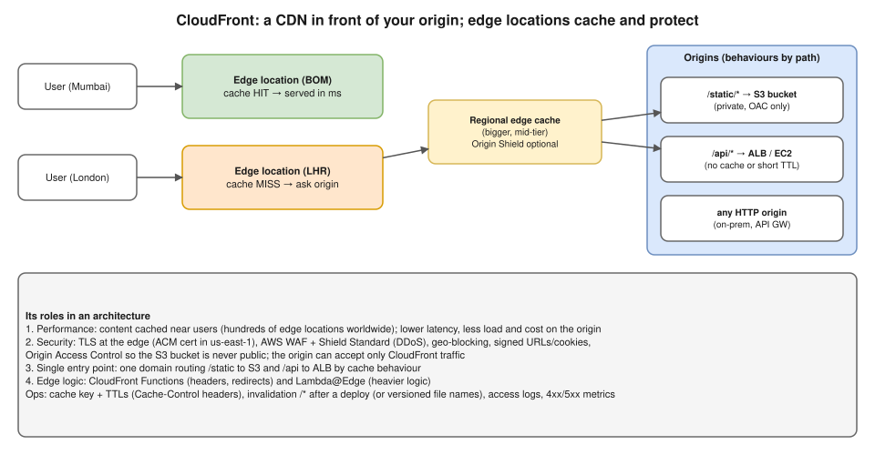

# R2 Q3 · What is the role of Amazon CloudFront in an architecture?

## Say this first

"CloudFront is AWS's **CDN**. It sits in front of an **origin**, an S3 bucket, an ALB, API Gateway or any HTTP server, and serves users from **edge locations** close to them. It plays four roles.

**Performance:** cacheable content, images, JS, CSS, downloads, even some API responses, is served from the edge cache, so latency drops and the origin gets far fewer requests; even uncached requests are faster because they travel over AWS's backbone with persistent connections to the origin. **Security:** it terminates TLS at the edge, AWS Shield Standard protects against DDoS by default, you attach **AWS WAF** rules, use geo-restriction and signed URLs or cookies for private content, and with **Origin Access Control** the S3 bucket stays private, only CloudFront can read it. **A single entry point:** one domain with **cache behaviours** by path, `/static/*` to S3 and `/api/*` to the ALB. **Edge logic:** CloudFront Functions for lightweight header rewrites and redirects, Lambda@Edge for heavier logic.

A typical design: Route 53 alias → CloudFront with WAF → S3 for the frontend and ALB for the API."

## Key concepts

| Concept | What it means |
|---|---|
| Distribution | The CloudFront configuration, with a `dxxxx.cloudfront.net` domain; add alternate domain names (CNAMEs) |
| Origin | Where content comes from: S3, ALB, EC2, API Gateway, MediaStore, any HTTP server; origin groups for failover |
| Cache behaviour | Path pattern → origin + cache policy + allowed methods + viewer protocol policy (redirect HTTP → HTTPS) |
| Cache key / cache policy | What makes two requests "the same object": path, plus selected headers, cookies, query strings; fewer = higher hit ratio |
| Origin request policy | What is forwarded to the origin without being part of the cache key |
| TTL | Min/default/max; origin's `Cache-Control: max-age` / `s-maxage` respected within limits |
| Invalidation | `aws cloudfront create-invalidation --distribution-id E123 --paths "/*"` after deploys; better: versioned file names (`app.3f9a.js`) |
| Regional edge cache / Origin Shield | Mid-tier caches that further reduce origin load |
| OAC (Origin Access Control) | CloudFront signs requests to S3; bucket policy allows only that distribution; replaces legacy OAI |
| Certificates | ACM certificate must be in **us-east-1** for CloudFront |
| Signed URLs / cookies | Time-limited access to private content (paid downloads, user files) |
| Logs / metrics | Standard/real-time logs; CloudWatch: requests, cache hit rate, 4xx/5xx error rate |

## When it helps and when it doesn't

- **Helps:** static websites (S3 + CloudFront), global users, media/downloads, APIs with cacheable GETs, DDoS/WAF protection in front of an ALB, hiding the origin.
- **Less useful:** highly personalised, uncacheable responses for users in one region (still gives TLS + WAF + backbone, but no cache benefit).
- **Origin protection:** restrict the ALB to CloudFront using the AWS-managed prefix list `com.amazonaws.global.cloudfront.origin-facing` in its security group, plus a secret custom header checked by an ALB rule (or VPC origins for private ALBs).

## Troubleshooting follow-ups

- **Users see old content after a deploy:** cached until TTL → invalidate, or use versioned file names; check `Cache-Control` headers.
- **403 from S3 origin:** bucket policy doesn't allow the distribution (OAC), wrong default root object, object missing (S3 returns 403 without ListBucket).
- **502 from CloudFront:** CloudFront can't establish TLS with the origin (certificate name mismatch, expired) or the origin closed the connection. **504:** origin timeout (SG blocks CloudFront, origin slow).
- **Low cache hit ratio:** cache key includes all headers/cookies/query strings → trim the cache policy. Check `X-Cache: Hit from cloudfront` in response headers.

## Deeper notes

S3 security in transit and at rest (scenario incl. CloudFront + OAC): `interview-prep/scenario-questions/aws/09-secure-s3-in-transit-and-at-rest.md` in draft PR #11 · [TLS termination diagram](../../networking/diagrams/3.6-tls-termination.drawio.svg)

## 🎯 Drill: say it from memory, then check

1. Four roles of CloudFront.
2. What keeps the S3 bucket private behind CloudFront?
3. In which region must the ACM certificate be?
4. Two ways to get users the new version after a deploy.

Check your answers

1. Performance (edge caching, backbone), security (TLS, Shield, WAF, OAC, signed URLs, geo-blocking), single entry point with path-based behaviours, edge compute (CloudFront Functions, Lambda@Edge).
2. Origin Access Control plus a bucket policy allowing only that distribution; Block Public Access stays on.
3. us-east-1 (N. Virginia).
4. Invalidation (`create-invalidation --paths "/*"`) or versioned/hashed file names (with short TTL on index.html).

## 🗣️ 30-second spoken answer

"CloudFront is AWS's CDN in front of origins like S3 or an ALB. It caches content at edge locations near users, so latency and origin load drop. It's also a security layer: TLS at the edge, Shield for DDoS, WAF rules, signed URLs, and Origin Access Control so the S3 bucket stays private. With cache behaviours one domain can send /static to S3 and /api to the ALB. After deploys we invalidate or use versioned file names."
