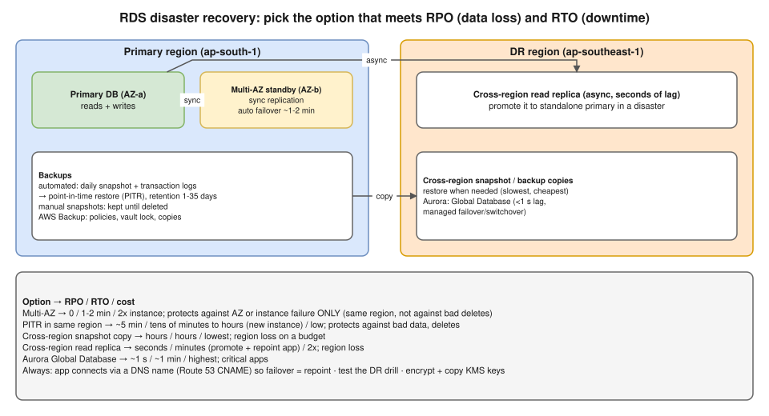

# R2 Q4 · How do you design disaster recovery for Amazon RDS?



## Say this first

"I start from the business numbers: **RPO**, how much data we can lose, and **RTO**, how long we can be down. Then I layer the options, because each protects against a different failure.

**Multi-AZ** keeps a synchronous standby in another AZ with automatic failover in about one to two minutes; RPO is zero, but it only protects against an instance or AZ failure in the same region, and it replicates mistakes too: a bad `DELETE` is deleted on the standby as well. So I also need **backups**: automated daily snapshots plus transaction logs give **point-in-time restore** to any second within the retention period, up to 35 days, for logical errors; manual snapshots or **AWS Backup** with a vault lock for long-term, tamper-proof copies.

For **region failure**, I copy snapshots to a second region, cheapest but RTO in hours, or run a **cross-region read replica** that I promote to primary, RPO of seconds and RTO of minutes; for Aurora, **Aurora Global Database** with under one second of lag and managed failover. The application connects through a DNS name, so failover means repointing Route 53, not redeploying. And DR isn't real until it's tested: we run regular restore and failover drills and measure the actual RTO."

## Options against failure types

| Failure | Protection | RPO | RTO | Cost |
|---|---|---|---|---|
| Instance/host failure, AZ outage | Multi-AZ instance (1 standby, not readable) | 0 | ~1–2 min (DNS flip) | ~2x instance |
| Same, faster + read scaling | Multi-AZ DB cluster (2 readable standbys) | ~0 | typically < 35 s | ~3x |
| Bad data, accidental delete/drop | Point-in-time restore (automated backups, 1–35 days) | ~5 min (latest restorable time) | Tens of minutes–hours (new instance, size-dependent) | Low |
| Long-term retention, ransomware | Manual snapshots, AWS Backup plans + vault lock, cross-account copy | Snapshot age | Hours | Low |
| Region outage (budget) | Cross-region snapshot/backup copy (+ KMS key in DR region) | Hours | Hours | Lowest |
| Region outage (fast) | Cross-region read replica → promote | Seconds (replica lag) | Minutes (+ repoint app) | ~2x |
| Region outage (critical) | Aurora Global Database (switchover/failover) | ~1 s | ~1 min | Highest |

## Design checklist (say 5–6 of these)

1. **Agree RPO/RTO** per database with the business; tier databases.
2. **Multi-AZ** for every production database.
3. **Automated backups** with enough retention; **deletion protection**; final snapshot on delete.
4. **Cross-region** copies or replica for region DR; **cross-account** copies so a compromised account can't delete backups.
5. **Encryption:** KMS keys must exist in the DR region (multi-Region keys or re-encrypt on copy).
6. **Connection by DNS:** app uses a Route 53 CNAME (or the RDS endpoint); failover = update the record (low TTL), or use RDS Proxy.
7. **Infrastructure as code:** Terraform for the DR region (subnet groups, parameter groups, SGs) so you're not building it during an incident.
8. **Runbook + drills:** quarterly restore test and failover test; measure real RTO; verify the restored data.
9. **Monitoring:** replica lag (`ReplicaLag`), backup job failures, free storage, `LatestRestorableTime`.

## Commands you might mention

```bash
# point-in-time restore to a NEW instance
aws rds restore-db-instance-to-point-in-time \
  --source-db-instance-identifier prod-db --target-db-instance-identifier prod-db-restored \
  --restore-time 2026-11-14T08:15:00Z

# copy a snapshot to the DR region (run in the DR region)
aws rds copy-db-snapshot --source-region ap-south-1 \
  --source-db-snapshot-identifier arn:aws:rds:ap-south-1:123456789012:snapshot:prod-2026-11-14 \
  --target-db-snapshot-identifier prod-2026-11-14-dr --kms-key-id alias/rds-dr

# promote a cross-region read replica during a regional disaster
aws rds promote-read-replica --db-instance-identifier prod-db-replica-sg --region ap-southeast-1

# test a Multi-AZ failover
aws rds reboot-db-instance --db-instance-identifier prod-db --force-failover
```

Note: a restore always creates a **new** instance with a new endpoint: the app must be repointed.

## Follow-up questions

**Q: Is a read replica a backup?** No. It replicates deletes and corruption within seconds. It's for read scaling and region DR, not for "undo".

**Q: Multi-AZ vs read replica?** Multi-AZ: synchronous, automatic failover, standby not readable (instance deployment), same region, for HA. Read replica: asynchronous, readable, can be cross-region, manual promotion, for scaling/DR.

**Q: After promoting the DR replica, how do you fail back?** Create a new replica from the promoted DB back in the original region, let it catch up, then do a planned switchover in a maintenance window.

## Deeper notes

[hemant-model-answers.md Q41–Q42 (DB scaling, Postgres → RDS)](../../hemant-model-answers.md#q41-the-database-will-not-scale-what-would-you-propose) · [DB scaling ladder diagram](../../diagrams/41-db-scaling-ladder.drawio.svg) · region failover scenario: `interview-prep/scenario-questions/kubernetes/02-region-failover.md` and S3 backup scenario `aws/06-s3-backup-bucket-unavailable.md` in draft PR #11 · playbook S6 "app can't connect to RDS" in draft PR #12

## 🎯 Drill: say it from memory, then check

1. Define RPO and RTO.
2. Which failure does Multi-AZ NOT protect against?
3. Fill RPO/RTO for: Multi-AZ, PITR, cross-region replica, Aurora Global.
4. Two things that make a DR plan real rather than theoretical.

<details><summary>Check your answers</summary>

1. RPO: maximum acceptable data loss (time). RTO: maximum acceptable downtime.
2. Logical errors (bad delete, corruption replicate to the standby) and region failure.
3. Multi-AZ 0 / 1–2 min; PITR ~5 min / tens of minutes–hours; cross-region replica seconds / minutes; Aurora Global ~1 s / ~1 min.
4. Regular tested drills with measured RTO; IaC for the DR region and app connecting via DNS (plus KMS keys and cross-account copies ready).

</details>

## 🗣️ 30-second spoken answer

"I start with RPO and RTO. Multi-AZ gives automatic failover in a minute or two with no data loss, but only for instance or AZ failures. Automated backups give point-in-time restore for bad deletes, and AWS Backup keeps locked long-term copies. For a region outage I use a cross-region read replica I can promote, or Aurora Global Database for critical systems, or just copied snapshots if hours are acceptable. The app connects through DNS so failover is a repoint, and we test restores and failovers regularly."
