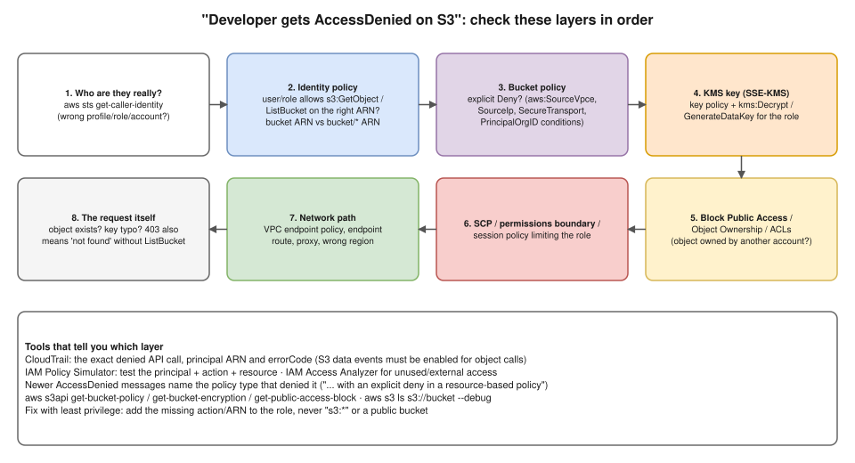

# R2 Q5 · A developer cannot access an S3 bucket. What will you check?



## Say this first

"First I get the **exact error and the exact command**: is it `AccessDenied` 403, `NoSuchBucket`, a timeout, or a KMS error? Is it `ListBucket`, `GetObject` or `PutObject`? Then I check the layers in order.

**One, identity:** `aws sts get-caller-identity`, because half the time they're using the wrong profile, role or account. **Two, the identity policy** on their user or role: does it allow that action on the right ARN? A classic mistake is `s3:ListBucket` needs the bucket ARN while `GetObject` needs `bucket/*`. **Three, the bucket policy:** an explicit Deny wins, for example conditions on a VPC endpoint, source IP, `aws:SecureTransport` or org ID. **Four, KMS:** if the bucket uses SSE-KMS they also need `kms:Decrypt` or `GenerateDataKey`, and the key policy must allow them. **Five, ownership and Block Public Access:** objects uploaded by another account, ACLs disabled. **Six, guardrails:** an SCP or permissions boundary. **Seven, the network path:** a VPC endpoint policy, a proxy, wrong region.

**CloudTrail** shows the exact denied call and principal, and newer AccessDenied messages even say which policy type denied it. The fix is least privilege: add the missing action on the right ARN, never `s3:*` or a public bucket."

## The checks with commands

| # | Check | How |
|---|---|---|
| 1 | Who am I? | `aws sts get-caller-identity`; `aws configure list`; env vars `AWS_PROFILE`, `AWS_ACCESS_KEY_ID` override profiles |
| 2 | Identity policy | `aws iam list-attached-role-policies --role-name dev-role`, `get-policy-version`; IAM Policy Simulator |
| 3 | Bucket policy | `aws s3api get-bucket-policy --bucket acme-data` → look for `"Effect": "Deny"` and its `Condition` |
| 4 | KMS | `aws s3api get-bucket-encryption --bucket acme-data`; `aws kms get-key-policy --key-id … --policy-name default` |
| 5 | Ownership / BPA / ACLs | `aws s3api get-bucket-ownership-controls`, `get-public-access-block`, `get-object-acl` |
| 6 | SCP / boundary | Organizations console / `aws organizations list-policies-for-target`; `aws iam get-role` (PermissionsBoundary) |
| 7 | Network | Request from a VPC? Check the S3 **VPC endpoint policy** and route; `aws s3 ls s3://acme-data --debug --region ap-south-1` |
| 8 | Request itself | Right bucket name/region? Object exists? Without `s3:ListBucket`, a missing object returns **403 instead of 404** |

**Evidence:** CloudTrail event for the call (`errorCode: AccessDenied`, `userIdentity.arn`); S3 object-level calls need **data events** enabled in the trail. IAM Access Analyzer for policy validation.

## Typical fixes

```json
{
  "Effect": "Allow",
  "Action": ["s3:ListBucket"],
  "Resource": "arn:aws:s3:::acme-data",
  "Condition": {"StringLike": {"s3:prefix": ["team-a/*"]}}
},
{
  "Effect": "Allow",
  "Action": ["s3:GetObject", "s3:PutObject"],
  "Resource": "arn:aws:s3:::acme-data/team-a/*"
}
```

Plus, if SSE-KMS: `kms:Decrypt`, `kms:GenerateDataKey` on the key ARN in the identity policy **and** the key policy allowing the role.

**Cross-account developer:** both sides must allow: their role's identity policy in account A **and** the bucket policy in account B naming that role (and the KMS key policy too).

## Questions to ask the developer first

What exact command/SDK call and error? Since when, did it ever work? Which role/profile? From laptop, EC2, Lambda or a pod (then which role: instance profile, IRSA)? One object or all? Uploaded by whom?

## Deeper notes

[R1 Q8: IAM role vs policy and evaluation logic](../round-1/08-iam-role-vs-policy.md) · playbook S5 "S3 Access Denied" in draft PR #12 · S3 security scenario `aws/09-secure-s3-in-transit-and-at-rest.md` in draft PR #11

## 🎯 Drill: say it from memory, then check

1. The first command you run, and why.
2. The 7 layers in order.
3. Why does `ListBucket` fail when `GetObject` on `bucket/*` is allowed?
4. Where do you find the exact denied call?

<details><summary>Check your answers</summary>

1. `aws sts get-caller-identity`: confirm which principal (account/role) is really making the call.
2. Identity → identity policy → bucket policy (explicit Deny) → KMS key policy → ownership/ACLs/Block Public Access → SCP/permissions boundary → network path (VPC endpoint policy, region, proxy).
3. `ListBucket` acts on the bucket ARN (`arn:aws:s3:::bucket`), not `bucket/*`.
4. CloudTrail (data events for object-level calls); also the AccessDenied message often names the policy type.

</details>

## 🗣️ 30-second spoken answer

"I'd get the exact error and command, then check in order: who they really are with sts get-caller-identity; whether their role's policy allows the action on the right ARN, bucket for ListBucket and bucket/* for objects; whether the bucket policy has an explicit Deny; whether SSE-KMS needs kms:Decrypt; then ownership, SCPs and the VPC endpoint policy. CloudTrail shows the exact denied call. Then I add least-privilege permissions, never s3:* or a public bucket."
