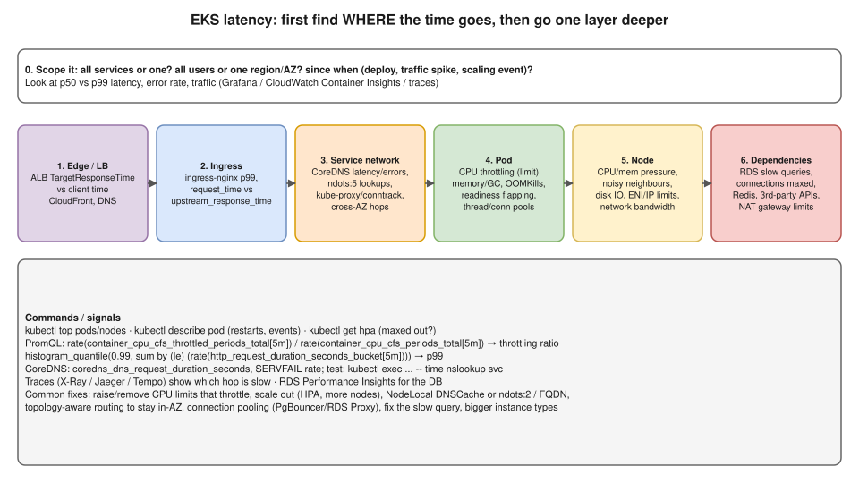

# R2 Q6 · You are facing latency issues in an EKS cluster. How do you troubleshoot?



## Say this first

"I don't guess; I find **where** the time is spent, layer by layer from the user inward.

First I **scope** it: all services or one, all users or one region or AZ, and **since when**: a deploy, a traffic spike, a scaling event? I look at p50 versus p99 latency, error rate and request rate on Grafana or CloudWatch Container Insights.

Then I split the request path. At the **load balancer**, ALB `TargetResponseTime` tells me if the time is inside the cluster or before it. At the **ingress**, nginx logs show `request_time` versus `upstream_response_time`. Inside the cluster I check **DNS**, CoreDNS latency and errors, because `ndots:5` makes external names do several lookups; the **pods**, especially **CPU throttling** from low CPU limits, memory pressure and GC, restarts, and readiness flapping; the **nodes**, CPU, memory, disk IO, network; and the **dependencies**, slow RDS queries, maxed connection pools, a third-party API, cross-AZ traffic. **Traces** with X-Ray or Jaeger show exactly which hop is slow.

Once I know the layer, I fix that: remove or raise CPU limits that throttle, scale out with HPA and more nodes, NodeLocal DNSCache, connection pooling, fix the slow query."

## Step by step with commands

**0. Scope and timeline**

```bash
kubectl get events -A --sort-by=.lastTimestamp | tail -30
kubectl rollout history deploy/web          # did a deploy coincide?
kubectl get hpa -A                          # anything pinned at maxReplicas?
```

**1. Is the time in the cluster at all?** ALB metrics `TargetResponseTime` (time the target took) vs total client time; CloudFront/DNS issues show before this.

**2. Ingress controller:** nginx access log fields `$request_time` (total) vs `$upstream_response_time` (backend). Big difference → ingress itself (CPU, too few replicas).

**3. Pods**

```bash
kubectl top pods -n app --sort-by=cpu
kubectl describe pod web-xxx | grep -A5 -E "Limits|Restart|Last State"   # OOMKilled? restarts?
```

```promql
# CPU throttling ratio (>25% is a latency problem)
sum by (pod) (rate(container_cpu_cfs_throttled_periods_total{namespace="app"}[5m]))
  / sum by (pod) (rate(container_cpu_cfs_periods_total{namespace="app"}[5m]))

# p99 per service
histogram_quantile(0.99, sum by (le, service) (rate(http_request_duration_seconds_bucket[5m])))
```

**4. DNS**

```bash
kubectl exec -it web-xxx -- sh -c 'time nslookup api.example.com; cat /etc/resolv.conf'
kubectl -n kube-system top pods -l k8s-app=kube-dns
kubectl -n kube-system logs -l k8s-app=kube-dns | grep -i -E "timeout|SERVFAIL"
```

`ndots:5` means `api.example.com` (2 dots) is tried as `api.example.com.app.svc.cluster.local`, `…svc.cluster.local`, `…cluster.local`, `…ec2.internal` first. Fixes: FQDN with trailing dot, `dnsConfig: options: [{name: ndots, value: "2"}]`, NodeLocal DNSCache, more CoreDNS replicas. Also EC2 DNS resolver limit: 1024 packets/s per ENI.

**5. Nodes**

```bash
kubectl top nodes
kubectl describe node ip-10-0-1-23 | grep -A8 -E "Conditions|Allocated"   # MemoryPressure? DiskPressure?
```

Noisy neighbours (pods without limits), burstable instances (t3) out of CPU credits, EBS IOPS/throughput limits, network bandwidth / PPS limits of the instance type.

**6. Dependencies:** RDS Performance Insights (top SQL, waits), `DatabaseConnections` at max, connection pool exhaustion in the app, RDS Proxy; Redis latency; third-party API latency; **NAT gateway** saturation or cross-AZ hops (topology-aware routing, `trafficDistribution: PreferClose`).

## Typical root causes and fixes

| Cause | Signal | Fix |
|---|---|---|
| CPU limits too low | High throttling ratio, p99 spikes, low average CPU | Raise or remove CPU limits, keep requests realistic |
| Not enough replicas | HPA at max, high CPU | Raise maxReplicas, add nodes (Karpenter), optimise |
| DNS | Slow `nslookup`, CoreDNS errors | NodeLocal DNSCache, ndots, CoreDNS scaling |
| Slow DB | Upstream time high, DB metrics | Query/index fix, read replicas, pooling |
| Memory / GC | GC pauses, OOMKills | Raise memory, tune heap |
| Cross-AZ / network | Latency only between some pods/AZs | Topology-aware routing, check instance bandwidth |
| Bad deploy | Started at a deploy | Roll back, then investigate |

## Deeper notes

[kubernetes/17-troubleshooting.md](../../kubernetes/17-troubleshooting.md) · [kubernetes/16-observability.md](../../kubernetes/16-observability.md) · [networking ndots trap diagram](../../networking/diagrams/3.4-ndots-trap.drawio.svg) · [hemant-model-answers.md Q26 debugging approach](../../hemant-model-answers.md#q26-examplecomabc-works-but-examplecomdef-does-not-what-is-your-debugging-approach) · EKS troubleshooting in playbook 5c (draft PR #12)

## 🎯 Drill: say it from memory, then check

1. The scoping questions you ask first.
2. The six layers in order.
3. Write the CPU throttling PromQL.
4. Why does `ndots:5` add latency and two fixes?

<details><summary>Check your answers</summary>

1. All services or one? All users or some region/AZ? Since when, and what changed (deploy, traffic, scaling)? p50 vs p99?
2. Edge/LB → ingress → service network/DNS → pod → node → dependencies.
3. `rate(container_cpu_cfs_throttled_periods_total[5m]) / rate(container_cpu_cfs_periods_total[5m])`.
4. Names with fewer than 5 dots are tried with every search domain first, causing several failed lookups; use FQDNs with a trailing dot or lower ndots, NodeLocal DNSCache.

</details>

## 🗣️ 30-second spoken answer

"I'd first scope it: which services, which users, since when and what changed, looking at p99 latency, errors and traffic. Then I follow the request: ALB TargetResponseTime tells me whether the time is inside the cluster; ingress logs split ingress from backend time; then CoreDNS, the pods, especially CPU throttling from tight limits, the nodes, and dependencies like RDS. Traces show the slow hop. Then I fix that layer: adjust limits, scale out, cache DNS, pool connections or fix the query."
