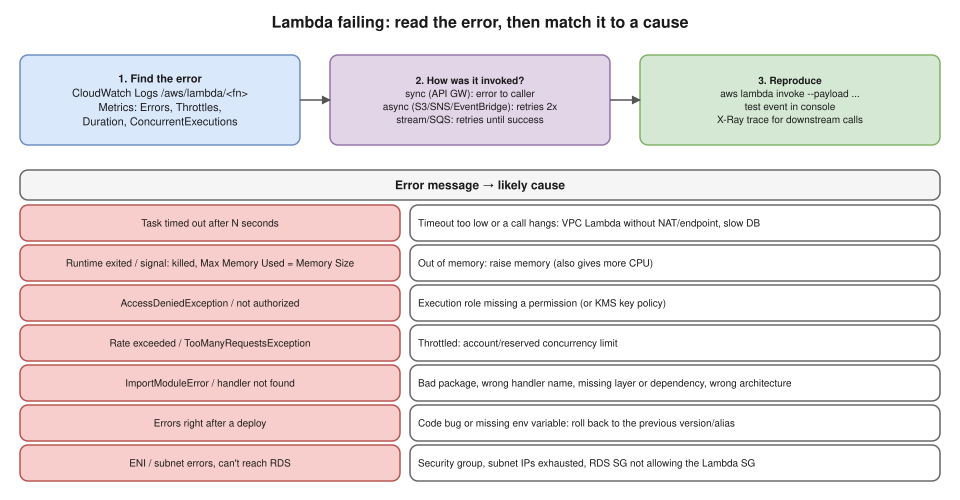

# R2 Q7 · AWS Lambda is failing internally. What are your debugging steps?



## Say this first

"I start with the **evidence**, not the code. **CloudWatch metrics** for the function: `Errors`, `Throttles`, `Duration` close to the timeout, `ConcurrentExecutions`; and **CloudWatch Logs** in `/aws/lambda/<function-name>`, where every invocation has a `START`, `END` and `REPORT` line with duration and **Max Memory Used**, plus any stack trace.

The error message usually tells the cause. **'Task timed out'**: the timeout is too low or a call hangs, very often a Lambda in a VPC without a NAT gateway or VPC endpoint trying to reach the internet or an AWS API, or a slow database. **Memory used equal to memory size** or 'Runtime exited': out of memory. **AccessDenied**: the execution role is missing a permission, or a KMS key policy. **Throttling / Rate exceeded**: concurrency limits. **ImportModuleError** or handler not found: bad packaging, wrong handler name, missing layer or wrong architecture. Errors starting right after a deploy: a code bug or a missing environment variable, so I roll back to the previous version or alias.

I also check **how it's invoked**, because retries differ: synchronous callers like API Gateway get the error directly; asynchronous sources like S3 or EventBridge retry twice and then go to a DLQ or on-failure destination; SQS and streams retry until success and can block a shard. Then I reproduce with `aws lambda invoke` using the failing event, and use **X-Ray** to see which downstream call fails or is slow."

## Steps in order

1. **Scope:** all invocations or some? Since when (deploy, config change, traffic spike)? One event source?
2. **Metrics:** Errors, Throttles, Duration (vs timeout), ConcurrentExecutions, IteratorAge (streams), DLQ errors, AsyncEventAge.
3. **Logs:**

   ```bash
   aws logs tail /aws/lambda/order-processor --since 30m --follow
   aws logs filter-log-events --log-group-name /aws/lambda/order-processor \
     --filter-pattern '?ERROR ?"Task timed out" ?"Runtime exited"'
   ```

   CloudWatch Logs Insights:

   ```text
   fields @timestamp, @requestId, @message
   | filter @message like /ERROR|Task timed out|Runtime exited/
   | sort @timestamp desc | limit 50
   ```

4. **Config:** `aws lambda get-function-configuration --function-name order-processor` → timeout, memory, env vars, VPC config, role, layers, architecture, reserved concurrency.
5. **Reproduce:** `aws lambda invoke --function-name order-processor --payload fileb://event.json out.json && cat out.json` (or a console test event).
6. **Trace downstream:** X-Ray (active tracing) or app logs with timing around DB/API calls.
7. **Fix, then prevent:** alarms on Errors/Throttles, DLQ/on-failure destinations, structured logging, versions + aliases for instant rollback.

## Error → cause → fix

| Symptom | Likely cause | Fix |
|---|---|---|
| `Task timed out after 3.00 seconds` | Default 3 s timeout too low; call hangs (VPC Lambda with no NAT/endpoint; DB slow; connection opened per invocation) | Raise timeout (max 15 min); add NAT GW or VPC endpoints; RDS Proxy; reuse connections outside the handler |
| `Max Memory Used` = memory size, `Runtime exited with error: signal: killed` | Out of memory | Raise memory (128 MB–10,240 MB; more memory = more CPU) |
| `AccessDeniedException ... is not authorized to perform` | Execution role lacks the action, or KMS key policy | Add least-privilege permission to the role |
| `TooManyRequestsException` / `Rate Exceeded`, Throttles metric | Account concurrency (default 1,000 per region) or reserved concurrency reached | Request quota increase, adjust reserved/provisioned concurrency, SQS buffering |
| `Runtime.ImportModuleError`, `Handler 'x' missing` | Packaging, wrong handler, missing dependency/layer, x86 vs arm64 binaries | Fix the package/handler, build for the right architecture |
| Errors after deploy | Code bug, missing env var/secret | Shift the alias back to the previous version; fix |
| ENI / `EC2ThrottledException` / can't reach RDS | Subnet out of IPs, SG rules, role missing ENI permissions (`AWSLambdaVPCAccessExecutionRole`) | More IPs/subnets, fix SG (DB SG allows Lambda SG) |
| Cold starts (slow first calls) | Init time, big package, VPC (much improved now) | Provisioned concurrency, SnapStart (Java/Python/.NET), smaller package |
| Same event processed again and again | Async/SQS retries on failure | Make handler idempotent, DLQ, `maxReceiveCount`, partial batch response |

## Deeper notes

Lambda multi-environment scenario: `interview-prep/scenario-questions/aws/10-lambda-multi-environment.md` in draft PR #11 · playbook S11 "Lambda / ECS / EKS can't reach something" in draft PR #12

## 🎯 Drill: say it from memory, then check

1. Where are the logs, and what's in the REPORT line?
2. Five error types and their causes.
3. Retry behaviour for sync, async and SQS/stream invocations.
4. Why does a VPC Lambda time out calling an AWS API, and two fixes?

<details><summary>Check your answers</summary>

1. CloudWatch Logs `/aws/lambda/<function>`; REPORT shows Duration, Billed Duration, Memory Size, Max Memory Used, Init Duration (cold start).
2. Timeout (low timeout / hanging call / no NAT), OOM (memory), AccessDenied (role), Throttling (concurrency), ImportModuleError (packaging/handler/architecture). Plus deploy regressions.
3. Sync: no retry, caller gets the error. Async: 2 retries, then DLQ/on-failure destination. SQS/streams: retried until success or expiry (DLQ via redrive policy; streams can block the shard).
4. A Lambda in a private subnet has no internet route; add a NAT gateway route or VPC interface/gateway endpoints for the service.

</details>

## 🗣️ 30-second spoken answer

"I'd start with CloudWatch: Errors, Throttles and Duration metrics, and the function's log group, where the REPORT line shows duration and max memory. The message points to the cause: timed out means a low timeout or a hanging call, often a VPC Lambda without NAT; memory equal to the limit means OOM; AccessDenied is the execution role; throttling is concurrency; import errors are packaging. I check how it's invoked because retries differ, reproduce with aws lambda invoke, use X-Ray for downstream calls, and roll back with aliases if a deploy caused it."
