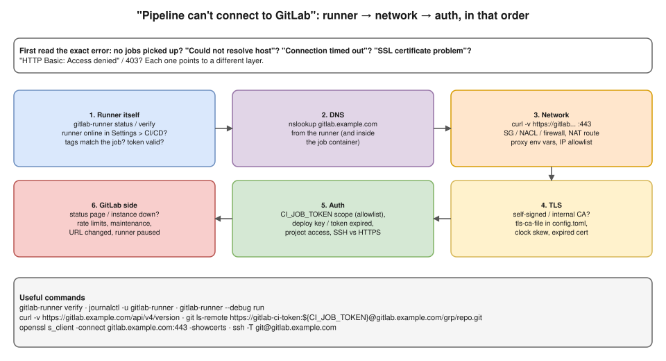

# R2 Q8 · CI/CD pipeline is not able to connect to GitLab. What will you check?



## Say this first

"First I pin down **what exactly fails and the exact error**, because 'can't connect' means different things: jobs stuck in *pending* means the runner isn't picking them up; the job starts but `git clone` fails; or a later step can't reach GitLab's API or registry.

Then I go layer by layer from the runner outwards. **The runner:** is it online in Settings → CI/CD → Runners, do the job's **tags** match, is the token valid, is the service running, `gitlab-runner verify`. **DNS:** can the runner, and the job container, resolve the GitLab hostname. **Network:** `curl -v` to GitLab on 443 or SSH on 22 from the runner: security groups, NACLs, a corporate firewall or proxy, a NAT route if the runner is in a private subnet, or an IP allowlist on GitLab's side. **TLS:** self-signed or internal CA certificates the runner doesn't trust, an expired cert, clock skew. **Authentication:** the `CI_JOB_TOKEN` scope or allowlist for cross-project access, an expired deploy token or access token, a removed deploy key, a project permission change. Finally **GitLab itself:** an outage, maintenance, rate limiting or a changed URL.

The error message usually points straight at the layer: 'Could not resolve host' is DNS, 'Connection timed out' is network, 'SSL certificate problem' is TLS, and 'HTTP Basic: Access denied' or 403 is auth."

## Error → layer

| Error / symptom | Layer | Check / fix |
|---|---|---|
| Job stuck "pending", "no active runners" | Runner | Runner online? Tags match? Runner paused? `run_untagged`? Protected-branch-only runner? Concurrency full? |
| `Could not resolve host: gitlab.example.com` | DNS | `nslookup` on the runner host and inside the job image; Docker `dns` in `config.toml`; VPC DNS; private hosted zone |
| `Failed to connect ... Connection timed out` | Network | SG egress, NACL, firewall, route to NAT/VPN, GitLab IP allowlist, proxy `HTTPS_PROXY`/`NO_PROXY` |
| `Connection refused` | Network / GitLab | Wrong port, GitLab service down, load balancer health |
| `SSL certificate problem: unable to get local issuer certificate` | TLS | `tls-ca-file` in runner `config.toml`, CA in the job image, `CI_SERVER_TLS_CA_FILE`; never `GIT_SSL_NO_VERIFY` as a fix |
| `HTTP Basic: Access denied` / 403 / `remote: You are not allowed to download code` | Auth | Job token allowlist (target project's "CI/CD job token" settings), token expired/revoked, user lost access |
| `Host key verification failed` / `Permission denied (publickey)` | SSH auth | Deploy key added? `known_hosts` in the job? Prefer HTTPS with `CI_JOB_TOKEN` |
| `ERROR: Registration token / authentication token invalid` (runner logs) | Runner auth | Re-register the runner with a new runner authentication token |
| Works intermittently | Rate limits, DNS flapping, NAT port exhaustion, GitLab load | GitLab status page/logs, NAT GW `ErrorPortAllocation` metric |

## Commands (on the runner host, then inside a job)

```bash
sudo gitlab-runner status
sudo gitlab-runner verify                       # can it authenticate to GitLab?
sudo journalctl -u gitlab-runner --since "30 min ago"
sudo gitlab-runner --debug run                  # verbose, foreground

nslookup gitlab.example.com
curl -v https://gitlab.example.com/api/v4/version          # DNS + TCP + TLS in one go
openssl s_client -connect gitlab.example.com:443 -showcerts </dev/null
nc -zv gitlab.example.com 22                               # SSH port open?
ssh -T git@gitlab.example.com                              # SSH auth
date                                                        # clock skew breaks TLS/tokens
```

Debug job to test from inside the job environment:

```yaml
debug-connectivity:
  script:
    - cat /etc/resolv.conf
    - nslookup "$CI_SERVER_HOST"
    - curl -sv "$CI_SERVER_URL/api/v4/version"
    - git ls-remote "https://gitlab-ci-token:${CI_JOB_TOKEN}@${CI_SERVER_HOST}/group/other-repo.git"
```

## Also consider

- **Runner on Kubernetes** (GitLab Runner Helm chart): the runner pod's network, NetworkPolicy egress, CoreDNS, proxy env vars in the job pods.
- **Self-managed GitLab behind an ALB/private network:** was a certificate renewed with a new CA? Was an IP allowlist or WAF rule added?
- **Recent changes:** CloudTrail for SG/NACL/route changes, GitLab audit events for token or permission changes.

## Resume angle

GitLab CI is on your resume. If you have a real story (runner registration expired, token scope, proxy, certificate), tell it here; otherwise answer from the method.

## Deeper notes

[AWS connectivity check-order idea](../round-1/07-public-vs-private-subnets.md) · CI/CD security: [hemant-model-answers.md Q40](../../hemant-model-answers.md#q40-what-security-would-you-put-around-cicd-and-the-network-footprint) · Terraform in CI/CD scenario: `interview-prep/scenario-questions/terraform/02-terraform-in-ci-cd.md` in draft PR #11

## 🎯 Drill: say it from memory, then check

1. The six layers in order.
2. Map these errors to layers: "Could not resolve host", "Connection timed out", "SSL certificate problem", "HTTP Basic: Access denied".
3. The one curl command that tests DNS, TCP and TLS together.
4. Two runner-side reasons a job stays pending.

<details><summary>Check your answers</summary>

1. Runner → DNS → network → TLS → auth → GitLab side.
2. DNS; network; TLS; auth.
3. `curl -v https://gitlab.example.com/api/v4/version`.
4. Runner offline/paused or token invalid; job tags don't match any runner (also protected-only runner, concurrency full).

</details>

## 🗣️ 30-second spoken answer

"I'd get the exact error first. If jobs stay pending, it's the runner: online, tags matching, valid token. If the job runs but can't reach GitLab, I go layer by layer from the runner: DNS with nslookup, network with curl -v to port 443 through security groups, firewall, proxy or NAT, then TLS trust for internal certificates, then authentication: job token allowlist, expired deploy tokens or keys. Finally GitLab itself: outage, rate limits or allowlists. The error text usually names the layer."
