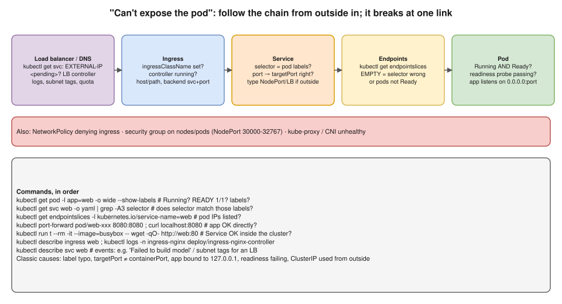

# R2 Q9 · Kubernetes is not able to expose a pod. What could be the issue?



## Say this first

"Exposing a pod is a chain: **load balancer or DNS → Ingress → Service → Endpoints → Pod**. It breaks at exactly one link, so I check each one, usually from the pod outwards.

**Pod:** is it Running **and Ready**? A failing readiness probe means it's never added behind the Service. Is the app listening on the right port and on `0.0.0.0`, not `127.0.0.1`? **Service:** does the **selector match the pod labels** exactly, and does `targetPort` match the `containerPort`? Is it the right type: ClusterIP is only reachable inside the cluster, so from outside you need NodePort, LoadBalancer or an Ingress. **Endpoints:** `kubectl get endpointslices`: if empty, it's the selector or readiness. **Ingress:** is there an ingress controller running, is `ingressClassName` set, do the host, path, backend service name and port match? **LoadBalancer:** `EXTERNAL-IP <pending>` means the cloud controller couldn't create it: on EKS check the AWS Load Balancer Controller logs, subnet tags and IAM. Also **NetworkPolicies** that deny ingress and **security groups** blocking NodePorts.

The fastest bisect is `kubectl port-forward` to the pod, then a test pod calling the Service name: that tells me which half is broken."

## The checks in order (commands)

```bash
# 1. Pod: Running and READY 1/1? labels? which node/IP?
kubectl get pods -l app=web -o wide --show-labels
kubectl describe pod web-xxx | grep -A10 -E "Readiness|Events"

# 2. App works directly (bypasses Service/Ingress)?
kubectl port-forward pod/web-xxx 8080:8080 &  curl -s localhost:8080/health
kubectl exec web-xxx -- ss -tlnp            # listening on 0.0.0.0:8080 or only 127.0.0.1?

# 3. Service: selector, ports, type
kubectl get svc web -o yaml | grep -E -A4 "selector|ports|type"

# 4. Endpoints: are pod IPs listed?
kubectl get endpointslices -l kubernetes.io/service-name=web
#   empty → selector mismatch or pods not Ready

# 5. Service from inside the cluster
kubectl run tmp --rm -it --image=busybox:1.36 --restart=Never -- wget -qO- http://web.default.svc.cluster.local:80

# 6. Ingress
kubectl get ingressclass
kubectl describe ingress web                 # backend resolved? events/errors?
kubectl logs -n ingress-nginx deploy/ingress-nginx-controller --tail=50
#   or AWS LB Controller: kubectl logs -n kube-system deploy/aws-load-balancer-controller

# 7. LoadBalancer Service stuck <pending>
kubectl describe svc web                     # events from the controller
```

## Causes and fixes

| Link | Cause | Fix |
|---|---|---|
| Pod | Not Ready (readiness probe wrong path/port, app slow to start) | Fix probe, add `startupProbe`, check logs |
| Pod | App binds `127.0.0.1` | Bind `0.0.0.0` |
| Pod | CrashLoopBackOff / ImagePullBackOff | Fix the pod first ([pod startup](../../kubernetes/05-pods.md)) |
| Service | Selector doesn't match labels (typo, `app: web` vs `app: web-app`) | Align labels/selector |
| Service | `targetPort` ≠ `containerPort` (or named port mismatch) | Fix ports |
| Service | Type ClusterIP used from outside | NodePort/LoadBalancer/Ingress |
| Service | Namespace mismatch (Ingress and Service must be in the same namespace) | Same namespace or ExternalName |
| Ingress | No controller installed / wrong `ingressClassName` | Install controller, set class |
| Ingress | Host/path mismatch, `pathType` wrong, backend port wrong | Fix rules; test with `curl -H "Host: app.example.com" http://<lb>` |
| LoadBalancer | `<pending>`: LB controller missing/IAM error, subnets not tagged (`kubernetes.io/role/elb`), quota | Fix controller/IAM, tag subnets |
| Network | NetworkPolicy default-deny without an allow rule | Add an ingress allow from the ingress controller namespace |
| Network | Node SG doesn't allow NodePort range 30000–32767 / ALB → pod SG | Fix security groups |
| Network | kube-proxy or CNI broken on the node | `kubectl -n kube-system get pods`, restart/repair |

## Deeper notes

[kubernetes/08-services-and-dns.md](../../kubernetes/08-services-and-dns.md) · [kubernetes/09-ingress-and-gateway-api.md](../../kubernetes/09-ingress-and-gateway-api.md) · [Service traffic diagram](../../kubernetes/diagrams/08-service-traffic.drawio.svg) · [ingress errors diagram](../../kubernetes/diagrams/09-ingress-errors.drawio.svg) · [kubernetes/17-troubleshooting.md](../../kubernetes/17-troubleshooting.md) · [R2 Q10: pods running but 503](10-pods-running-users-get-503.md)

## 🎯 Drill: type the commands from memory, then check

1. The five links of the chain.
2. Endpoints are empty: two causes.
3. The bisect: which two commands split "app problem" from "Service problem"?
4. `EXTERNAL-IP <pending>` on EKS: three things to check.

<details><summary>Check your answers</summary>

1. LB/DNS → Ingress → Service → Endpoints → Pod.
2. Selector doesn't match pod labels; pods not Ready (readiness probe failing).
3. `kubectl port-forward pod/<pod> 8080:8080` + curl (app OK?), then a temp pod `wget http://<svc>:<port>` (Service OK?).
4. AWS Load Balancer Controller running and its logs; IAM permissions (IRSA) of the controller; subnet tags `kubernetes.io/role/elb` (public) / `internal-elb` (private) (also quotas, annotations).

</details>

## 🗣️ 30-second spoken answer

"Exposing a pod is a chain: load balancer, Ingress, Service, endpoints, pod, and it breaks at one link. I check the pod is Running and Ready and listening on 0.0.0.0, that the Service selector matches the pod labels and targetPort matches the container port, and that endpoints aren't empty. Then the Service type, the Ingress controller and class, host and path rules, and whether the LoadBalancer is stuck pending because of the controller, IAM or subnet tags. NetworkPolicies and security groups come last. port-forward and a test pod tell me which half is broken."
