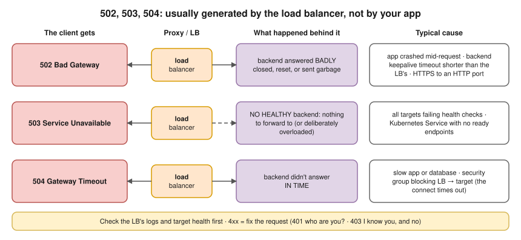

# R2 Q10 · Pods are running but users are getting 503 errors. How do you debug?



## Say this first

"'Running' is not 'Ready', and a 503 almost always means **the proxy in front had no healthy backend to send to**, so I first find **who generated the 503**: the ALB, the ingress controller, a service mesh sidecar, or the app itself. The response body and headers tell me: an ALB 503 page, an nginx 503 page, `server: envoy`, or the app's own JSON error. ALB metrics split `HTTPCode_ELB_5XX_Count` from `HTTPCode_Target_5XX_Count`.

If the proxy generated it, I check the **backends**. Are the pods actually **Ready**? `kubectl get pods` shows `0/1` when the readiness probe fails, and then the pod is removed from the Service. Does the **Service have endpoints**? An empty EndpointSlice means the selector doesn't match or no pod is Ready. Is the **Ingress** pointing to the right Service and port? On an ALB with the AWS Load Balancer Controller, are the **targets healthy** in the target group, and does the ALB health-check path return 200? Can the ALB reach the pod: security groups. Is the 503 only during deploys? Then it's pods terminating before they're removed: I add a `preStop` sleep and readiness gates.

If the **app** returns 503, it's usually overloaded or a dependency is down: connection pool exhausted, database unreachable, rate limiting, circuit breaker open. Then I look at app logs, saturation and the dependency."

## Step by step

```bash
# 1. Who generated it? (body, Server header)
curl -sv https://app.example.com/ 2>&1 | grep -iE "^< (HTTP|server|x-)"
#   ALB:  "503 Service Temporarily Unavailable" HTML, server: awselb/2.0
#   nginx ingress: "<center>nginx</center>"   envoy: server: envoy   app: its own JSON

# 2. Pods Ready, not just Running
kubectl get pods -l app=web               # READY 0/1 = readiness failing
kubectl describe pod web-xxx | grep -A5 Readiness
kubectl logs web-xxx --tail=100

# 3. Service has endpoints?
kubectl get endpointslices -l kubernetes.io/service-name=web
kubectl get svc web -o yaml | grep -A3 selector

# 4. Ingress → service/port right? controller logs
kubectl describe ingress web
kubectl logs -n ingress-nginx deploy/ingress-nginx-controller | grep -E " 503 "

# 5. ALB target health (AWS LB Controller, IP targets)
aws elbv2 describe-target-health --target-group-arn <tg-arn> \
  --query 'TargetHealthDescriptions[].[Target.Id,TargetHealth.State,TargetHealth.Reason]'
kubectl get targetgroupbindings -A
```

## Who returns 503 and why

| Source | Means | Typical causes |
|---|---|---|
| ALB | No registered targets in the target group | All pods unready → controller deregistered all IP targets; wrong Service/port in Ingress; TargetGroupBinding broken |
| ALB (fail-open) | All targets **unhealthy** but registered → ALB still sends to all of them | Users then see the targets' own errors (often 502/504) |
| ingress-nginx | No endpoints for the backend Service | Selector mismatch, 0 ready pods, wrong service name/port, Service in another namespace |
| Service mesh (Envoy) | `UH` no healthy upstream, `UO` overflow (circuit breaker) | Outlier detection ejected pods, connection limits |
| App | Overloaded or dependency down | DB down, pool exhausted, rate limit, maintenance mode, thread pool full |

## Common root causes and fixes

| Cause | Fix |
|---|---|
| Readiness probe wrong (path/port/timeout) or depends on a down dependency | Fix the probe; readiness should check the pod can serve, not every downstream |
| Selector/label mismatch after a refactor | Align labels |
| ALB health check path returns 301/401/404 | Set `alb.ingress.kubernetes.io/healthcheck-path` and success codes |
| SG doesn't allow ALB → pod port | Fix node/pod security groups |
| 503s only during rollouts | `preStop: sleep 10–15`, `terminationGracePeriodSeconds`, `maxUnavailable: 0`, ALB deregistration delay, pod readiness gates (`elbv2.k8s.aws/pod-readiness-gate-inject: enabled` namespace label) |
| Traffic spike, pods saturated | HPA, more replicas, rate limiting |
| Dependency down (DB) | Fix dependency; circuit breakers, graceful degradation |

## Deeper notes

[R1 Q9 load balancer and the 5xx table](../round-1/09-load-balancer.md) · [R2 Q9 can't expose a pod](09-cannot-expose-pod.md) · [kubernetes/06-probes.md](../../kubernetes/06-probes.md) · [kubernetes/05-pods.md graceful shutdown](../../kubernetes/05-pods.md) · [hemant-model-answers.md Q28–Q30](../../hemant-model-answers.md#q28-it-returns-502-what-do-501-502-and-503-each-mean) · namespace readiness scenario `kubernetes/03-namespace-readiness-failures.md` in draft PR #11 · playbook S3/S4 in draft PR #12

## 🎯 Drill: say it from memory, then check

1. First question to answer about any 503.
2. Running vs Ready, and why it matters here.
3. Commands: pod readiness, endpoints, ALB target health.
4. Fixes for 503s that happen only during deploys.

<details><summary>Check your answers</summary>

1. Who generated it: ALB, ingress controller, mesh, or the app (body/Server header, ELB vs Target 5XX metrics).
2. Running = containers started; Ready = readiness probe passing. Only Ready pods are endpoints, so Running-but-unready pods get no traffic → no backends → 503.
3. `kubectl get pods` (READY column) + `describe`; `kubectl get endpointslices -l kubernetes.io/service-name=web`; `aws elbv2 describe-target-health --target-group-arn …`.
4. `preStop` sleep, enough `terminationGracePeriodSeconds`, `maxUnavailable: 0`, deregistration delay tuning, ALB pod readiness gates.

</details>

## 🗣️ 30-second spoken answer

"Running isn't Ready. A 503 usually means the proxy had no healthy backend, so first I find who returned it: ALB, ingress controller or the app, from the body, headers and ELB versus target metrics. Then I check the pods are Ready, not just Running, that the Service has endpoints, so the selector matches and readiness passes, that the Ingress points at the right service and port, and that the ALB target group shows healthy targets and the security groups allow it. If it only happens during deploys, I add preStop and readiness gates; if the app itself returns 503, it's overload or a dependency."
