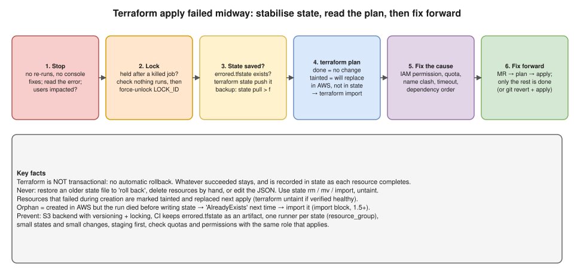

# R2 Q11 · Terraform apply failed midway: how do you recover safely?



> This question is also answered in depth, with a table for reading the plan and typical causes, in `interview-prep/scenario-questions/terraform/06-failed-halfway-recovery.md` (draft PR #11) and `interview-prep/terraform/08-rollback.md` (draft PR #9). This page is the interview-length version; the facts match.

## Say this first

"Terraform is **not transactional**: there's no automatic rollback, so whatever succeeded before the error still exists, and Terraform **records each resource in state as soon as it's created**. So the good news is I don't clean up by hand. I stop and don't re-run blindly or fix things in the console, and I read the error.

First I make sure **state is healthy**. If the job was killed, the **lock** may still be held: I confirm nothing else is running and use `terraform force-unlock` with the lock ID. If Terraform couldn't save state at the end, it writes **`errored.tfstate`** locally, and I push it back with `terraform state push`. I take a backup with `terraform state pull`.

Then I run **`terraform plan`** and read it: resources that succeeded show no change; a resource that failed during creation is marked **tainted** and will be replaced; anything that exists in AWS but never reached state, an **orphan**, would cause an 'already exists' error, so I **import** it. Then I fix the actual cause, usually a missing IAM permission, a quota, a name clash or a timeout, and **fix forward** through a merge request: plan and apply, and Terraform only does the remaining work. If the change itself was wrong, I `git revert` and apply. I never restore an old state file to 'roll back'."

## Step by step

```bash
# 1. Lock still held after a killed CI job?
terraform plan
#   Error: Error acquiring the state lock ... Lock Info: ID: 9db590f1-...
terraform force-unlock 9db590f1-b6fe-c5f2-2f19-1b2c8a6a1d2e     # only after confirming no run is active

# 2. Did Terraform fail to save state? It leaves errored.tfstate in the working dir
ls errored.tfstate && terraform state push errored.tfstate

# 3. Backup before touching anything
terraform state pull > before-repair-$(date +%s).tfstate

# 4. See reality
terraform plan -out=tfplan
terraform state list
```

| Plan shows | Meaning | Action |
|---|---|---|
| No change for resources that succeeded | In state and matching code | Nothing |
| `is tainted, so must be replaced` | Creation started but failed (timeout, failed provisioner) | Let it be replaced, or `terraform untaint` if verified healthy |
| `+ create` for something visible in the console | Orphan: created in AWS, not saved to state | `import` it, otherwise duplicate / AlreadyExists |
| `+ create` for never-attempted resources | Remaining work | Done on next apply |

```hcl
import {                       # Terraform 1.5+: adopt the orphan, plan shows "import" not "create"
  to = aws_iam_role.app
  id = "app-prod-role"
}
```

```bash
terraform import aws_iam_role.app app-prod-role     # command form, any version
terraform untaint aws_instance.web                  # only if you've checked it's healthy
```

## Fix forward vs revert

- **Fix forward (usual):** correct the permission/quota/value/dependency in an MR → plan → apply. Only the remaining resources are created.
- **Revert:** the change itself was wrong → `git revert` → plan (Terraform computes how to undo) → apply.
- **Users impacted?** Stabilise first (shift traffic, scale the old node group back up), then repair.

## Why things fail midway, and prevention

| Cause | Prevention |
|---|---|
| Missing IAM permission on the apply role | Plan/apply in staging with the same role |
| Service quota (vCPUs, EIPs, VPCs) | Check quotas before big changes; Service Quotas alarms |
| Name already taken (S3 bucket, IAM role from an earlier failed run) | Imports, prefixes/random suffixes |
| API eventual consistency, slow resources | Provider retries, `timeouts {}` blocks (RDS, EKS) |
| CI job killed / runner died | Long enough job timeout; keep `errored.tfstate` as an artifact (`artifacts: when: on_failure`); `resource_group` so one job per state |
| Huge change in one apply | Small states, small MRs, staging first |
| State safety | S3 backend with **versioning** + encryption + locking |

## Follow-up questions

**Q: Why is state usually still correct after a failure?** Terraform writes each resource to state as it completes and persists state at the end even on errors; the rare gap is a crash between the API call and the state write (→ orphan → import).

**Q: Why not restore the previous state version from S3?** The old state no longer matches reality; Terraform would try to create resources that already exist or lose track of real ones. Restore old state only for actual state corruption, and then reconcile with plan/import.

**Q: What is `errored.tfstate`?** The state Terraform couldn't persist to the backend at the end of a run, written locally so it isn't lost; push it once the backend works.

## 🎯 Drill: type from memory, then check

1. The six steps in order.
2. The three commands that make state healthy.
3. The plan-reading table: four rows.
4. Two things you never do.

<details><summary>Check your answers</summary>

1. Stop → release lock if needed → push errored.tfstate if present + backup → plan and read it → fix the cause → fix forward (or git revert) via MR.
2. `terraform force-unlock <LOCK_ID>`, `terraform state push errored.tfstate`, `terraform state pull > backup.tfstate`.
3. No change = succeeded; tainted = will be replaced; + create for something that exists = orphan → import; + create for the rest = remaining work.
4. Restore an old state file to "roll back"; delete or fix resources by hand / edit the state JSON (also: re-run apply blindly).

</details>

## 🗣️ 30-second spoken answer

"Terraform isn't transactional, so whatever succeeded stays and is already in state. I don't re-run blindly or clean up by hand. First I make state healthy: force-unlock if a killed job left the lock, push errored.tfstate if state wasn't saved, and take a backup. Then I run plan: failed resources are tainted and will be replaced, anything created but missing from state gets imported. I fix the root cause, like a permission or quota, and fix forward through an MR, or git revert if the change was wrong. Never restore an old state file."
