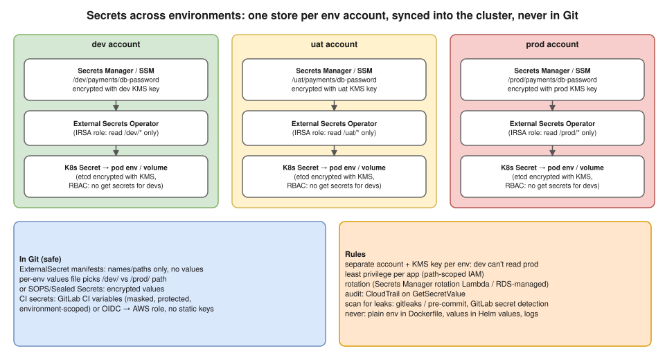

# R2 Q12 · How do you handle secrets securely across multiple environments?



## Say this first

"Three principles: secrets **never live in Git, images or plain config**; each environment's secrets are **isolated** so dev can never read prod; and access is **least privilege, audited and rotated**.

In practice, each environment, Dev, UAT, Prod-Int and Production, has its own secrets in **AWS Secrets Manager** or SSM Parameter Store, ideally in a **separate AWS account per environment**, encrypted with that environment's **KMS key**, under a path like `/prod/payments/db-password`. In Kubernetes, the **External Secrets Operator** (or the Secrets Store CSI driver) syncs them into Kubernetes Secrets; its IAM role through **IRSA or Pod Identity** can only read that environment's path. Git only holds the `ExternalSecret` manifest, which is names and paths, not values, so GitOps still works. Kubernetes Secrets are encrypted at rest in etcd with KMS, and RBAC stops developers reading them in production.

In **CI/CD**, I avoid static AWS keys: GitLab connects to AWS with **OIDC** and assumes a role per environment, and any CI variables are masked, protected and environment-scoped. Database passwords **rotate** automatically, Secrets Manager rotation or RDS-managed passwords, **CloudTrail** audits every `GetSecretValue`, and **gitleaks** or GitLab secret detection blocks secrets from being committed. At Koko we synced Secrets Manager into Kubernetes ⟨fill: with External Secrets / CSI driver⟩."

## Layers of the design

| Layer | How | Why |
|---|---|---|
| Store | Secrets Manager (rotation, cross-account sharing) or SSM Parameter Store SecureString (cheaper, no built-in rotation); or HashiCorp Vault (dynamic secrets, multi-cloud) | One source of truth |
| Isolation | Account per env (or at least path + KMS key per env), IAM conditions on path/tags | Dev credentials can't read prod |
| Encryption | KMS customer-managed key per env; key policy restricts who can decrypt | Even S3/RDS/Secrets data unreadable without the key |
| Delivery to pods | External Secrets Operator (`SecretStore` per env + `ExternalSecret`), or Secrets Store CSI driver (mounted files, optional sync) | Values never in Git; refresh interval picks up rotation |
| Pod identity | IRSA / EKS Pod Identity, path-scoped policy | No keys in pods |
| In-cluster | etcd encryption with KMS (EKS envelope encryption), RBAC (no `get/list secrets` for devs in prod), mount as files rather than env vars where possible | Limit exposure |
| GitOps alternatives | SOPS (encrypted values in Git, KMS-decrypted by ArgoCD/Flux plugin) or Sealed Secrets (controller-specific encryption) | When you must keep secrets with the manifests |
| CI/CD | OIDC → AWS role per env (no long-lived keys); GitLab masked + protected + environment-scoped variables; prod variables only on protected branches/tags | Pipelines can't leak prod creds from a feature branch |
| Terraform | Don't put secret values in `.tf`/tfvars; generate in Secrets Manager (`manage_master_user_password` for RDS), mark `sensitive`, protect state (it stores values) | State and code leaks |
| Rotation | Secrets Manager rotation Lambda, RDS-managed master password, short-lived dynamic creds (Vault) | Leaked secret has short life |
| Detection | gitleaks / pre-commit, GitLab secret detection, CloudTrail `GetSecretValue`, GuardDuty | Catch leaks early |

## ExternalSecret example (type the shape from memory)

```yaml
apiVersion: external-secrets.io/v1      # v1beta1 in older ESO versions
kind: ExternalSecret
metadata:
  name: payments-db
  namespace: payments
spec:
  refreshInterval: 1h
  secretStoreRef:
    name: aws-secrets-manager            # SecretStore per env, uses the IRSA role
    kind: SecretStore
  target:
    name: payments-db                    # K8s Secret that gets created
  data:
    - secretKey: password
      remoteRef:
        key: /prod/payments/db           # dev overlay points to /dev/payments/db
        property: password
```

The only difference between environments is the path (via Kustomize overlay or Helm values) and which account's store the SecretStore points at.

## Anti-patterns to name (shows experience)

Secrets in Git (even "private" repos; history keeps them), in Dockerfile `ENV`/build args (visible in `docker history`), in Helm values files, in Terraform tfvars committed to Git, printed in CI logs, shared across environments, never rotated, one IAM user key used by everyone.

**If a secret leaks:** rotate/revoke it first, then remove it from history (git filter-repo) and invalidate caches, check CloudTrail for misuse, and add a detection rule. See [hemant-model-answers.md Q57](../../hemant-model-answers.md#q57--os-security-how-secrets-leak-and-how-to-prevent-a-repeat-of-the-key-incident).

## Deeper notes

[kubernetes/10-configmaps-and-secrets.md](../../kubernetes/10-configmaps-and-secrets.md) · [secrets flow diagram](../../kubernetes/diagrams/10-secrets-flow.drawio.svg) · [secret leak diagram](../../diagrams/57-secret-leak.drawio.svg) · Terraform secrets note `interview-prep/terraform/02-secrets.md` in draft PR #9 · Lambda multi-env scenario `aws/10-lambda-multi-environment.md` in draft PR #11

## 🎯 Drill: say it from memory, then check

1. The three principles.
2. How does a prod pod get its DB password, step by step?
3. How does CI get AWS access without stored keys?
4. Four places secrets must never be.

<details><summary>Check your answers</summary>

1. Never in Git/images/plain config; isolated per environment (account + KMS key + path); least privilege, audited, rotated.
2. Secret in prod account Secrets Manager (`/prod/...`, prod KMS key) → External Secrets Operator with an IRSA/Pod Identity role allowed to read only `/prod/*` → creates a K8s Secret (etcd encrypted with KMS) → mounted into the pod as env var or file.
3. OIDC federation: GitLab's ID token → `AssumeRoleWithWebIdentity` into a per-environment role, restricted by project/branch claims.
4. Git, Dockerfile/image layers, Helm values / tfvars in Git, CI logs (also: shared across envs, Slack).

</details>

## 🗣️ 30-second spoken answer

"Secrets never go in Git or images, every environment is isolated, and access is least privilege and audited. Each environment has its own secrets in Secrets Manager, ideally in its own AWS account with its own KMS key. External Secrets Operator syncs them into Kubernetes using an IRSA role that can read only that environment's path, so Git holds only references. CI uses OIDC to assume a per-environment role, with no static keys. We rotate database passwords, audit GetSecretValue in CloudTrail and scan commits with gitleaks."
