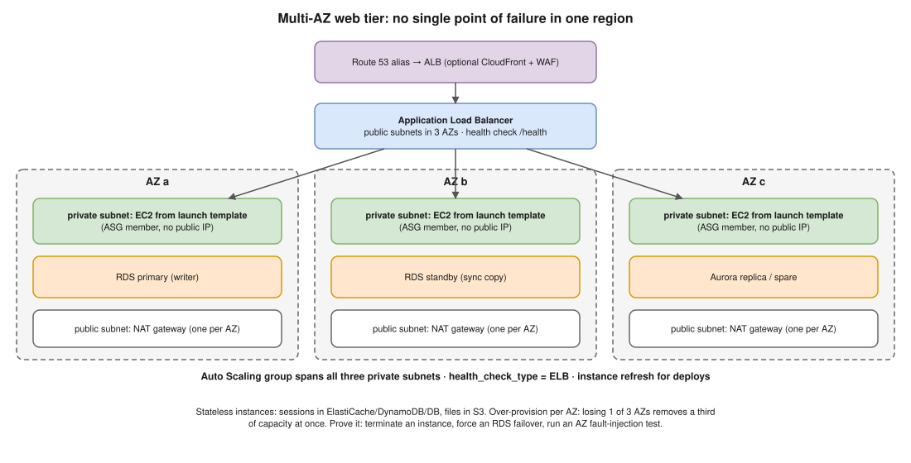

# AWS 01 · Highly Available EC2 Web App Across Multiple AZs ⭐



> **Say this first:** "I'd remove every single point of failure inside one region. A VPC with public and private subnets in **three AZs**. An **internet-facing ALB** in the public subnets, with health checks. The EC2 instances sit in **private subnets** inside an **Auto Scaling group** that spans all three AZs, built from a **launch template** with a baked AMI, so any instance can die and the ASG replaces it. The database is **RDS Multi-AZ** (or Aurora), and no state lives on the instances: sessions go to the database or a cache, files go to S3. Outbound traffic uses one **NAT gateway per AZ**. Route 53 points an alias record at the ALB. Then I prove it works by terminating an instance and failing over the database."

## The building blocks

| Layer | What I use | Why it's HA |
|---|---|---|
| DNS | Route 53 **alias** record → ALB | Alias follows the ALB's changing IPs; Route 53 has a 100% availability SLA |
| Edge (optional) | CloudFront + AWS WAF | Caches static content, absorbs spikes, blocks bad traffic before it reaches the ALB |
| Load balancer | **ALB** in public subnets of 3 AZs, cross-zone load balancing (always on for ALB) | ALB nodes run in every enabled AZ; health checks remove bad targets |
| Compute | **Auto Scaling group** across 3 private subnets, min 2–3, `health_check_type = "ELB"` | ASG rebalances across AZs and replaces any instance the ALB marks unhealthy |
| Image | **Launch template** + golden AMI (Packer) or user data | Every new instance comes up identical, no manual steps |
| State | Sessions in ElastiCache / DynamoDB / DB; files in **S3** or EFS | An instance can be terminated at any time without losing data |
| Database | **RDS Multi-AZ** (synchronous standby, automatic failover ~1–2 min) or Aurora (6 copies over 3 AZs, failover usually < 30 s) | Survives an AZ loss; apps reconnect to the same endpoint |
| Egress | **NAT gateway per AZ**, each private route table → its own AZ's NAT | One NAT = an AZ-level single point of failure |
| Observability | CloudWatch alarms on ALB 5xx, `UnHealthyHostCount`, target response time; ASG events | You find out before users do |

## Design rules to say out loud

1. **N+1 per AZ.** If you need 4 instances to carry peak load, run enough that losing one AZ out of three still leaves 4 (that is 6). Losing an AZ removes a third of capacity at once.
2. **ELB health checks on the ASG**, not only EC2 status checks, so an instance whose app is dead (but whose VM is fine) is replaced. Add a **health check grace period** long enough for boot.
3. **Stateless instances.** No sticky sessions if you can avoid them; if you must, keep them short. Logs are shipped off the box (CloudWatch agent).
4. **Deploy without downtime:** ASG **instance refresh** (rolling, `MinHealthyPercentage = 90`) or blue/green with two target groups; ALB **deregistration delay** lets in-flight requests finish.
5. **Security:** ALB security group allows 443 from the internet; the instance security group allows the app port **only from the ALB's security group**; no public IPs on instances; admin access via **SSM Session Manager** instead of SSH.
6. **Test failure:** terminate an instance, simulate an AZ failure (AWS Fault Injection Service has an AZ power-interruption scenario), `aws rds reboot-db-instance --force-failover`.

```bash
# Prove the DB fails over (Multi-AZ only) and the app reconnects
aws rds reboot-db-instance --db-instance-identifier app-prod --force-failover

# Check target health behind the ALB
aws elbv2 describe-target-health --target-group-arn "$TG_ARN" \
  --query 'TargetHealthDescriptions[].{id:Target.Id,az:Target.AvailabilityZone,state:TargetHealth.State}'
```

```hcl
# (illustrative) the ASG part in Terraform
resource "aws_autoscaling_group" "web" {
  name                      = "web-prod"
  min_size                  = 3
  max_size                  = 12
  desired_capacity          = 3
  vpc_zone_identifier       = module.vpc.private_subnets # one subnet per AZ
  target_group_arns         = [aws_lb_target_group.web.arn]
  health_check_type         = "ELB"
  health_check_grace_period = 120

  launch_template {
    id      = aws_launch_template.web.id
    version = "$Latest"
  }

  instance_refresh {
    strategy = "Rolling"
    preferences { min_healthy_percentage = 90 }
  }
}
```

## Multi-AZ vs multi-region

- **Multi-AZ** protects against an instance, rack, data centre or AZ failure. It's the default for anything production.
- **Multi-region** protects against a whole region failing, at much higher cost and complexity (data replication, DNS failover). Only if the RTO/RPO or compliance demands it; see [K8s 02 region failover](../kubernetes/02-region-failover.md) for the pattern.

## Resume check

AWS, EC2, ALB, ASG, RDS, Terraform and Prometheus/Grafana match your resume. Don't claim CloudFront/WAF or Fault Injection Service unless you used them; say "I'd add".

## Real-world example (suggested story, adapt it to what you really did)

"At Perfios we ran a customer-facing API on EC2 behind an ALB. Originally it was two instances in one AZ. I moved it to an ASG across three private subnets with a launch template, ELB health checks and an instance refresh for deploys, and put RDS on Multi-AZ. During a later AZ issue the ASG shifted capacity to the healthy AZs and we didn't page anyone." Only say the parts you really did.

## Follow-up questions

**Q: Why private subnets for the instances?**
Nothing on the internet can reach them directly; only the ALB can. They reach out through NAT. Smaller attack surface.

**Q: What happens when an AZ goes down?**
ALB stops sending traffic to that AZ's targets (health checks fail), ASG launches replacements in the remaining AZs, RDS Multi-AZ fails over to the standby. Capacity drops by a third until the ASG catches up, which is why you over-provision per AZ.

**Q: EC2 status check vs ELB health check?**
EC2 status checks see the VM/host (hardware, network, OS boot). ELB health checks hit your app's path (`/health`). Use ELB checks so a hung app is replaced.

**Q: Is one NAT gateway enough?**
It works, but it lives in one AZ. If that AZ fails, all private subnets lose outbound internet. One per AZ for production; one shared NAT is acceptable for dev to save money.

## 🎯 Drill: type this from memory

1. The table rows above (layer → service → why), from DNS down to the database, without looking.
2. The `aws_autoscaling_group` block with `vpc_zone_identifier`, `health_check_type = "ELB"`, `target_group_arns` and `instance_refresh`.
3. `aws rds reboot-db-instance --db-instance-identifier <id> --force-failover`
4. `aws elbv2 describe-target-health --target-group-arn <arn>`

## 🗣️ 30-second spoken answer

1. Three AZs, public + private subnets.
2. ALB with health checks → ASG across private subnets from a launch template, ELB health checks.
3. Stateless instances: sessions/cache/S3 outside.
4. RDS Multi-AZ or Aurora; NAT per AZ; Route 53 alias.
5. Over-provision per AZ, deploy with instance refresh, test by killing things.
