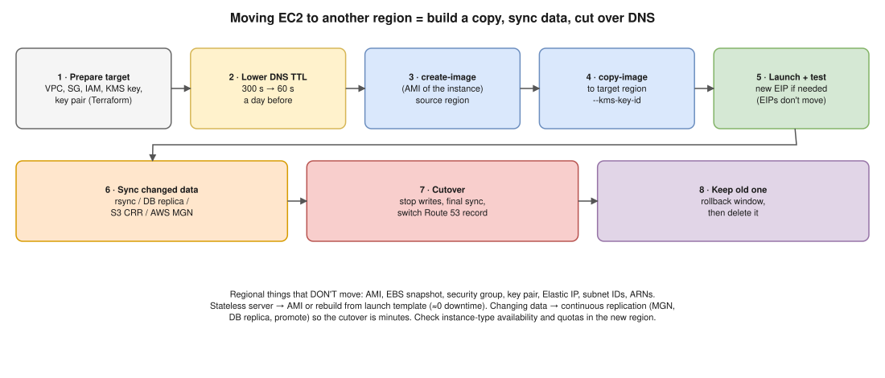

# AWS 02 · Migrate a Running EC2 Instance to Another Region With Minimal Downtime ⭐



> **Say this first:** "You can't move an instance between regions: AMIs, EBS snapshots, security groups, key pairs and Elastic IPs are all **regional**. So I build a copy in the target region and cut over. For a simple stateless server: create an **AMI**, **copy it to the new region**, launch it with recreated networking, test it, then switch **Route 53** (TTL lowered a day before). For a server with changing data, the downtime is the data, so I use **continuous replication**, either **AWS Application Migration Service (MGN)**, which does block-level replication across regions, or database replication (RDS cross-region read replica, then promote), and the cutover is only a few minutes."

## Step by step (AMI method)

1. **Prepare the target region:** VPC, subnets, route tables, security groups, IAM instance profile, KMS keys, key pair (import your public key; key pairs are regional). Ideally all in Terraform with the region as a variable.
2. **Lower the DNS TTL** (e.g., 300 s → 60 s) at least one old-TTL period before cutover.
3. **Create an AMI** of the running instance. `--no-reboot` avoids downtime but risks an inconsistent file system; for a database server, stop writes or reboot for a clean image.
4. **Copy the AMI** to the target region. Encrypted snapshots need a **KMS key in the target region** (`--kms-key-id`).
5. **Launch** from the copied AMI in the target region; attach a **new Elastic IP** if needed (the old EIP can't move; tell partners who allow-list your IP).
6. **Sync the data that changed** since the AMI (rsync, database replication, S3 cross-region replication).
7. **Test** the new instance directly (hosts file / test DNS name).
8. **Cut over:** stop writes on the old instance, final sync, switch the Route 53 record (or use a weighted record 90/10 → 0/100), watch metrics.
9. **Keep the old instance** for a rollback window, then delete it, its snapshots and AMIs.

```bash
# 1. AMI from the running instance (in the source region)
aws ec2 create-image --region ap-south-1 --instance-id i-0abc123 \
  --name "web-$(date +%F)" --no-reboot

# 2. Copy it to the target region (run against the TARGET region)
aws ec2 copy-image --region eu-west-1 --source-region ap-south-1 \
  --source-image-id ami-0src123 --name web-migrated \
  --encrypted --kms-key-id alias/ebs-eu

# 3. Wait, then launch
aws ec2 wait image-available --region eu-west-1 --image-ids ami-0dst456
aws ec2 run-instances --region eu-west-1 --image-id ami-0dst456 \
  --instance-type t3.medium --subnet-id subnet-0eu1 \
  --security-group-ids sg-0eu1 --iam-instance-profile Name=web-profile
```

## Which method for which server

| Server | Method | Downtime |
|---|---|---|
| Stateless web/app server | AMI copy, or better: rebuild from the launch template/Packer AMI in the new region | ~0 (DNS switch) |
| Server with local data that changes (files, app on one box) | **AWS MGN** (continuous block replication, test launch, then cutover launch) or **AWS Elastic Disaster Recovery** | Minutes |
| Database on EC2 | Native replication (MySQL/Postgres replica in the new region), then promote | Seconds to minutes |
| RDS | **Cross-region read replica**, then promote; or snapshot copy (longer downtime) | Minutes |
| Files on S3 | S3 **Cross-Region Replication** (+ Batch Replication for existing objects) | 0 |

## Things people forget

- **Elastic IPs, security group IDs, AMI IDs, subnet IDs, ARNs with the region** in them all change. Grep configs and IAM policies for the old region.
- **Instance type availability** differs by region; check before.
- **Service quotas** in the new region (vCPU limits) start at defaults.
- **Hard-coded endpoints** (`s3.ap-south-1.amazonaws.com`, SQS URLs) in app config.
- **Data transfer cost** between regions is charged per GB.
- **Compliance/data residency**: some data may not be allowed in the target region.

## Resume check

EC2, AMIs, Terraform, Route 53 and RDS fit your AWS experience. **AWS MGN / Elastic Disaster Recovery are not on your resume**: name them as "the AWS service I'd use", don't claim you ran them.

## Real-world example (suggested story, adapt it to what you really did)

"We moved a reporting server from one region to another to sit closer to the database. I lowered the TTL the day before, made an AMI, copied it with a KMS key in the new region, launched it from the same Terraform module with a different region variable, rsynced the data directory, and at cutover stopped the app, did a last rsync and flipped the Route 53 record. Downtime was about five minutes." Only claim it if you did something like it.

## Follow-up questions

**Q: Can you move an EBS volume to another region?**
Not directly. Snapshot it, `aws ec2 copy-snapshot` to the other region, create a volume from it there.

**Q: Why lower the TTL first?**
Resolvers cache the old record for the old TTL. If the TTL is 1 day when you switch, some users hit the old server for up to a day.

**Q: How do you make the cutover reversible?**
Keep the old instance running (read-only), use a weighted Route 53 record so you can shift back, and don't delete anything until the rollback window passes.

**Q: Does `--no-reboot` make a safe image?**
Not guaranteed: data in memory/page cache may not be flushed, so the file system may need recovery. Fine for stateless servers; for databases, stop the DB or use the DB's own replication.

## 🎯 Drill: type this from memory

1. `aws ec2 create-image --instance-id <id> --name <name> --no-reboot`
2. `aws ec2 copy-image --region <target> --source-region <src> --source-image-id <ami> --name <name>`
3. `aws ec2 copy-snapshot --region <target> --source-region <src> --source-snapshot-id <snap>`
4. The list of regional things that don't move: AMI, snapshot, SG, key pair, EIP, subnet.

## 🗣️ 30-second spoken answer

1. Nothing moves across regions; build a copy and cut over.
2. Prepare target networking with Terraform; lower DNS TTL.
3. AMI → copy-image (KMS key in target) → launch → test.
4. Changing data: MGN or DB replication for a short cutover.
5. Switch Route 53, keep the old one for rollback.
