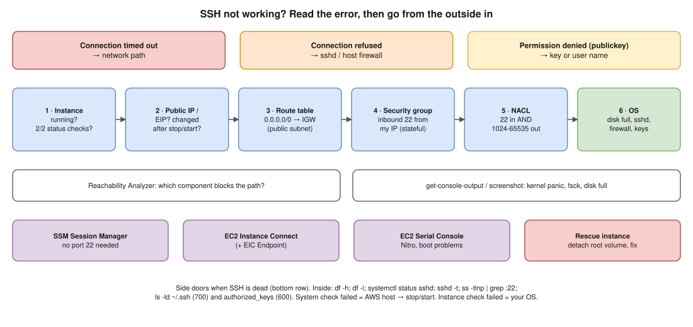

# AWS 03 · EC2 Instance Not Reachable via SSH ⭐



> **Say this first:** "I go from the outside in. First the **error message** tells me which layer: a **timeout** is the network path, **connection refused** means the packet arrived but nothing listens on 22, **permission denied (publickey)** is the key or user. Then: is the instance **running and passing both status checks**? Is it in a **public subnet** with a route to an **internet gateway** and a **public IP**? Does the **security group** allow 22 from my IP and does the **NACL** allow 22 in **and the ephemeral ports out**? If the network is fine, it's the OS: disk full, sshd dead, firewall, wrong key. To look inside I use **SSM Session Manager**, **EC2 Instance Connect**, the **serial console**, or the **system log/screenshot**, and as a last resort detach the root volume and fix it from another instance."

## Read the error first

| What you see | Layer | Usual causes |
|---|---|---|
| `Connection timed out` | Network path | SG doesn't allow 22 from your IP, NACL blocks, no IGW route, no public IP, instance stopped, your office firewall blocks 22, wrong IP (public IP changed after stop/start) |
| `Connection refused` | Instance reached, port closed | sshd not running / crashed, sshd on another port, host firewall REJECT |
| `Permission denied (publickey)` | Authentication | Wrong `.pem`, wrong user (`ec2-user` Amazon Linux, `ubuntu` Ubuntu, `admin` Debian, `centos`/`rocky`), `authorized_keys` changed, bad permissions on `~/.ssh` |
| `UNPROTECTED PRIVATE KEY FILE` | Your laptop | `chmod 400 key.pem` |
| `Host key verification failed` | Your laptop | Same IP, new instance → remove the line from `~/.ssh/known_hosts` |

```bash
ssh -vvv -i key.pem ec2-user@<public-ip>   # verbose: shows where it stops
nc -vz <public-ip> 22                        # is the port reachable at all?
```

## Checklist, outside in

1. **Instance state & status checks:** running? 2/2 checks? A failed **system** check = AWS host problem → stop/start (moves to new hardware). A failed **instance** check = OS problem (kernel panic, disk full, bad fstab, out of memory).
2. **IP:** does it have a public IP / EIP? Did a stop/start change the public IP?
3. **Route table:** subnet's route table has `0.0.0.0/0 → igw-…` (public subnet). A private subnet needs a bastion, VPN or SSM.
4. **Security group** (stateful): inbound TCP 22 from your current IP (`curl ifconfig.me`).
5. **NACL** (stateless): inbound 22 **and** outbound ephemeral ports 1024–65535 back to you. People forget the return traffic.
6. **Reachability Analyzer** (VPC): tells you exactly which component blocks the path.
7. **OS level:** get the **system log** and **instance screenshot**; look for kernel panic, `fsck` prompts, "No space left on device", cloud-init errors.

```bash
aws ec2 describe-instance-status --instance-ids i-0abc --include-all-instances
aws ec2 get-console-output --instance-id i-0abc --latest --output text | tail -50
aws ec2 describe-security-groups --group-ids sg-0abc \
  --query 'SecurityGroups[].IpPermissions'
aws ec2 describe-route-tables --filters Name=association.subnet-id,Values=subnet-0abc
```

## Side doors when SSH is dead

| Door | Needs | Use for |
|---|---|---|
| **SSM Session Manager** | SSM agent running, instance profile with `AmazonSSMManagedInstanceCore`, outbound 443 to SSM (NAT or VPC endpoints) | Shell without port 22 at all; best default |
| **EC2 Instance Connect** | Package installed (default on Amazon Linux 2/2023, Ubuntu), SG allows 22 from the EIC IP range or an **EIC Endpoint** for private subnets | Push a temporary key for 60 s |
| **EC2 Serial Console** | Nitro instance, enabled at account level, an OS user with a password | Boot problems, broken network config, fstab errors |
| **Rescue instance** | Stop the instance, detach root volume, attach to a helper instance in the same AZ, mount, fix (`authorized_keys`, `fstab`, sshd_config, free disk), reattach as root device | Last resort |
| **AWSSupport-ExecuteEC2Rescue** / `AWSSupport-ResetAccess` SSM automation runbooks | SSM | Automated version of the rescue instance |

```bash
aws ssm start-session --target i-0abc
aws ec2-instance-connect send-ssh-public-key --instance-id i-0abc \
  --instance-os-user ec2-user --ssh-public-key file://~/.ssh/id_ed25519.pub
```

## Inside the OS (once you're in)

```bash
df -h; df -i                          # disk or inodes full → sshd can't start/log
sudo systemctl status sshd            # sshd (Amazon Linux) / ssh (Ubuntu)
sudo journalctl -u sshd --since "1 hour ago"
sudo sshd -t                          # syntax check sshd_config
sudo ss -tlnp | grep :22              # is it listening, on which port?
sudo iptables -L -n; sudo firewall-cmd --list-all; sudo ufw status
ls -ld ~/.ssh; ls -l ~/.ssh/authorized_keys   # 700 and 600, owned by the user
free -m; dmesg -T | tail                       # OOM killer?
```

## Resume check

All AWS/Linux, matches your SRE/DevOps experience. Make sure you can type the inside-the-OS commands without looking; that was the weak spot on 11 Nov.

## Real-world example (suggested story, adapt it to what you really did)

"An instance stopped accepting SSH after a deploy. The error was a timeout, so I checked the SG and NACL first: fine. The status check showed the **instance** check failing. The console output showed 'No space left on device': logs had filled the root volume, and sshd couldn't start. I got in with Session Manager, cleared old logs, added logrotate and a CloudWatch disk alarm." Only use it if it matches something you saw.

## Follow-up questions

**Q: Security group vs NACL?**
SG is per ENI, **stateful** (return traffic allowed automatically), allow rules only. NACL is per subnet, **stateless** (need explicit return rules), allow and deny, rules evaluated in number order.

**Q: The instance is in a private subnet. How do you get in?**
SSM Session Manager (best, no inbound port), EC2 Instance Connect Endpoint, a bastion host, or VPN/Direct Connect.

**Q: You lost the private key. Now what?**
SSM Session Manager or Instance Connect to add a new key; if neither works, the rescue-volume method or `AWSSupport-ResetAccess`.

**Q: System status check vs instance status check?**
System = AWS side (host hardware, power, network) → stop/start to move hosts. Instance = your OS (kernel, disk, network config) → fix the OS.

## 🎯 Drill: type this from memory

1. `ssh -vvv -i key.pem ec2-user@<ip>` and `nc -vz <ip> 22`
2. `aws ec2 get-console-output --instance-id <id> --latest --output text`
3. `aws ssm start-session --target <id>`
4. `df -h; df -i; sudo systemctl status sshd; sudo sshd -t; sudo ss -tlnp | grep :22`
5. The error → layer table (timeout / refused / publickey).

## 🗣️ 30-second spoken answer

1. Read the error: timeout = network, refused = sshd, publickey = key/user.
2. Instance running, 2/2 status checks, public IP.
3. Route to IGW, SG inbound 22, NACL both directions; Reachability Analyzer.
4. Console output/screenshot for OS issues (disk full, panic).
5. Get in via SSM / Instance Connect / serial console; last resort rescue volume.
