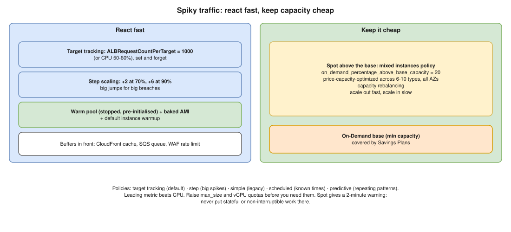

# AWS 04 · Auto Scaling for Unpredictable Spikes While Optimizing Cost ⭐



> **Say this first:** "Unpredictable means I can't schedule it, so I combine **fast reaction** with **cheap capacity**. A **target tracking** policy on a metric that moves early, **ALB `RequestCountPerTarget`** or CPU around 50–60%, handles normal ups and downs. A **step scaling** policy on top adds big chunks when the alarm is far over the threshold. To make new capacity useful fast I keep boot time short (baked AMI) and use a **warm pool** of pre-initialised stopped instances. For cost: a small **On-Demand base** covered by **Savings Plans**, and everything above it on **Spot** with a **mixed instances policy** across several instance types, and scale-in that is slower than scale-out so we don't flap."

## The scaling policy types

| Policy | How it works | Use it for |
|---|---|---|
| **Target tracking** | You set a target (CPU 50%, 1000 req/target); AWS creates the CloudWatch alarms and adds/removes capacity to stay near it | The default for almost everything |
| **Step scaling** | Alarm breach size → step: +2 at 70% CPU, +6 at 90% | Sudden, large spikes; add a lot at once |
| **Simple scaling** | One alarm, one adjustment, then a cooldown | Legacy; step/target tracking replace it |
| **Scheduled** | Change min/max/desired at a time (cron) | Known patterns, see [AWS 05](05-scheduled-vs-dynamic-scaling.md) |
| **Predictive scaling** | ML forecast from 14 days of history, scales **ahead** of daily/weekly cycles | Repeating patterns; can run in forecast-only mode first |

## Making scale-out fast enough

- **Pick a leading metric.** CPU lags; `ALBRequestCountPerTarget` or queue depth (SQS `ApproximateNumberOfMessagesVisible` per instance) moves first.
- **Short boot:** golden AMI with the app already installed (Packer), not a 10-minute user-data script.
- **Warm pool:** instances already launched and initialised, kept **Stopped** (pay only for EBS) or **Running**; scale-out moves them into service in seconds.
- **Default instance warmup** (e.g., 120 s) so new instances' metrics don't count until they're ready (prevents overshoot).
- **Detailed monitoring** (1-minute metrics) on the instances.
- **Headroom:** a lower target (50%) leaves room for the spike while new instances boot.
- **Higher `max_size`** and enough **vCPU service quota** for the burst. Spot capacity can run out, so diversify.
- **Front buffers:** CloudFront caching, SQS queues for async work, ALB/WAF rate limiting to shed abusive traffic.

## Making it cheap

| Lever | How |
|---|---|
| **Mixed instances policy** | `on_demand_base_capacity = 2`, `on_demand_percentage_above_base_capacity = 20`, rest Spot |
| **Spot allocation** | `price-capacity-optimized` across 6–10 instance types/sizes in all AZs → fewer interruptions |
| **Capacity rebalancing** | ASG launches a replacement when AWS signals a Spot instance is at elevated risk |
| **Savings Plans / RIs** | Cover the always-on base (the min capacity) |
| **Scale in carefully** | Longer scale-in cooldown / target tracking scales in slowly by design; **instance scale-in protection** for busy workers; **lifecycle hooks** to drain |
| **Right-size + Graviton** | `m7g`/`c7g` instances often cheaper per request |
| **Lower min outside business hours** | Scheduled action (that's AWS 05) |

```hcl
# (illustrative) target tracking on ALB requests per target
resource "aws_autoscaling_policy" "req_per_target" {
  name                   = "req-per-target"
  autoscaling_group_name = aws_autoscaling_group.web.name
  policy_type            = "TargetTrackingScaling"

  target_tracking_configuration {
    predefined_metric_specification {
      predefined_metric_type = "ALBRequestCountPerTarget"
      resource_label         = "${aws_lb.web.arn_suffix}/${aws_lb_target_group.web.arn_suffix}"
    }
    target_value = 1000
  }
}

# Spot + On-Demand mix inside the ASG
#  mixed_instances_policy {
#    instances_distribution {
#      on_demand_base_capacity                  = 2
#      on_demand_percentage_above_base_capacity = 20
#      spot_allocation_strategy                 = "price-capacity-optimized"
#    }
#    launch_template { ... override { instance_type = "m6i.large" } override { instance_type = "m7g.large" } ... }
#  }
```

```bash
aws autoscaling describe-scaling-activities --auto-scaling-group-name web-prod --max-items 10
aws autoscaling put-warm-pool --auto-scaling-group-name web-prod \
  --pool-state Stopped --min-size 2
```

## Resume check

ASG/EC2 scaling is core AWS, fine to discuss. If you mostly scaled **EKS** (HPA + Cluster Autoscaler/Karpenter), say so and map it: HPA ≈ target tracking for pods, node autoscaler ≈ ASG. Karpenter isn't on your resume, so don't claim it.

## Real-world example (suggested story, adapt it to what you really did)

"Our API traffic jumped 5× when a partner ran batch jobs at random times. CPU-based scaling reacted too late, so we switched to target tracking on requests per target, baked the AMI to cut boot time from 6 minutes to about 90 seconds, and put 70% of the burst capacity on Spot across four instance types. Cost went down and we stopped seeing 5xx during spikes." Only claim the numbers you really had.

## Follow-up questions

**Q: Why not just set a huge minimum?**
It works but you pay for idle capacity 24/7. Base + fast scaling + Spot is cheaper.

**Q: How do you avoid flapping (scale out, in, out)?**
Target tracking scales in conservatively; use instance warmup; longer scale-in than scale-out; don't use a metric that drops the moment capacity is added (per-instance metrics are fine).

**Q: What if Spot is interrupted during a spike?**
Two-minute warning; capacity rebalancing + diversified types + an On-Demand base keep you serving. Don't put stateful or non-interruptible work on Spot.

**Q: Step vs target tracking?**
Target tracking keeps a metric near a value, set and forget. Step scaling gives explicit, bigger jumps for large breaches; often used together.

## 🎯 Drill: type this from memory

1. The five policy types and one use case each.
2. The `aws_autoscaling_policy` target tracking block with `ALBRequestCountPerTarget`.
3. `instances_distribution` with base, percentage above base and `price-capacity-optimized`.
4. `aws autoscaling describe-scaling-activities --auto-scaling-group-name <name>`

## 🗣️ 30-second spoken answer

1. Target tracking on a leading metric (requests per target), ~50–60% target.
2. Step scaling for big jumps.
3. Fast boot: baked AMI, warm pool, instance warmup.
4. Cost: On-Demand base on Savings Plans, Spot above it across many types.
5. Scale out fast, scale in slow; buffer with CloudFront/SQS.
